# CompTIA A+ Core 2 Wrong Answers

用于记录 Core 2 错题、易混概念、简短中文解释和记忆口诀。
后续新错题默认追加到这里。

## XSS = 恶意脚本注入网站并在用户浏览器执行；别和 CSRF 混（Select 3）
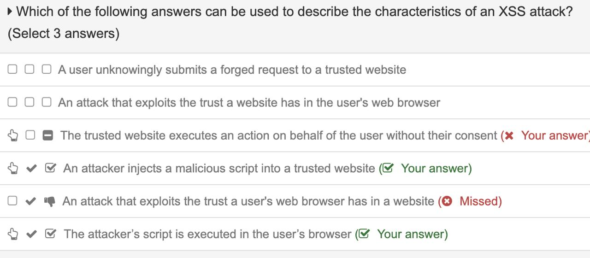

**题干：** Which of the following answers can be used to describe the characteristics of an XSS attack? (Select 3 answers)

|  |  |
| --- | --- |
| ✅ 我选对了 | An attacker injects a malicious script into a trusted website |
| ✅ 我选对了 | The attacker's script is executed in the user's browser |
| ❌ 我的错误答案 | The trusted website executes an action on behalf of the user without their consent |
| ✅ 漏选正确答案 | An attack that exploits the trust a user's web browser has in a website |

### 这题核心在什么
这题最容易和 **CSRF** 混。

先记一句：
- **XSS** = **脚本注入 + 在用户浏览器执行**
- **CSRF** = **借用户身份，强迫网站替用户发请求/执行操作**

### XSS 为什么这 3 个是对的
#### 1) An attacker injects a malicious script into a trusted website
对。
XSS 的核心起点就是：
**攻击者把恶意脚本注入到可信网站页面里。**

#### 2) The attacker’s script is executed in the user’s browser
对。
XSS 的恶意代码最终是在：
## **受害者的浏览器里执行**
而不是在服务器端执行。

#### 3) An attack that exploits the trust a user's web browser has in a website
对。
XSS 的本质就是：
**浏览器信任这个网站，所以也信了这个页面里夹带的恶意脚本。**

### 为什么你选的那个不对
#### The trusted website executes an action on behalf of the user without their consent
这更像：
## **CSRF (Cross-Site Request Forgery)**

CSRF 的重点是：
- 用户已经登录可信网站
- 攻击者诱导用户发起一个伪造请求
- 网站误以为是用户本人要操作
- 最终 **网站替用户执行动作**

比如：
- 自动改密码
- 自动转账
- 自动发帖

这不是 XSS 的核心描述。

### 顺手把另外一句也一起区分
如果你看到：
**A user unknowingly submits a forged request to a trusted website**
这也是 **CSRF** 风格，不是 XSS。

### 一句话对比
- **XSS**：我把坏脚本塞进网站，让你浏览器执行
- **CSRF**：我借你的登录状态，让网站替你办事

### 口诀
**XSS 是“脚本进页面，浏览器执行”；CSRF 是“用户已登录，网站替他做事”。**

---

## On-path attack = 插到通信路径中间，可拦截/篡改/冒充（Select 3）
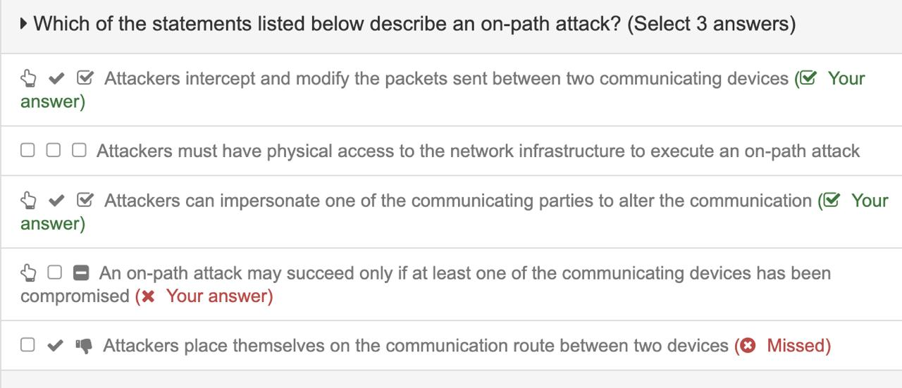

**题干：** Which of the statements listed below describe an on-path attack? (Select 3 answers)

|  |  |
| --- | --- |
| ✅ 我选对了 | Attackers intercept and modify the packets sent between two communicating devices |
| ✅ 我选对了 | Attackers can impersonate one of the communicating parties to alter the communication |
| ❌ 我的错误答案 | An on-path attack may succeed only if at least one of the communicating devices has been compromised |
| ✅ 漏选正确答案 | Attackers place themselves on the communication route between two devices |

### 这题核心在什么
**On-path attack**（以前也常叫 **man-in-the-middle**）
核心就一句话：
## **攻击者把自己插进两台设备的通信路径中间。**

一旦插进去了，就可能：
- **监听** 通信
- **拦截** 数据
- **篡改** 数据包
- **冒充** 通信一方

### 正确的 3 个为什么对
#### 1) Attackers intercept and modify the packets sent between two communicating devices
对。
这正是 on-path attack 的典型行为：
**拦截并修改数据包。**

#### 2) Attackers can impersonate one of the communicating parties to alter the communication
对。
攻击者常常会冒充其中一方，
让另一方以为自己还在和可信对象通信。

#### 3) Attackers place themselves on the communication route between two devices
对。
这是最本质、最定义级别的一句：
**把自己放到两者通信路径上。**

### 为什么你选错的那个不对
#### An on-path attack may succeed only if at least one of the communicating devices has been compromised
不对，关键错在 **only if**。

On-path attack **不一定非要先攻陷某台设备** 才能成立。
攻击者也可能通过：
- ARP spoofing
- rogue Wi‑Fi / evil twin
- session hijacking
- 路由劫持等方式

把自己插入通信路径。

也就是说：
**“设备必须先被攻陷”不是必要条件。**

### 为什么“必须有物理访问权限”也不对
题目里另一个错误点是：
**不一定需要 physical access**。
很多 on-path 攻击可以远程或通过同网段/伪造网络环境实现。

### 口诀
**On-path 三件套：插中间、能冒充、可改包。**

再短一点：
**在路上截、在中间骗、顺手改。**

---

## 伪造 email/IP/MAC/caller ID/网站身份 = Spoofing，不只是泛泛的 impersonation
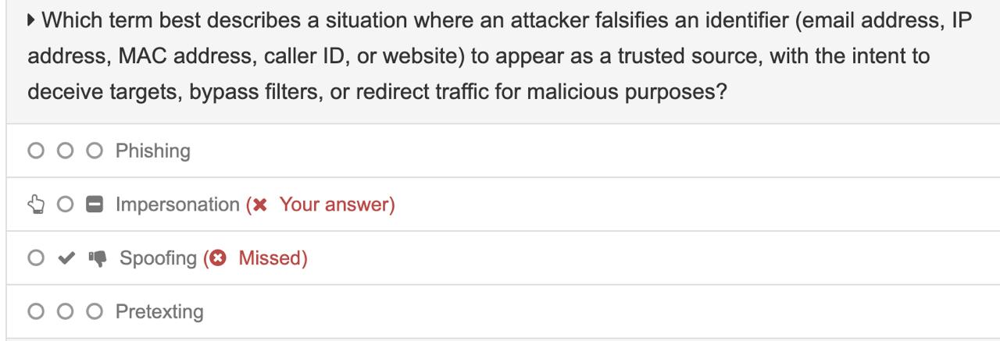

**题干：** Which term best describes a situation where an attacker falsifies an identifier (email address, IP address, MAC address, caller ID, or website) to appear as a trusted source, with the intent to deceive targets, bypass filters, or redirect traffic for malicious purposes?

|  |  |
| --- | --- |
| ❌ 我的答案 | Impersonation |
| ✅ 正确答案 | Spoofing |

### 这题核心在什么
题目不是泛泛地说“冒充别人”，
而是非常具体地点出了：
- falsifies an identifier
- email / IP / MAC / caller ID / website

只要看到“**伪造标识符/地址/来源信息**”，
标准术语优先想：
## **Spoofing**

### 为什么答案是 Spoofing
**Spoofing（欺骗/伪装）**
就是攻击者伪造某种身份标识，
让自己看起来像可信来源。

常见例子：
- **email spoofing**：伪造发件人地址
- **IP spoofing**：伪造源 IP
- **MAC spoofing**：伪造 MAC 地址
- **caller ID spoofing**：伪造来电显示
- **website spoofing**：伪造网站外观/来源

所以这题描述得非常标准，
就是 **spoofing**。

### 为什么不是 Impersonation
**Impersonation** 更像广义上的“冒充他人身份/角色”。
它不一定强调技术上去**伪造地址、号码、来源标识**。

而题目列出的这些对象：
- email address
- IP address
- MAC address
- caller ID
- website

都在提示更精确的术语：
## **Spoofing**

### 为什么其他选项也不对
- **Phishing**
  - 强调诱骗用户上当、交出信息、点链接
  - 虽然 phishing 可能会用 spoofing，但两者不是同一个概念

- **Pretexting**
  - 强调编造一个情境/借口去套信息
  - 重点是“故事脚本”，不是伪造技术标识符

### 口诀
**伪造地址和来源，先想 Spoofing；编故事套信息，再想 Pretexting。**

---

## 利用开发者还没修补的未知漏洞 = Zero-day attack
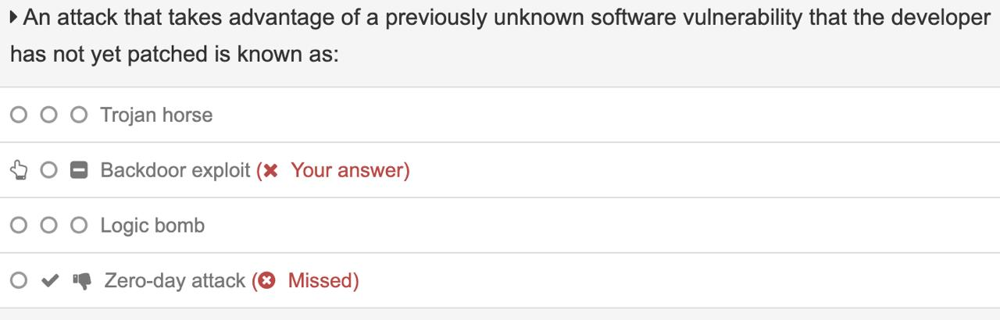

**题干：** An attack that takes advantage of a previously unknown software vulnerability that the developer has not yet patched is known as:

|  |  |
| --- | --- |
| ❌ 我的答案 | Backdoor exploit |
| ✅ 正确答案 | Zero-day attack |

### 这题核心在什么
题目关键词非常直接：
- **previously unknown vulnerability**
- **developer has not yet patched**

也就是：
**漏洞刚被利用时，厂商还不知道，或者还来不及修补。**

这就叫：
## **Zero-day attack**

### 为什么答案是 Zero-day attack
**Zero-day** 的“zero day”意思可以理解成：
厂商从知道这个漏洞开始，
**可用于防守和打补丁的时间几乎是 0 天。**

所以它指的是：
- 漏洞此前未知
- 还没有补丁
- 攻击者已经开始利用

### 为什么不是 Backdoor exploit
**Backdoor** 指的是：
- 绕过正常认证
- 留后门入口
- 方便以后再次进入系统

它强调的是 **进入系统的隐藏通道**，
不是“利用未知且未修补漏洞”这个概念。

### 为什么其他选项也不对
- **Trojan horse**
  - 伪装成正常程序诱骗用户运行
  - 重点是伪装，不是未知漏洞

- **Logic bomb**
  - 满足某个条件后触发恶意行为
  - 重点是触发条件，不是未修补漏洞

### 口诀
**未知漏洞、补丁还没有，先想 Zero-day。**

再短一点：
**未知 + 未补丁 = Zero-day。**

---

## 针对公司高管的定向钓鱼 = Whaling，不只是普通 Spear phishing
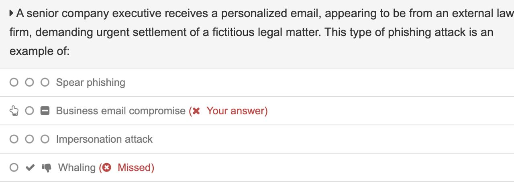

**题干：** A senior company executive receives a personalized email, appearing to be from an external law firm, demanding urgent settlement of a fictitious legal matter. This type of phishing attack is an example of:

|  |  |
| --- | --- |
| ❌ 我的答案 | Business email compromise |
| ✅ 正确答案 | Whaling |

### 这题核心在什么
题目里最关键的词是：
- **senior company executive**
- **personalized email**

也就是：
**攻击对象是公司高层/高价值目标。**

这时候最佳答案就是：
## **Whaling**

### 为什么答案是 Whaling
**Whaling（捕鲸式钓鱼）**
本质上是 **spear phishing 的高管版**，
专门针对：
- CEO
- CFO
- senior executives
- 其他高价值管理层目标

因为“鲸鱼”代表大目标、值钱目标，
所以 whaling = **专钓大人物**。

### 为什么不是 Business Email Compromise
**BEC (Business Email Compromise)**
更强调的是：
- 伪装成可信商务身份
- 诱导转账、改付款信息、发送敏感数据
- 常见于企业财务欺诈场景

这题虽然有商务欺诈味道，
但题目问的是 **phishing attack 的类型**，
而且明确点出了 **高级主管是目标**。

所以最佳分类是：
**Whaling**

### 为什么不是 Spear phishing
**Spear phishing** 是更大的总类，
表示“针对特定对象的定向钓鱼”。

而 **Whaling** 是其中更具体的子类：
**专门针对高管/大人物的 spear phishing**。

题目既然明确写了 **senior executive**，
就应该选更精确的那个：
## **Whaling**

### 为什么 Impersonation attack 也不是最佳答案
它只是描述“冒充别人”的攻击方式，
不如 **whaling** 这个分类精准。

### 口诀
**定向钓普通目标叫 Spear phishing；定向钓老板高管叫 Whaling。**

---

## 针对特定个人或群体的钓鱼 = Spear phishing，不是 Watering hole
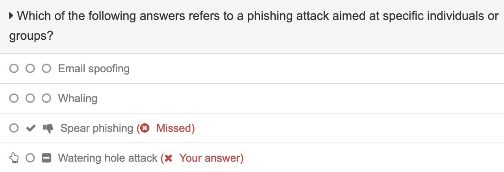

**题干：** Which of the following answers refers to a phishing attack aimed at specific individuals or groups?

|  |  |
| --- | --- |
| ❌ 我的答案 | Watering hole attack |
| ✅ 正确答案 | Spear phishing |

### 这题核心在什么
题目关键词是：
- **phishing attack**
- **aimed at specific individuals or groups**

只要看到“**特定目标、定向攻击**”，
优先想：
## **Spear phishing**

### 为什么答案是 Spear phishing
**Spear phishing（鱼叉式网络钓鱼）**
就是专门针对：
- 某个个人
- 某个部门
- 某类特定人群

攻击者通常会提前做信息收集，
让邮件/消息内容看起来更真实、更有针对性。

所以它本质上是：
**定向钓鱼**。

### 为什么不是 Watering hole attack
**Watering hole attack（水坑攻击）**
不是“直接给某个人发定制钓鱼消息”，
而是：
- 先找到目标群体常访问的网站
- 再去污染/入侵这个网站
- 等目标自己来访问时中招

所以它更像：
**在目标常去的地方埋伏**，
而不是“定向发 phishing 消息”。

### 为什么其他选项不对
- **Email spoofing**
  - 是伪造发件人身份/邮件来源
  - 是一种手法，不等于“针对特定人群的 phishing 类型”

- **Whaling**
  - 是 spear phishing 的一个更具体子类
  - 主要针对高层、老板、关键高管
  - 如果题目只说“specific individuals or groups”，最佳泛化答案还是 **spear phishing**

### 口诀
**定向发钓鱼，叫 Spear phishing；埋伏常去网站，叫 Watering hole。**

---

## 保护单个终端设备，先想 Software firewall
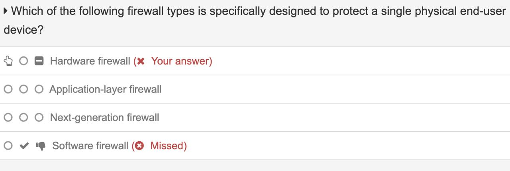

**题干：** Which of the following firewall types is specifically designed to protect a single physical end-user device?

|  |  |
| --- | --- |
| ❌ 我的答案 | Hardware firewall |
| ✅ 正确答案 | Software firewall |

### 这题核心在什么
题目关键不是问“哪种防火墙更强”，
而是问：
**哪一种是专门给单个物理终端用户设备使用的。**

关键词：
- **single physical end-user device**

这就对应：
## **Software firewall**

### 为什么答案是 Software firewall
**Software firewall（软件防火墙）**
通常直接安装在单台设备上，比如：
- 一台 Windows 笔记本
- 一台台式机
- 单个终端

它是 **host-based firewall** 的典型形式，
作用对象就是某一台具体设备。

### 为什么不是 Hardware firewall
**Hardware firewall（硬件防火墙）**
一般部署在：
- 网络边界
- 路由器/安全设备
- 企业或家庭网络入口

它保护的通常是：
- 一个网络
- 一批设备
- 整个网段

所以它不是“专门为单个 end-user device 设计”的最佳答案。

### 为什么其他选项也不对
- **Application-layer firewall**
  - 是按工作层次/过滤方式分类
  - 不强调“单设备专用”

- **Next-generation firewall**
  - 是高级功能型防火墙
  - 更偏企业级、网络级安全设备概念
  - 题目问的不是“高级不高级”，而是“保护对象是谁”

### 口诀
**单机装软件，整网上硬件。**

再短一点：
**一台机器 → software firewall；一片网络 → hardware firewall。**

---

## 连续监控 + 威胁检测 + 事件响应 = MDR，不是 MSP
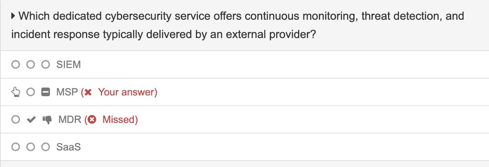

**题干：** Which dedicated cybersecurity service offers continuous monitoring, threat detection, and incident response typically delivered by an external provider?

|  |  |
| --- | --- |
| ❌ 我的答案 | MSP |
| ✅ 正确答案 | MDR |

### 这题核心在什么
题目问的是一种 **专门的网络安全服务**，而且关键词非常明显：
- **continuous monitoring**
- **threat detection**
- **incident response**
- **delivered by an external provider**

这几个词组合起来，最匹配的就是：
## **MDR (Managed Detection and Response)**

### 为什么答案是 MDR
**MDR** 的核心就是：
- 持续安全监控
- 检测威胁
- 分析异常
- 协助或直接进行事件响应

它通常由外部安全服务商提供，
相当于“托管式安全检测与响应”。

### 为什么不是 MSP
**MSP (Managed Service Provider)**
是更广义的 **托管服务提供商**，
通常负责：
- IT 运维
- 网络设备管理
- 备份
- 账户/系统维护
- Help desk

MSP 可以管很多 IT 事情，
但它**不是专门指安全监控与事件响应**。

也就是说：
- **MSP** = 泛 IT 外包/托管
- **MDR** = 专门安全监控 + 检测 + 响应

### 为什么其他选项不对
- **SIEM**
  - 是安全信息与事件管理平台/系统
  - 更偏工具或平台，不是题目说的那种“由外部提供的专门服务”最佳答案

- **SaaS**
  - 是软件交付模式
  - 太泛，不是专门安全响应服务

### 口诀
**外包管 IT，先想 MSP；外包盯威胁、帮你打安全仗，才是 MDR。**

---

## WinRE 是现代恢复环境，替代的是 Recovery Console
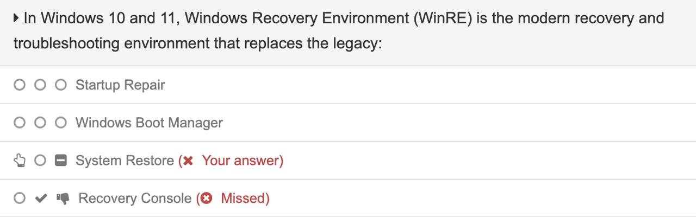

**题干：** In Windows 10 and 11, Windows Recovery Environment (WinRE) is the modern recovery and troubleshooting environment that replaces the legacy:

|  |  |
| --- | --- |
| ❌ 我的答案 | System Restore |
| ✅ 正确答案 | Recovery Console |

### 这题核心在什么
这题考的是：
**WinRE 是“恢复环境”本身，替代的是旧时代的恢复环境。**

所以对应的旧东西不是某一个具体修复功能，
而是早期 Windows 的命令行恢复平台：
## **Recovery Console**

### 为什么答案是 Recovery Console
**Recovery Console** 是早期 Windows（尤其 XP 时代）常见的恢复/修复环境，
主要用来：
- 修复启动问题
- 访问磁盘和系统文件
- 执行一些恢复命令

后来 Windows 发展出更完整的恢复体系，
就变成了现在的：
## **WinRE (Windows Recovery Environment)**

所以题目问“WinRE replaces the legacy what”，
答案就是 **Recovery Console**。

### 为什么不是 System Restore
**System Restore（系统还原）** 只是 WinRE 里面可能提供的一个**功能选项**，
不是 WinRE 所替代的“上一代恢复环境”。

也就是说：
- **WinRE** = 一个恢复平台 / 恢复环境
- **System Restore** = 平台里的一个工具功能

两者不是同一级概念。

### 为什么另外两个也不对
- **Startup Repair**
  - 这是恢复工具之一
  - 不是旧版恢复环境名称

- **Windows Boot Manager**
  - 这是启动管理组件
  - 不是恢复环境

### 口诀
**WinRE 对老前辈，替代的是 Recovery Console；System Restore 只是里面的一个工具。**

---

## 恶意占用算力挖矿 = Cryptominer，不是 Fileless malware
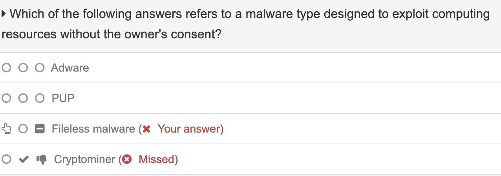

**题干：** Which of the following answers refers to a malware type designed to exploit computing resources without the owner's consent?

|  |  |
| --- | --- |
| ❌ 我的答案 | Fileless malware |
| ✅ 正确答案 | Cryptominer |

### 这题核心在什么
这题问的是：
**哪种恶意软件的设计目的，是未经用户同意就占用设备计算资源。**

关键词是：
- **exploit computing resources**
- **without the owner's consent**

这正是在说：
## **Cryptominer**

### 为什么正确答案是 Cryptominer
**Cryptominer（加密货币挖矿恶意软件）**
会偷偷使用受害者的：
- CPU
- GPU
- 电力
- 系统性能

去帮攻击者挖加密货币。

所以它最符合：
**“未经机主同意，利用计算资源获利”**。

### 为什么 Fileless malware 不对
**Fileless malware** 说的是一种**攻击/执行方式**：
- 尽量不落地成传统文件
- 常驻内存
- 借助 PowerShell、WMI、脚本、系统工具运行

它描述的是：
**恶意软件怎么运行、怎么隐藏自己**。

但题目问的不是“运行方式”，
而是“它的主要用途/目标是什么”。

所以：
- **Fileless** = 方式 / 技术路线
- **Cryptominer** = 目的 / 恶意用途

### 为什么其他选项不对
- **Adware**
  - 主要目的是弹广告、导流、广告变现
  - 不是专门占用算力挖矿

- **PUP**
  - Potentially Unwanted Program
  - 是“可能不受欢迎程序”的大类，不够精确
  - 不特指偷偷吃计算资源

### 口诀
**偷你算力去赚钱，先想 Cryptominer；Fileless 只是“怎么藏”，不是“干什么”。**

---

## Virus 要依附宿主；独立传播的是 Worm
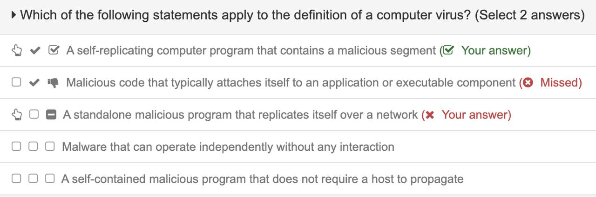

**题干：** Which of the following statements apply to the definition of a computer virus? (Select 2 answers)

|  |  |
| --- | --- |
| ❌ 我的错误答案 | A standalone malicious program that replicates itself over a network |
| ✅ 正确答案 1 | A self-replicating computer program that contains a malicious segment |
| ✅ 正确答案 2 | Malicious code that typically attaches itself to an application or executable component |

### 这题核心在什么
这题的关键不是只看 **self-replicating**，
而是分清：
- **Virus（病毒）**：通常要**附着在宿主文件/程序**上
- **Worm（蠕虫）**：通常是**独立存在**，并且会通过网络自己传播

### 为什么正确答案是这两个
#### 1) A self-replicating computer program that contains a malicious segment
这是在描述病毒的基本特征之一：
- 会复制自己
- 带有恶意代码

#### 2) Malicious code that typically attaches itself to an application or executable component
这句更关键，
因为它点出了 **virus 最典型的定义**：
**依附在应用程序、可执行文件或宿主代码上。**

### 为什么你选的那个不对
#### A standalone malicious program that replicates itself over a network
这更像：
## **Worm（蠕虫）**
因为关键词是：
- **standalone** = 独立存在
- **replicates itself over a network** = 通过网络自行复制传播

这正是 worm 的典型特征，
不是 virus。

### 为什么其他选项也不对
- **Malware that can operate independently without any interaction**
  - 也是偏向独立运行型恶意软件
  - 不符合 virus 必须依附宿主的典型定义

- **A self-contained malicious program that does not require a host to propagate**
  - **does not require a host** 这句话几乎就在提示 **worm**
  - virus 通常需要 host

### 口诀
**Virus 贴宿主，Worm 走网络。**

再短一点：
**要 host 是 virus；不要 host 多半是 worm。**

---

## MFA 要不同因子：Password + Biometric 才算，不是两个生物特征
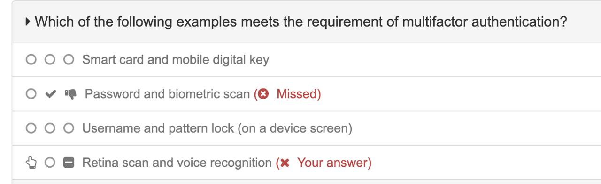

**题干：** Which of the following examples meets the requirement of multifactor authentication?

|  |  |
| --- | --- |
| ❌ 我的答案 | Retina scan and voice recognition |
| ✅ 正确答案 | Password and biometric scan |

### 这题核心在什么
这题考的是 **MFA = 多因素认证**，
不是“用了两个验证方式就算”，
而是要看它们是不是来自 **不同类型的认证因子**。

常见三类因子：
- **Something you know**：你知道的东西（password、PIN）
- **Something you have**：你拥有的东西（smart card、token、phone key）
- **Something you are**：你的生物特征（fingerprint、retina、voice、face）

### 为什么正确答案是 Password and biometric scan
因为它组合了两种不同因子：
- **Password** = something you know
- **Biometric scan** = something you are

所以这是标准的 **multifactor authentication**。

### 为什么 Retina scan and voice recognition 不对
虽然看起来用了两种方式，
但：
- **Retina scan** = 生物特征
- **Voice recognition** = 生物特征

它们都属于 **something you are**，
只是同一类因子的两种形式。

**同类两次验证 ≠ MFA。**
这叫加强验证，但不满足“多因素”的要求。

### 为什么其他选项也不对
- **Smart card and mobile digital key**
  - 都偏向 **something you have**
  - 还是同一类，不算 MFA

- **Username and pattern lock**
  - **Username** 通常只是标识身份，不算真正认证因子
  - **Pattern lock** 更接近 **something you know**
  - 也不满足多因素

### 口诀
**MFA 看“类别”不看“数量”：Know + Have / Know + Are / Have + Are 才算；Are + Are 不算。**

---

## Apple 的 RSR = Rapid Security Response（快速安全响应）
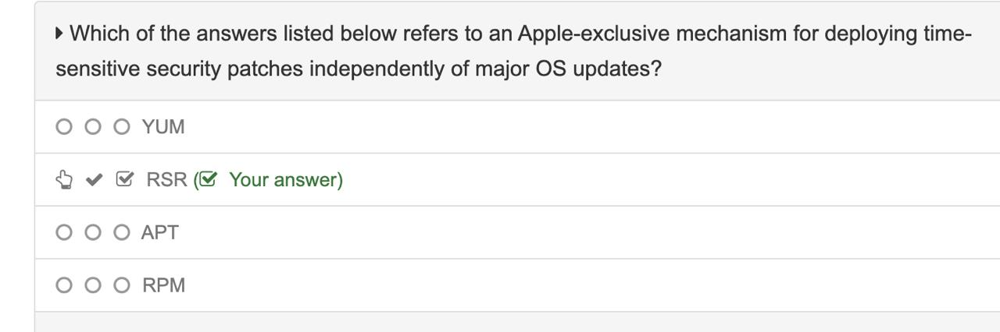

**题干：** Which of the answers listed below refers to an Apple-exclusive mechanism for deploying time-sensitive security patches independently of major OS updates?

|  |  |
| --- | --- |
| ✅ 你的答案 | RSR |
| ✅ 正确答案 | RSR |

### RSR 是什么意思？
**RSR = Rapid Security Response**
中文可以记成：
**快速安全响应**。

这是 Apple 推出的一个机制，
用来：
- **不等大版本系统更新**
- **先快速下发重要安全补丁**

也就是说，
它是专门给 **iPhone / iPad / Mac** 这类 Apple 生态设备用的“紧急安全补丁快车道”。

### 为什么这题选 RSR
题目里的关键词是：
- **Apple-exclusive** → Apple 独有
- **time-sensitive security patches** → 时间敏感的安全补丁
- **independently of major OS updates** → 不依赖大版本系统更新

这三个关键词合起来，指的就是：
## **RSR（Rapid Security Response）**

### 为什么其他选项不对
- **YUM**：Linux 的包管理工具
- **APT**：Debian / Ubuntu 常见包管理工具
- **RPM**：Red Hat 系发行版的软件包格式 / 管理体系

它们都不是 Apple 专属的快速安全补丁机制。

### 口诀
**Apple 快补丁，先想 RSR；Linux 装软件，再想 YUM / APT / RPM。**

---

---

## 使用说明
- 保留题目原文（或浓缩版）
- 保留原题截图
- 记录正确答案
- 写中文简短解析
- 尽量附一句口诀

---
---

## Apple 设备间无缝接力 = Continuity，不是 iCloud Drive
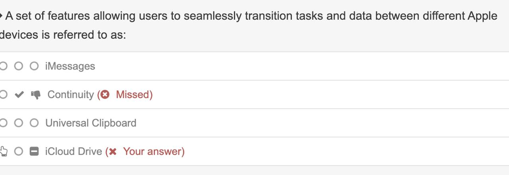

**题干：** A set of features allowing users to seamlessly transition tasks and data between different Apple devices is referred to as:

|  |  |
| --- | --- |
| ❌ 我的答案 | iCloud Drive |
| ✅ 正确答案 | Continuity |

### 这题核心在什么
题目关键词是：
- **seamlessly transition tasks and data**
- **between different Apple devices**

这不是单纯“存文件到云端”，
而是指 **Apple 设备之间无缝接力、联动、切换任务** 的整套能力。

所以答案是：
## **Continuity**

### Continuity 是什么
**Continuity** 是 Apple 生态里的“设备协同总称”。
常见例子包括：
- 在 iPhone 开始写东西，Mac 上继续做
- iPhone 复制，Mac 上直接粘贴（Universal Clipboard）
- iPhone 来电话，Mac / iPad 也能接
- Handoff、AirDrop、Universal Clipboard 等协同体验

也就是说：
**Continuity = Apple 设备间无缝衔接的一整套功能**。

### 为什么不是 iCloud Drive
**iCloud Drive** 主要是：
- 云端文件存储
- 文件同步

它是 Continuity 生态的一部分相关服务，
但它本身**不是“设备间任务无缝切换”这个总称**。

所以：
- **iCloud Drive** 更像“云盘 / 文件同步”
- **Continuity** 才是“跨 Apple 设备无缝接力”

### 为什么 Universal Clipboard 也不是最佳答案
**Universal Clipboard** 只是 Continuity 下面的**一个具体功能**。
题目问的是一整套 features 的名称，
所以应该选更大的总称：
## **Continuity**

### 口诀
**苹果设备接力干活，先想 Continuity；只是云端存文件，才想 iCloud Drive。**

---

## 多设备自动同步最新版文件 = iCloud Drive，不是 Continuity
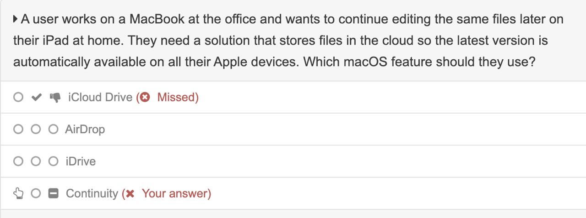

**题干：** A user works on a MacBook at the office and wants to continue editing the same files later on their iPad at home. They need a solution that stores files in the cloud so the latest version is automatically available on all their Apple devices. Which macOS feature should they use?

|  |  |
| --- | --- |
| ❌ 我的答案 | Continuity |
| ✅ 正确答案 | iCloud Drive |

### 这题为什么是 iCloud Drive
这题关键词不是“接力做任务”本身，
而是：
- **stores files in the cloud**
- **latest version is automatically available**
- **on all their Apple devices**

这就是标准的：
## **云端文件存储 + 自动同步最新版**
所以答案应该是：
## **iCloud Drive**

### iCloud Drive 是什么
**iCloud Drive** 是 Apple 的云端文件存储与同步服务。
它适合：
- 在 Mac 上保存文件
- 到 iPad / iPhone / 另一台 Mac 上继续打开
- 自动同步最新版本

### 为什么不是 Continuity
**Continuity** 更偏向：
- 设备之间无缝接力
- Handoff
- Universal Clipboard
- 通话/短信跨设备协同

它是“协同体验总称”，
不是专门负责“云端保存并同步文件最新版”的功能。

所以这两题要分开记：
- **任务接力 / 设备联动** → **Continuity**
- **云端文件同步 / 最新版自动可用** → **iCloud Drive**

### 其他选项为什么不对
- **AirDrop**：适合临时点对点传文件，不是持续云同步
- **iDrive**：第三方服务，不是 Apple 原生这个答案

### 口诀
**要接力，想 Continuity；要云同步最新版，想 iCloud Drive。**

---

## 启动盘整盘加密 = FileVault，不是 Gatekeeper
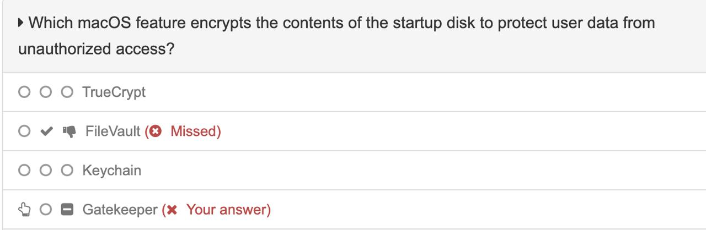

**题干：** Which macOS feature encrypts the contents of the startup disk to protect user data from unauthorized access?

|  |  |
| --- | --- |
| ❌ 我的答案 | Gatekeeper |
| ✅ 正确答案 | FileVault |

### 这题核心关键词
题目问的是：
- **encrypts the contents**
- **startup disk**
- **protect user data from unauthorized access**

只要看到：
## **磁盘加密 / 整盘加密 / 启动盘加密**
就先想：
## **FileVault**

### FileVault 是什么
**FileVault** 是 macOS 的全磁盘加密功能，
用于给 Mac 的启动盘内容加密。

作用是：
- 别人拿到你的电脑
- 即使把硬盘拆下来
- 没有授权也不能轻易读取里面的数据

所以它保护的是：
## **存储在磁盘上的数据**

### 为什么不是 Gatekeeper
**Gatekeeper** 保护的不是硬盘数据，
而是：
- 控制应用程序来源
- 阻止未签名或不受信任的软件运行

也就是说：
- **Gatekeeper** = 管“能不能装 / 能不能运行这个 App”
- **FileVault** = 管“磁盘里的数据有没有被加密”

### 其他选项顺手区分
- **Keychain**：保存密码、证书、密钥等凭据
- **TrueCrypt**：老的第三方加密工具，不是 macOS 这题的标准内置答案

### 口诀
**装软件看 Gatekeeper；加密硬盘想 FileVault；密码凭据在 Keychain。**

---

## 现代 Red Hat 系包管理器 = dnf，不是 dpkg
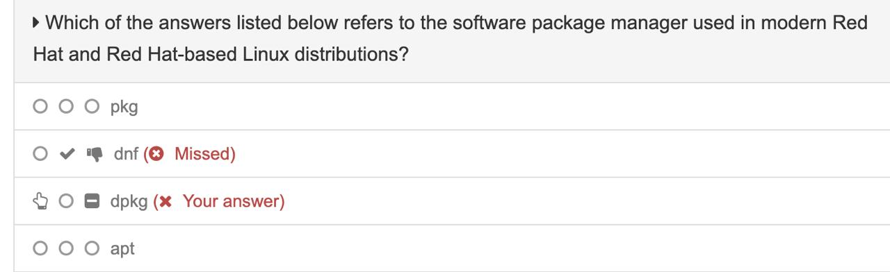

**题干：** Which of the answers listed below refers to the software package manager used in modern Red Hat and Red Hat-based Linux distributions?

|  |  |
| --- | --- |
| ❌ 我的答案 | dpkg |
| ✅ 正确答案 | dnf |

### 这题怎么判断
关键词是：
- **modern Red Hat**
- **Red Hat-based Linux distributions**
- **software package manager**

只要看到 **现代 Red Hat / RHEL / Fedora 系** 的包管理器，
优先想：
## **dnf**

### 为什么是 dnf
**dnf** 是现代 Red Hat 系发行版常见的包管理器，
可以理解成是较新的管理工具。

考试里你可以直接记：
- **Red Hat / Fedora 现代题目** → **dnf**

### 为什么不是 dpkg
**dpkg** 是：
- Debian / Ubuntu 这一路体系常见的底层包管理工具

所以：
- **dpkg** 不属于 Red Hat 阵营
- 它和 **apt** 更常一起出现在 Debian 系题目里

### 其他选项顺手区分
- **apt**：Debian / Ubuntu 常见高级包管理工具
- **pkg**：常见于 BSD 等其他环境，不是这题 Red Hat 标准答案

### 快速分类记忆
- **Red Hat / Fedora** → **dnf**
- **Debian / Ubuntu** → **apt / dpkg**

### 口诀
**红帽现代用 dnf；Debian 阵营想 apt、dpkg。**

---

## 多协议数据传输工具 = curl，不是 wget
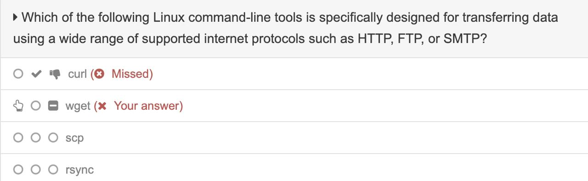

**题干：** Which of the following Linux command-line tools is specifically designed for transferring data using a wide range of supported internet protocols such as HTTP, FTP, or SMTP?

|  |  |
| --- | --- |
| ❌ 我的答案 | wget |
| ✅ 正确答案 | curl |

### 这题核心关键词
看到这些词要警觉：
- **transferring data**
- **wide range of supported internet protocols**
- **HTTP, FTP, SMTP**

只要题目强调：
## **支持很多协议的数据传输工具**
就优先想：
## **curl**

### 为什么是 curl
**curl** 的特点就是：
- 支持很多网络协议
- 常用于命令行发请求、上传/下载数据、和服务交互

考试里它常被考成：
- 多协议
- 数据传输
- HTTP/FTP 等网络请求工具

### 为什么不是 wget
**wget** 当然也能下载文件，
但它更常见的记忆点是：
- **从 Web 下载内容**
- 偏“抓取/下载”

而这题考点强调的是：
## **支持广泛协议的数据传输工具**
所以更标准的答案是 **curl**。

### 其他选项顺手区分
- **scp**：通过 SSH 在主机之间安全复制文件
- **rsync**：做文件同步、增量复制、备份

### 快速分类记忆
- **curl** = 多协议数据传输 / 发请求
- **wget** = 下载网页或文件
- **scp** = SSH 安全复制
- **rsync** = 同步 / 增量复制

### 口诀
**多协议传数据想 curl；只说下载常想 wget；主机拷贝用 scp；同步备份看 rsync。**

---

## Linux 里是 traceroute，不是 tracert
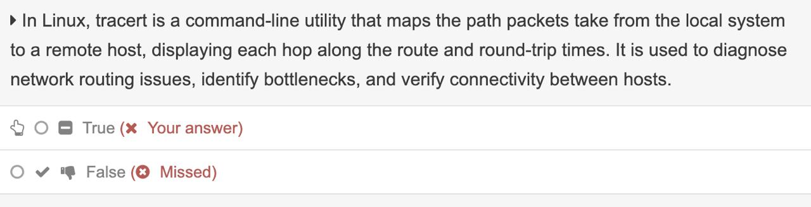

**题干：** In Linux, tracert is a command-line utility that maps the path packets take from the local system to a remote host, displaying each hop along the route and round-trip times. It is used to diagnose network routing issues, identify bottlenecks, and verify connectivity between hosts.

|  |  |
| --- | --- |
| ❌ 我的答案 | True |
| ✅ 正确答案 | False |

### 为什么是 False
题目描述的功能本身没有错：
- 显示每一跳（hop）
- 看往返时间
- 排查路由问题

错在命令名：
## **Linux 里常用的是 traceroute，不是 tracert**

### 怎么区分
- **tracert** → Windows 常见命令
- **traceroute** → Linux / Unix 常见命令

所以题目如果写：
- “In Linux, **tracert** …”
那就是错的。

### 这题最容易被绕进去的地方
它故意把“功能描述”写得很对，
让你忽略真正考点不是功能，
而是：
## **命令属于哪个操作系统**

### 快速记忆
- **Windows**：`tracert`
- **Linux**：`traceroute`

### 口诀
**Windows 少两个字母：tracert；Linux 写全：traceroute。**

---

## 看文件/目录占了多少空间 = du，不是 df
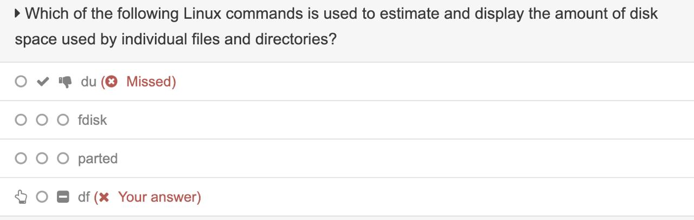

**题干：** Which of the following Linux commands is used to estimate and display the amount of disk space used by individual files and directories?

|  |  |
| --- | --- |
| ❌ 我的答案 | df |
| ✅ 正确答案 | du |

### 这题核心区别
这题考的是 **du 和 df 的经典对比**。

看到关键词：
- **individual files and directories**
- **disk space used**

就该想到：
## **du**

### du 是什么
**du = disk usage**
用来看：
- 某个文件用了多少空间
- 某个目录用了多少空间
- 哪个文件夹特别大

也就是：
## **按文件 / 目录去看占用量**

### 为什么不是 df
**df = disk free**（常理解为看文件系统剩余/使用情况）
它更偏向：
- 整个分区 / 文件系统用了多少
- 还剩多少可用空间

所以：
- **du** 看“文件和目录占用”
- **df** 看“磁盘/分区整体空间情况”

### 其他选项顺手区分
- **fdisk**：磁盘分区工具
- **parted**：磁盘分区管理工具

它们都不是用来看文件/目录空间占用的。

### 快速分类记忆
- **du** = file / directory usage
- **df** = filesystem free / overall disk space

### 口诀
**查文件夹多大用 du；看磁盘还剩多少用 df。**

---

## 本地主机名到 IP 映射看 /etc/hosts，不是 /etc/resolv.conf
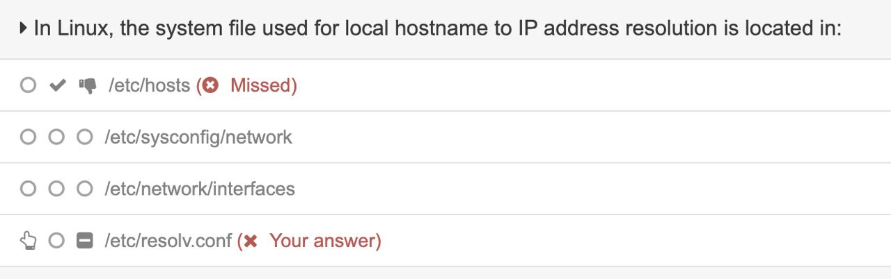

**题干：** In Linux, the system file used for local hostname to IP address resolution is located in:

|  |  |
| --- | --- |
| ❌ 我的答案 | /etc/resolv.conf |
| ✅ 正确答案 | /etc/hosts |

### 这题核心怎么分
这是 Linux 里非常常见的一组混淆：
- **/etc/hosts**
- **/etc/resolv.conf**

题目关键词是：
## **local hostname to IP address resolution**
也就是：
## **本地手工定义的主机名 ↔ IP 对应关系**

这个要看：
## **/etc/hosts**

### /etc/hosts 是干什么的
`/etc/hosts` 用来保存：
- 主机名和 IP 地址的本地静态映射

比如：
- `127.0.0.1 localhost`
- 某个内网服务器名字对应某个固定 IP

所以它负责的是：
## **本地名称解析表**

### 为什么不是 /etc/resolv.conf
`/etc/resolv.conf` 不是放主机名-IP 映射的，
它主要是配置：
- DNS 服务器地址
- 域名解析相关设置

也就是说：
- **/etc/hosts** = 直接写“名字对应哪个 IP”
- **/etc/resolv.conf** = 告诉系统“去问哪个 DNS 服务器”

### 其他选项顺手区分
- **/etc/sysconfig/network**：老式网络相关配置（不同发行版可能不同）
- **/etc/network/interfaces**：网络接口配置，常见于 Debian 系

它们都不是本地主机名解析文件。

### 快速分类记忆
- **/etc/hosts** = 本地 hostname → IP 映射
- **/etc/resolv.conf** = DNS 服务器配置

### 口诀
**本地名字找 IP 看 hosts；要问 DNS 去哪问，看 resolv.conf。**

---

## Linux 的系统与服务管理器是 systemd，不是 systemctl
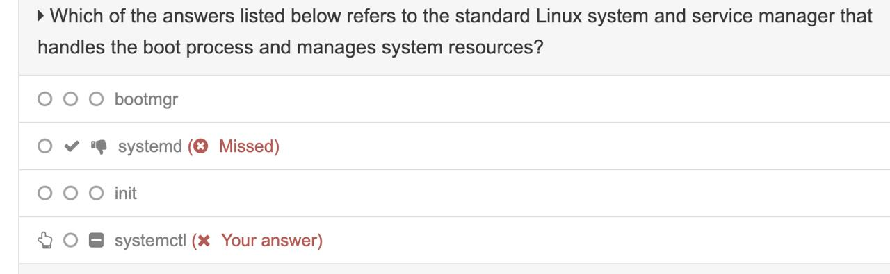

**题干：** Which of the answers listed below refers to the standard Linux system and service manager that handles the boot process and manages system resources?

|  |  |
| --- | --- |
| ❌ 我的答案 | systemctl |
| ✅ 正确答案 | systemd |

### 这题为什么选 systemd
题目问的是：
- **system and service manager**
- **handles the boot process**
- **manages system resources**

这说的是 Linux 里的 **核心管理系统本体**，
所以答案是：
## **systemd**

### systemd 是什么
**systemd** 是现代很多 Linux 发行版使用的：
- 初始化系统（init system）
- 服务管理器
- 启动流程管理者

它负责系统开机后的很多核心管理工作。

### 为什么不是 systemctl
**systemctl** 不是管理系统本体，
而是：
## **用来控制 systemd 的命令行工具**

也就是说：
- **systemd** = 后台真正干活的管理系统
- **systemctl** = 你拿来操作它的命令

比如：
- `systemctl start nginx`
- `systemctl status sshd`

这些命令是在“控制 systemd 管理的服务”。

### 其他选项顺手区分
- **bootmgr**：Windows Boot Manager，不是 Linux
- **init**：老一代初始化系统概念/实现，这题问“standard system and service manager”通常指现代的 **systemd**

### 快速分类记忆
- **systemd** = 系统/服务管理器本体
- **systemctl** = 控制 systemd 的命令

### 口诀
**d 在后台当大脑；ctl 在前台发命令。**

---

## chmod a=r 会把所有人权限都改成只读 = 444
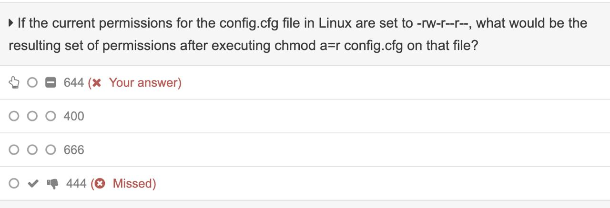

**题干：** If the current permissions for the config.cfg file in Linux are set to -rw-r--r--, what would be the resulting set of permissions after executing chmod a=r config.cfg on that file?

|  |  |
| --- | --- |
| ❌ 我的答案 | 644 |
| ✅ 正确答案 | 444 |

### 这题为什么不是 644
原权限是：
- `-rw-r--r--`
- 也就是 **644**

但题目不是问“原来是多少”，
而是问执行这条命令之后：
## `chmod a=r config.cfg`

### 这条命令什么意思
拆开看：
- **a** = all（所有人：owner / group / others）
- **=** = 直接设置成（覆盖原权限）
- **r** = read（只读）

关键就在这个：
## `=` 不是“追加”，而是“重设/覆盖”

所以执行后：
- owner = r--
- group = r--
- others = r--

结果就是：
## **444**

### 为什么不是 644
如果结果还是 **644**，说明 owner 还有写权限 `w`。
但 `a=r` 已经把所有人的权限**重设为只读**了，
owner 原来的 `w` 会被清掉。

### 这题最该抓的考点
不是数字换算本身，
而是：
## `=` 会覆盖原权限
对比记：
- `+` = 添加权限
- `-` = 移除权限
- `=` = 直接指定成什么，就只剩什么

### 快速记忆
- `chmod a=r file` → everyone gets read only → **444**
- `a` = all
- `=` = overwrite/reset

### 口诀
**加权限看 +，减权限看 -，等号 = 直接重写；a=r 一刀切，全员只读 444。**

---

## 只改文件所属组，用 chown :group filename
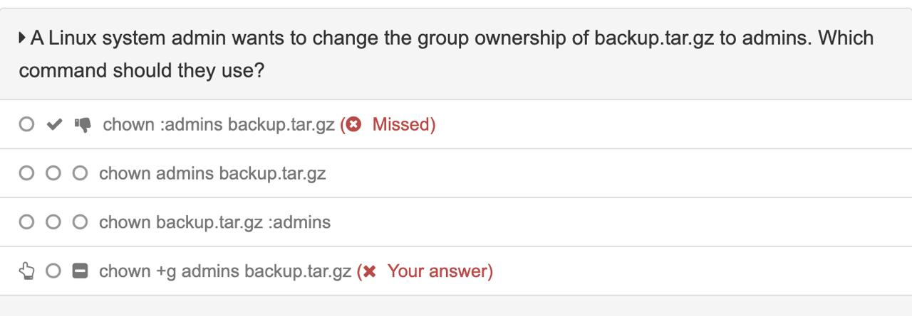

**题干：** A Linux system admin wants to change the group ownership of backup.tar.gz to admins. Which command should they use?

|  |  |
| --- | --- |
| ❌ 我的答案 | chown +g admins backup.tar.gz |
| ✅ 正确答案 | chown :admins backup.tar.gz |

### 这题为什么是 `chown :admins backup.tar.gz`
题目要的是：
## **change the group ownership**
也就是：
## **只修改所属组，不改 owner**

在 `chown` 里，格式常见是：
- `chown owner file`
- `chown owner:group file`
- `chown :group file`

所以如果 **只改 group**，正确写法就是：
## `chown :admins backup.tar.gz`

### 为什么前面要带冒号 `:`
这个冒号非常关键：
- 冒号前面是 **owner**
- 冒号后面是 **group**

写成：
- `:admins`
表示：
- owner 留空，不改
- group 改成 `admins`

### 为什么不是 `chown +g admins backup.tar.gz`
这个写法混淆了 `chmod` 和 `chown`：
- `+g` 这种风格更像权限位/模式修改的思路
- **chown** 不是这么改 group ownership 的

所以它不是合法的这题标准答案。

### 其他选项为什么不对
- `chown admins backup.tar.gz` → 会把 **owner** 改成 `admins`，不是改 group
- `chown backup.tar.gz :admins` → 参数顺序错了，`chown` 不是这么写

### 快速分类记忆
- **改 owner** → `chown user file`
- **改 owner 和 group** → `chown user:group file`
- **只改 group** → `chown :group file`

### 口诀
**只改组，前面留空加冒号；`:admins` 一看就是只换 group。**

---

## 按文件名通配查找，用 find -name，不是 -file
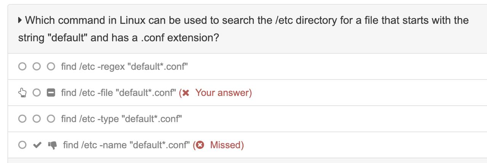

**题干：** Which command in Linux can be used to search the /etc directory for a file that starts with the string "default" and has a .conf extension?

|  |  |
| --- | --- |
| ❌ 我的答案 | find /etc -file "default*.conf" |
| ✅ 正确答案 | find /etc -name "default*.conf" |

### 这题为什么是 `find /etc -name "default*.conf"`
题目要的是：
- 在 `/etc` 里找文件
- 文件名以 `default` 开头
- 以 `.conf` 结尾

这就是标准的：
## **按文件名模式匹配搜索**
所以 `find` 里应该用：
## **`-name`**

完整写法就是：
## `find /etc -name "default*.conf"`

### 为什么不是 `-file`
因为 `find` 里并没有一个常规这样用的 `-file` 选项来表示“按文件名查找”。
你这里是把“文件”这个概念，和 `find` 的真实参数混在一起了。

考试里要记住：
- **按名字匹配** → `-name`

### 其他选项为什么不对
- `-type "default*.conf"`：`-type` 是用来指定文件类型的，比如 `f`（file）、`d`（directory），不是拿来放文件名模式的
- `-regex "default*.conf"`：正则方式不是这题最直接标准答案，而且题目明显是在考常用的文件名通配方式

### 快速分类记忆
- `find /path -name "pattern"` = 按文件名模式找
- `find /path -type f` = 只找普通文件
- `find /path -regex "..."` = 用正则匹配

### 口诀
**找名字先想 -name；找类型才用 -type。**

---

## su 默认要输入目标用户密码；题里通常就是 root 密码
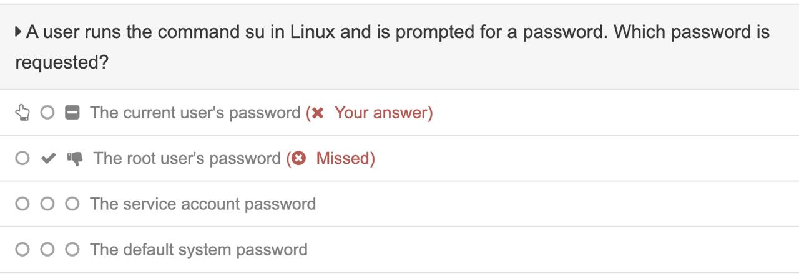

**题干：** A user runs the command su in Linux and is prompted for a password. Which password is requested?

|  |  |
| --- | --- |
| ❌ 我的答案 | The current user's password |
| ✅ 正确答案 | The root user's password |

### 这题为什么是 root 密码
`su` 的意思是：
## **switch user**
默认不带用户名时，通常就是切换到：
## **root**

所以执行：
## `su`
系统一般要求输入的是：
## **目标用户的密码**
在这题里，目标用户默认就是 **root**，
所以答案是：
## **The root user's password**

### 为什么不是当前用户密码
因为 `su` 不是拿当前账号密码再次验证自己，
而是要验证你有没有资格切换到另一个用户。

所以它检查的是：
## **你要切换过去的那个用户的密码**

### 这题最该记住的本质
- `su` = switch user
- 默认目标 = root
- 所以默认提示输入 = root 密码

### 顺手和 sudo 区分一下
这是很多人容易混的地方：
- **su**：通常要输入 **目标用户密码**（默认常是 root 密码）
- **sudo**：通常输入 **当前用户自己的密码**（前提是你在 sudoers 里）

### 口诀
**su 看对方；sudo 验自己。**

---

## 查看当前路由表和默认网关，用 ip route show，不是 netstat -a
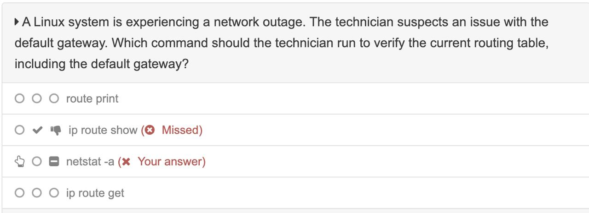

**题干：** A Linux system is experiencing a network outage. The technician suspects an issue with the default gateway. Which command should the technician run to verify the current routing table, including the default gateway?

|  |  |
| --- | --- |
| ❌ 我的答案 | netstat -a |
| ✅ 正确答案 | ip route show |

### 为什么是 `ip route show`
题目要看的是：
- **current routing table**
- **including the default gateway**

这就是：
## **查看当前路由表**
标准命令就是：
## `ip route show`

它会列出：
- 默认路由（default via ...）
- 各网段路由
- 出口接口等信息

所以排查默认网关时非常合适。

### 为什么不是 `netstat -a`
`netstat -a` 主要看的是：
- 所有连接
- 监听端口
- socket 状态

它**不是专门看当前路由表**的。

所以这题考点不是“网络状态很多信息”，
而是很明确地要：
## **routing table**

### 其他选项顺手区分
- **route print**：更常见于 Windows 语境，不是这题 Linux 标准答案
- **ip route get**：通常是查询到某个特定目标地址时会走哪条路由，不是直接完整查看当前路由表

### 快速分类记忆
- **ip route show** = 看整张路由表 / 默认网关
- **ip route get** = 看到某个目标会怎么走
- **netstat -a** = 看连接和监听状态

### 口诀
**查路由表用 route show；查连接端口看 netstat。**

---

## traceroute 看 hops / 主机名和 IP / RTT，不看总收发包数
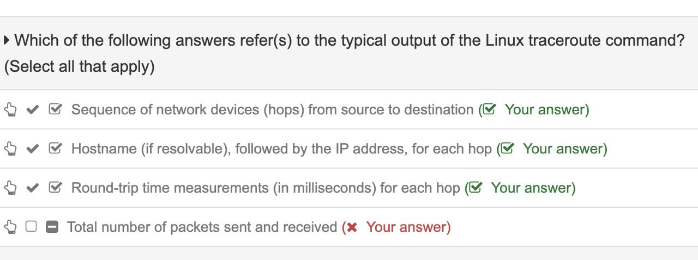

**题干：** Which of the following answers refer(s) to the typical output of the Linux traceroute command? (Select all that apply)

|  |  |
| --- | --- |
| ❌ 我的答案 | Total number of packets sent and received |
| ✅ 正确答案 | Sequence of network devices (hops) from source to destination / Hostname (if resolvable), followed by the IP address, for each hop / Round-trip time measurements (in milliseconds) for each hop |

### 这题在考什么
这题考的是：
## **traceroute 的典型输出内容**

traceroute 通常会显示：
- 从源到目标经过的 **每一跳（hops）**
- 每一跳的 **主机名 / IP 地址**（如果能解析）
- 每一跳的 **RTT 往返延迟**，通常是毫秒

所以前 3 个都对。

### 为什么 “Total number of packets sent and received” 不对
这个更像是：
- `ping` 的统计信息风格
- 或其他网络诊断工具的汇总结果

**traceroute** 的重点是：
## **路径 + 每跳延迟**
而不是最后给你一个“总共发了多少包、收了多少包”的汇总统计。

### 你要这样记 traceroute
看到 traceroute，就联想到：
- hop 1、hop 2、hop 3...
- 每跳的名字/IP
- 每跳延迟时间

而不是：
- 总发送包数
- 总接收包数

### 快速分类记忆
- **traceroute** = 路径 / hops / 每跳 RTT
- **ping** = 连通性 / 往返延迟 / 常见收发包统计

### 口诀
**traceroute 看一路怎么走；ping 看通不通、丢不丢。**

---

## 查看系统范围全部进程，用 ps -e，不是裸 ps
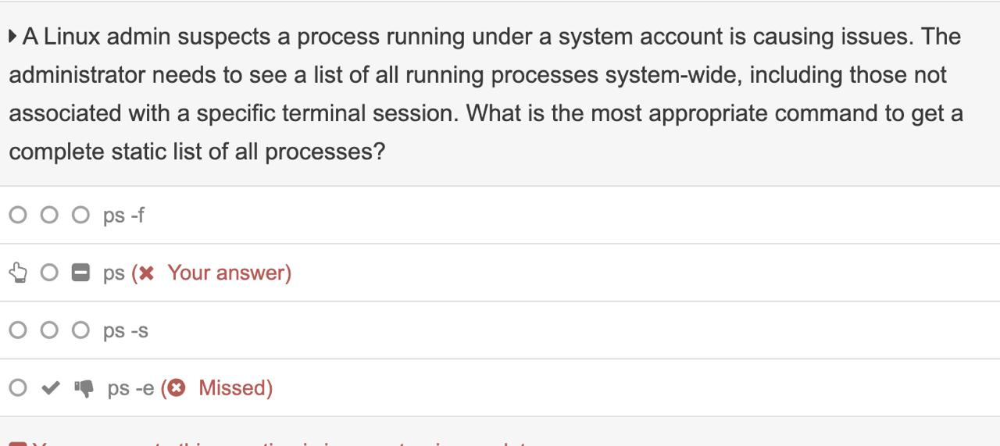

**题干：** A Linux admin suspects a process running under a system account is causing issues. The administrator needs to see a list of all running processes system-wide, including those not associated with a specific terminal session. What is the most appropriate command to get a complete static list of all processes?

|  |  |
| --- | --- |
| ❌ 我的答案 | ps |
| ✅ 正确答案 | ps -e |

### 为什么是 `ps -e`
题目关键词很明确：
- **all running processes system-wide**
- **including those not associated with a specific terminal session**
- **complete static list**

这说明要看的是：
## **整个系统里的所有进程**
所以要用：
## `ps -e`

### 为什么不是裸 `ps`
直接输入 `ps` 时，
通常只显示：
- 当前终端会话相关的进程

它不会自动把系统范围内所有后台进程、其他会话进程、系统账户进程全列出来。

所以题目既然强调：
- system-wide
- not associated with a specific terminal

那裸 `ps` 就不够了。

### 其他选项顺手区分
- `ps -f`：更偏完整格式显示（full format），但不是这题核心“显示全部系统进程”的点
- `ps -s`：不是这题要考的“列出所有系统进程”标准答案

### 快速分类记忆
- **ps** = 当前终端相关进程
- **ps -e** = 全系统所有进程
- **ps -f** = 更详细格式

### 口诀
**裸 ps 看当前；ps -e 看全场。**

---

## top 里终止进程按 K，不是 X
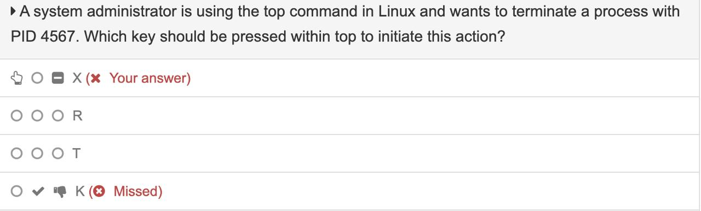

**题干：** A system administrator is using the top command in Linux and wants to terminate a process with PID 4567. Which key should be pressed within top to initiate this action?

|  |  |
| --- | --- |
| ❌ 我的答案 | X |
| ✅ 正确答案 | K |

### 为什么是 K
在 `top` 交互界面里：
## **`k` = kill a process**

按下 `k` 之后，
通常会提示你输入：
- 要终止的 PID
- 以及发送什么 signal（默认常见是 15）

所以题目问“within top 要按哪个键来终止进程”，
答案就是：
## **K**

### 为什么不是 X
`X` 不是 `top` 里标准的“终止进程”按键。
这题本质考的是：
## **top 的常用交互快捷键**

### 顺手记几个常见 top 键位
- **k** = kill 进程
- **r** = renice，修改优先级
- **q** = quit，退出 top

所以选项里的：
- **R** 更像 renice 相关
- **T** 也不是这里的 kill 进程标准答案

### 口诀
**top 里要杀进程，先按 k；要退出，按 q。**

---

## top 里按 M 按内存排序，不是 R
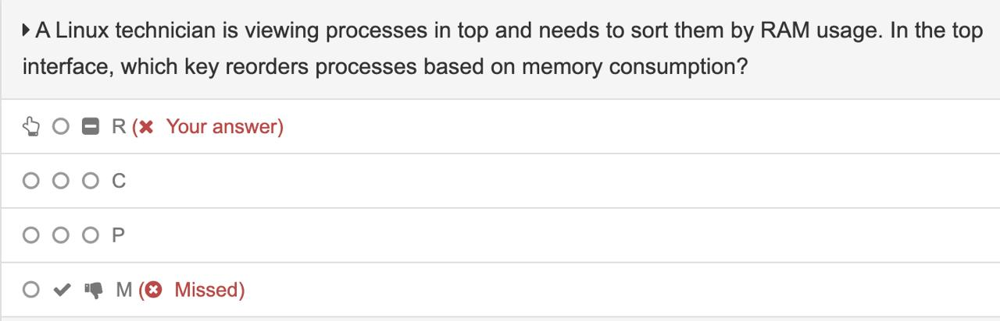

**题干：** A Linux technician is viewing processes in top and needs to sort them by RAM usage. In the top interface, which key reorders processes based on memory consumption?

|  |  |
| --- | --- |
| ❌ 我的答案 | R |
| ✅ 正确答案 | M |

### 为什么是 M
在 `top` 里：
## **`M` = sort by memory usage**

也就是按 RAM / 内存占用来重新排序进程列表。

所以题目说：
- **sort them by RAM usage**
- **based on memory consumption**

答案就是：
## **M**

### 为什么不是 R
`R` 不是“按内存排序”的快捷键。
你可能把它和别的交互键混了。

这题本质还是在考：
## **top 常见快捷键记忆**

### 顺手把 top 高频键一起记
- **M** = 按内存排序
- **P** = 按 CPU 排序
- **k** = kill 进程
- **r** = renice，改优先级
- **q** = 退出

### 快速对比
- **M** → Memory
- **P** → Processor / CPU

### 口诀
**M 看内存，P 看 CPU；k 杀进程，q 退出。**

---

## 旧版 Windows 程序在新系统运行，先想 Compatibility Mode，不是 Sandbox
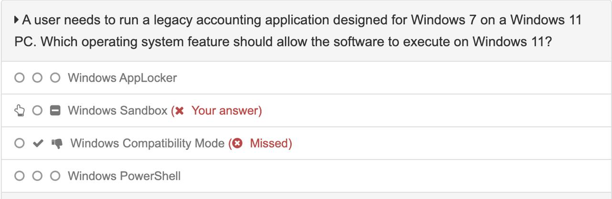

**题干：** A user needs to run a legacy accounting application designed for Windows 7 on a Windows 11 PC. Which operating system feature should allow the software to execute on Windows 11?

|  |  |
| --- | --- |
| ❌ 我的答案 | Windows Sandbox |
| ✅ 正确答案 | Windows Compatibility Mode |

### 为什么是 Compatibility Mode
题目关键词是：
- **legacy application**
- **designed for Windows 7**
- **run on Windows 11**

这就是经典的：
## **旧程序在新版本 Windows 上兼容运行**
对应功能就是：
## **Windows Compatibility Mode**

它的作用是让旧软件用更早版本 Windows 的兼容设置来运行，
从而提高在新系统上的可执行性。

### 为什么不是 Windows Sandbox
**Windows Sandbox** 是：
- 一个隔离出来的临时沙盒环境
- 用来安全测试程序
- 关闭后环境会重置

它的重点是：
## **隔离和安全测试**
不是解决“旧程序兼容新系统”的首选功能。

所以题目问的是：
- **让旧软件能执行**
而不是：
- **把软件放进隔离测试环境**

### 其他选项顺手区分
- **Windows AppLocker**：控制哪些应用允许/禁止运行
- **Windows PowerShell**：命令行和自动化工具

它们都不是解决旧版程序兼容性的标准答案。

### 快速分类记忆
- **Compatibility Mode** = 旧软件兼容运行
- **Sandbox** = 隔离测试
- **AppLocker** = 应用控制
- **PowerShell** = 管理/脚本

### 口诀
**旧程序跑不动，先开 Compatibility Mode；要安全试毒，再想 Sandbox。**

---

## 跨不同操作系统架构本地运行程序，选 Virtualization + Emulator，不是 Sandboxing
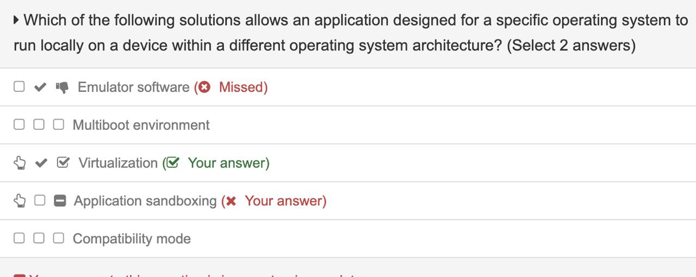

**题干：** Which of the following solutions allows an application designed for a specific operating system to run locally on a device within a different operating system architecture? (Select 2 answers)

|  |  |
| --- | --- |
| ❌ 我的答案 | Application sandboxing |
| ✅ 正确答案 | Virtualization / Emulator software |

### 这题在考什么
题目关键词是：
- **application designed for a specific operating system**
- **run locally on a device**
- **within a different operating system architecture**

本质是在问：
## **怎么让为别的系统/架构设计的软件，在当前机器本地运行**

正确答案是：
## **Virtualization**
## **Emulator software**

### 为什么 Virtualization 对
**Virtualization（虚拟化）** 可以：
- 在当前机器上创建虚拟机
- 运行另一个操作系统环境
- 让该系统里的应用在本机上跑起来

它是跨 OS 运行环境最常见的标准答案之一。

### 为什么 Emulator software 对
**Emulator（模拟器）** 的重点是：
- 模拟另一种系统或硬件/平台环境
- 让原本不是给当前平台设计的软件也能运行

如果题目提到：
- 不同操作系统架构
- 不同平台
- 本地运行

**emulator** 通常就是强提示答案。

### 为什么不是 Application sandboxing
**Application sandboxing** 的作用是：
- 限制应用权限
- 隔离应用行为
- 提高安全性

它不是用来解决：
## **跨操作系统架构运行应用**

所以 sandboxing 关注的是：
- 安全隔离
不是：
- 兼容不同系统/架构

### 其他选项为什么不对
- **Multiboot environment**：是开机时选不同系统，不是“在当前系统里本地运行另一个系统的软件”
- **Compatibility mode**：适合同一大平台内的旧软件兼容，比如旧版 Windows 程序在新版 Windows 上运行；但题目强调的是 **different operating system architecture**，更强指向 virtualization / emulation

### 快速分类记忆
- **Virtualization** = 建虚拟 OS 环境来跑别的系统应用
- **Emulator** = 模拟别的平台/架构
- **Sandboxing** = 隔离应用权限
- **Compatibility mode** = 同平台旧软件兼容

### 口诀
**跨系统先想虚拟化；跨架构再想模拟器；Sandbox 只管隔离，不管跨平台。**

---

## 只让云盘里指定文件夹下载到本地，选 Selective sync，不是 Offline access
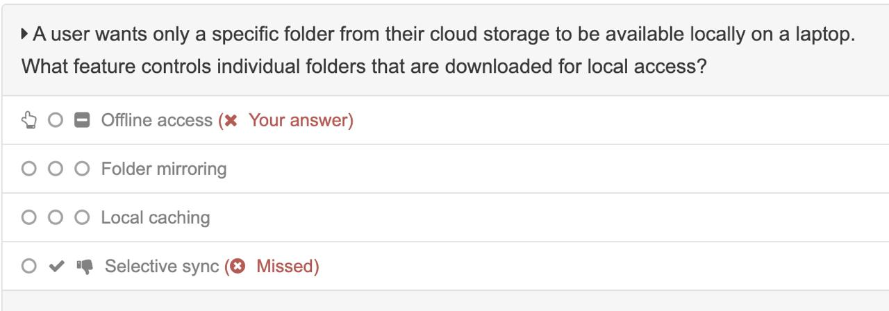

**题干：** A user wants only a specific folder from their cloud storage to be available locally on a laptop. What feature controls individual folders that are downloaded for local access?

|  |  |
| --- | --- |
| ❌ 我的答案 | Offline access |
| ✅ 正确答案 | Selective sync |

### 为什么是 Selective sync
题目关键词是：
- **only a specific folder**
- **available locally**
- **controls individual folders that are downloaded**

这说明重点不是“能不能离线访问”，
而是：
## **决定哪些具体文件夹要同步/下载到本地**

这个功能就是：
## **Selective sync**

### Selective sync 是什么
**Selective sync** 的作用是：
- 让用户挑选某些文件夹同步到本机
- 不需要把整个云盘内容都占满本地硬盘
- 只下载自己需要的那部分

### 为什么不是 Offline access
**Offline access** 更偏向：
- 文件已经可在本地使用
- 没网络时也能打开

但它不一定强调：
## **由你来精确控制哪些文件夹被下载到本地**

也就是说：
- **Selective sync** = 选哪些文件夹要落地
- **Offline access** = 已落地或已缓存内容能否离线打开

### 其他选项顺手区分
- **Folder mirroring**：更偏整套镜像同步概念，不是这题“挑单个文件夹是否同步”的标准考点
- **Local caching**：偏性能/缓存机制，不是用户手动选择特定文件夹同步的核心术语

### 快速分类记忆
- **Selective sync** = 选择哪些文件夹同步到本地
- **Offline access** = 没网时还能打开本地可用内容
- **Local caching** = 临时缓存/性能优化

### 口诀
**要挑文件夹落地，先想 Selective sync；要没网也能看，才想 Offline access。**

---

## 查云应用 license 分配和余量，先看 Admin dashboard / portal，不是 credential manager
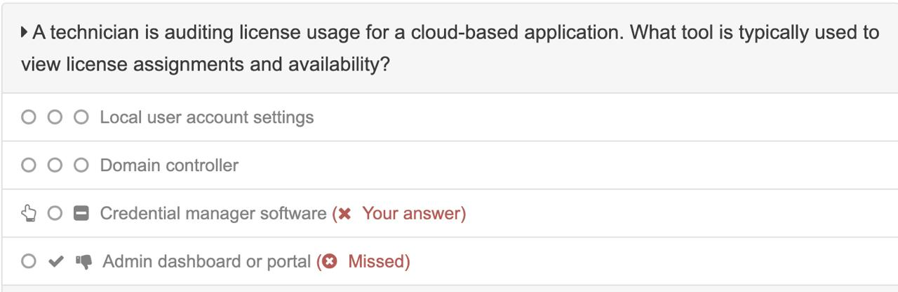

**题干：** A technician is auditing license usage for a cloud-based application. What tool is typically used to view license assignments and availability?

|  |  |
| --- | --- |
| ❌ 我的答案 | Credential manager software |
| ✅ 正确答案 | Admin dashboard or portal |

### 为什么是 Admin dashboard / portal
题目关键词是：
- **auditing license usage**
- **cloud-based application**
- **view license assignments and availability**

这说明要看的内容是：
- 谁被分配了 license
- 还剩多少 license 可用
- 整体订阅/授权状态

这类信息通常都在：
## **Admin dashboard / admin portal**

也就是云服务的管理员控制台里查看。

### 为什么不是 Credential manager software
**Credential manager** 管的是：
- 账号密码
- 登录凭据
- 认证信息存储

它不是用来看：
## **license 分配和可用数量**

也就是说：
- **Credential manager** 关注“登录凭证”
- **Admin portal** 关注“租户、用户、license、订阅、管理”

### 其他选项顺手区分
- **Local user account settings**：本地设备账户设置，不是云应用 license 审计中心
- **Domain controller**：管理域身份/认证资源，不是典型云应用 license 管理界面

### 快速分类记忆
- **Admin portal / dashboard** = 看云服务 license / 用户分配 / 订阅
- **Credential manager** = 管密码和凭据
- **Domain controller** = 域身份管理

### 口诀
**看 license 去管理后台；看密码才找 credential manager。**

---

## 整个受限周界同时拦人和车，先想 Fencing，不是 guards
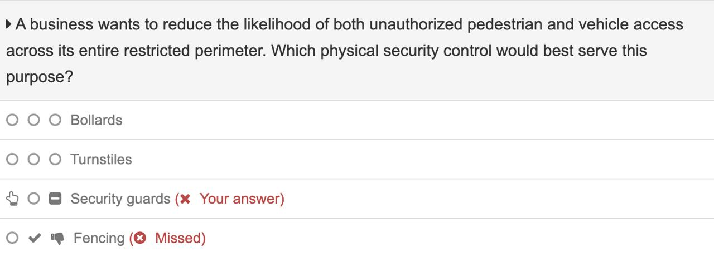

**题干：** A business wants to reduce the likelihood of both unauthorized pedestrian and vehicle access across its entire restricted perimeter. Which physical security control would best serve this purpose?

|  |  |
| --- | --- |
| ❌ 我的答案 | Security guards |
| ✅ 正确答案 | Fencing |

### 为什么是 Fencing
题目关键词特别重要：
- **both unauthorized pedestrian and vehicle access**
- **across its entire restricted perimeter**

这题强调的是：
## **整个周界 perimeter 的持续物理阻挡**

最符合这个需求的就是：
## **Fencing**

因为围栏/围网可以：
- 沿整个边界连续部署
- 阻止或显著降低行人随意进入
- 也对车辆越界进入形成外围障碍

所以它最符合“全周界防护”的意思。

### 为什么不是 Security guards
**Security guards** 当然能巡逻、威慑、响应，
但它们不是一个：
## **覆盖 entire perimeter 的固定物理屏障**

题目问的是 **physical security control**，而且强调整个 perimeter，
所以应该优先想那种：
- 连续、固定、边界型的物理设施

而不是主要靠人力巡逻。

### 其他选项顺手区分
- **Bollards**：主要防车辆冲撞，不适合整个 perimeter，也不能有效拦住行人
- **Turnstiles**：主要控制行人通过单个入口点，不适合整条外围边界

### 快速分类记忆
- **Fencing** = 整体外围周界防护
- **Bollards** = 防车辆冲撞/限制车道
- **Turnstiles** = 控制单点行人入口
- **Guards** = 巡逻/监控/响应

### 口诀
**问整个 perimeter，先想 fencing；问单点入口，才想 turnstile；问防车冲撞，再想 bollards。**

---

## 跨 Windows / macOS / Linux 最广兼容先想 FAT32 + exFAT，不是 NTFS
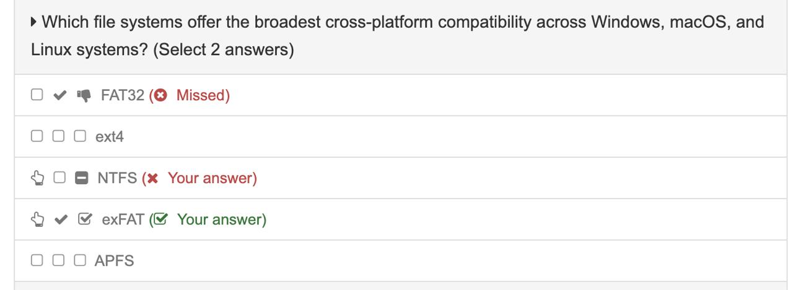

**题干：** Which file systems offer the broadest cross-platform compatibility across Windows, macOS, and Linux systems? (Select 2 answers)

|  |  |
| --- | --- |
| ❌ 我的答案 | NTFS |
| ✅ 正确答案 | FAT32 / exFAT |

### 这题最该先抓的核心
题目问的是：
## **broadest cross-platform compatibility**

也就是：
### **跨 Windows、macOS、Linux 最通用、最容易都能认的文件系统**

所以正确答案是：
## **FAT32**
## **exFAT**

---

## 为什么不是 NTFS
**NTFS** 当然在 Windows 里很常见，
功能也强，
但它不是“最广跨平台兼容”那组答案。

因为：
- Windows 对 NTFS 支持最好
- macOS / Linux 对 NTFS 的原生读写兼容性没有 FAT32 / exFAT 那么自然、那么通用

所以题目如果在考：
## **谁最跨平台、最通用**
那优先就不是 NTFS。

---

## 为什么 FAT32 对
### **FAT32 = 老牌通用格式**
它的最大优势就是：
## **兼容性特别广**

几乎各种系统、设备、U 盘、老机器都认。

缺点你也要顺手记：
- **单个文件不能超过 4GB**

所以 FAT32 你可以记成：
## **最老最通用，但有 4GB 限制。**

---

## 为什么 exFAT 对
### **exFAT = 为闪存/移动存储更现代、更方便的大文件方案**

它也很强调：
## **跨平台、移动存储、兼容性强**

相比 FAT32，
它最大的记忆点是：
### **支持更大的文件，不受 4GB 单文件限制**

所以 exFAT 你可以记成：
## **现代 U 盘/移动硬盘跨平台通用格式。**

---

## 为什么其他几个不对
### ext4
- Linux 常见文件系统
- 不属于三大桌面系统里“最广通用”的答案

### APFS
- Apple File System
- 苹果自己的文件系统
- 不是跨 Windows/macOS/Linux 最广兼容

---

## 最简单记忆法
### 跨平台最广兼容就记两兄弟：
## **FAT32 + exFAT**

### 再压缩成一句
- **FAT32** → 老牌万能，但 4GB 限制
- **exFAT** → 现代万能，大文件更友好

---

## 一句话口诀
## **老通用选 FAT32，大文件跨平台选 exFAT；NTFS 强在 Windows，不是最广兼容。**

### 给你一个最好背的版本
## **跨平台看 FAT 家族：FAT32 老万能，exFAT 新万能。**

**一句话：**
这题以后直接这样背：**问最广跨平台兼容，就先想 FAT32 和 exFAT；问 Windows 本地强功能，再想 NTFS。**
---

## Core 2：跨系统共享数据先看文件系统兼容；企业桌面最广泛采用通常还是 Windows
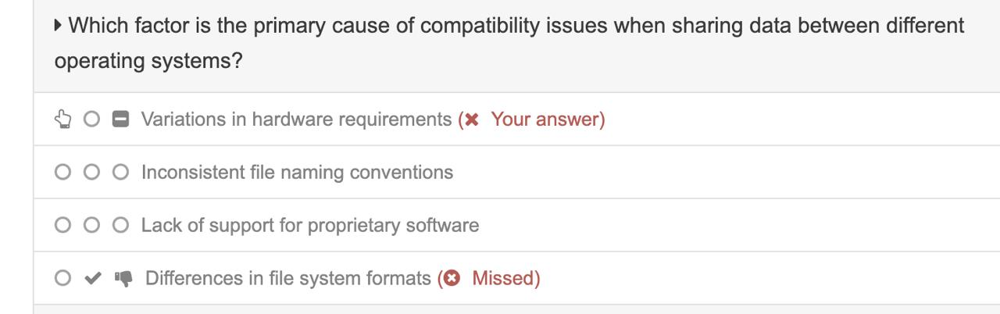

### 题 1：不同操作系统之间共享数据，最常见兼容问题来源
**题干：** What is the primary cause of compatibility issues when sharing data between different operating systems?

|  |  |
| --- | --- |
| ❌ 我的答案 | Variations in hardware requirements |
| ✅ 正确答案 | Differences in file system formats |

#### 为什么答案是 file system formats
这题问的是：
## **sharing data between different operating systems**

最根本、最常见的兼容问题之一就是：
### **文件系统格式支持不同**

比如：
- Windows 常见 **NTFS**
- macOS 常见 **APFS**
- Linux 常见 **ext4**
- 跨平台更常见 **FAT32 / exFAT**

所以题目如果在问：
## **跨系统共享数据的 primary cause of compatibility issues**
优先想到：
## **Differences in file system formats**

#### 最短记忆
## **跨系统先看文件系统，不先看硬件。**

---

### 题 2：企业环境里最广泛采用的 workstation OS
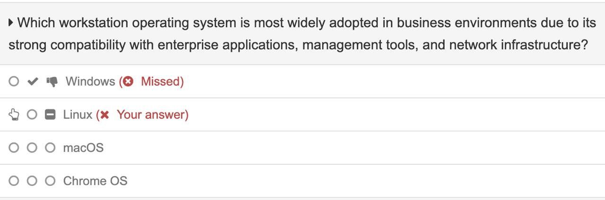

**题干：** Which workstation operating system is most widely adopted in business environments due to its strong compatibility with enterprise applications, management tools, and network infrastructure?

✅ **正确答案：Windows**

#### 为什么答案是 Windows
这题不是在问：
- 哪个系统最自由
- 哪个系统技术最强
- 哪个最适合服务器

而是在问：
## **企业桌面 / workstation 环境里谁最普及**

在这个语境里，
最标准答案就是：
## **Windows**

因为它在企业桌面生态里的优势是：
- 企业软件兼容性广
- 管理工具成熟
- 和域控/AD/组策略/办公环境整合强

#### 顺手对比
- **Windows** → 企业桌面/workstation 最常见
- **Linux** → 服务器、开发、云、运维更强势
- **macOS** → 设计、创意、Apple 生态、类 Unix 体验更有优势

#### 最短记忆
## **桌面企业看 Windows，服务器开发看 Linux。**

---

## 你顺手问的：那 macOS 的优势是什么？
这个可以这样简短记：

### macOS 常见优势
#### 1. Apple 生态整合好
- iPhone / iPad / AirDrop / iCloud / Handoff 配合顺

#### 2. 界面和体验稳定统一
- 硬件软件一体化
- 机器和系统配合通常比较顺手

#### 3. 创意/设计类用户很多
- 设计、视频、音乐、内容创作人群常见

#### 4. 兼顾桌面易用性 + Unix 底子
- 图形桌面友好
- 底层又有类 Unix 环境，开发者也喜欢

### 一句话记法
## **Windows 强企业桌面，Linux 强服务器开发，macOS 强 Apple 生态与创意体验。**

**一句话：**
这两题你可以一起记：**跨系统共享先看文件系统格式；企业桌面最广泛采用通常是 Windows。与此同时，macOS 的优势更多在 Apple 生态整合、体验统一，以及创意工作和类 Unix 开发环境。**
---

## 分区的好处：整理数据、支持 multiboot、也更方便备份恢复；不会让硬盘“变大”
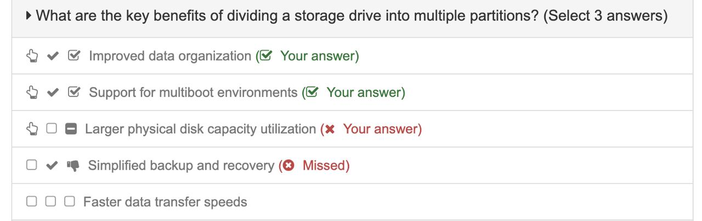

**题干：** What are the key benefits of dividing a storage drive into multiple partitions? (Select 3 answers)

|  |  |
| --- | --- |
| ✅ 我答对的 | Improved data organization |
| ✅ 我答对的 | Support for multiboot environments |
| ❌ 我的错误答案 | Larger physical disk capacity utilization |
| ✅ 漏掉的正确答案 | Simplified backup and recovery |

### 这题最容易错的点
你前两个其实已经抓得很准：
- **Improved data organization** ✅
- **Support for multiboot environments** ✅

你错在把：
- **Larger physical disk capacity utilization**
当成了分区的好处。

但分区：
## **不会让硬盘物理容量变大，也不会凭空提高物理容量利用率。**

---

## 为什么 Simplified backup and recovery 是对的
因为分区后你可以把：
- 系统
- 数据
- 其他用途

分开存放。

这样带来的一个实际好处就是：
## **备份和恢复更方便**

比如：
- 只备份数据分区
- 系统坏了重装时不一定要动数据分区
- 恢复系统和恢复资料可以分开处理

所以：
### **Simplified backup and recovery**
是合理的分区好处。

---

## 为什么 physical disk capacity 那项不对
因为分区只是：
## **把同一块盘切成逻辑区域**

它做的是逻辑划分，
不是物理扩容。

所以：
- 500GB 分成 2 个分区，还是 500GB
- 1TB 分成 4 个分区，也还是 1TB

### 分区能改善组织方式
### 但不能增加容量本身

---

## 为什么 faster data transfer speeds 也不对
分区本身不是加速技术。
它不会天然让：
- 磁盘变快
- 传输速率上升

所以这项也不是标准好处。

---

## 最简单记忆法
### 分区三大好处先记：
## **好整理**
## **能多系统启动**
## **更方便备份恢复**

不要乱加：
## **容量变大**
## **速度变快**

---

## 一句话口诀
## **分区帮你分门别类、双系统启动、备份恢复更轻松；但不加容量，也不直接加速。**

### 再压缩一句
## **分区管组织，不管扩容。**

**一句话：**
这题以后就这样背：**partition 的好处是整理、multiboot、备份恢复方便；它不会让硬盘容量更大，也不是提速手段。**
---

## 安装系统时 NVMe 盘检测不到：先想安装程序缺驱动，题库标准答案是加载第三方 NVMe 驱动，不是先刷 BIOS
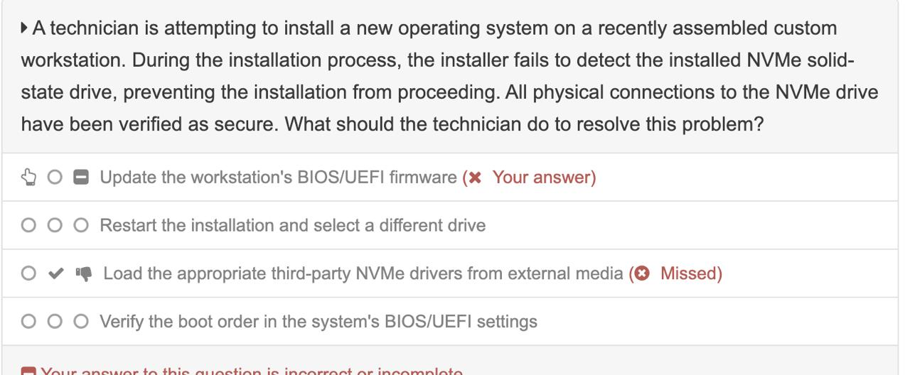

**题干：** A technician is attempting to install a new operating system on a recently assembled custom workstation. During the installation process, the installer fails to detect the installed NVMe solid-state drive, preventing the installation from proceeding. All physical connections to the NVMe drive have been verified as secure. What should the technician do to resolve this problem?

|  |  |
| --- | --- |
| ❌ 我的答案 | Update the workstation's BIOS/UEFI firmware |
| ✅ 正确答案 | Load the appropriate third-party NVMe drivers from external media |

### 这题为什么容易错
因为你看到：
- **recently assembled custom workstation**
- **installer fails to detect NVMe SSD**

很容易第一反应就怀疑：
## **BIOS/UEFI 太旧，不支持 NVMe**

这个现实里不是完全没可能，
但这题题库更标准的落点是：
## **安装程序缺少对应 NVMe 驱动**

所以标准答案是：
### **Load the appropriate third-party NVMe drivers from external media**

---

## 为什么正确答案是“加载驱动”
题目说的是：
## **during the installation process, the installer fails to detect the drive**

这类题在考试里常常是在考：
- 安装程序本身缺少存储控制器/NVMe 驱动
- 需要手动从外部介质加载驱动

也就是说：
### **盘可能物理上没问题，BIOS 也未必有问题，只是安装器暂时不认它。**

这时候最标准的动作就是：
## **load third-party NVMe drivers**

---

## 为什么 BIOS/UEFI firmware 这题没中
### Update the workstation's BIOS/UEFI firmware
这在现实故障排查里是一个合理方向，
但不是题库这里最直接、最优先的标准答案。

因为题目没有明确给你：
- 主板过旧
- 固件版本过老
- NVMe support 缺失

它更像是在考：
## **安装阶段识别不到存储设备 → 先补驱动**

所以这题先不要把脑子带到“刷 BIOS”上。

---

## 为什么 boot order 不对
因为现在的问题不是：
### **从哪块盘启动**

而是：
### **安装程序压根没看到那块 NVMe 盘**

既然安装器都看不到，
那先调 boot order 没有解决核心问题。

---

## 为什么选不同 drive 不对
因为题目没有说：
- 还有别的可用目标盘
- 当前盘不适合安装

而是在问：
### **怎么解决 NVMe 盘检测不到的问题**

所以“换盘选”不是核心处理。

---

## 最简单记忆法
### 安装系统时遇到：
- **installer 看不到 NVMe / storage device**
- **物理连接已确认没问题**

优先想到：
## **先加载存储/NVMe 驱动**

不要第一反应就：
## **刷 BIOS**

---

## 一句话口诀
## **安装器不认盘，先补驱动；能进系统后再谈固件。**

### 再压缩一句
## **看不到 NVMe 先想驱动，不先想 BIOS。**

**一句话：**
这题以后直接这样背：**安装系统时如果 installer 检测不到 NVMe，而物理连接已确认正常，题库标准处理优先是加载第三方 NVMe 驱动。**
---

## 对，这题和 NVMe 那题同一路：安装器看不到 RAID，先加载 RAID 驱动，不先换控制器
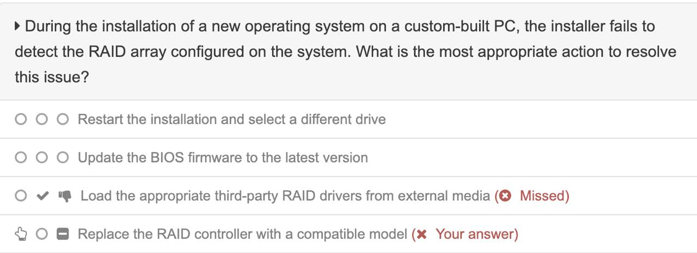

**题干：** During the installation of a new operating system on a custom-built PC, the installer fails to detect the RAID array configured on the system. What is the most appropriate action to resolve this issue?

|  |  |
| --- | --- |
| ❌ 我的答案 | Replace the RAID controller with a compatible model |
| ✅ 正确答案 | Load the appropriate third-party RAID drivers from external media |

### 对，这题和上一题本质是同一路
你这个总结是对的：
## **安装器看不到 RAID / NVMe 这类存储目标时，题库很爱考“先加载驱动”。**

也就是：
- **看不到 NVMe** → 先补 NVMe 驱动
- **看不到 RAID array** → 先补 RAID 驱动

---

## 为什么答案是加载 RAID 驱动
题目最关键的词是：
- **during the installation of a new operating system**
- **installer fails to detect the RAID array**

这很像在说：
## **安装程序本身没有对应 RAID controller / storage driver**

所以最合适的动作就是：
### **Load the appropriate third-party RAID drivers from external media**

也就是让安装器先“认得出”这个 RAID 阵列。

---

## 为什么不是更换 RAID controller
你选的是：
### **Replace the RAID controller with a compatible model**

这个太重了，
也不是 first / most appropriate action。

因为题目没有说：
- RAID controller 损坏
- controller 不兼容
- 阵列配置错误

它更像是在考：
## **安装程序缺驱动，暂时识别不到控制器/阵列**

所以直接换控制器属于：
### **过度处理**

---

## 为什么 BIOS update 也没中
和上一题 NVMe 很像。

更新 BIOS 当然有时现实里可能有帮助，
但题库更标准的答案通常是：
## **先加载存储控制器驱动**

因为题目重点落在：
### **installer fails to detect**
不是：
### **固件完全不支持**

---

## 为什么“选别的盘”不对
因为题目不是在问：
- 还有没有别的安装目标

而是在问：
### **如何解决 installer 看不到 RAID array 的问题**

所以换盘不是根本解决思路。

---

## 最简单记忆法
### 安装系统时如果：
- 看不到 **NVMe**
- 看不到 **RAID array**
- 物理层/阵列已配置好

优先想到：
## **加载第三方存储驱动**

---

## 一句话口诀
## **安装器不认存储目标，先补控制器驱动；别一上来刷 BIOS，更别直接换硬件。**

### 再压缩成一句
## **OS 安装看不到盘，先加载驱动。**

**一句话：**
对，这题你可以和上一题绑着背：**安装系统时如果 installer 看不到 RAID 或 NVMe，题库标准答案通常是先从外部介质加载对应第三方驱动。**
---

## 恢复出厂设置且不靠外部介质，先想 recovery partition；system restore 不是重置到 factory settings
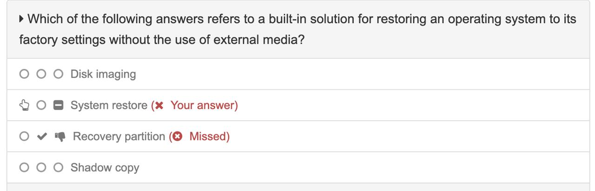

**题干：** Which of the following answers refers to a built-in solution for restoring an operating system to its factory settings without the use of external media?

|  |  |
| --- | --- |
| ❌ 我的答案 | System restore |
| ✅ 正确答案 | Recovery partition |

### 这题最容易混的点
你会选 **System restore** 很正常，
因为它听起来就像：
## **恢复系统**

但题目问得更具体：
### **restoring an operating system to its factory settings**
而且还强调：
### **without the use of external media**

这两个关键词一组合，
标准答案就变成：
## **Recovery partition**

---

## 为什么答案是 recovery partition
### **Recovery partition = 恢复分区**
它通常是机器/系统预先内建在本地磁盘上的恢复环境，
用来：
- 恢复出厂设置
- 重置系统到初始状态
- 不需要额外 U 盘 / 光盘 / 外部安装介质

所以题目说：
## **built-in solution**
## **factory settings**
## **without external media**

这就是 recovery partition 的经典描述。

---

## 为什么 system restore 不对
### **System Restore**
更像是：
## **把系统状态回滚到之前的一个还原点**

它主要恢复的是：
- 系统文件
- 注册表
- 某些配置状态

它不是：
## **把系统恢复到出厂设置**

也就是说：
- **System Restore** → 回到之前某个系统状态
- **Recovery Partition** → 回到更接近出厂/初始恢复环境

所以这题不能选 System Restore。

---

## 为什么 disk imaging 不对
### **Disk imaging**
更像：
- 做整盘镜像备份
- 用镜像恢复系统

但题目强调的是：
## **built-in solution without external media**

它不是在问“备份镜像技术”，
而是在问机器本机自带的恢复机制。

---

## 为什么 shadow copy 不对
### **Shadow copy**
更偏：
- 文件/卷快照
- 版本副本
- 便于恢复某些文件版本

它不是“恢复到 factory settings”的标准答案。

---

## 最简单记忆法
### 题目如果问：
- **factory settings**
- **built-in solution**
- **no external media**

优先想到：
## **Recovery partition**

### 顺手区分
- **System Restore** → 还原点回滚
- **Recovery Partition** → 出厂恢复/重置系统
- **Disk Imaging** → 镜像备份恢复
- **Shadow Copy** → 快照/文件版本

---

## 一句话口诀
## **还原点选 System Restore，恢复出厂选 Recovery Partition。**

### 再压一句
## **factory settings 不看 restore point，看 recovery partition。**

**一句话：**
这题以后直接这样背：**System Restore 是回滚到还原点，不是恢复出厂；问 built-in factory reset without external media，就选 Recovery Partition。**
---

## 无盘工作站每次开机都从网络拉系统镜像，先想 PXE；SMB/NFS 是共享协议，不是“网启”本身
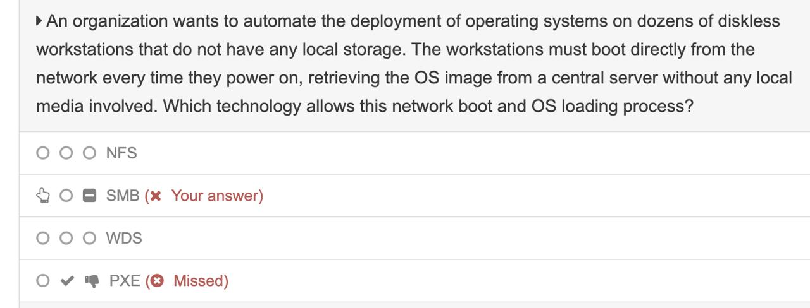

**题干：** An organization wants to automate the deployment of operating systems on dozens of diskless workstations that do not have any local storage. The workstations must boot directly from the network every time they power on, retrieving the OS image from a central server without any local media involved. Which technology allows this network boot and OS loading process?

|  |  |
| --- | --- |
| ❌ 我的答案 | SMB |
| ✅ 正确答案 | PXE |

### 这题最关键的词
- **diskless workstations**
- **boot directly from the network every time**
- **retrieving the OS image from a central server**
- **without any local media**

只要看到：
## **从网络启动 / 网启 / boot directly from the network**

第一反应就该是：
## **PXE**

---

## 为什么答案是 PXE
### **PXE = Preboot eXecution Environment**
它就是用来：
## **通过网卡启动系统，并从网络获取启动/安装映像**

这题里无盘工作站：
- 没本地存储
- 没本地介质
- 每次都从网络开机

这完全就是 PXE 的经典应用场景。

---

## 为什么你选的 SMB 不对
### **SMB = Server Message Block**
它是：
## **文件共享协议**

也就是说 SMB 更偏：
- 共享文件夹
- 访问共享目录
- 传文件

但它不是：
## **让机器开机时通过网卡直接启动的技术**

所以这题不能选 SMB。

---

## 为什么 NFS 也不对
### **NFS = Network File System**
和 SMB 一样，
它也是：
## **网络文件共享协议**

它能共享文件，
但不是“网络引导启动机制”本身。

---

## 为什么 WDS 这题也没中
### **WDS = Windows Deployment Services**
它和网络部署 Windows 确实有关，
但题目问的是：
## **哪一种 technology allows this network boot and OS loading process**

更底层、更核心的“网络启动”技术是：
## **PXE**

你可以这样区分：
- **PXE** → 网启机制
- **WDS** → 利用 PXE 等方式进行 Windows 部署的服务

---

## 最简单记忆法
### 看到这些词：
- **network boot**
- **diskless workstation**
- **boot from network**
- **no local media**

优先想到：
## **PXE**

### 顺手区分
- **PXE** → 网络启动
- **SMB / NFS** → 文件共享
- **WDS** → Windows 部署服务

---

## 一句话口诀
## **网启看 PXE，共享看 SMB/NFS，Windows 批量部署才想 WDS。**

### 再压一句
## **从网络开机 = PXE，不是共享协议。**

**一句话：**
这题以后直接这样背：**无盘工作站每次从网络开机、拉系统镜像，核心技术就是 PXE；SMB/NFS 只是共享协议，不是网启本身。**
---

## Multiboot 不是“同时运行多个系统”，而是开机时选一个系统；常见用途是不同系统做不同任务
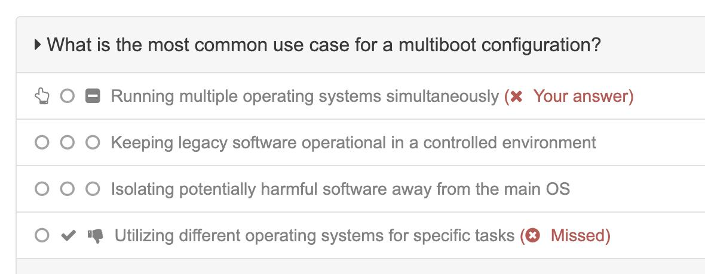

**题干：** What is the most common use case for a multiboot configuration?

|  |  |
| --- | --- |
| ❌ 我的答案 | Running multiple operating systems simultaneously |
| ✅ 正确答案 | Utilizing different operating systems for specific tasks |

### 这题你错的根本原因
你把：
## **multiboot**
和
## **virtualization / multiple OS simultaneously**
混了。

这是非常常见的错法。

---

## 为什么正确答案是“for specific tasks”
### **Multiboot** 的意思是：
- 一台机器装多个操作系统
- **开机时选其中一个进去**
- 不是同时并行运行

所以它的最常见用途就是：
## **不同系统做不同任务**

比如：
- Windows 打游戏 / 跑某些办公软件
- Linux 做开发 / 安全实验 / 学习
- 老版本系统保留某些特定用途

这就是：
### **Utilizing different operating systems for specific tasks**

---

## 为什么“simultaneously”不对
你选的是：
### **Running multiple operating systems simultaneously**

这个更像：
## **虚拟化（virtualization）**

也就是：
- host OS 里再跑 guest OS
- 多个系统同时在线
- 同时运行

但 multiboot 不是这样。

### Multiboot 的关键词是：
## **boot 时选一个，不是一起跑。**

---

## 为什么其他两个不是最常见 use case
### Keeping legacy software operational in a controlled environment
这个也可能是用途之一，
但题目问的是：
## **most common use case**

更通用、更标准的答案还是：
### **不同 OS 处理不同任务**

### Isolating potentially harmful software away from the main OS
这更像：
- sandbox
- VM
- 隔离测试环境

不是 multiboot 最典型的 primary use case。

---

## 最简单记忆法
### Multiboot 就记一句：
## **一台机器多个系统，但一次只进一个。**

### 顺手对比
- **Multiboot** → 开机选一个系统
- **Virtualization** → 多系统可同时运行

---

## 一句话口诀
## **多系统同时跑看虚拟化，开机选一个看 multiboot。**

### 再压缩一句
## **Multiboot 管“切换”，不是管“同时”。**

**一句话：**
这题以后直接这样背：**multiboot 最常见用途是让不同操作系统承担不同任务；如果题目说 simultaneously，那通常更像 virtualization，不是 multiboot。**
---

## Internet-based OS installation 先想“外网/云/厂商下载”，不要和 PXE/LAN 大规模部署混掉
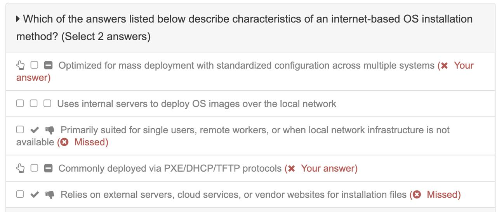

**题干：** Which of the answers listed below describe characteristics of an internet-based OS installation method? (Select 2 answers)

|  |  |
| --- | --- |
| ❌ 我的答案 | Optimized for mass deployment with standardized configuration across multiple systems |
| ❌ 我的答案 | Commonly deployed via PXE/DHCP/TFTP protocols |
| ✅ 漏掉的正确答案 | Primarily suited for single users, remote workers, or when local network infrastructure is not available |
| ✅ 漏掉的正确答案 | Relies on external servers, cloud services, or vendor websites for installation files |

### 这题为什么会错
因为你把：
## **internet-based installation**
和
## **network/PXE mass deployment**
混在一起了。

它们都带“network”味道，
所以特别容易串。

---

## Internet-based installation 真正的特征是什么
### 1. Relies on external servers, cloud services, or vendor websites for installation files
这就是最核心定义。

也就是：
- 安装文件来自外部服务器
- 来自云端
- 来自厂商网站
- 依赖互联网获取镜像/安装资源

所以：
## **external servers / cloud / vendor websites**
一定是对的。

### 2. Primarily suited for single users, remote workers, or when local network infrastructure is not available
因为这种安装方式不依赖企业内网部署体系，
所以更适合：
- 单个用户
- 远程办公用户
- 没有本地 LAN 部署环境时

所以这项也是标准答案。

---

## 为什么你选的那两项不对
### 1. Optimized for mass deployment with standardized configuration across multiple systems
这更像：
## **企业内网批量部署 / 镜像标准化部署**

也就是：
- 大规模统一装机
- 多台机器标准化配置
- IT 批量部署场景

这不是 internet-based installation 最典型的标签。

### 2. Commonly deployed via PXE/DHCP/TFTP protocols
这个更是明显在说：
## **PXE 网络部署 / 内网启动安装**

也就是：
- 本地网络
- DHCP
- TFTP
- PXE boot

这更像：
## **network-based / LAN-based deployment**

不是这题的 **internet-based**。

---

## 最简单对照记忆
### Internet-based installation
- 外部服务器 / 云端 / 厂商网站
- 单用户 / 远程用户 / 没有本地部署环境

### PXE / network deployment
- 内部服务器
- 本地网络
- PXE / DHCP / TFTP
- 批量部署

---

## 最方便记忆的方法
## **Internet-based = 从外网拿文件**
## **PXE-based = 从内网开机装系统**

---

## 一句话口诀
## **外网装系统看 cloud/vendor；内网批量装机看 PXE/DHCP/TFTP。**

### 再压缩一句
## **单机远程走互联网，批量部署走本地网。**

**一句话：**
这题以后就这样背：**internet-based OS installation 强调外部服务器/云端/厂商下载，适合单用户和远程用户；PXE/DHCP/TFTP 那套属于本地网络批量部署，不是 internet-based。**
---

## NetBT = NetBIOS over TCP/IP，这题是 True；看到 NetBT 就想到“让 NetBIOS 跑在 TCP/IP 上”
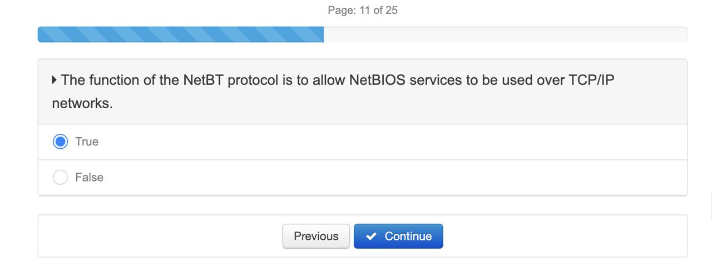

**题干：** The function of the NetBT protocol is to allow NetBIOS services to be used over TCP/IP networks.

|  |  |
| --- | --- |
| ❌ 我的答案 | False |
| ✅ 正确答案 | True |

### 这题其实就是缩写题
你只要把这个缩写拆开，
题目就几乎等于白送：

## **NetBT = NetBIOS over TCP/IP**

也就是：
### **让 NetBIOS 服务可以运行在 TCP/IP 网络上。**

所以题干说：
> allow NetBIOS services to be used over TCP/IP networks

这句话本身就是：
## **True**

---

## NetBIOS / NetBT 最简单怎么理解
### NetBIOS
是比较老的一套网络服务/接口概念，
常见和：
- 名称解析
- 会话服务
- 局域网共享

这些东西联系在一起。

### NetBT
就是把：
## **NetBIOS 这套服务搬到 TCP/IP 上跑**

所以你可以把它直接记成：
## **NetBIOS over TCP/IP 的桥梁/封装方式**

---

## 为什么这题容易反应不过来
因为如果你没把：
### **NetBT**
和
### **NetBIOS over TCP/IP**
直接绑定，
那它看起来就像一个陌生缩写。

一旦绑定之后，
这题就会变成：
## **定义题**

---

## 顺手再和相关端口一起记
如果题目再延伸到老式 NetBIOS 服务，
常见会想到：
- **137** → NetBIOS Name
- **138** → NetBIOS Datagram
- **139** → NetBIOS Session

所以你可以把它们顺手串起来：
## **NetBT = 让 NetBIOS 这些服务跑在 TCP/IP 网络里。**

---

## 最简单记忆法
## **NetBT 看到 BT，不是蓝牙；它是 NetBIOS over TCP/IP。**

### 一句话口诀
## **NetBT = NetBIOS 搭 TCP/IP。**

### 再压缩一句
## **看到 NetBT，就判断：它就是把 NetBIOS 放到 TCP/IP 上跑。**

**一句话：**
这题以后直接秒杀：**NetBT 的作用就是让 NetBIOS services 能在 TCP/IP 网络上使用，所以题目是 True。**
---

## Windows 11 最容易漏的硬性门槛：TPM 2.0；32GB 存储不是这题标准答案
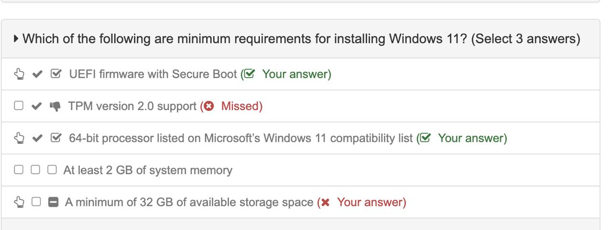

**题干：** Which of the following are minimum requirements for installing Windows 11? (Select 3 answers)

|  |  |
| --- | --- |
| ✅ 我答对的 | UEFI firmware with Secure Boot |
| ✅ 我答对的 | 64-bit processor listed on Microsoft’s Windows 11 compatibility list |
| ❌ 漏掉的正确答案 | TPM version 2.0 support |
| ❌ 我的错误答案 | A minimum of 32 GB of available storage space |

### 这题最该先抓的门槛
## **Windows 11 = Secure Boot + TPM 2.0 + 合规 64-bit CPU**

你前两个已经抓对了：
- **UEFI firmware with Secure Boot** ✅
- **64-bit processor on the compatibility list** ✅

你最容易漏掉的就是：
## **TPM 2.0 support**

---

## 为什么 TPM 2.0 是对的
Windows 11 跟以前版本一个很明显的区别就是：
## **更强调安全硬件门槛**

其中最爱考的就是：
### **TPM 2.0**

它几乎已经成了 Windows 11 题的“招牌关键词”。

所以以后只要看到：
## **Windows 11 minimum requirements**
优先脑内跳出来：
- **TPM 2.0**
- **Secure Boot / UEFI**
- **64-bit supported CPU**

---

## 为什么 32 GB 这题没中
你选的：
### **A minimum of 32 GB of available storage space**

它看起来很像“以前 Windows 安装题”的常见选项，
所以很容易被选进去。

但这题按当前题库标准，
它没有把这项列进你这道题的正确三项里。

换句话说，
这题最稳的考法更偏：
## **Windows 11 的三大硬门槛：TPM 2.0、Secure Boot、受支持 CPU**

所以你记忆时不要让存储容量抢走注意力。

---

## 为什么 2 GB RAM 明显不对
这个你没选是对的。
因为 Windows 11 不可能只要 2 GB RAM。

这种选项一般就是拿来当干扰项。

---

## 最简单记忆法
### Windows 11 三件套直接死记：
## **TPM 2.0**
## **UEFI + Secure Boot**
## **受支持的 64-bit CPU**

### 一句话口诀
## **Win11 三道门：TPM 2.0、Secure Boot、64-bit 合规 CPU。**

### 再压缩一句
## **看到 Windows 11 requirements，先锁 TPM 2.0。**

**一句话：**
这题以后就这样背：**Windows 11 最常考的三个最低要求是 TPM 2.0、UEFI Secure Boot、以及受支持的 64-bit 处理器；TPM 2.0 是最容易漏掉的那个。**
---

## Task Manager 最核心四件事：看运行、看资源、管启动、结束卡死程序；不管计划任务和用户权限
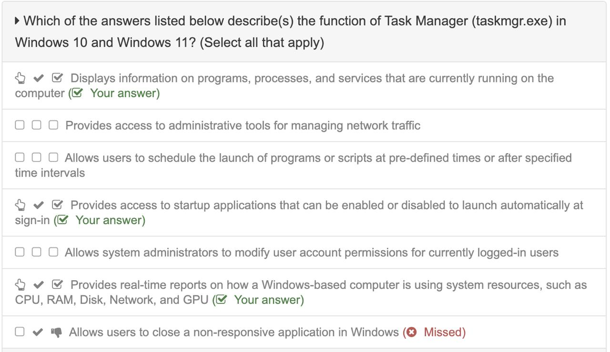

**题干：** Which of the answers listed below describe(s) the function of Task Manager (taskmgr.exe) in Windows 10 and Windows 11? (Select all that apply)

**正确答案：**
- **Displays information on programs, processes, and services that are currently running on the computer**
- **Provides access to startup applications that can be enabled or disabled to launch automatically at sign-in**
- **Provides real-time reports on how a Windows-based computer is using system resources, such as CPU, RAM, Disk, Network, and GPU**
- **Allows users to close a non-responsive application in Windows**

### 你这题其实已经会了 75%
你已经选对了三项：
- **running programs / processes / services** ✅
- **startup applications** ✅
- **real-time resource reports** ✅

你漏掉的是：
- **Allows users to close a non-responsive application in Windows** ✅

这项其实也是 Task Manager 最经典、最直觉的用途之一。

---

## 为什么这个漏掉最可惜
因为很多人对 Task Manager 的第一反应就是：
## **程序卡死了，去 Task Manager 里 End task**

所以：
### **Allows users to close a non-responsive application in Windows**
是非常标准、非常基础的 Task Manager 功能。

这题漏它，
就等于把 Task Manager 最招牌的功能忘掉了。

---

## Task Manager 最核心到底是哪四件事
你以后就把它固定背成四件事：

### 1. 看当前运行内容
- 程序
- 进程
- 服务

### 2. 看系统资源占用
- CPU
- RAM
- Disk
- Network
- GPU

### 3. 管启动项
- 开机自启程序启用/禁用

### 4. 杀掉卡死程序
- **End task**

---

## 为什么其他几个不对
### Provides access to administrative tools for managing network traffic
这更像：
- 专门网络管理工具
- 高级网络监控/管理工具

不是 Task Manager 的标准定义。

### Allows users to schedule the launch of programs or scripts at pre-defined times
这个是：
## **Task Scheduler（任务计划程序）**
不是 Task Manager。

### Allows system administrators to modify user account permissions
这个更像：
- 用户管理
- 本地安全策略
- 账户权限配置

不是 Task Manager 的功能。

---

## 最简单记忆法
### Task Manager = 四件事
## **看运行**
## **看资源**
## **管启动**
## **杀卡死**

不要混到：
- **Task Scheduler**（定时任务）
- **User permissions**（用户权限）
- **高级网络管理**

---

## 一句话口诀
## **Task Manager 看运行、看资源、管启动、杀卡死；定时任务去 Scheduler。**

### 再压缩一句
## **程序卡死先开 Task Manager，不是去改权限。**

**一句话：**
这题以后直接背 Task Manager 的四大功能：**看运行进程、看资源占用、管理启动项、结束无响应程序。**
---

## lusrmgr.msc = Local Users and Groups，能管本地用户和组；但 Home 版通常没有，这题是 True
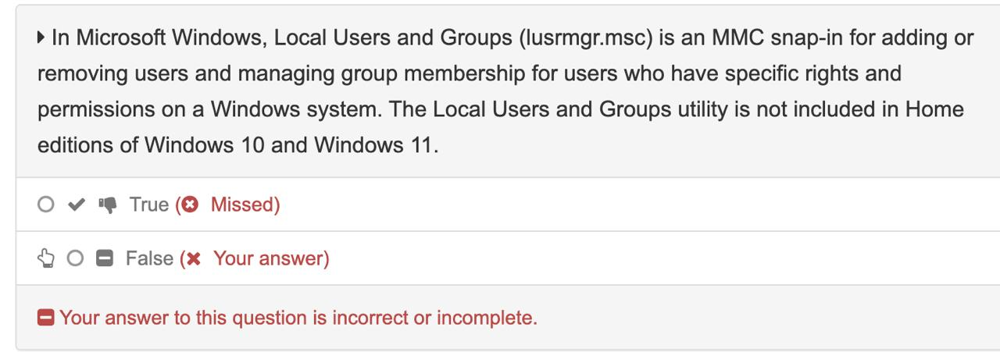

**题干：** In Microsoft Windows, Local Users and Groups (lusrmgr.msc) is an MMC snap-in for adding or removing users and managing group membership for users who have specific rights and permissions on a Windows system. The Local Users and Groups utility is not included in Home editions of Windows 10 and Windows 11.

|  |  |
| --- | --- |
| ❌ 我的答案 | False |
| ✅ 正确答案 | True |

### 这题最该直接记住的点
## **lusrmgr.msc = Local Users and Groups**
它就是 Windows 里的一个：
### **MMC snap-in**

主要用来：
- 管理本地用户
- 管理本地组
- 调整组成员关系

所以题目前半句本身就是对的。

---

## 为什么后半句也是对的
题目后半句说：
### **The Local Users and Groups utility is not included in Home editions of Windows 10 and Windows 11.**

这也是题库常考点：
## **Home 版通常没有这个本地用户和组管理器。**

也就是说：
- **Pro / Enterprise / 更高版本** 更常见这个工具
- **Home 版** 往往没有完整提供这个 MMC 工具

所以整句话判定就是：
## **True**

---

## 为什么你容易误判成 False
因为这题前半句很长，
后半句又补了一个版本差异，
很容易让人怀疑：
- “会不会有一句是错的？”
- “是不是 Home 版也有？”

但这题真正要你记的就是两件事：
1. **lusrmgr.msc 是管本地用户和组的 MMC snap-in**
2. **Home 版通常不带它**

这两个都成立，
所以答案就是：
## **True**

---

## 最简单记忆法
### lusrmgr.msc 先拆词
- **usr** → users
- **mgr** → manager

你就把它记成：
## **本地用户和组管理器**

### 再补一句版本差异
## **Home 没它，Pro 更常见。**

---

## 一句话口诀
## **lusrmgr 管本地用户组，Home 版通常没有。**

### 再压缩一句
## **看到 lusrmgr.msc，就想到 Local Users and Groups。**

**一句话：**
这题以后直接背：**lusrmgr.msc 就是本地用户和组管理器（MMC snap-in），而且 Windows 10/11 Home 版通常不包含它，所以这题是 True。**
---

## 启动故障排查先想 msconfig.exe，不是 sysdm.cpl；sysdm 偏系统属性，msconfig 偏启动配置

**题干：** Which of the following refers to a Microsoft Windows tool designed for troubleshooting system startup problems?

|  |  |
| --- | --- |
| ❌ 我的答案 | sysdm.cpl |
| ✅ 正确答案 | msconfig.exe |

### 这题最关键的对比
你这题不是完全不会，
而是把两个 Windows 工具的用途混了：
- **sysdm.cpl**
- **msconfig.exe**

其中真正偏：
## **启动问题排查**
的是：
## **msconfig.exe**

---

## 为什么答案是 msconfig.exe
### **msconfig.exe = System Configuration**
它最经典的用途就是：
- 排查启动问题
- 调整启动配置
- 控制启动项/服务的加载方式
- 进行选择性启动 / diagnostic startup

所以题目问：
## **tool designed for troubleshooting system startup problems**

最标准答案就是：
## **msconfig.exe**

---

## 为什么 sysdm.cpl 不对
### **sysdm.cpl = System Properties**
它更偏：
- 计算机名
- 系统保护
- 高级系统设置
- 环境变量
- 性能设置入口
- 远程设置

也就是说：
## **它是系统属性配置工具**
不是专门拿来做“启动故障排查”的代表答案。

你会选它，
多半是因为它也长得很“系统底层”，
但它不是这题最贴的那个。

---

## 为什么另外两个不对
### eventvwr.msc
- 事件查看器
- 可以看日志
- 对排错有帮助
- 但题目问的是“designed for troubleshooting startup problems”的工具名
更标准还是 **msconfig**

### compmgmt.msc
- 计算机管理
- 是综合管理控制台
- 能进很多管理模块
- 也不是这题最直接的“启动故障排查工具”

---

## 最简单记忆法
### Windows 启动故障题先记：
## **msconfig = 启动配置/启动排错**

### 顺手对比
- **msconfig.exe** → 启动配置、启动排错
- **sysdm.cpl** → 系统属性
- **eventvwr.msc** → 事件查看器
- **compmgmt.msc** → 计算机管理

---

## 一句话口诀
## **启动排错找 msconfig，系统属性找 sysdm。**

### 再压缩一句
## **msconfig 管启动，sysdm 管系统属性。**

**一句话：**
这题以后直接这样背：**Windows 里排查启动问题最典型的工具是 msconfig.exe；sysdm.cpl 是系统属性，不是启动排错工具。**
---

## msconfig 的 Boot tab 不只管 Safe boot，还能管 boot logging、默认启动系统、以及资源限制；startup items 不在 Boot tab

**题干：** Which of the settings listed below can be managed through the Boot tab of the System Configuration utility in Windows? (Select all that apply)

**正确答案：**
- **Safe boot, including an option to load minimal drivers and services for troubleshooting during system startup**
- **Boot logging, which collects detailed information about the startup process for diagnostic purposes**
- **Selecting the default operating system to load in a multiboot environment**
- **Limits on hardware resources, such as maximum RAM, allocated to the selected OS in a multiboot environment**

**错误选项：**
- **Startup items, including programs and services set to launch automatically during system boot**

### 这题你其实已经抓对一半以上了
你答对了：
- **Safe boot** ✅
- **Selecting the default operating system in a multiboot environment** ✅

你漏掉了：
- **Boot logging** ✅
- **Limits on hardware resources (like max RAM)** ✅

你错选的是：
- **Startup items** ❌

---

## 这题最关键的思路
### **Boot tab = 跟“启动方式、启动日志、多系统启动、启动参数限制”有关**

不是：
### **普通程序自启动管理页**

也就是说，
Boot tab 关注的是：
- 怎么启动
- 启动时记录什么
- 启哪个系统
- 启动时给这个系统加什么限制/参数

---

## 为什么 boot logging 是对的
这个很容易漏。

在 msconfig 的 Boot 相关选项里，
**boot log / boot logging** 是很典型的排错功能，
用来：
## **记录启动过程细节，帮助诊断问题**

所以它属于 Boot tab 管的内容。

---

## 为什么 hardware resource limits 也是对的
这个更容易被忽略。

msconfig 的 Boot 相关高级选项里，
可以做一些启动资源限制类设置，
比如：
- 最大内存（maximum memory）
- 处理器数量（number of processors）

所以题目里说：
### **Limits on hardware resources, such as maximum RAM**
是成立的。

你可以把它记成：
## **Boot tab 不只是选系统，也能加启动参数和资源限制。**

---

## 为什么 startup items 不对
这个是最容易混的。

### **Startup items**
更像：
- 开机自启动程序
- 启动应用
- 一般应用层自启动项目

它不属于这题说的：
## **Boot tab**

也就是说：
- **Boot tab** → 启动方式/日志/系统选择/启动参数
- **Startup items** → 启动程序管理（不是这题这页的核心）

所以你这项不该选。

---

## 最简单记忆法
### Boot tab 先记四件事：
## **Safe boot**
## **Boot logging**
## **选默认系统**
## **资源限制（如 max RAM）**

不要记成：
## **启动程序管理页**

---

## 一句话口诀
## **Boot tab 管怎么启动、记不记日志、启哪个系统、限多少资源；不管普通 startup apps。**

### 再压缩一句
## **msconfig 的 Boot 是“启动参数页”，不是“程序自启动页”。**

**一句话：**
这题以后就这样背：**Boot tab 主要管 Safe boot、boot logging、默认启动系统、以及启动资源限制；startup items 不属于这里。**
---

## CMD 里列出当前目录文件和子目录直接用 dir；/all 不是标准参数，/? 是看帮助

**题干：** Which of the following Windows command-line commands can be used to list all files and subdirectories in the current directory?

|  |  |
| --- | --- |
| ❌ 我的答案 | dir /all |
| ✅ 正确答案 | dir |

### 这题为什么会错
因为你是按直觉在想：
- “all files and subdirectories”
- 那是不是要加一个 **/all** 才像“全部显示”？

这个直觉很正常，
但 Windows CMD 的标准命令不是这么设计的。

---

## 为什么答案就是 dir
### **dir**
本身就是：
## **列出当前目录内容**

它默认就会显示：
- 文件
- 子目录

所以题目问：
### **list all files and subdirectories in the current directory**
直接答案就是：
## **dir**

不需要额外写 `/all`。

---

## 为什么 dir /all 不对
因为：
### **/all 不是 dir 的标准参数写法**

所以它看起来“语义很对”，
但命令本身不标准。

这类题的坑就在这里：
## **不是看你英文感觉像不像，而是看 Windows 命令本身认不认。**

---

## 为什么 dir /list 不对
它不是这题要的标准命令写法，
题库在这里就是要你记住：
### **最基础列目录命令就是 dir**

---

## 为什么 dir /? 也不对
### **/?**
在 Windows 命令里常表示：
## **查看帮助**

所以：
- `dir /?` = 看 dir 命令帮助说明
- 不是直接列目录内容的标准答案

---

## 最简单记忆法
### CMD 里：
- **dir** → 列当前目录
- **dir /?** → 看 dir 帮助

### 一句话口诀
## **列目录就用 dir；加 /? 是看帮助，不是看文件。**

### 再压缩一句
## **Windows CMD 先记：列目录 = dir。**

**一句话：**
这题以后直接秒选：**在 Windows CMD 里，列出当前目录的文件和子目录，标准命令就是 `dir`；`/?` 是帮助，`/all` 不是这题的标准参数。**
---

## Windows 里的命令行分区工具是 diskpart；sfdisk / gpart / diskutil 都是别的平台味道

**题干：** Which of the commands in Windows launches a text-based, command-line partitioning utility?

|  |  |
| --- | --- |
| ❌ 我的答案 | gpart |
| ✅ 正确答案 | diskpart |

### 这题最该先抓的关键词
## **in Windows**

题目不是单纯问：
- 哪个命令像分区工具

而是在问：
## **Windows 里哪个命令能打开文本型命令行分区工具**

标准答案就是：
## **diskpart**

---

## 为什么答案是 diskpart
### **diskpart**
就是 Windows 里的：
## **命令行磁盘/分区管理工具**

它能做的事包括：
- 查看磁盘
- 选择磁盘/分区
- 创建分区
- 删除分区
- 格式化
- 指派盘符

所以题目说的：
### **text-based, command-line partitioning utility**
在 Windows 里最标准就是：
## **diskpart**

---

## 为什么你选的 gpart 不对
### **gpart**
看起来也像分区工具名字，
所以你会选它完全不奇怪。

但这题的关键不是“名字像不像”，
而是：
## **题目限定了 Windows**

Windows 里常考、标准、原生命令就是：
## **diskpart**

---

## 其他几个为什么不对
### sfdisk
- 更像 Linux/Unix 语境的命令
- 不是 Windows 里这一题的标准答案

### diskutil
- 更偏 macOS 语境
- 不是 Windows 命令

### gpart
- 也不是这题里 Windows 的标准原生命令

---

## 最简单记忆法
### 平台一对照就好记：
- **Windows** → **diskpart**
- **macOS** → **diskutil**
- **Linux** → 常见 fdisk / sfdisk / parted 这类

---

## 一句话口诀
## **Windows 分区命令记 diskpart，Mac 记 diskutil，Linux 再看 fdisk/sfdisk。**

### 再压缩一句
## **看到“in Windows”，先锁 diskpart。**

**一句话：**
这题以后直接秒选：**Windows 的文本型命令行分区工具就是 diskpart；别被其他平台的命令名字带偏。**
---

## Windows 命令行里复制功能最强、选项最多的是 robocopy；move 只是移动，xcopy 比较老，copy 更基础

**题干：** Which copying utility accessible via Windows command line interface offers the widest range of options?

|  |  |
| --- | --- |
| ❌ 我的答案 | move |
| ✅ 正确答案 | robocopy |

### 这题最核心的词
## **copying utility**
和
## **widest range of options**

也就是说题目不是在问：
- 哪个命令能搬文件

而是在问：
### **哪个“复制工具”功能最全、选项最多**

所以标准答案就是：
## **robocopy**

---

## 为什么 robocopy 是对的
### **robocopy = Robust File Copy**
它是 Windows 里功能非常强的复制工具，
常见优势包括：
- 复制目录树
- 镜像同步
- 保留属性/权限
- 断点/重试
- 过滤文件
- 多种高级参数

所以如果题目问：
## **widest range of options**
Windows CLI 里最标准就该想到：
## **robocopy**

---

## 为什么你选的 move 不对
### **move**
只是：
## **移动文件/目录**

它不是“高级复制工具”，
更不是以“选项最多”著称。

所以这题不能选 move。

---

## 为什么 xcopy 没中
### **xcopy**
确实也是复制命令，
而且比最基础的 `copy` 强得多，
所以它很容易当干扰项。

但考试里如果问：
## **最强 / 选项最广 / widest range of options**

那通常是：
## **robocopy > xcopy > copy**

所以 xcopy 不如 robocopy。

---

## 为什么 copy 也不对
### **copy**
是更基础的复制命令，
功能最简单，
不是这题要的“选项最多”的那个。

---

## 最简单记忆法
### Windows CLI 复制命令这样排：
- **copy** → 最基础
- **xcopy** → 老一点、比 copy 强
- **robocopy** → 最强、最全、企业味最重
- **move** → 不是复制，是移动

---

## 一句话口诀
## **复制功能最强看 robocopy，移动文件才用 move。**

### 再压缩一句
## **copy < xcopy < robocopy。**

**一句话：**
这题以后直接背：**Windows 命令行里复制工具功能最强、选项最多的是 robocopy；move 不是复制工具，xcopy 也没有 robocopy 全。**
---

## Windows CMD 看某个命令的帮助语法：直接 `command /?`；`man` 是 Linux 味，不是 Windows 这题答案

**题干：** What is the standard syntax in Windows command line for displaying help or usage information related to a specific utility?

|  |  |
| --- | --- |
| ❌ 我的答案 | [command name] man |
| ✅ 正确答案 | [command name] /? |

### 这题最关键的点
你这次是把：
## **Windows CMD**
和
## **Linux / Unix 命令习惯**
混了。

在 Windows 里，
最标准的帮助写法通常是：
# **command /?**

比如：
- `dir /?`
- `ipconfig /?`
- `robocopy /?`

---

## 为什么 `/?” 是对的
在 Windows 命令提示符里，
很多命令都会支持：
## **`/?` = 查看该命令帮助/用法说明**

所以题目问：
### **displaying help or usage information related to a specific utility**
答案就是：
# **[command name] /?**

---

## 为什么 `man` 不对
### `man`
是 Linux / Unix 很经典的：
## **manual pages**

比如：
- `man ls`
- `man grep`
- `man ps`

但这题问的是：
## **Windows command line**

所以不能把 Linux 那套直接搬过来。

---

## 为什么 `help` 和 `info` 这题没中
它们看起来“像英语正确”，
但题目要的是：
## **standard syntax**

在 Windows 题库里，
最标准、最稳定、最常考的固定形式就是：
# **command /?**

所以不要靠英语感觉猜。

---

## 最简单记忆法
### 平台一对照就好记：
- **Windows CMD** → `command /?`
- **Linux/Unix** → `man command`

---

## 一句话口诀
# **Windows 看帮助用 `/?`，Linux 看帮助用 `man`。**

### 再压缩一句
# **CMD 见帮助先想斜杠问号，不想 man。**

**一句话：**
这题以后直接秒选：**Windows 命令行里查看某个命令的帮助/用法，标准写法是 `command /?`；`man` 是 Linux/Unix 那套。**
---

## 查看当前用户/计算机的 Group Policy 设置，用 gpresult；net view 是看网络共享，不是组策略

**题干：** Which of the answers listed below refers to a command-line tool in Windows that can be used to display current Group Policy settings for a user or computer?

|  |  |
| --- | --- |
| ❌ 我的答案 | net view |
| ✅ 正确答案 | gpresult |

### 这题最关键的词
## **Group Policy settings**

只要题目里出现：
- Group Policy
- 当前策略结果
- 用户/计算机应用了哪些策略

第一反应就该是：
# **gpresult**

---

## 为什么答案是 gpresult
### **gpresult = Group Policy Result**
它本来就是 Windows 里用来：
## **显示用户或计算机当前应用到的组策略结果**

所以题目问：
> display current Group Policy settings for a user or computer

标准答案就是：
# **gpresult**

它名字本身就能帮你记：
- **gp** = Group Policy
- **result** = 结果 / 生效结果

---

## 为什么你选的 net view 不对
### **net view**
更偏：
## **查看网络上的共享资源 / 共享计算机**

也就是它和：
- 共享
- 网络浏览
- 远程主机共享资源

更相关，
而不是组策略。

所以：
- **net view** ≠ Group Policy
- **gpresult** = Group Policy result

---

## 另外两个为什么不对
### verify
- 是文件/卷校验相关语境的命令
- 跟组策略无关

### gpupdate
- 这个很容易混！
- **gpupdate** 是：
## **刷新/重新应用 Group Policy**

而不是：
## **显示当前生效的 Group Policy 结果**

所以这题一定要分清：
- **gpupdate** → 更新/刷新策略
- **gpresult** → 查看策略结果

---

## 最简单记忆法
### Group Policy 两兄弟：
- **gpupdate** → 更新策略
- **gpresult** → 看结果

---

## 一句话口诀
# **要刷新用 gpupdate，要查看用 gpresult。**

### 再压缩一句
# **Group Policy 看结果就找 gpresult。**

**一句话：**
这题以后直接秒选：**查看当前用户/计算机应用了哪些组策略，用 `gpresult`；`gpupdate` 是刷新策略，`net view` 是看网络共享。**
---

## SFC = System File Checker，核心就是“扫系统文件 + 修系统文件”；不是加密，也不是查磁盘坏道

**题干：** The sfc command-line utility in Windows: (Select 2 answers)

**正确答案：**
- **Replaces incorrect system file versions with correct Microsoft versions**
- **Scans the integrity of all protected system files**

**错误选项：**
- Scans disk volumes for file system errors
- Identifies and recovers readable data from bad sectors on a drive
- Encrypts files to prevent unauthorized access to sensitive data

### 这题你卡住很正常
因为 **sfc** 如果没实际用过，
光看缩写很难第一反应知道它干嘛。

你现在只要把它强行绑定成一句话就行：
# **SFC = System File Checker = 查系统文件、修系统文件**

---

## sfc 到底是干嘛的
### **sfc = System File Checker**
它是 Windows 里专门用来：
- 检查受保护的系统文件是否损坏
- 发现系统文件版本不对/损坏时进行修复
- 用正确的 Microsoft 系统文件替换坏掉的版本

所以这题正确两项就是：

### 1. **Scans the integrity of all protected system files**
也就是：
## **检查受保护系统文件的完整性**

### 2. **Replaces incorrect system file versions with correct Microsoft versions**
也就是：
## **把错误/损坏的系统文件换成正确版本**

---

## 最常见命令长什么样
你以后看到最常见的就是：
# **sfc /scannow**

这个命令的味道就是：
## **现在立刻扫描并尝试修复系统文件**

所以你可以把 sfc 直接记成：
# **Windows 系统文件体检 + 修复工具**

---

## 为什么其他几个不对
### 1. Scans disk volumes for file system errors
这个更像：
# **chkdsk**

因为 **chkdsk** 才是检查磁盘/文件系统错误的。

### 2. Identifies and recovers readable data from bad sectors on a drive
这个也更像：
# **chkdsk /r**

因为坏道、恢复可读数据，这都是磁盘层面的事情，
不是 sfc。

### 3. Encrypts files to prevent unauthorized access to sensitive data
这个更像：
- **EFS**
- **BitLocker**

总之是加密工具，
不是 sfc。

---

## 最简单区分
### Windows 常见命令这样记：
- **sfc** → 查/修系统文件
- **chkdsk** → 查磁盘/文件系统/坏道
- **BitLocker / EFS** → 加密

---

## 一句话口诀
# **SFC 修系统文件，CHKDSK 修磁盘。**

### 再压缩一句
# **sfc /scannow = 扫系统文件，不扫坏道。**

**一句话：**
这题以后直接这样背：**SFC 就是 System File Checker，负责检查受保护系统文件的完整性，并用正确的 Microsoft 版本替换损坏或错误的系统文件。**
---

## rmdir 要删整个目录树，关键是“路径要对 + /s”；这题错在选项都没指向 Data，所以答案是 None of the above

**题干：** A user wants to delete the entire directory named Data located at `C:\Files\Data` along with all its subdirectories and files using the Windows command-line. Which variant of the `rmdir` command should they run?

|  |  |
| --- | --- |
| ❌ 我的答案 | `rmdir C:\Files /r` |
| ✅ 正确答案 | **None of the above** |

### 这题最坑的地方
你不是完全不会，
而是被：
## **“删整个目录树”**
这个概念带去想 `/r` 了。

但 Windows 这题真正要你同时看两件事：
1. **参数对不对**
2. **路径对不对**

只看参数很容易掉坑。

---

## 为什么正确答案是 None of the above
题目要删的是：
# **`C:\Files\Data`**

而选项写的是：
- `rmdir C:\Files /s`
- `rmdir C:\Files /q`
- `rmdir C:\Files /r`

它们都在删：
# **`C:\Files`**
不是：
# **`C:\Files\Data`**

所以这几项即使参数里有看起来“接近”的，
也都不是题目要求的正确命令。

因此标准答案才是：
# **None of the above**

---

## 真正正确的命令应该长什么样
如果真要删除：
- `C:\Files\Data`
- 连同其子目录和文件

标准写法应该是：
# **`rmdir C:\Files\Data /s`**

如果还想静默不提示确认，
常见会再加：
# **`rmdir C:\Files\Data /s /q`**

---

## 为什么你选的 `/r` 不对
因为在 Windows 这题语境里，
## **rmdir 常见考点是 `/s` 和 `/q`**

### `/s`
- 删除目录本身
- 连同所有子目录和文件

### `/q`
- quiet
- 静默模式
- 不再确认（通常和 `/s` 搭配）

而你选的：
### `/r`
不是这题要考的标准参数。

---

## 最简单记忆法
### Windows `rmdir` 两个最常考开关：
- **`/s`** → 连子目录和文件一起删
- **`/q`** → 静默删除，不确认

### 所以固定背法：
# **删整个目录树先想 `/s`**
# **安静删再加 `/q`**

---

## 一句话口诀
# **删目录树用 `rmdir /s`，静默再加 `/q`。**

### 再压一句
# **先看路径，再看参数；路径错了整题都错。**

**一句话：**
这题以后直接这样背：**Windows 里删除整个目录及其子目录/文件要靠 `rmdir <目录> /s`，但这题所有选项都写成了 `C:\Files` 而不是 `C:\Files\Data`，所以只能选 None of the above。**
---

## chkdsk 里 `/f` 是修文件系统错误，`/r` 是找坏扇区并尽量恢复数据；这题问 `/f`，不是 `/r`

**题干：** The `/f` switch of the `chkdsk` command-line utility in MS Windows instructs the utility to:

|  |  |
| --- | --- |
| ❌ 我的答案 | Identify bad sectors on the disk and attempt to recover any readable data from them |
| ✅ 正确答案 | Automatically repair detected file system errors on the disk |

### 你这题错得非常典型
因为你其实记住的是：
# **`chkdsk /r`**

但题目问的是：
# **`chkdsk /f`**

这两个经常一起考，
也最容易混。

---

## `/f` 和 `/r` 到底差在哪
### **`/f`**
意思是：
# **修复磁盘上的文件系统错误**

也就是：
- 检测 file system errors
- 自动尝试修复这些错误

所以题目里正确答案：
### **Automatically repair detected file system errors on the disk**
就是 `/f`。

---

### **`/r`**
意思是：
# **查找坏扇区，并尽量恢复可读数据**

也就是：
- identify bad sectors
- recover readable data

这正是你这题选的那句。

所以：
## **你不是不会 chkdsk，你是把 `/r` 的作用答到了 `/f` 题上。**

---

## 最简单对照记忆
### **`/f` = fix**
直接记：
# **f = fix file system errors**

### **`/r` = recover**
直接记：
# **r = recover readable data from bad sectors**

虽然严格说 `/r` 还包含定位坏扇区，
但考试里这样记最好用。

---

## 你可以这样一口气背下来
- **chkdsk /f** → 修文件系统错误
- **chkdsk /r** → 找坏扇区 + 尽量恢复可读数据

而且常见理解里：
## **`/r` 比 `/f` 更重、更慢**
因为它做的事情更多。

---

## 为什么其他两个也不对
### Scan the system for corrupted or missing system files
这个更像：
# **sfc /scannow**

### Optimize disk usage by consolidating fragmented file data
这个更像：
# **磁盘碎片整理 / defrag**

都不是 chkdsk `/f`。

---

## 一句话口诀
# **`/f` = fix 错误，`/r` = recover 坏道数据。**

### 再压一句
# **CHKDSK：修错看 `/f`，查坏道看 `/r`。**

**一句话：**
这题以后直接这样背：**`chkdsk /f` 用来自动修复文件系统错误；`chkdsk /r` 才是查找坏扇区并尽量恢复可读数据。**
---

## pathping：既看路径，也看延迟/丢包；不是测指定端口

**题干：** What are the most important functionalities provided by the pathping utility? (Select 2 answers)

|  |  |
| --- | --- |
| ❌ 我的答案 | Tests connectivity to a specific port |
| ✅ 正确答案 | Traces the path to the destination / Measures latency and packet loss |

### 这题最该抓的关键词
题目问的是：
## **pathping utility**

这个命令本质上可以把它记成：
## **ping + tracert 的结合版**

所以它最重要的两个功能就是：
- **Traces the path to the destination**
- **Measures latency and packet loss**

---

## 为什么 trace the path 对
`pathping` 会先像 `tracert/traceroute` 一样：
### **把数据到目标主机经过的路径跳点列出来**

也就是看：
- 经过哪些路由器
- 路径走到哪里
- 哪一跳可能有问题

所以：
## **Traces the path to the destination** 一定是对的。

---

## 为什么 latency and packet loss 对
`pathping` 比 `tracert` 更进一步的地方就在于：
### **它还会统计每一跳的延迟和丢包情况**

所以它常被用来判断：
- 哪一段链路慢
- 哪一跳丢包严重

因此：
## **Measures latency and packet loss** 也是对的。

---

## 为什么不是 specific port
### **测指定端口** 更像是：
- `telnet <host> <port>`
- `Test-NetConnection -Port`
- `nc` / `nmap`

`pathping` 不是拿来测某个 TCP/UDP 端口通不通的。

所以：
## **Tests connectivity to a specific port** 是错的。

---

## 其他选项为什么不对
### Displays network statistics
这说法太泛，不是 `pathping` 的核心考试点。

### Sends broadcast messages over the network
这根本不是 `pathping` 的用途。

---

## 最短记忆法
## **pathping = 路径 + 延迟/丢包**

再压缩成一句：
## **先 trace route，再看 loss/latency。**

---

## 一句话口诀
## **pathping 不是查端口，是查路径和丢包。**

### 再给你一个考场版
## **端口找 telnet / Test-NetConnection；路径丢包找 pathping。**

**一句话：**
这题以后直接这样背：**pathping = traceroute 功能 + latency/packet loss 分析，所以答案是“追踪路径”加“测延迟和丢包”，不是“测试指定端口”。**
---

## robocopy：大批量拷贝、网络中断可续传，优先于 xcopy

**题干：** A user needs to copy a very large volume of files from one Windows host to another. The task must resume automatically if interrupted due to network issues. Which command-line tool is best suited for this task?

|  |  |
| --- | --- |
| ❌ 我的答案 | xcopy |
| ✅ 正确答案 | robocopy |

### 这题最该抓的关键词
题目里最关键的是：
- **very large volume of files**
- **resume automatically if interrupted**

只要看到这种描述，就优先想到：
## **robocopy**

---

## 为什么 robocopy 对
`robocopy` = **Robust File Copy**，名字就已经在提示它的用途：
### **适合大量文件、网络复制、可重试、可恢复**

它特别适合：
- 大批量文件迁移
- 网络共享之间复制
- 中断后继续
- 更稳定的复制任务

所以这题说“网络问题中断后还能自动继续”，正确答案就是：
## **robocopy**

---

## 为什么不是 xcopy
`xcopy` 比 `copy` 强，能复制目录树，历史上也常用。

但考试里要分清：
- **xcopy** → 老一点、基础一点
- **robocopy** → 更强壮、更适合大规模和不稳定网络环境

题目已经明确强调：
## **大批量 + 中断恢复**

这正是 `robocopy` 的典型场景，不是 `xcopy` 的最佳答案。

---

## 为什么其他两个更不对
### copy
- 适合简单文件复制
- 不适合大规模目录/复杂迁移

### move
- 是移动，不是强调可靠的大批量复制工具
- 也不是这题考点

---

## 最短记忆法
## **大批量传输看 robocopy，简单复制才想 copy/xcopy。**

再压缩成一句：
## **网络会断、文件很多，就选 robocopy。**

---

## 一句话口诀
## **robocopy = robust copy，越大越乱越该用它。**

### 考场速记版
## **copy 复制单个，xcopy 复制目录，robocopy 打大仗。**

**一句话：**
这题以后直接这样背：**看到“大量文件 + Windows 主机间传输 + 网络中断后自动恢复”，就选 robocopy；xcopy 不如它适合这种企业级/大批量复制场景。**

---

## Control Panel 的 Category 视图是分类入口，不是全部 applet 平铺列表

**题干：** The “View by: Category” option in the Microsoft Windows Control Panel displays the entire contents of the Control Panel in a single window, enabling quick access to each Control Panel applet.

|  |  |
| --- | --- |
| ❌ 我的答案 | True |
| ✅ 正确答案 | False |

### 为什么这题是错的
题干把 **Category view** 和 **Large icons / Small icons** 搞混了。

- **Category**：按功能分类显示
  - System and Security
  - Network and Internet
  - Hardware and Sound
- **Large icons / Small icons**：才是把各个 **Control Panel applet** 直接列出来

所以：
## **Category 不是“全部项目一页展开”**
它只是**分类入口页**。

---

## 为什么 False 才对
题干说：
> displays the entire contents of the Control Panel in a single window, enabling quick access to each Control Panel applet

这句话描述的其实更像：
## **Large icons / Small icons 视图**
因为这两种视图才会把控制面板里的项目直接列出来，方便你直接点到某个 applet。

而 **Category** 视图是先按类别分组，
你通常还要再点进去下一层，
所以不算“把整个内容完整平铺出来”。

---

## 考点本质
这题考的是：
## **Windows Control Panel 不同查看方式的区别**

### 快速对应
- **Category** → 分类看
- **Large icons / Small icons** → 全项目直接看

---

## 最简单记忆法
## **Category 看大类，Icons 看全表。**

再压缩一句：
## **想一眼看到全部 applet，不选 Category，选 Icons。**

---

## 一句话口诀
## **Category 先分组，Icons 才全出。**

**一句话：**
以后看到 Control Panel 题目里写 **Category 会显示全部 applet**，基本就要警觉：**错，真正接近“全部列出”的是 Large icons / Small icons。**

---

## Internet Properties 里删除浏览痕迹先想 General，不是 Privacy

**题干：** Which tab of the Windows Internet Properties applet provides an option for deleting temporary Internet files, cookies, web browsing and download history, saved passwords, and data typed into web forms?

|  |  |
| --- | --- |
| ❌ 我的答案 | Privacy |
| ✅ 正确答案 | General |

### 为什么正确答案是 General
在 **Internet Properties** 里面，
和下面这些“浏览数据清理”最直接对应的是：

- temporary Internet files
- cookies
- browsing history
- download history
- saved passwords
- form data

这些都属于：
## **Browsing history / Delete browsing history**
而这个按钮位置就在：
## **General 选项卡**

---

## 为什么 Privacy 容易让人选错
因为看到 **cookies**，很多人会马上联想到 **Privacy**。
这就是这题最容易掉坑的地方。

但 **Privacy** 选项卡更偏向：
- cookie 处理策略
- 弹窗阻止
- 隐私级别设置

它不是那个“把浏览记录、缓存、密码、表单记录一起清掉”的主要入口。

所以这题问的是：
## **删除一整组浏览数据的入口在哪个 tab**
答案就该想到：
## **General**

---

## 考点本质
这题考的是：
## **Internet Properties 各标签页的职责区分**

### 快速对应
- **General** → 主页、标签页、浏览历史删除
- **Security** → 安全区域级别
- **Privacy** → Cookie / 隐私设置 / 弹窗
- **Content** → 证书、自动完成
- **Connections** → 拨号/VPN/代理连接
- **Programs** → 默认程序
- **Advanced** → 高级 IE/网络选项

---

## 最简单记忆法
## **删历史去 General；调隐私才去 Privacy。**

再压缩一句：
## **“Delete browsing history” 看到 delete 就先想 General。**

---

## 一句话口诀
## **清缓存删记录找 General，控 Cookie 隐私看 Privacy。**

**一句话：**
以后遇到这类题，别被 **cookies** 这个词带跑：**如果题目是在问“删除整套浏览痕迹”的入口，优先选 General。**

---

## Internet Properties 的内建弹窗拦截器在 Privacy，不在 Content

**题干：** Which of the answers listed below refers to a Windows Internet Properties applet tab that provides settings for a built-in pop-up blocker?

|  |  |
| --- | --- |
| ❌ 我的答案 | Content |
| ✅ 正确答案 | Privacy |

### 为什么正确答案是 Privacy
在 **Internet Properties** 里面，
**Pop-up Blocker（弹窗阻止程序）** 的设置放在：
## **Privacy**

这是经典考点：
- Privacy 里不只是隐私级别
- 还包含 **Pop-up Blocker** 相关设置

所以题目问：
## **built-in pop-up blocker 在哪个 tab**
就应该选：
## **Privacy**

---

## 为什么 Content 容易选错
因为很多人会把下面这些混在一起：
- certificates
- AutoComplete
- feeds/web slices
- content advisor
- 浏览器内容相关设置

这些更像是 **Content** 在管的范围。

但 **弹窗拦截器** 不是 Content 的主考点，
它属于：
## **Privacy**

---

## 考点本质
这题考的是：
## **Internet Properties 各 tab 的功能定位**

### 快速对应
- **General** → 浏览历史 / 主页 / 标签页
- **Security** → 安全区域
- **Privacy** → Cookie、隐私级别、Pop-up Blocker
- **Content** → 证书、AutoComplete、内容相关
- **Connections** → 拨号 / VPN / 代理
- **Programs** → 默认程序
- **Advanced** → 高级设置

---

## 最简单记忆法
## **弹窗拦截属于隐私控制，所以看 Privacy。**

再压缩一句：
## **Pop-up → Privacy。**

---

## 一句话口诀
## **删记录找 General，拦弹窗找 Privacy。**

**一句话：**
以后看到 **pop-up blocker**，直接先想 **Privacy**；看到 **certificates / AutoComplete** 才更容易联想到 **Content**。

---

## Internet Properties 里的高级 Cookie 管理选项在 Privacy，不在 Security

**题干：** Which tab of the Internet Properties applet in Windows provides access to advanced cookie management options?

|  |  |
| --- | --- |
| ❌ 我的答案 | Security |
| ✅ 正确答案 | Privacy |

### 为什么这题是 Privacy
题目问的是：
## **advanced cookie management options**

只要看到：
- cookie
- privacy level
- site handling / cookie handling
- pop-up blocker

大概率就要先想到：
## **Privacy 选项卡**

因为 **Internet Properties → Privacy** 里面本来就负责：
- Cookie 处理策略
- 隐私级别
- 站点例外设置
- 高级 Cookie 选项
- Pop-up Blocker

所以这题答案是：
## **Privacy**

---

## 为什么不是 Security
**Security** 选项卡主要在管：
- Internet / Local intranet / Trusted sites / Restricted sites 区域
- 安全级别
- 站点信任区域分配

它重点是：
## **安全区域和安全级别**
不是 Cookie 的高级管理。

所以这题如果选 Security，
说明把“安全”这个大词和“隐私/Cookie管理”混在一起了。

---

## 考点本质
这题其实和前两题是同一组：
## **Internet Properties 各 tab 的职责区分**

### 快速对应
- **General** → 浏览历史、主页
- **Security** → 安全区域
- **Privacy** → Cookie、隐私级别、弹窗拦截
- **Content** → 证书、AutoComplete
- **Connections** → 拨号/VPN/代理
- **Programs** → 默认程序
- **Advanced** → 高级系统/浏览器设置

---

## 最简单记忆法
## **Cookie 管理看 Privacy；站点信任区看 Security。**

再压缩一句：
## **cookie → Privacy，zone → Security。**

---

## 一句话口诀
## **隐私管 Cookie，安全管区域。**

**一句话：**
以后看到题干里有 **advanced cookie management**，就直接往 **Privacy** 想；如果看到 **trusted sites / security zones**，才是 **Security**。

---

## Internet Properties 里证书、AutoComplete、RSS/Feeds 看 Content，不是 Connections

**题干：** Which of the Windows Internet Properties applet tabs enables the management of digital certificates, the AutoComplete functionality, and RSS feeds?

|  |  |
| --- | --- |
| ❌ 我的答案 | Connections |
| ✅ 正确答案 | Content |

### 为什么正确答案是 Content
这题其实是在考 **Internet Properties 各标签页的“招牌功能”**。

看到下面这些关键词时：
- digital certificates
- AutoComplete
- RSS feeds / Feeds and Web Slices

就应该先想到：
## **Content**

因为 **Content** 选项卡典型包含：
- **Certificates**
- **AutoComplete**
- **Feeds and Web Slices**
- （老版本里还常见 Content Advisor）

所以这题答案很标准：
## **Content**

---

## 为什么不是 Connections
**Connections** 选项卡主要负责的是：
- 拨号设置
- VPN / 网络连接相关
- LAN settings
- Proxy server

它重点是：
## **连接方式与网络接入配置**

不是证书、自动完成、RSS 这些“浏览器内容/身份/表单体验”相关内容。

所以如果题干出现：
- certificate
- AutoComplete
- feed

那就别往 Connections 想。

---

## 考点本质
这题和前面几题一样，都是：
## **Internet Properties tab 对应关系题**

### 快速对应
- **General** → 主页、浏览历史删除
- **Security** → 安全区域
- **Privacy** → Cookie、弹窗拦截
- **Content** → 证书、AutoComplete、Feeds
- **Connections** → 拨号 / VPN / 代理
- **Programs** → 默认程序
- **Advanced** → 高级设置

---

## 最简单记忆法
## **证书和自动完成，先看 Content。**

再压缩一句：
## **certificate / autocomplete / feed → Content**

---

## 一句话口诀
## **证书自动填，RSS 也归 Content。**

**一句话：**
以后看到题干里同时出现 **Certificates + AutoComplete + RSS/Feeds**，基本就是在明示你选 **Content**。

---

## Connections 选项卡要记住：VPN、Proxy、LAN；Security zones 不在这里

**题干：** Which of the following answers refer to network settings accessible through the Connections tab of the Internet Properties applet in Windows? (Select 3 answers)

|  |  |
| --- | --- |
| ❌ 我的答案 | Internet security zone settings / Dial-up and VPN settings / Proxy server settings |
| ✅ 正确答案 | LAN settings / Dial-up and VPN settings / Proxy server settings |

### 为什么你这题会错
你已经抓对了两项：
- **Dial-up and VPN settings**
- **Proxy server settings**

漏掉的是：
- **LAN settings**

错选的是：
- **Internet security zone settings**

---

## 为什么 LAN settings 对
在 **Internet Properties → Connections** 里，经典会出现这些东西：
- 拨号连接
- VPN 连接
- **LAN settings**
- 代理（Proxy）相关设置

所以题目问 **Connections tab 可访问的网络设置**，
**LAN settings** 一定要想到。

---

## 为什么 Internet security zone settings 不对
**Internet security zone settings** 属于：
## **Security 选项卡**

那边管的是：
- Internet
- Local intranet
- Trusted sites
- Restricted sites
- 安全级别 / 区域策略

它不是 **Connections** 的内容。

所以这题的核心混淆点是：
## **Connections = 连接方式 / 代理 / LAN**
## **Security = 区域 / 站点信任 / 安全级别**

---

## 考点本质
这题本质还是在考：
## **Internet Properties 各选项卡的职责边界**

### Connections 速记
- **Dial-up / VPN**
- **LAN settings**
- **Proxy**

### Security 速记
- **Security zones**
- Trusted / Restricted sites
- 安全级别

---

## 最简单记忆法
## **Connections 管“怎么连”，Security 管“连哪些站更信任”。**

再压缩一句：
## **VPN / Proxy / LAN → Connections；Zones → Security**

---

## 一句话口诀
## **连线走 Connections，分区看 Security。**

**一句话：**
以后只要题目里出现 **LAN / VPN / Proxy**，优先想 **Connections**；出现 **security zones / trusted sites**，就转去 **Security**。

---

## Devices and Printers 是简化设备视图，可增删设备也可做故障排除，不是详细驱动管理页

**题干：** Which of the answers listed below refer to features of the Windows Devices and Printers Control Panel applet? (Select 3 answers)

|  |  |
| --- | --- |
| ❌ 我的答案 | Allows users to add/remove wired and wireless devices / Provides a detailed view of all connected devices / Allows users to troubleshoot a device that is not working properly |
| ✅ 正确答案 | Allows users to add/remove wired and wireless devices / Provides a simplified view of all connected devices / Allows users to troubleshoot a device that is not working properly |

### 这题错在哪里
你选对了两项：
- **Allows users to add/remove wired and wireless devices**
- **Allows users to troubleshoot a device that is not working properly**

错的是把：
- **Provides a detailed view of all connected devices**

选进去了。

真正正确的是：
- **Provides a simplified view of all connected devices**

---

## 为什么是 simplified view
**Devices and Printers** 的定位更像：
## **给用户一个比较直观、简化的设备总览界面**

它会把：
- 打印机
- 蓝牙设备
- 外接设备
- 部分已连接硬件

用比较容易理解的方式展示出来，
方便普通用户做：
- 添加设备
- 删除设备
- 查看基本状态
- 运行故障排除

所以它不是那种“详细技术参数/驱动层级/硬件树状结构”的页面。

那种更细、更底层、更技术性的查看，通常更像：
## **Device Manager 的风格**

---

## 为什么 detailed view 不对
题目里的 **detailed view of all connected devices** 听起来更像：
- 设备管理器（Device Manager）
- 更底层的硬件详情
- 驱动与资源级别的查看

而不是 **Devices and Printers** 这种偏用户友好的入口。

所以这题的关键就是区分：
## **Devices and Printers = 简化设备视图**
## **Device Manager = 详细硬件/驱动视图**

---

## 其他选项为什么不对
### Does not include troubleshooting features
错，因为它**确实带 troubleshooting**。

### Allows users to restore a device driver to the previously installed version
这更像 **Device Manager 里的 driver rollback**，不是 Devices and Printers 的核心功能。

---

## 最简单记忆法
## **Devices and Printers 给用户看“设备概览”，Device Manager 给技术员看“设备细节”。**

再压缩一句：
## **Printers 看简图，Manager 看细节。**

---

## 一句话口诀
## **增删排障去 Devices and Printers，驱动细节去 Device Manager。**

**一句话：**
以后看到 **Devices and Printers**，先想 **简化视图 + 添加/删除设备 + 故障排除**；看到 **详细硬件/驱动信息**，就别选它，去想 **Device Manager**。

---

## Network and Sharing Center 记三样：Adapter、Advanced sharing、Media streaming；不是 security zones

**题干：** The Network and Sharing Center Control Panel applet in Windows provides access to: (Select 3 answers)

|  |  |
| --- | --- |
| ❌ 我的答案 | Network adapter settings / Advanced sharing settings / Internet security zone settings |
| ✅ 正确答案 | Network adapter settings / Advanced sharing settings / Media streaming options |

### 这题错在哪里
你前两项选对了：
- **Network adapter settings**
- **Advanced sharing settings**

漏掉的是：
- **Media streaming options**

错选的是：
- **Internet security zone settings**

---

## 为什么 Media streaming options 对
在 **Network and Sharing Center** 里，常见入口包括：
- **Change adapter settings**
- **Change advanced sharing settings**
- **Media streaming options**

这些都和：
## **网络发现、共享、连接方式、局域网媒体共享**
有关，所以属于这个 applet 的范围。

---

## 为什么 Internet security zone settings 不对
**Internet security zone settings** 属于：
## **Internet Properties / Internet Options → Security**

它管的是：
- Internet
- Local intranet
- Trusted sites
- Restricted sites
- 安全级别和站点区域

这不是 **Network and Sharing Center** 的内容。

所以这题的坑点就是：
## **Network and Sharing Center = 网络/共享/媒体流**
## **Security zones = Internet Options 的 Security**

---

## Physical location settings 为什么不对
这个说法不是 Network and Sharing Center 的标准核心入口。
考题里真正常考的是：
- adapter settings
- advanced sharing settings
- media streaming options

所以别被“location”这种听起来像网络环境的词带偏。

---

## 最简单记忆法
## **共享中心先想：网卡、共享、媒体流。**

再压缩一句：
## **Adapter + Sharing + Streaming**

---

## 一句话口诀
## **共享中心三件套：网卡、共享、媒体流。**

**一句话：**
以后看到 **Network and Sharing Center**，优先往 **adapter / advanced sharing / media streaming** 想；看到 **security zones**，马上切换到 **Internet Options → Security**。

---

## Windows 10/11 里防火墙设置对应的是 Windows Defender Firewall

**题干：** Which of the following Control Panel applets in Windows 10 and Windows 11 provides access to firewall settings?

|  |  |
| --- | --- |
| ❌ 我的答案 | Security and Maintenance |
| ✅ 正确答案 | Windows Defender Firewall |

### 为什么正确答案是 Windows Defender Firewall
题目问的是：
## **哪个 Control Panel applet 提供 firewall settings**

在 **Windows 10 / Windows 11** 里，对应名称是：
## **Windows Defender Firewall**

这就是控制：
- 防火墙开关
- 允许应用通过防火墙
- 入站/出站规则（进一步高级配置）
- 公用/专用网络防火墙状态

所以这题是很直接的“名称识别题”。

---

## 为什么不是 Security and Maintenance
**Security and Maintenance** 更像是：
- 查看系统安全状态
- 查看维护提醒
- 汇总安全/维护通知

它不是专门进入防火墙详细配置的 applet。

也就是说：
## **Security and Maintenance 偏状态总览**
## **Windows Defender Firewall 才是防火墙入口**

---

## 为什么不是 Windows Firewall
这题有个容易混淆点：
旧资料或旧版本里你可能见过：
- **Windows Firewall**

但题目特别说的是：
## **Windows 10 and Windows 11**

所以新版正式名称更应该对应：
## **Windows Defender Firewall**

考试遇到这种题，
如果选项里同时有旧叫法和新叫法，
优先选**符合当前系统版本命名**的那个。

---

## 最简单记忆法
## **Win10/11 的防火墙看 Defender Firewall。**

再压缩一句：
## **防火墙设置 ≠ Security and Maintenance**

---

## 一句话口诀
## **安全总览看 Maintenance，防火墙本体找 Defender Firewall。**

**一句话：**
以后题目一旦明确写 **Windows 10/11**，再问防火墙 applet，优先想 **Windows Defender Firewall**。

---

## Outlook 的控制面板配置入口叫 Mail，不是 User Accounts

**题干：** In Windows 10 and Windows 11, the Control Panel applet providing access to Microsoft Outlook configuration options is called:

|  |  |
| --- | --- |
| ❌ 我的答案 | User Accounts |
| ✅ 正确答案 | Mail |

### 为什么正确答案是 Mail
这题考的是一个很具体的 Control Panel 名称。

如果要配置 **Microsoft Outlook** 相关内容，比如：
- Outlook profiles
- data files
- email accounts
- account setup / profile management

常见入口就是：
## **Mail**

在控制面板里它通常会显示成类似：
- **Mail**
- 或 **Mail (Microsoft Outlook)**

所以题目问 Outlook configuration options 对应哪个 applet，
答案就是：
## **Mail**

---

## 为什么不是 User Accounts
**User Accounts** 主要处理的是：
- Windows 本地账户/微软账户相关设置
- 用户类型
- 密码/凭据的部分管理
- UAC 等账户层面的东西

它不负责 Outlook 配置。

所以这题的混淆点在于：
## **邮箱账户 ≠ Windows 用户账户**

Outlook 的邮件配置入口是 **Mail**，
不是 **User Accounts**。

---

## 其他选项为什么不对
### Programs and Features
是程序安装/卸载与功能管理，
不是 Outlook 配置入口。

### Administrative Tools
是系统管理工具集合，
也不是 Outlook profile 配置入口。

---

## 最简单记忆法
## **配 Outlook 看 Mail，配 Windows 账户看 User Accounts。**

再压缩一句：
## **Outlook → Mail**

---

## 一句话口诀
## **邮箱配置找 Mail，系统账户找 User Accounts。**

**一句话：**
以后只要题目问 **Outlook configuration options**，就直接先想 **Mail applet**。

---

## Windows 10/11 的音频配置控制面板叫 Sound，不是老名字 Sounds and Audio Devices

**题干：** Which of the answers listed below refers to an audio configuration Control Panel applet in Windows 10 and Windows 11?

|  |  |
| --- | --- |
| ❌ 我的答案 | Sounds and Audio Devices |
| ✅ 正确答案 | Sound |

### 为什么正确答案是 Sound
题目特别限定了：
## **Windows 10 and Windows 11**

在这两个版本里，音频相关的控制面板 applet 名称是：
## **Sound**

它对应的就是：
- 播放设备
- 录音设备
- 声音方案
- 默认音频设备
- 通信设备等设置

所以如果题目问的是：
## **现在这代 Windows 里的音频配置 applet 叫什么**
答案就是：
## **Sound**

---

## 为什么不是 Sounds and Audio Devices
**Sounds and Audio Devices** 是更老版本 Windows 的常见叫法，
比如早期 Windows XP 时代你更容易看到这个名称。

但题目已经明确缩小到：
## **Windows 10 / Windows 11**

所以这题考的核心就是：
## **旧名称 vs 新名称**

新版里你要认：
## **Sound**
而不是老名称。

---

## 为什么其他选项不对
### Device Manager
它可以看/管理声卡设备驱动，
但它不是“音频配置 Control Panel applet”的名称。

### Computer Management
更不是音频控制面板入口。

---

## 最简单记忆法
## **新系统看短名字：Sound。**

再压缩一句：
## **Win10/11 音频配置 = Sound**

---

## 一句话口诀
## **老系统名字长，新系统直接 Sound。**

**一句话：**
以后题目只要写 **Windows 10/11**，再看到音频控制面板名字，优先想 **Sound**，别被老名字 **Sounds and Audio Devices** 带偏。

---

# 2026-04-27 Control Panel 本地账户设置入口

**题目简述：**
Which applet in the Windows Control Panel enables the modification of local user account settings?

- 你的答案：Local Users and Groups
- 正确答案：User Accounts

### 为什么正确答案是 User Accounts
这题考的是 **Control Panel 里的 applet 名称**。

如果题目问：
- 修改本地用户账户设置
- 在 **Control Panel** 里找入口

那对应的是：
## **User Accounts**

这里可以做的通常包括：
- 更改账户类型
- 管理密码/凭据相关设置
- 修改本地账户的一些基础配置

### 为什么不是 Local Users and Groups
**Local Users and Groups** 确实也能管理本地用户，
但它属于：
## **Computer Management / MMC 管理控制台**

它不是标准的 **Control Panel applet**。

所以这题不是在问：
- “哪个工具功能更强？”
而是在问：
- “Control Panel 里这个入口叫啥？”

### 为什么这种题会考
说实话，这类题确实有点无聊 😅
但它在 CompTIA 里的意义通常不是让你死记菜单，而是考你：

- 能不能区分 **Control Panel / Settings / MMC / 管理工具** 这几类入口
- 用户描述一个问题时，你知不知道大概要去哪个管理界面
- 看到老题或旧文档时，能不能认出这些 Windows 传统入口

也就是说，它本质考的是：
## **“你认不认识 Windows 管理入口的分类”**
而不只是背单词。

### 应试角度怎么记
你不用把所有入口都当百科全书背。
重点记这一层：

- **User Accounts** → Control Panel 里的“账户入口”
- **Local Users and Groups** → MMC 里的“高级本地用户管理”

### 最短记忆法
## **题目写 Control Panel，就先选面板名字；别选 MMC 工具名。**

### 一句话口诀
## **面板改账户找 User Accounts；高级管用户才是 Local Users and Groups。**

---

# 2026-04-27 Hidden items 与 File Explorer Options

## 题 1：显示隐藏文件/文件夹的入口

**题目简述：**
Which of the following actions provides access to the Windows 10 and Windows 11 File Explorer setting that toggles the visibility of files and folders marked by default as hidden?

- 你的答案：Windows logo key + F > File > Show hidden files and folders
- 正确答案：Windows logo key + E > View > Hidden items

### 为什么正确答案是 View > Hidden items
在 **Windows 10 / 11** 里，要快速切换隐藏文件显示，最直接的是：

## **File Explorer > View > Hidden items**

这就是资源管理器里的可见性开关。

### 为什么你的答案不对
你的选项写的是：
- **Windows logo key + F**
- **File > Show hidden files and folders**

问题有两个：
1. **Win + F** 不是这里标准的资源管理器入口记法；题目通常会用 **Win + E** 打开 File Explorer
2. **File > Show hidden files and folders** 这个菜单路径本身也不像 Win10/11 的标准现成选项名称

也就是说，这题考的是：
## **Win10/11 里“直接显示隐藏项”的新路径**

### 最短记忆法
## **看隐藏文件：资源管理器打开后，去 View 找 Hidden items。**

---

## 题 2：隐藏/显示已知文件扩展名的入口

**题目简述：**
Which sequence of steps in Windows 10 and Windows 11 Control Panel provides access to a configuration setting that enables showing or hiding extensions for known file types?

- 你的答案：Folder Options applet > View tab > Hide extensions for known file types
- 正确答案：File Explorer Options applet > View tab > Advanced settings: > Hide extensions for known file types

### 为什么正确答案是 File Explorer Options
这题故意卡的是 **名称**。

在 Win10/11 / 新版题库表述里，Control Panel 这里更标准的名字是：
## **File Explorer Options**

然后路径是：
- **View tab**
- **Advanced settings**
- **Hide extensions for known file types**

### 为什么你的答案会错
**Folder Options** 其实更像旧名称/旧叫法。
功能方向没错，但题库要你选的是：
## **Win10/11 当前标准名称：File Explorer Options**

所以这题和前面那题本质一样，都是：
## **旧叫法 vs 新叫法 / 精确入口名**

### 应试角度怎么记
你不用纠结所有按钮位置，记住两层就够：

- **直接显示隐藏文件** → **View > Hidden items**
- **扩展名等高级显示设置** → **File Explorer Options > View > Advanced settings**

### 最短口诀
## **隐藏项走 View；扩展名走 File Explorer Options。**

---

# 2026-04-27 File name extensions 与 General tab 范围

## 题 1：显示文件扩展名的更直接入口

**题目简述：**
The File Explorer setting that enables showing or hiding extensions for known file types in Windows 10 and 11 can be accessed via:

- 你的答案：Windows logo key + E > View > Options > Advanced settings > File name extensions
- 正确答案：Windows logo key + E > View > File name extensions

### 为什么正确答案更直接
这题和上一组有点像，但它考的是：
## **File Explorer 里有没有一个更直接的开关**

答案是有：
## **View > File name extensions**

也就是说，在 Win10/11 里，显示扩展名不一定要绕进 **Options > Advanced settings**，可以直接在 View 菜单里切换。

### 为什么你的答案会错
你的路径不是完全没道理，
但题目问的是：
## **can be accessed via**

它要的是现成、直接的入口，
不是更绕的高级设置路径。

所以这题本质是：
- **直接开关** 优先
- 不要一上来就钻 Advanced settings

### 最短记忆法
## **扩展名现在也能直接在 View 里切。**

---

## 题 2：General tab 不包含什么

**题目简述：**
Which of the settings listed below is not part of the General tab of the File Explorer Options Control Panel applet in Windows 10 and Windows 11?

- 你的答案：File Explorer browsing history options (Privacy section)
- 正确答案：Visibility of hidden files, folders, and drives

### 为什么正确答案是 hidden files visibility
这题考的是 **General tab** 和 **View tab** 的范围区分。

在 **General tab** 里常见的是：
- 打开 File Explorer 默认进入哪里
- 单击/双击打开项目
- 浏览文件夹是在同一窗口还是新窗口
- Privacy / history 相关选项

但：
## **hidden files, folders, and drives 的可见性**
属于 **View tab > Advanced settings**

所以它**不属于 General tab**。

### 为什么你的答案不对
因为 **Privacy / browsing history** 恰恰就是 **General tab** 里很典型的一块。

所以这题不是考功能，而是在考：
## **General 管“基础行为”，View 管“显示规则”**

### 最短口诀
## **General 管打开方式和历史；View 管隐藏项和扩展名。**

---

# 2026-04-27 Hibernation mode 三个特征

**题目简述：**
Which of the following answers refer to hibernation mode in Windows? (Select 3 answers)

- 你的答案：
  - Requires a small amount of power to maintain system memory
  - Keeps system state in RAM
  - Resumes full system operation faster than when waking from sleep mode
- 正确答案：
  - Saves the system state to a storage drive
  - Resumes full system operation more slowly than it does when waking from sleep mode
  - Turns the computer off after saving the system state to disk

### 为什么你会错
因为你选到的那三项，基本都在描述：
## **Sleep（睡眠）**

Sleep 的特点是：
- 状态保存在 **RAM**
- 需要一点点电维持内存
- 唤醒通常比较快

而这题问的是：
## **Hibernation（休眠）**

### Hibernation 的核心特征
休眠的关键就是：
## **把当前系统状态写到磁盘，然后彻底断电**

所以它对应这三条：

1. **Saves the system state to a storage drive**
   - 状态写到硬盘/SSD，不是只留在 RAM

2. **Turns the computer off after saving the system state to disk**
   - 写完以后机器相当于关机

3. **Resumes full system operation more slowly than it does when waking from sleep mode**
   - 因为要从磁盘恢复，所以通常比 Sleep 慢

### 一句话区分 Sleep vs Hibernation
- **Sleep** = 存 RAM、耗一点电、恢复快
- **Hibernation** = 存磁盘、几乎不耗电、恢复较慢

### 最短口诀
## **睡眠留内存，休眠落硬盘；睡眠醒得快，休眠更省电。**

---

# 2026-04-27 Sleep mode 三个特征

**题目简述：**
Which of the statements listed below describe the behavior of sleep mode in Windows? (Select 3 answers)

- 你的答案：
  - Requires a small amount of power to maintain system memory
  - Saves the system state to a storage drive
  - Resumes full system operation more slowly than when recovering from hibernation mode
- 正确答案：
  - Requires a small amount of power to maintain system memory
  - Resumes full system operation faster than it does when recovering from hibernation mode
  - Keeps the system state (e.g., all open/unsaved files and running applications) in RAM

### 为什么这题会错
因为你把 **Sleep** 和 **Hibernation** 的特征又混了一下。

你选错的两项：
- **Saves the system state to a storage drive**
- **Resumes more slowly than hibernation**

这两条其实都更像：
## **Hibernation（休眠）**

### Sleep 的核心特征
Sleep 本质上是：
## **状态留在 RAM，系统保持低功耗待机**

所以它的三个关键点是：

1. **Requires a small amount of power to maintain system memory**
   - 需要一点点电维持内存内容

2. **Keeps the system state in RAM**
   - 当前打开的文件、程序状态还留在内存里

3. **Resumes full system operation faster than recovering from hibernation**
   - 因为不用从磁盘整包恢复，所以比休眠更快

### 和 Hibernation 再对照一次
- **Sleep** → RAM / 少量供电 / 恢复快
- **Hibernation** → 磁盘 / 近乎断电 / 恢复慢

### 最短口诀
## **睡眠在内存，休眠在硬盘；睡眠醒得快，休眠更省电。**

---

# 2026-04-27 USB selective suspend 设置入口

**题目简述：**
USB selective suspend is a power-saving feature in Windows... The USB selective suspend setting can be accessed via: (Select all that apply)

- 你选对的：
  - Control Panel (icon view) > Power Options > Change plan settings > Change advanced power settings > USB settings > USB selective suspend setting
  - Control Panel (category view) > Hardware and Sound > Power Options > Change plan settings > Change advanced power settings > USB settings > USB selective suspend setting
- 你漏掉的正确答案：
  - Start > Settings > System > Power & sleep > Additional power settings > Change plan settings > Change advanced power settings > USB settings > USB selective suspend setting
- 你选错的：
  - Start > Settings > Devices > Power & sleep ...

### 这题真正考什么
这题不是考 USB 原理，主要考：
## **电源相关设置归谁管：System，不是 Devices**

虽然 USB 听起来像设备管理，
但 **USB selective suspend** 本质上是：
## **Power Options 里的电源策略设置**

所以从 Settings 走时，要进：
- **Settings > System > Power & sleep**
而不是：
- **Settings > Devices**

### 为什么 Control Panel 两条都对
因为不管你是：
- **图标视图** 直接进 Power Options
还是：
- **分类视图** 先进 Hardware and Sound 再进 Power Options

最后都会到同一个地方：
## **Power Options > Change plan settings > Change advanced power settings > USB settings**

### 最短记忆法
## **USB selective suspend 虽然名字带 USB，本质归电源管理。**

### 一句话口诀
## **看到 suspend 先想电源；Settings 里走 System，不走 Devices。**

---

# 2026-04-27 Ease of Access vs Accessibility

**题目简述：**
Which of the following sections of the Settings app in Windows 10 includes configuration options aimed at users with disabilities?

- 你的答案：Accessibility
- 正确答案：Ease of Access

### 为什么你会觉得是 Accessibility
因为按现在的直觉，
**Accessibility** 这个词确实更像“无障碍功能”的标准叫法。

而且在较新的 Windows / 现代产品语境里，
很多地方也确实更常看到 **Accessibility** 这个名称。

### 但这题卡的是 Windows 10 的命名
题目明确写的是：
## **Windows 10**

在 Windows 10 的 Settings 里，面向残障用户/辅助功能的这一栏名称是：
## **Ease of Access**

所以这题不是考你理解错了，
而是在考：
## **旧版 Windows 10 里的实际菜单名字**

### 为什么不是 Ease of Access Center
这也是故意混淆人的地方。

- **Ease of Access** → Settings 里的对应分类名称
- **Ease of Access Center** → 更像 Control Panel / 传统 Windows 组件里的旧叫法

题目问的是 **Settings app section**，
所以要选：
## **Ease of Access**

### 最短记忆法
## **Win10 叫 Ease of Access；新语境才更像 Accessibility。**

### 一句话口诀
## **问 Win10 设置页无障碍，先选 Ease of Access。**

---

# 2026-04-27 Update & Security 与 Personalization

## 题 1：备份、恢复、系统升级属于哪个 Settings section

**题目简述：**
Which of the sections listed below provides access to backup, recovery, and OS upgrade options within the Windows 10 Settings app?

- 你的答案：Windows Update
- 正确答案：Update & Security

### 为什么不是 Windows Update
因为题目问的是：
## **Settings app 的 section（一级分类）**

而 **Windows Update** 只是 **Update & Security** 下面的一个子项，
不是 Settings 首页上的一级分类名字。

### 为什么正确答案是 Update & Security
在 Windows 10 里，这一整组内容——
- Windows Update
- Backup
- Recovery
- Activation
- Troubleshoot
- Delivery Optimization

都归在：
## **Update & Security**

### 最短记忆法
## **更新、恢复、备份，别看子页名，往上一级想 Update & Security。**

---

## 题 2：桌面个性化设置属于哪个 section

**题目简述：**
In the Windows Settings app, which section hosts desktop customization settings?

- 你的答案：Appearance and Personalization
- 正确答案：Personalization

### 为什么你会选 Appearance and Personalization
因为这个名字很像：
- **Control Panel** 时代/传统 Windows 菜单体系里的叫法
- 或者是你脑子里对“外观 + 个性化”的自然组合

但这题问的是：
## **Windows Settings app**

在 Settings 里，桌面相关个性化设置归到：
## **Personalization**

这里通常包括：
- Background
- Colors
- Lock screen
- Themes
- Start
- Taskbar

### 为什么不是 Appearance and Personalization
因为那更像：
## **旧控制面板语境/旧命名风格**

而不是 Win10 Settings 首页的标准一级分类名。

### 最短口诀
## **问 Settings 一级分类：升级恢复找 Update & Security；桌面外观找 Personalization。**

---

# 2026-04-27 Privacy 权限设置入口

**题目简述：**
Which section of the Settings app in Windows 10 allows users to modify permissions for the operating system and applications?

- 你的答案：Apps
- 正确答案：Privacy

### 为什么不是 Apps
**Apps** 这一栏更多是：
- 安装的应用
- 默认应用
- 可选功能
- 应用卸载/管理

它偏向的是：
## **应用本身的安装与管理**

### 为什么正确答案是 Privacy
题目问的是：
## **modify permissions for the operating system and applications**

这里说的权限，更多是类似：
- 位置权限
- 摄像头权限
- 麦克风权限
- 通知/诊断/后台应用权限

这些在 Windows 10 Settings 里归到：
## **Privacy**

### 为什么不是 Privacy & security
因为题目明确是：
## **Windows 10**

在 Windows 10 里，这一栏的标准名称是：
## **Privacy**

而 **Privacy & security** 更像是后面新版本 Windows 的命名风格。

### 最短记忆法
## **管应用安装看 Apps；管权限许可看 Privacy。**

### 一句话口诀
## **权限问题先想 Privacy，不要被 Apps 这个词带偏。**

---

# 2026-04-27 System vs Hardware and Sound

**题目简述：**
In the Windows Settings app, which section provides access to settings for display, sound, notifications, power management, and storage?

- 你的答案：Hardware and Sound
- 正确答案：System

### 为什么你会选 Hardware and Sound
因为 **Hardware and Sound** 确实是：
## **Control Panel 里的经典分类名**

而且它看起来也很像会包含：
- 声音
- 电源
- 设备

所以直觉上很容易被带过去。

### 但题目问的是 Windows Settings app
只要题目写的是：
## **Windows Settings app**

那就要优先想 **Settings 首页的一级分类名**，不是 Control Panel 分类名。

在 Windows 10 Settings 里，这些内容归到：
## **System**

下面会包含类似：
- Display
- Sound
- Notifications & actions
- Power & sleep
- Storage

### 为什么不是 Devices / Device Manager
因为题目列的这些内容里：
- 显示
- 通知
- 电源管理
- 存储

明显不是单纯“设备管理”范围，
而是一整组系统级设置。

### 最短记忆法
## **Settings 里：显示、声音、电源、存储，都先想到 System。**

### 一句话口诀
## **题目写 Settings，就别回到控制面板；看见显示声音电源存储，先选 System。**

---

# 2026-04-27 Devices vs Device Manager

**题目简述：**
Which section of the Settings app in Windows 10 includes options for managing Bluetooth devices, printers, and other connected hardware?

- 你的答案：Device Manager
- 正确答案：Devices

### 为什么不是 Device Manager
**Device Manager** 是一个具体的管理工具，
更偏向：
- 看硬件列表
- 驱动状态
- 启用/禁用设备
- 更新/卸载驱动

它不是 **Windows 10 Settings app 的一级 section 名称**。

### 为什么正确答案是 Devices
题目问的是：
## **Settings app in Windows 10**

而在 Win10 的 Settings 首页里，
蓝牙、打印机、鼠标、已连接硬件这些，归在：
## **Devices**

### 为什么不是 Bluetooth & devices
因为这又是一个版本命名坑。

- **Windows 10** 常见一级分类名：**Devices**
- **更新一点的 Windows / 新语境**：更常见 **Bluetooth & devices**

题目既然明确写 Win10，
就优先按 Win10 的叫法选：
## **Devices**

### 最短记忆法
## **Win10 里蓝牙打印机这些，先想 Devices；Device Manager 是工具，不是 Settings 分类。**

### 一句话口诀
## **管理连接设备看 Devices；管驱动硬件细节才看 Device Manager。**

---

# 2026-04-27 Windows 域环境下的资源共享

**题目简述：**
Which of the answers listed below best describe how resource sharing is managed in a Windows domain environment? (Select 3 answers)

- 你选对的：
  - Centralized access control
  - Active Directory integration
- 你选错的：
  - Manual configuration per device
- 你漏掉的正确答案：
  - Scalable across many users/devices

### 为什么 Manual configuration per device 不对
这条更像：
## **工作组 / 小网络 / 很原始的分散管理**

如果每台机器、每个共享资源都要手动单独配置，
那就说明它**不够集中，也不够可扩展**。

而题目问的是：
## **Windows domain environment**

域环境的核心就是：
- 集中身份认证
- 集中权限管理
- 集中管理共享资源

所以它不强调“每台设备手动配”，反而强调统一管理。

### 为什么 Scalable across many users/devices 是正确答案
域环境最重要的价值之一就是：
## **规模化管理**

有了：
- Active Directory
- 中央账户/组策略/权限控制

你就可以把同一套资源共享和访问规则，
扩展到很多：
- 用户
- 电脑
- 服务器
- 打印机/共享文件夹

所以它天然比“本地用户逐台配置”更适合大规模环境。

### 这题的 3 个核心点
Windows 域环境下的资源共享，关键词就是：
- **Centralized access control**
- **Active Directory integration**
- **Scalable across many users/devices**

### 最短口诀
## **域 = AD + 集中权限 + 可扩展；不是逐台手工配。**

---

# 2026-04-27 Windows 工作组下的资源共享

**题目简述：**
Which of the following statements are true regarding resource sharing in Windows workgroups? (Select 3 answers)

- 你选错的：
  - Scalable across many users/devices
  - Active Directory integration
  - Centralized access control
- 你漏掉的正确答案：
  - Limited to small networks
  - Manual configuration per device
  - Local user-based access control

### 这题为什么容易错
因为它就是上一题 **domain** 的反面题。

如果你脑子里还停留在“企业网络统一管理”的画面，
就会把域环境特征误套到 **workgroup** 上。

### 工作组的核心特征
工作组没有：
- Active Directory
- 集中身份认证
- 集中权限控制

它更像：
## **每台机器各管各的**

所以对应的 3 个正确点是：

1. **Limited to small networks**
   - 更适合小规模环境

2. **Manual configuration per device**
   - 共享、权限、访问很多都得逐台处理

3. **Local user-based access control**
   - 权限控制更多依赖本机账户，不是域账户统一管

### 为什么你选的三项不对
- **Scalable across many users/devices** → 这是域环境更擅长
- **Active Directory integration** → 工作组没有 AD
- **Centralized access control** → 工作组不是集中式管理

### 最短对照记忆
- **Domain** = AD + centralized + scalable
- **Workgroup** = local + manual + small

### 一句话口诀
## **工作组：本地账户、逐台配置、小网络；域环境才是 AD 集中管。**

---

# 2026-04-27 管理共享的隐藏后缀

**题目简述：**
Which character, when appended to the end of the name of a network share in Windows, indicates that the network share is intended for administrative access and not visible to regular users?

- 你的答案：#
- 正确答案：$

### 为什么正确答案是 $
在 Windows 里，
如果共享名后面加上：
## **$**

这个共享就会变成：
## **隐藏共享（hidden share）**

普通用户在网络浏览里通常不会直接看到，
但只要知道准确路径、并且权限够，仍然可以访问。

常见例子：
- `C$`
- `ADMIN$`
- `IPC$`

这些都属于很经典的 Windows 管理共享。

### 为什么不是 #
`#` 在这里没有这个特殊含义。
这题就是单纯考你：
## **Windows 隐藏/管理共享的后缀记号是什么**

答案就是：
## **$**

### 最短记忆法
## **Windows 共享名后面加 $ = 隐藏共享 / 管理共享。**

### 一句话口诀
## **共享想隐藏，尾巴加美元。**

---

# 2026-04-27 Shared Folders 的多个访问方式

**题目简述：**
Which of the options listed below provides access to shared folders in a Windows environment?

- 你的答案：
  - Control Panel > Windows Tools (Windows 11) > Computer Management > System Tools > Shared Folders > Shares
- 正确答案：
  - All of the above

### 为什么是 All of the above
这题的坑在于：
## **它不是问“哪个最常用”**
而是在问：
## **“下面哪些方式都能提供 access”**

实际上题目里列的几条都成立：

1. **Control Panel / Administrative Tools / Computer Management / Shared Folders / Shares**
   - 这是图形界面里的标准管理路径之一

2. **Windows command-line interface > `net share`**
   - 命令行也可以查看/管理共享信息

3. **Windows 11 的 Windows Tools > Computer Management > Shared Folders > Shares**
   - 只是新版本名称/入口稍有变化，本质还是能到同一个管理位置

所以答案才是：
## **All of the above**

### 为什么你会选错
因为你选的那条本身**并不假**，
它确实能进入共享文件夹管理。

但这题不是单选“唯一正确路径”，
而是在考你：
## **图形界面路径和命令行路径都能访问共享管理**

### 最短记忆法
## **Shared folders 不只一种入口：MMC 能进，`net share` 也能看。**

### 一句话口诀
## **共享管理看结果，不只看一路；GUI 能进，命令行也能进。**

---

# 2026-04-27 本地打印机共享入口

**题目简述：**
In the Windows Control Panel, local printer sharing can be enabled via: (Select all that apply)

- 你选对的：
  - Windows Control Panel (category view) > View devices and printers (under Hardware and Sound) > right-click on a selected printer > Printer properties > Sharing tab
- 你漏掉的正确答案：
  - Windows Control Panel (icon view) > Devices and Printers > right-click on a selected printer > Printer properties > Sharing tab
  - Windows Control Panel (category view) > Hardware and Sound > Devices and Printers > right-click on a selected printer > Printer properties > Sharing tab
- 你选错的：
  - Windows Control Panel (icon view) > Devices and Printers > right-click on a selected printer > Properties > Sharing tab

### 这题的坑点
这题不是在卡大路径，
而是在卡：
## **Printer properties ≠ Properties**

你走到 **Devices and Printers** 这一步其实已经很接近了，
真正分生死的是右键后要进：
## **Printer properties**
而不是普通的：
## **Properties**

### 为什么正确答案有 3 条
因为它们只是进入 **Devices and Printers** 的方式不同：
- icon view 直接进
- category view 通过 **Hardware and Sound** 进去
- category view 通过 **View devices and printers** 进去

但最后真正启用共享的关键动作都一样：
## **右键打印机 > Printer properties > Sharing tab**

### 为什么你选的那条不对
因为：
- **Properties** 不等于 **Printer properties**

CompTIA 很喜欢用这种很烦的字面差异卡你。
这题本质不是你不会，而是它在考：
## **精确菜单名**

### 最短记忆法
## **打印机共享别点普通 Properties，要点 Printer properties。**

### 一句话口诀
## **开打印机共享：先到 Devices and Printers，再进 Printer properties 的 Sharing。**

---

# 2026-04-27 Windows 10 Settings 里的打印机共享路径

**题目简述：**
Which path in the Windows 10 Settings app provides access to printer sharing configuration options?

- 你的答案：
  - Devices and Printers > right-click on a selected printer > Printer properties > Sharing tab
- 正确答案：
  - Devices > Printers & scanners > left-click on a selected printer > Manage > Printer properties > Sharing tab

### 为什么你这条不对
你写的：
## **Devices and Printers**

这更像：
- **Control Panel** 里的路径
- 传统打印机管理入口

但题目明确写的是：
## **Windows 10 Settings app**

所以要按 **Settings 的一级分类路径** 来答，不是控制面板路径。

### 为什么正确答案是 Devices > Printers & scanners
在 Windows 10 的 Settings 里，打印机相关入口归到：
## **Devices > Printers & scanners**

然后选中某台打印机后：
- **left-click**
- **Manage**
- **Printer properties**
- **Sharing tab**

这才是题目要的 **Settings app 路径**。

### 为什么不是 Bluetooth & devices
这又是一个版本命名坑：
- **Windows 10**：**Devices**
- 更新一点的 Windows：更常见 **Bluetooth & devices**

题目既然限定 Win10，
就优先按 Win10 名字答：
## **Devices**

### 最短记忆法
## **题目写 Win10 Settings，就先想 Devices > Printers & scanners，不要跳回 Control Panel。**

### 一句话口诀
## **Settings 管打印机：Devices 里找 Printers & scanners；Control Panel 那套别混进来。**

---

# 2026-04-27 Windows 11 Settings 里的打印机共享路径

**题目简述：**
In the Windows 11 Settings app, printer sharing options can be accessed via:

- 你的答案：
  - Devices and Printers > right-click on a selected printer > Printer properties > Sharing tab
- 正确答案：
  - Bluetooth & devices > Printers & scanners > left-click on a selected printer > Printer properties > Sharing tab

### 为什么你会错
你选的：
## **Devices and Printers**

这还是 **Control Panel** 语境下的老入口，
不是 **Windows 11 Settings app** 的路径。

这题和上一道 Win10 题本质一样，
只是把新版的一级分类名字换掉了。

### 为什么正确答案是 Bluetooth & devices
在 **Windows 11 Settings** 里，
打印机相关内容归到：
## **Bluetooth & devices > Printers & scanners**

然后选中打印机后进入：
- **Printer properties**
- **Sharing tab**

### 和 Windows 10 对照记
- **Windows 10** → **Devices > Printers & scanners**
- **Windows 11** → **Bluetooth & devices > Printers & scanners**

所以这题真正考的是：
## **Win10 / Win11 Settings 一级分类名字差异**

### 最短记忆法
## **Win10 是 Devices；Win11 升级成 Bluetooth & devices。**

### 一句话口诀
## **打印机在 Settings 里都走 Printers & scanners；Win10 看 Devices，Win11 看 Bluetooth & devices。**

---

# 2026-04-27 映射网络驱动器

**题目简述：**
A technician needs to map a network drive for a user. The shared folder is located at `\\Server1\Documents`, and the user wants it mapped to drive letter X. What should the technician do?

- 你的答案：
  - Open File Explorer > right-click on the shared folder > select "Pin to Quick access" > choose X from the dropdown list, and enter `\\Server1\Documents`
- 正确答案：
  - Open File Explorer > right-click "This PC" > select "Map network drive" > choose X from the dropdown list, and enter `\\Server1\Documents`

### 为什么你的答案不对
**Pin to Quick access** 只是：
## **把常用文件夹固定到快速访问**

它不会：
- 分配盘符
- 把共享路径映射成 `X:` 这种网络驱动器

所以它和 **map network drive** 不是一回事。

### 为什么正确答案对
题目明确要求的是：
- 把共享文件夹 `\\Server1\Documents`
- 映射成驱动器号 **X:**

Windows 图形界面里的标准做法就是：
## **This PC > Map network drive**

然后：
- 选驱动器号 `X:`
- 填入 UNC 路径 `\\Server1\Documents`

### 这题顺便也考你认不认命令
题目里另一个迷惑项是假的命令：
- `map drive X: ...`

真正常见的命令是：
## **`net map` 不对，`net use` / 图形界面 Map network drive 才靠谱**

至少从这题给的选项里，
最标准、明显正确的就是：
## **This PC > Map network drive**

### 最短记忆法
## **要盘符就用 Map network drive；Quick access 只是收藏夹。**

### 一句话口诀
## **想把共享变成 X:，就去 This PC 里 Map network drive。**

---

# 2026-04-27 Allow an app through Windows Defender Firewall

**题目简述：**
Which of the steps listed below provide(s) access to an interface that allows users to modify how apps communicate through Windows Defender Firewall? (Select all that apply)

- 你选对的：
  - Windows Control Panel (category view) > System and Security > Allow an app through Windows Firewall (under Windows Defender Firewall)
  - Windows Control Panel (icon view) > Windows Defender Firewall > Allow an app or feature through Windows Defender Firewall
- 你漏掉的正确答案：
  - Windows Control Panel (icon view) > Network and Sharing Center > Windows Defender Firewall (bottom left pane) > Allow an app or feature through Windows Defender Firewall

### 为什么你漏掉的那条也对
这题考的是：
## **能不能进入同一个目标界面**

不是只考“最短路径”或“最标准路径”。

你漏掉的那条虽然绕一点：
- 先进 **Network and Sharing Center**
- 再从左下角跳到 **Windows Defender Firewall**
- 再点 **Allow an app or feature...**

但它最后确实也能到：
## **允许应用通过 Windows Defender Firewall 的那个界面**

所以它也算正确。

### 为什么第三条不对
- `Network and Internet > Windows Defender Firewall > ...`

这条问题在于它给出的分类路径不准确，
并不是题库认可的标准 Control Panel 导航方式。

也就是说，这题不是所有“看起来差不多”的路径都算，
而是要选：
## **真实能到目标界面的路径**

### 这题的核心思路
只要最后能进入：
- **Allow an app through Windows Defender Firewall**

而且中间路径在 Windows 控制面板里是合理成立的，
就可能是正确项。

### 最短记忆法
## **防火墙允许应用，不只一个入口；Firewall 本页能进，Network and Sharing Center 也可能绕进去。**

### 一句话口诀
## **多选题别只盯最短路；能到同一防火墙界面的入口，都要留意。**

---

# 2026-04-27 Set up a new connection or network 的入口

**题目简述：**
Which sequence of steps in Windows provides access to an interface for creating network connections? (Select 2 answers)

- 你选对的：
  - Windows Control Panel (icon view) > Network and Sharing Center > Set up a new connection or network
- 你漏掉的正确答案：
  - Windows Control Panel (category view) > View network status and tasks > Set up a new connection or network
- 你选错的：
  - Windows Control Panel (category view) > Network and Internet > Set up a new connection or network

### 为什么你漏掉的那条是对的
因为 **View network status and tasks** 本质上就是：
## **进入 Network and Sharing Center 的分类视图入口**

所以这两条其实最后都会到同一个地方：
- **icon view** 直接进 **Network and Sharing Center**
- **category view** 先点 **View network status and tasks**，再到同一个中心

然后都能看到：
## **Set up a new connection or network**

### 为什么你选错的那条不对
- **Network and Internet > Set up a new connection or network**

这条错在：
## **少了一层真实入口**

在 category view 下，
**Network and Internet** 只是更上层的分类，
它本身不是题目这里要的直接可点击结果项。

真正题库认可的路径会写成：
## **View network status and tasks**
因为这是那个页面上的具体入口名称。

### 这题本质在考什么
它考的是：
- **icon view 直接名**
- **category view 里显示给用户的具体链接名**

而不是让你只写一个大类名字就算对。

### 最短记忆法
## **建网络连接：图标视图看 Network and Sharing Center；分类视图看 View network status and tasks。**

### 一句话口诀
## **分类题别停在大类名；要点到真正那条可点击入口。**

# 2026-04-29 物理安全与访问控制错题（5 题）

## 锁柜 + 签出日志 = Physical keys

**题干：** A locked cabinet with a corresponding sign-out log is a standard procedure to maintain accountability and tracking for:

|  |  |
| --- | --- |
| ❌ 我的答案 | Access badges |
| ✅ 正确答案 | Physical keys |

### 简析
题目关键词是 **locked cabinet** 和 **sign-out log**。这是一种典型的实体钥匙管理方式：钥匙放在锁柜里，谁拿走、何时归还都要登记，所以对应的是 **Physical keys**。像 access badges、smart cards、key fobs 这类电子门禁凭证，通常会有系统自动记录，不是这道题强调的“手工签出实体保管”场景。

### 口诀
**锁柜配登记，先想实体钥匙，不是电子门禁卡。**

---

## 高安全、难伪造 = Palm print scanner

**题干：** A large corporation needs a biometric solution for a restricted server farm. The solution must provide strong security and be difficult to spoof. Which physical access control method would be best?

|  |  |
| --- | --- |
| ❌ 我的答案 | Fingerprint scanner |
| ✅ 正确答案 | Palm print scanner |

### 简析
题目强调 **restricted server farm**、**strong security**、**difficult to spoof**。在这些选项里，**Palm print scanner** 比普通指纹更难伪造、采集特征更多，更符合“高安全区域最佳选择”的思路。

### 口诀
**一般生物识别想指纹；高安全、难 spoof，就升级到 palm print。**

---

## Lighting 的主要作用 = Deterrence

**题干：** What is the primary role of lighting as a physical access security measure?

|  |  |
| --- | --- |
| ❌ 我的答案 | Surveillance |
| ✅ 正确答案 | Deterrence |

### 简析
照明本身不是摄像头，不负责直接监控；也不是门锁那种主动阻止。它的主要作用是让潜在入侵者觉得自己更容易被发现，从而**不敢行动**，所以属于 **Deterrence（威慑）**。

### 口诀
**灯光不是抓贼，是吓贼。**

---

## 超出职责范围不能访问 = Least privilege

**题干：** A security rule that prevents users from accessing information and resources that lie beyond the scope of their responsibilities is referred to as:

|  |  |
| --- | --- |
| ❌ 我的答案 | Separation of duties |
| ✅ 正确答案 | Principle of least privilege |

### 简析
题目在说：用户不能访问超出自己职责范围的信息和资源。这正是 **Principle of least privilege（最小权限原则）**：只给完成工作所需的最少权限。**Separation of duties** 则是把高风险流程拆给不同的人，重点是职责分离，不是访问范围控制。

### 口诀
**能看多少看 least privilege；谁来分工看 separation of duties。**

---

## associated inbox = Email MFA

**题干：** After typing in a password, a login system prompts the user to enter a one-time verification code sent to the account's associated inbox. Which MFA method is being used?

|  |  |
| --- | --- |
| ❌ 我的答案 | TOTP |
| ✅ 正确答案 | Email |

### 简析
关键词是 **associated inbox**，这里的 inbox 指的是电子邮箱收件箱，所以这是 **Email** 验证码。**TOTP** 是认证器 app 基于时间生成的一次性密码，不需要“发到收件箱”。

### 口诀
**发到邮箱看 Email；认证器动态码才是 TOTP。**

---

## 开关 Defender = Virus & threat protection

**题干：** In Windows 10 and 11, which section of the Windows Security app is used to turn Microsoft Defender Antivirus on or off?

|  |  |
| --- | --- |
| ❌ 我的答案 | Firewall & network protection |
| ✅ 正确答案 | Virus & threat protection |

### 简析
题目问的是 **Microsoft Defender Antivirus** 的开关位置，这属于 **病毒与威胁防护（Virus & threat protection）**。**Firewall & network protection** 管的是防火墙和网络配置，不是杀毒引擎开关。

### 口诀
**杀毒去 Virus；防火墙看 Firewall。**

---

## 本机专属登录码 = PIN

**题干：** Which Windows sign-in method uses a device-specific code that is stored locally and not transmitted over the network?

|  |  |
| --- | --- |
| ❌ 我的答案 | Security key |
| ✅ 正确答案 | PIN |

### 简析
题目关键词是 **device-specific**、**stored locally**、**not transmitted over the network**。这正是 **Windows Hello PIN** 的特点：PIN 只绑定当前设备，本地保存验证，不会像传统密码那样在网络上传输。**Security key** 是外部硬件认证设备，不是题目描述的“本机本地码”。

### 口诀
**本机四位想 PIN；外接钥匙才 key。**

---

## Windows Hello 多选 = PIN + 指纹 + 人脸

**题干：** Windows Hello is a built-in authentication system in Windows 10 and Windows 11 that lets users sign in to devices, apps, and online services without relying solely on a traditional password. Instead, it provides passwordless sign-in options such as: (Select all that apply)

|  |  |
| --- | --- |
| ❌ 漏选 | PIN-based sign-in / Fingerprint scan |
| ✅ 选对了 | Facial recognition |
| ✅ 正确答案 | PIN-based sign-in / Fingerprint scan / Facial recognition |

### 简析
**Windows Hello** 常见的无密码登录方式就是 **PIN、Fingerprint、Facial recognition**。题里 **Voice recognition** 不属于 Windows Hello 的标准登录方式，所以不能选。

### 口诀
**Hello 三件套：PIN、指纹、脸；声音不算。**

---

## Share permissions = 仅网络用户 + 仅文件夹层级

**题干：** Which of the following statements describing share permissions in Microsoft Windows are true? (Select 2 answers)

|  |  |
| --- | --- |
| ❌ 我的错误答案 | Apply to both network and local users |
| ✅ 正确答案 | Apply exclusively to network users / Can be set only at the folder level |
| ✅ 你选对了 | Can be set only at the folder level |

### 简析
**Share permissions（共享权限）** 只在用户通过网络访问共享资源时生效，**不管本机本地登录用户**，所以是 **apply exclusively to network users**。另外，共享权限是加在“共享文件夹”上的，**不是单独设在文件级别**，所以是 **can be set only at the folder level**。

### 口诀
**共享只管网络，权限只挂文件夹。**

---

## Share + NTFS 叠加 = 远程取最严，本地看 NTFS

**题干：** The share permissions on a Windows folder grant Read access, while the NTFS permissions grant Modify access. What are the user's effective permission levels? (Select 2 answers)

|  |  |
| --- | --- |
| ❌ 我的错误答案 | Read when accessing the folder locally |
| ✅ 正确答案 | Read when accessing the share remotely / Modify when accessing the folder locally |
| ✅ 你选对了 | Read when accessing the share remotely |

### 简析
通过**网络远程访问共享**时，要同时看 **Share permissions** 和 **NTFS permissions**，最后取 **更严格的那个**，所以远程只有 **Read**。但如果是**本机本地访问文件夹**，共享权限不参与，只看 **NTFS permissions**，因此本地是 **Modify**。

### 口诀
**远程看双份取最严，本地只看 NTFS。**

---

## Share Full + NTFS Read = 远程 Read，本地也 Read

**题干：** The share permissions on a Windows folder grant the user Full Control access, while the NTFS permissions grant Read access. Which of the answers listed below represent the user's effective permission levels? (Select 2 answers)

|  |  |
| --- | --- |
| ❌ 我的错误答案 | Full Control when accessing the folder locally |
| ✅ 正确答案 | Read when accessing the share remotely / Read when accessing the folder locally |
| ✅ 你选对了 | Read when accessing the share remotely |

### 简析
远程通过共享访问时，要同时看 **Share permissions** 和 **NTFS permissions**，结果取 **更严格的权限**。虽然 Share 给了 **Full Control**，但 NTFS 只有 **Read**，所以远程最终还是 **Read**。本地访问时不看 Share，只看 **NTFS**，因此本地也是 **Read**。

### 口诀
**NTFS 若只读，远程本地都别冲动。**

---

## NTFS 权限优先级 = 显式拒绝 > 显式允许 > 继承拒绝 > 继承允许

**题干：** What is the correct hierarchy of precedence for permission settings in NTFS?

|  |  |
| --- | --- |
| ❌ 我的答案 | Explicit Allow > Inherited Allow > Explicit Deny > Inherited Deny |
| ✅ 正确答案 | Explicit Deny > Explicit Allow > Inherited Deny > Inherited Allow |

### 简析
NTFS 权限判断先看 **显式（Explicit）** 还是 **继承（Inherited）**，显式优先于继承；在同一层里，**Deny** 又压过 **Allow**。所以完整顺序就是：**Explicit Deny > Explicit Allow > Inherited Deny > Inherited Allow**。

### 口诀
**先显式，后继承；先拒绝，后允许。**

---

## NTFS 同卷移动/复制 = move 保留，copy 继承

**题干：** In NTFS, a folder or file moved from one location to another on the same volume inherits the permissions of its new parent folder. / In NTFS, a folder or file copied from one location to another on the same volume retains its original permissions.

|  |  |
| --- | --- |
| ❌ 你的答案 | 两题都选 True |
| ✅ 正确答案 | 两题都选 False |

### 简析
在 **同一个 NTFS volume** 内：
- **Move（移动）**：通常**保留原来的 NTFS 权限**，不会自动继承新父文件夹权限，所以第一题是 **False**。
- **Copy（复制）**：会被当成新对象创建，通常**继承目标父文件夹权限**，不会保留原权限，所以第二题也是 **False**。

### 口诀
**同卷移动留原权，同卷复制跟新爹。**

---

## 可移动盘加密 = BitLocker To Go

**题干：** Which of the following answers refers to a Microsoft Windows feature specifically designed to encrypt removable drives?

|  |  |
| --- | --- |
| ❌ 我的答案 | DriveCrypt |
| ✅ 正确答案 | BitLocker To Go |

### 简析
普通 **BitLocker** 常说的是系统盘或固定磁盘加密；题目特别强调 **removable drives（可移动驱动器）**，对应的 Windows 功能名就是 **BitLocker To Go**。**TrueCrypt** 和 **DriveCrypt** 都不是微软 Windows 里这个专用内置功能的标准答案。

### 口诀
**移动盘别乱 guess，微软专名 To Go。**

---

## 加 AD 安全组成员 = Active Directory Users and Computers

**题干：** Which tool is used to add a user to a security group in Active Directory?

|  |  |
| --- | --- |
| ❌ 我的答案 | Group Policy Object Editor |
| ✅ 正确答案 | Active Directory Users and Computers |

### 简析
要把用户加入 **Active Directory 的安全组**，用的是 **Active Directory Users and Computers (ADUC)**，因为它就是管理域用户、计算机和组对象的工具。**Group Policy Object Editor** 是改组策略，不是拿来直接管理用户组成员的。

### 口诀
**加人进组找 ADUC；改策略才找 GPO。**

---

## 用户文件夹放到网络共享 = Folder redirection

**题干：** Which feature of the Windows Active Directory's Group Policy Management Console is used to ensure a user's profile folders are stored on a centralized network share rather than on their local computer?

|  |  |
| --- | --- |
| ❌ 我的答案 | Home folders |
| ✅ 正确答案 | Folder redirection |

### 简析
题目说的是把用户的 **profile folders**（像 Documents、Desktop 这类用户文件夹）存到 **centralized network share**，这正是 **Folder Redirection** 的用途。**Home folders** 更像是给用户指定一个网络主目录，不等于把这些常用配置文件夹统一重定向过去。

### 口诀
**文档桌面改去向，用 Folder Redirection；Home folder 只是家目录。**

---

## detect and record restricted access = Badge readers

**题干：** Which of the following is used to detect and record access to restricted areas?

|  |  |
| --- | --- |
| ✅ 你最初判断 | Badge readers |
| ❌ 容易误选 | Video surveillance |

### 简析
这题你一开始想的 **C. Badge readers** 是对的。关键词是 **detect and record access**，也就是不只是“看见有人进去”，而是要能**识别谁刷了证件、谁被拒绝、什么时候进出**，这种带门禁日志的控制最符合 **badge readers**。

**Video surveillance** 虽然能拍到画面，但更偏向**看见/回看现场**，默认不等于精确记录“是谁通过了门禁”。  
**Bollards** 是防车辆冲撞的，**Fence** 是围挡边界的，这两个都不会帮你记录具体进出人员。

### 口诀
**要日志、要身份、要进出记录，先想 badge reader；只有画面监控，才是 video surveillance。**

---

## 单个 SaaS 登录异常但门户可进 = 先开 private browsing 排除本地 session 冲突

**题干：** A user reports some single sign-on errors to a help desk technician. Currently, the user is able to sign in to the company's application portal but cannot access a specific SaaS-based tool. Which of the following would the technician most likely suggest as a next step?

|  |  |
| --- | --- |
| ✅ 正确答案 | Use a private browsing window to avoid local session conflicts |
| ❌ 容易想偏 | Reenroll MFA token / Bypass SSO / Factory reset device |

### 简析
题目已经先告诉你：用户**能登录公司的 application portal**，说明大方向上的 **SSO 账号、主认证流程、甚至 MFA** 大概率都已经过了。现在偏偏只是**某一个 SaaS 工具进不去**，最像的是本地浏览器里的 **cookie / cached session / token** 跟这个应用的会话打架。

所以技术支持最可能先建议的下一步是：
## **开 private browsing / incognito window 重新试**

因为无痕窗口会：
- 带一个新的浏览器会话
- 不继承原来的大部分 cookie / session 状态
- 很适合快速判断是不是本地会话冲突

### 为什么不是其他选项
- **Reenroll MFA**
  - 如果 MFA 真有问题，通常连前面的门户登录都会更容易出问题
  - 这题是“只卡某个 SaaS”，不优先怀疑 MFA 重新注册

- **Bypass single sign-on**
  - 这通常不是标准 help desk 的首选排错步骤
  - 很多企业 SaaS 就是强依赖 SSO，也未必允许你绕过

- **Factory reset**
  - 这太重了，明显不是“next step”

### 口诀
**门户能进、单点卡壳，先开无痕查 session。**

再短一点：
**单个 SaaS 异常，先排浏览器会话。**

---

## 钓鱼中招已隔离已重装 = 下一步做用户安全教育

**题干：** A small office reported a phishing attack that resulted in a malware infection. A technician is investigating the incident and has verified the following: all endpoints are updated and have the newest EDR signatures, logs confirm the malware was quarantined by EDR on one system, and the potentially infected machine was reimaged. Which of the following actions should the technician take next?

|  |  |
| --- | --- |
| ✅ 正确答案 | Discuss the cause of the issue and educate the end user about security hygiene |
| ❌ 容易想偏 | Install more tools / Upgrade security software / Flash router firmware |

### 简析
题目已经把关键技术处置都先讲完了：
- **终端已更新到最新 EDR 签名**
- **恶意软件已被隔离**
- **可能受感染主机已重装**

说明这次事件的**隔离、清除、恢复**基本已经完成了。接下来最合理的下一步，不是再乱加一层工具，而是做 **lessons learned / user awareness**，也就是和用户说明这次是怎么中招的，并加强 **security hygiene**，减少再次点开 phishing 邮件的机会。

### 为什么不是别的
- **A. Install network security tools**
  - 题干没说现有防护缺失，反而明确说 **EDR 已经有而且生效了**
  - 现在补装工具不是这道题里最直接的 **next step**

- **C. Flash the firmware of the router**
  - 这题是 **phishing -> endpoint malware**，不是在暗示路由器固件被攻破
  - 动到路由器太跳了

- **D. Suggest alternate preventative controls / more advanced security software**
  - 这和 A 一样，容易让人觉得“安全事件后就继续买更强软件”
  - 但题干已经说明现有 **EDR 成功发现并隔离**，根因更像**用户被 phishing 骗到**
  - 所以考试更想要你选 **教育用户、改行为**

### 口诀
**毒已隔离、机已重装，下一步先补人，不先补软件。**

再短一点：
**钓鱼题收尾，先做用户教育。**

---

## 补丁还没出就先被利用 = Zero-day，不是 spoofing / brute-force / DoS

**题干：** Which of the following describes a vulnerability that has been exploited before a patch or remediation is available?

|  |  |
| --- | --- |
| ✅ 正确答案 | Zero-day |
| ❌ 容易混淆 | Spoofing / Brute-force / DoS |

### 简析
这题关键就盯住一句：
**before a patch or remediation is available**

也就是：
**厂商还没来得及出补丁或修复方案，这个漏洞就已经被攻击者利用了。**

这正是 **Zero-day** 的定义。

### 为什么不是别的
- **Spoofing**
  - 是**冒充/伪装身份或来源**
  - 比如伪造邮箱地址、IP、MAC、来电显示
  - 它强调“装成别人”，不是“未知漏洞未修补就被利用”

- **Brute-force**
  - 是**暴力破解**
  - 靠不断试密码或组合硬猜进去
  - 它强调“反复猜”，不是漏洞是否来得及打补丁

- **DoS**
  - 是**拒绝服务攻击**
  - 目标是把服务打瘫，让正常用户没法使用
  - 它强调“压垮服务”，不是漏洞的披露和补丁时间差

### 口诀
**补丁未出先被打，先想 Zero-day。**

再短一点：
**未修补 + 已利用 = Zero-day。**

---

## 手机 OS 升级后公司邮箱 app 打不开，先更新 app，不是先做 MDM

**题干：** After a recent mobile OS upgrade to a smartphone, a user attempts to access their corporate email, but the application does not open. A technician restarts the smartphone, but the issue persists. Which of the following is the most likely way to resolve the issue?

|  |  |
| --- | --- |
| ✅ 正确答案 | Updating the failed software |
| ❌ 容易想偏 | Registering the smartphone with an MDM solution / Installing a third-party client / Clearing the cache partition |

### 简析
这题优先抓住两个词：
- **recent mobile OS upgrade**
- **application does not open**

这更像是 **OS 升级后，原来的邮件 app 和新系统兼容性出了问题**。既然已经重启过还是不行，最直接、最合理的处理就是先把这个出问题的 app 更新到支持新系统的版本。

### 为什么不是别的
- **B. Registering the smartphone with an MDM solution**
  - `MDM` 主要是企业对手机做**注册、管理、策略下发**
  - 它更像“让设备受管”，不是“修一个升级后打不开的 app”
  - 如果题干说的是公司资源访问被策略拦住，才更可能往 MDM 想

- **C. Installing a third-party client**
  - 这是绕路，不是优先排错
  - 考试里通常先修现有官方/原有应用，而不是马上换客户端

- **D. Clearing the cache partition**
  - 有时能解决一些升级后的系统残留问题
  - 但题干更直接暗示的是 **app 在 OS 升级后失去兼容性**
  - 所以最优先仍然是 **更新这个失败的软件**

### 口诀
**系统刚升级，app 打不开，先更 app。**

再短一点：
**升级后崩 app，先更新，不先换客户端。**

---

## 同名不安全 Wi-Fi 能上网但进不了文件共享，多半是 Rogue AP

**题干：** Users are reporting that an unsecured network is broadcasting with the same name as the normal wireless network. They are able to access the internet but cannot connect to the file share servers. Which of the following best describes this issue?

|  |  |
| --- | --- |
| ✅ 正确答案 | Rogue wireless access point |
| ❌ 容易想偏 | Unreachable DNS server / Virtual local area network misconfiguration / Incorrect IP address |

### 简析
题干最关键的线索有两个：
- **an unsecured network is broadcasting with the same name**
- **能上互联网，但进不了文件共享服务器**

这很像有人放了一个**同名假 Wi-Fi / 非授权无线接入点**，把用户骗连过去。因为它能把用户带上互联网，所以看起来“网络是通的”；但它并不在公司正常内网里，所以碰不到内部的 **file share servers**。

### 为什么不是别的
- **A. Unreachable DNS server**
  - `DNS` 主要影响的是**域名解析**
  - 题干重点不是“名字解析失败”，而是出现了一个**同名但不安全的无线网络**

- **B. Virtual local area network misconfiguration**
  - `VLAN` 配错会导致网段/访问范围异常
  - 但它解释不了“**有人在广播一个和正常 Wi-Fi 同名的不安全网络**”这个强提示

- **C. Incorrect IP address**
  - IP 不对会造成连通性异常
  - 但题干已经明确说用户**可以访问 internet**
  - 而且同名不安全 SSID 这个线索明显更像接入了错误的 AP

### 口诀
**同名假 Wi-Fi，能上外网进不了内网，先想 Rogue AP。**

再短一点：
**假热点给外网，真内网进不去。**

---
