### 顺手再记一次
- **Ingress** = 进来
- **Egress** = 出去

所以如果题目说 cloud 计费、流量、按量收费，
就要马上想到：
- 进站流量
- 出站流量

### 最简单记忆
**metered billing + cloud traffic** →
- **Ingress volume**
- **Egress volume**

**一句话：**
云服务按量计费里，进入和离开云的数据流量都可能是核心计费指标，不要只想到 ingress。
---

## Cloud 共享资源的潜在缺点：高峰期性能下降
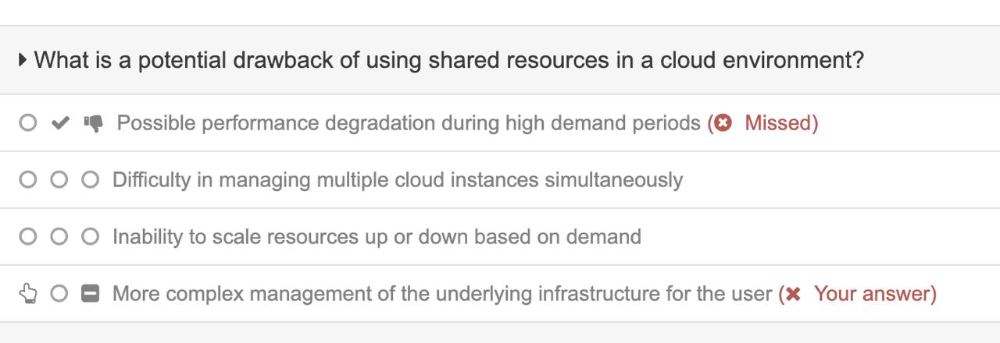

**题干：** What is a potential drawback of using shared resources in a cloud environment?

|  |  |
| --- | --- |
| ❌ 我的答案 | More complex management of the underlying infrastructure for the user |
| ✅ 正确答案 | Possible performance degradation during high demand periods |

### 为什么答案是这个
Cloud 里的 **shared resources（共享资源）** 意味着：
- 多个用户/租户共用同一批底层资源
- 在高峰时段，大家都在抢资源

所以一个典型缺点就是：
> **高需求时期可能出现性能下降**

比如：
- 响应变慢
- 资源争抢
- 吞吐下降
- 延迟升高

### 为什么你选的那个不对
你选的是：
> **More complex management of the underlying infrastructure for the user**

这其实更像是反过来的。
因为 cloud 的一个优点恰恰是：
- 用户通常**不用**自己复杂地管理底层基础设施
- 底层很多管理工作是 provider 负责的

所以它不是“shared resources”的典型 drawback。

### 其他选项为什么不对
- **Difficulty in managing multiple cloud instances simultaneously**：更像运维管理问题，不是共享资源本身的直接缺点
- **Inability to scale resources up or down based on demand**：这反而违背 cloud 的典型优势，cloud 通常就是强调弹性伸缩

### 最简单记忆
看到：
- **shared resources**
- **cloud environment**

优先想到的缺点就是：
### **高峰期可能性能下降**

**一句话：**
共享资源最大的隐患不是你来管理底层，而是大家一起用时，可能在高峰期互相抢资源导致性能变差。
---

## Dedicated resources 和 shared resources 刚好相反
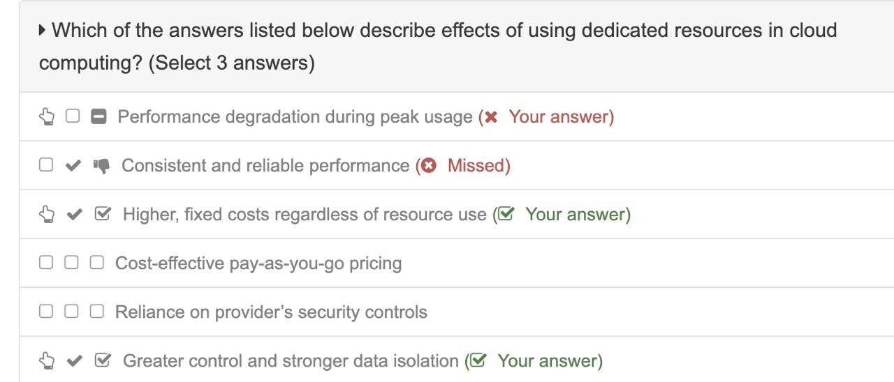

**题干：** Which of the answers listed below describe effects of using dedicated resources in cloud computing? (Select 3 answers)

**正确答案：**
- **Consistent and reliable performance**
- **Higher, fixed costs regardless of resource use**
- **Greater control and stronger data isolation**

### 这题和前一题的关系
对，你这题和前面那道 **shared resources** 的题，核心上就是：
## **刚好反着记**

### Shared resources 常见缺点
- 高峰期可能性能下降
- 多租户抢资源
- 隔离感较弱一些

### Dedicated resources 常见特点
- 性能更稳定
- 隔离更强
- 但成本更高，而且往往更固定

### 为什么这三个是对的
#### 1. Consistent and reliable performance
- dedicated resources = 资源不跟别人抢
- 所以更容易得到稳定、可预测的性能
- 这正好和 shared resources 的“高峰期可能性能下降”相反

#### 2. Higher, fixed costs regardless of resource use
- 专属资源意味着你为这批资源长期买单
- 即使没用满，也要承担更高、更固定的成本
- 所以它不像 pay-as-you-go 那样灵活省钱

#### 3. Greater control and stronger data isolation
- dedicated resources 通常意味着：
  - 更少租户共享
  - 更强隔离
  - 更多控制权
- 对安全和合规场景往往更有吸引力

### 为什么你错选的 Performance degradation during peak usage 不对
- 这个更像 **shared resources** 的典型问题
- 不是 dedicated resources 的特点
- 你可以把这两个题配在一起记：
  - **shared** → 高峰期可能掉性能
  - **dedicated** → 性能更稳定

### 最简单记忆
- **Shared** → 便宜/灵活，但高峰期可能被抢资源
- **Dedicated** → 贵一些，但更稳、更可控、更隔离

**一句话：**
这题和前一题可以成对记：
### **shared 看性能下降，dedicated 看性能稳定 + 隔离更强 + 成本更高。**
---

## 换盘也救不回来的 RAID：RAID 0
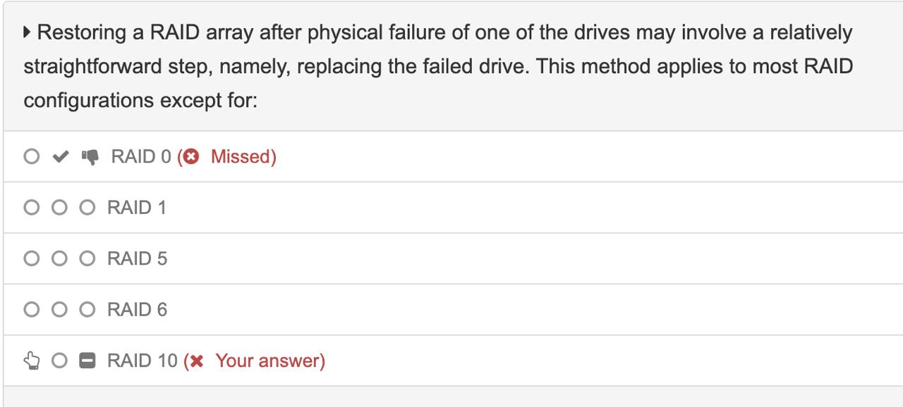

**题干：** In all the RAID levels listed below, restoring a RAID array after physical failure of one of the drives may involve a relatively straightforward step, namely, replacing the failed drive, except for:

|  |  |
| --- | --- |
| ❌ 我的答案 | RAID 10 |
| ✅ 正确答案 | RAID 0 |

### 这题在考什么
题目其实是在问：
> **哪一种 RAID 在坏掉一块盘之后，不能靠“换一块新盘”来恢复阵列？**

答案就是：
### **RAID 0**

### 为什么 RAID 0 是对的
因为 RAID 0：
- 只有 **striping（条带化）**
- **没有镜像**
- **没有 parity**
- **没有冗余**

所以一旦一块盘坏了：
## 整个阵列数据通常就直接没了

这时你不是简单“换盘”就能 rebuild 回来，
因为它根本没有冗余信息可用。

### 为什么 RAID 10 不对
你这题容易错在：
- 感觉 RAID 10 更复杂
- 直觉以为复杂结构更难恢复

但 RAID 10 本质上有：
- **镜像（RAID 1）**
- 再加条带（RAID 0）

所以它是有冗余的，
坏一块盘后通常可以：
- 换盘
- 让阵列重建

### 顺手对比
- **RAID 0** → 只要性能，不要保护
- **RAID 1** → 镜像，可换盘恢复
- **RAID 5** → 有 parity，可换盘恢复
- **RAID 6** → 双 parity，可换盘恢复
- **RAID 10** → 有镜像，可换盘恢复

### 最简单记忆
## RAID 0 = 0 容错
看到：
- **坏盘**
- **能不能换盘重建**

第一反应就记：
### **RAID 0 不行**

**一句话：**
RAID 0 只提供性能，不提供冗余；一块盘坏掉后，不能像其他冗余 RAID 那样通过换盘重建恢复。
---

## RAID 文件损坏先查硬盘健康：看 S.M.A.R.T. 数据
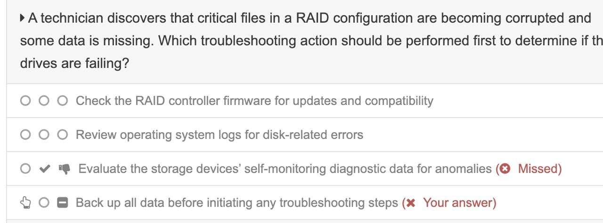

**题干：** A technician discovers that critical files in a RAID configuration are becoming corrupted and some data is missing. Which troubleshooting action should be performed first to determine if the drives are failing?

|  |  |
| --- | --- |
| ❌ 我的答案 | Back up all data before initiating any troubleshooting steps |
| ✅ 正确答案 | Evaluate the storage devices' self-monitoring diagnostic data for anomalies |

### 这题在考什么
题目不是在问：
> **最安全的总体做法是什么？**

而是在问：
> **为了先判断硬盘是不是正在坏掉，第一步该做什么？**

所以关键词是：
### **to determine if the drives are failing**

### 为什么答案是看 S.M.A.R.T. / self-monitoring diagnostic data
如果你想先确认硬盘是不是出问题，最直接的第一步就是：
- 看硬盘的健康监控信息
- 看有没有异常指标
- 看有没有 impending failure 的迹象

也就是：
> **Evaluate the storage devices' self-monitoring diagnostic data for anomalies**

这实际上就是在看：
### **S.M.A.R.T. 数据**

### 为什么你选的 backup 不是这题答案
你选的：
> **Back up all data before initiating any troubleshooting steps**

这个思路在现实里其实不算错，
甚至从风险角度说很合理。 
但这题考的是：
- **哪一步最先用来判断 drives are failing**

也就是说它要的是：
### **诊断动作**
不是：
### **风险控制动作**

所以这题标准答案不会选 backup。

### 其他选项为什么不是第一步
- **Review operating system logs**：也有帮助，但不如直接看硬盘自监控数据更直接
- **Check RAID controller firmware**：更偏后续排查，不是判断 drive failure 的首选第一步

### 最简单记忆
看到：
- **drives are failing?**
- **first troubleshooting action**

第一反应就记：
### **先看 S.M.A.R.T. / self-monitoring diagnostics**

**一句话：**
如果题目是在问“先怎么判断盘是不是快坏了”，标准答案通常是先看硬盘自监控诊断数据，而不是先做 backup。
---

## 电脑啪一声后关机：优先想到 blown capacitor
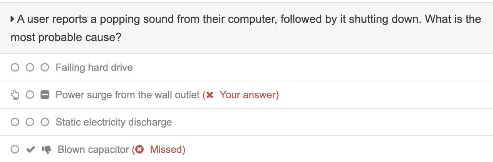

**题干：** A user reports a popping sound from their computer, followed by it shutting down. What is the most probable cause?

|  |  |
| --- | --- |
| ❌ 我的答案 | Power surge from the wall outlet |
| ✅ 正确答案 | Blown capacitor |

### 为什么答案是 blown capacitor
题目关键词非常典型：
- **popping sound**
- **followed by it shutting down**

这很像电子元件（尤其电容）损坏时的表现。
### **Blown capacitor（爆掉的电容）**
可能会：
- 发出“啪”一声
- 冒味道或轻微爆裂声
- 之后导致系统立即断电或关机

### 为什么不是 power surge from the wall outlet
- 墙上电源浪涌当然也可能损坏设备
- 但题目问的是：
  > **most probable cause**
- 这里给出的“啪一声 + 立刻关机”更像是机器内部元件本身炸掉，尤其是电容

### 为什么另外两个更不对
- **Failing hard drive**：硬盘坏通常不会表现成“啪一声然后整机断电”
- **Static electricity discharge**：静电更偏瞬间放电风险，不是这种典型设备内部爆裂故障描述

### 最简单记忆
看到：
- **popping sound**
- **computer shuts down**

优先想到：
### **blown capacitor**

**一句话：**
电脑内部“啪”一声后马上关机，考试里最典型的答案就是 **blown capacitor**。
---

## 过热最直接的典型结果：Random system shutdowns
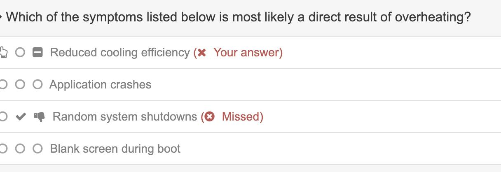

**题干：** Which of the symptoms listed below is most likely a direct result of overheating?

|  |  |
| --- | --- |
| ❌ 我的答案 | Reduced cooling efficiency |
| ✅ 正确答案 | Random system shutdowns |

### 为什么答案是 Random system shutdowns
过热最典型、最直接的系统级表现之一就是：
- **突然关机**
- **随机重启/掉电**
- 保护性断电

因为系统为了防止 CPU / GPU / 主板继续受损，
温度过高时可能会触发：
### **thermal protection**
于是就出现：
### **random system shutdowns**

### 为什么你选的 Reduced cooling efficiency 不对
这个很容易混，因为：
- **reduced cooling efficiency** 更像是“导致过热的原因”
- 不是“过热造成的直接症状”

也就是说：
- 散热效率下降 → 会导致过热
- 过热之后 → 更直接看到的是随机关机、卡顿、降频、崩溃

### 其他选项为什么不如 shutdown 典型
- **Application crashes**：也可能出现，但不如随机关机更直接、更典型
- **Blank screen during boot**：更偏硬件/显示/启动问题，不是过热的首选标准答案

### 最简单记忆
- **Cooling efficiency reduced** = 过热的原因
- **Random shutdowns** = 过热的直接后果

**一句话：**
这题关键是分清“原因”和“结果”：散热差会导致过热，但过热最直接的典型结果是 **random system shutdowns**。
---

## 显示器画面发暗：先查亮度/节能/线缆
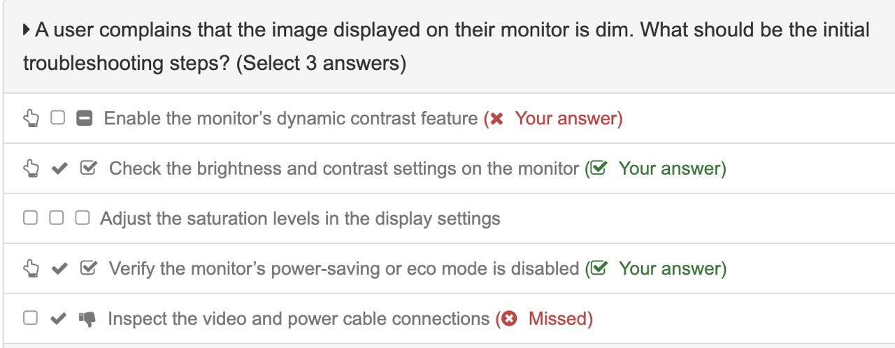

**题干：** A user complains that the image displayed on their monitor is dim. What should be the initial troubleshooting steps? (Select 3 answers)

**正确答案：**
- **Check the brightness and contrast settings on the monitor**
- **Verify the monitor's power-saving or eco mode is disabled**
- **Inspect the video and power cable connections**

### 这题在考什么
题目问的是：
> **initial troubleshooting steps**

也就是：
### 先做最基础、最直接、最常见的检查

### 为什么这三个是对的
#### 1. Check the brightness and contrast settings
- 画面发暗时，最先就该看亮度/对比度
- 这是最直接的显示设置问题

#### 2. Verify eco mode / power-saving is disabled
- 很多显示器开了节能模式后会明显变暗
- 所以这也是初步排查里很典型的一步

#### 3. Inspect the video and power cable connections
- 线缆松动、供电异常、视频连接问题
- 也可能造成显示异常、亮度异常、信号表现不稳定
- 这也是考试里典型的 first-step 检查动作

### 为什么你选的 dynamic contrast 不对
- **dynamic contrast** 更像某种增强/优化功能
- 不是“画面发暗时最基础的初步排查步骤”
- 考试这里更看重基础 troubleshooting 逻辑，而不是打开额外增强功能

### 为什么 saturation 也不对
- **saturation（饱和度）** 影响的是颜色鲜艳程度
- 不直接对应“整体变暗”的核心问题
- 所以不是首选排查项

### 最简单记忆
显示器发暗先查三件事：
- **亮度/对比度**
- **节能模式**
- **线缆连接**

不要先去想：
- 动态对比增强
- 饱和度微调

**一句话：**
monitor dim 题先走最基础排查：亮度、eco mode、线缆连接，而不是先开高级画质功能。
---

## 笔记本声音没走外接显示器：先查默认音频设备 + 显示器是否支持音频
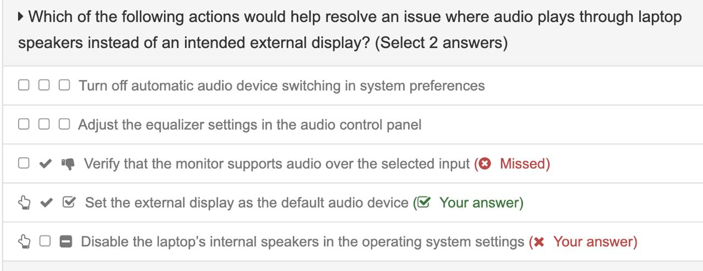

**题干：** Which of the following actions would help resolve an issue where audio plays through laptop speakers instead of an intended external display? (Select 2 answers)

**正确答案：**
- **Verify that the monitor supports audio over the selected input**
- **Set the external display as the default audio device**

### 为什么这两个是对的
#### 1. Verify that the monitor supports audio over the selected input
这题最容易漏掉的点就在这里：
- 不是所有显示器都支持音频输出
- 就算支持，也不一定每种输入方式都支持音频

例如：
- HDMI 通常可以同时传音频和视频
- DisplayPort 也常常支持音频
- 但某些转接器、某些接口模式、某些显示器本身可能不支持

所以第一步就要确认：
> **这个显示器在当前选用的输入接口下，到底支不支持音频**

#### 2. Set the external display as the default audio device
即使外接显示器支持音频，系统也可能默认还在走：
- laptop speakers
- internal audio device

所以必须把：
> **外接显示器/外接音频设备设成默认输出设备**

### 为什么 Disable the laptop’s internal speakers 不对
- 这个做法太粗暴
- 也不是标准 troubleshooting 的首选
- 你真正要做的是把正确输出设备设为 default，而不是先把内建喇叭禁掉

### 为什么另外两个不对
- **Turn off automatic audio device switching**：不是这个场景最核心的解决动作
- **Adjust the equalizer settings**：均衡器不会解决“声音走错设备”的问题

### 最简单记忆
外接显示器没出声时，先查两件事：
- **显示器/接口支不支持音频**
- **它是不是默认音频输出设备**

**一句话：**
这题关键不是禁用笔记本喇叭，而是确认外接显示器有音频能力，并把它设为默认音频输出。
---

## 洗白/色彩不对不等于亮度问题
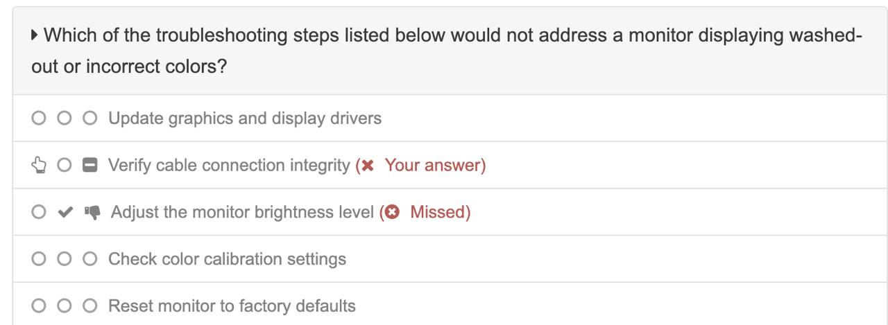

**题干：** Which of the troubleshooting steps listed below would **not** address a monitor displaying washed-out or incorrect colors?

|  |  |
| --- | --- |
| ❌ 我的答案 | Verify cable connection integrity |
| ✅ 正确答案 | Adjust the monitor brightness level |

### 这题为什么容易错
因为“washed-out”看起来很像：
- 太亮
- 发白
- 颜色淡

所以很容易下意识想到：
### **调亮度**

但这题问的是：
> **哪一个步骤不会真正解决 washed-out 或颜色错误的问题**

### 为什么答案是 Adjust the monitor brightness level
- **亮度（brightness）** 主要影响的是明暗程度
- 但题目重点是：
  - **washed-out colors**
  - **incorrect colors**
- 这更偏向：
  - 颜色校准问题
  - 显示配置问题
  - 线缆/信号问题
  - 驱动/输出问题

所以调亮度并不是处理“颜色不对”的核心步骤。

### 为什么 Verify cable connection integrity 反而是合理排查
你这题错在把它排除了。
但实际上：
- 视频线缆接触不良
- 接口松动
- 传输异常
都可能导致：
  - 颜色偏差
  - 色彩异常
  - 显示不正常

所以检查线缆完整性，反而是很合理的 troubleshooting step。

### 其他正确方向为什么能帮助
- **Update graphics and display drivers** → 可能修复输出/色彩问题
- **Check color calibration settings** → 直接对准颜色问题
- **Reset monitor to factory defaults** → 排除显示器设置被改乱

### 最简单记忆
- **Brightness** → 主要管明暗
- **Color calibration / cable / driver** → 更直接管颜色异常

**一句话：**
这题关键是分清“亮不亮”和“颜色对不对”不是同一件事；washed-out 或 incorrect colors 更该查校色、驱动和线缆，不是先调 brightness。
---

## 黑色死点（dead pixel）题：None of the above
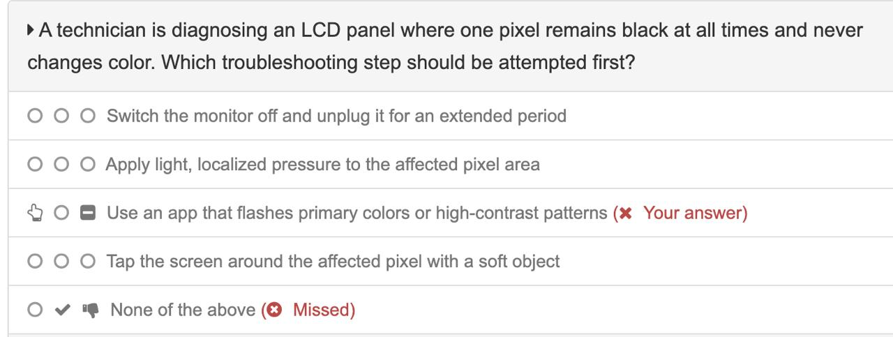

**题干：** A technician is diagnosing an LCD panel where one pixel remains black at all times and never changes color. Which troubleshooting step should be attempted first?

|  |  |
| --- | --- |
| ❌ 我的答案 | Use an app that flashes primary colors or high-contrast patterns |
| ✅ 正确答案 | None of the above |

### 这题为什么容易错
因为很多人会把：
- **stuck pixel（卡住的像素）**
和
- **dead pixel（坏掉的像素）**
混在一起。

题目这里明确说的是：
> **one pixel remains black at all times and never changes color**

这更像：
## **dead pixel**
也就是：
- 像素已经坏了
- 不响应
- 不会再亮

### 为什么 flashing app 不对
你选的：
> **Use an app that flashes primary colors or high-contrast patterns**

这种方法有时是拿来尝试修：
### **stuck pixel**
也就是像素卡在某个颜色上，还不是完全坏死。

但题目这里是：
- 一直黑
- 从不变色

这种更像硬件层面的死点，
所以这类方法通常没用。

### 为什么其他三个也不对
- **Switch the monitor off and unplug it for an extended period**
- **Apply light, localized pressure to the affected pixel area**
- **Tap the screen around the affected pixel with a soft object**

这些都更像民间偏方 / 针对 stuck pixel 的尝试，
但对明确的 **dead black pixel** 不是标准可靠的 first troubleshooting step。

所以考试这里才给：
## **None of the above**

### 那现实中应该怎么处理
如果真的是：
### **dead pixel**
更现实的处理办法通常是：
- 确认是否在保修/厂商像素政策范围内
- 申请换屏 / 维修 / 更换显示器

也就是说：
## 不是“修像素”，而是“确认硬件缺陷并走更换/保修流程”

### 最简单记忆
- **stuck pixel** → 有时还能尝试软件闪烁/温和方法
- **dead pixel** → 通常修不回来，更偏硬件缺陷

**一句话：**
这题关键是分清：题目描述的是 **dead black pixel**，不是 stuck pixel，所以前面那些“修复像素”的招数都不是标准答案，正确是 **None of the above**。
---

## 会缩短 projector bulb 寿命的两种误用
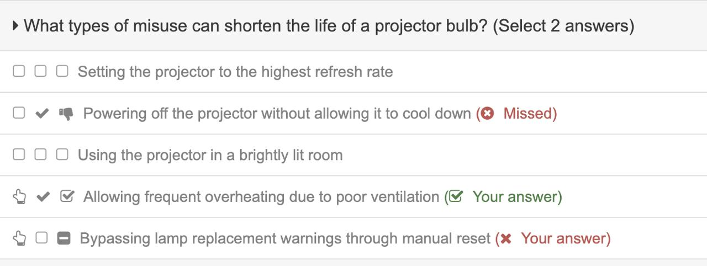

**题干：** What types of misuse can shorten the life of a projector bulb? (Select 2 answers)

**正确答案：**
- **Powering off the projector without allowing it to cool down**
- **Allowing frequent overheating due to poor ventilation**

### 为什么这两个是对的
#### 1. Powering off the projector without allowing it to cool down
投影机灯泡工作时温度很高。
如果你在它还很热的时候就粗暴断电，
会让：
- 散热流程被打断
- 灯泡热冲击更大
- 寿命明显缩短

这就是 projector 题里很经典的考点：
### **关机后要让它正常冷却**

#### 2. Allowing frequent overheating due to poor ventilation
如果通风差：
- 热量排不出去
- 灯泡长期高温工作
- 老化速度会明显加快

所以“过热 + 散热不好”一定是会伤灯泡寿命的。

### 为什么 bypassing lamp replacement warnings 不对
这个选项看起来很像对，
因为听起来像是在“硬撑着继续用”。

但题目问的是：
> **types of misuse can shorten the life of a projector bulb**

更直接缩短寿命的是：
- **热冲击**
- **长期过热**

而手动重置 lamp warning 更像：
- 忽略维护提示
- 继续使用老旧灯泡
- 有风险

但它不是这题最标准、最直接的两个“伤灯泡寿命”的 misuse。

### 其他选项为什么不对
- **Setting the projector to the highest refresh rate**：不是 projector bulb 寿命的核心因素
- **Using the projector in a brightly lit room**：影响观感，不是直接缩短 bulb life 的关键 misuse

### 最简单记忆
 projector bulb 最怕两件事：
- **没冷却就断电**
- **长期过热 / 通风差**

**一句话：**
投影机灯泡寿命最怕热管理做不好：要么没冷却完就断电，要么散热差长期过热。
---

## Burnt-out projector bulb 最常见症状：开机但没图像
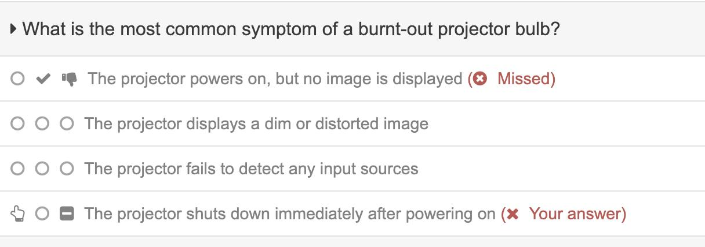

**题干：** What is the most common symptom of a burnt-out projector bulb?

|  |  |
| --- | --- |
| ❌ 我的答案 | The projector shuts down immediately after powering on |
| ✅ 正确答案 | The projector powers on, but no image is displayed |

### 为什么答案是这个
投影机灯泡如果已经 **burnt out（烧坏）**，最典型的结果就是：
- 机器本身还能通电
- 风扇、指示灯、系统可能还能启动
- 但因为没有可用光源，
### **画面不会被投出来**

所以最常见症状是：
> **The projector powers on, but no image is displayed**

### 为什么你选的“开机后马上关机”不对
- 这个现象更像：
  - 过热保护
  - 电源问题
  - 内部硬件故障
  - 风扇/散热异常
- 不是 projector bulb 烧掉后最典型、最标准的第一症状

### 为什么 dim or distorted image 不是最佳答案
- 画面变暗、失真，确实可能表示灯泡老化
- 但题目问的是：
  > **burnt-out bulb**
- “烧坏”比“老化”更严重，
  所以更典型的结果是：
  ## **直接没有图像**

### 其他选项为什么不对
- **Fails to detect input sources**：更像输入源/接口/信号问题，不是 bulb 的典型故障表现

### 最简单记忆
- **Lamp aging** → 画面变暗
- **Lamp burnt out** → 开机但没图像

**一句话：**
投影机灯泡彻底烧坏时，最典型的是机器还能开，但没有图像可投，不是立刻整机关机。
---

## RAID 发出告警声常见含义：Drive failure + Array degradation
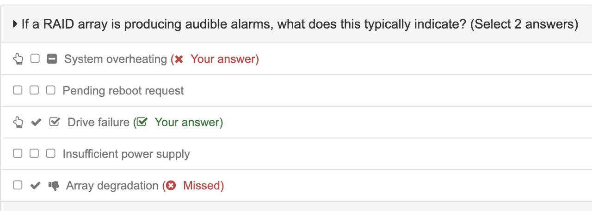

**题干：** If a RAID array is producing audible alarms, what does this typically indicate? (Select 2 answers)

**正确答案：**
- **Drive failure**
- **Array degradation**

### 为什么这两个是对的
RAID 控制器或 RAID 阵列发出 **audible alarms（蜂鸣/报警声）**，
最常见的含义通常是：
- 某块盘出问题了
- 阵列已经不是健康完整状态了

#### 1. Drive failure
- 这是 RAID 告警里最经典的原因之一
- 某块硬盘坏了、掉线、异常
- 阵列会发出声音提醒管理员尽快处理

#### 2. Array degradation
- 即使阵列还没完全挂掉，只要已经失去冗余、进入 degraded 状态
- 很多 RAID 控制器也会报警
- 所以这也是标准答案

### 为什么 system overheating 不对
- 系统过热当然也可能触发某些设备报警
- 但题目明确是在问：
  > **RAID array is producing audible alarms**
- RAID 题里最典型的答案还是：
  - drive failure
  - array degradation
- 不是优先想到整机过热

### 为什么其他选项不对
- **Pending reboot request**：不是 RAID 告警的典型含义
- **Insufficient power supply**：可能引发硬件问题，但不是 RAID 阵列报警最标准的直接含义

### 最简单记忆
看到：
- **RAID audible alarm**

优先想到：
- **盘坏了**
- **阵列 degraded 了**

**一句话：**
RAID 一响，先想盘故障和阵列降级，不要先想到系统过热。
---

## 手机 persistent malware 最稳的清除方式：Factory reset
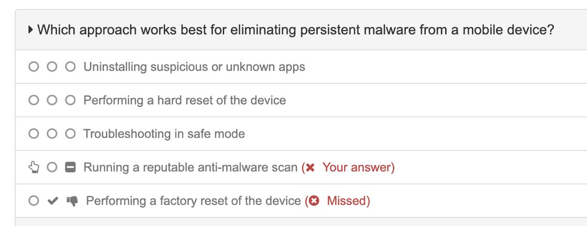

**题干：** Which approach works best for eliminating persistent malware from a mobile device?

|  |  |
| --- | --- |
| ❌ 我的答案 | Running a reputable anti-malware scan |
| ✅ 正确答案 | Performing a factory reset of the device |

### 为什么答案是 factory reset
题目里的关键词是：
### **persistent malware**
也就是：
- 顽固恶意软件
- 一直残留
- 不容易被普通清理方式干掉

这时候最稳、最彻底的做法通常就是：
## **factory reset（恢复出厂设置）**

因为它会：
- 清掉用户空间里的大部分恶意软件
- 把设备恢复到初始状态
- 比单纯扫描/卸载更彻底

### 为什么 anti-malware scan 不对
你选的：
- **Running a reputable anti-malware scan**

这个不是完全没用，
但它更像是：
- 初步检查
- 尝试清理
- 一般性处理

题目问的是：
> **works best for eliminating persistent malware**

也就是说，要选**最有效、最彻底**的方案。 
所以标准答案不会是扫描，而是：
### **factory reset**

### 为什么 hard reset 不是答案
这个题里容易混：
- **hard reset**
- **factory reset**

在很多考试语境里：
- **hard reset** 更像强制重启/硬重启
- **factory reset** 才是恢复出厂设置、真正清除数据和配置

所以这里必须选：
### **factory reset**

### 最简单记忆
- **scan** → 尝试查杀
- **safe mode** → 辅助排查
- **uninstall app** → 针对明显来源
- **factory reset** → 对 persistent malware 最彻底

**一句话：**
如果题目强调的是 **persistent malware**，考试里最稳的标准答案通常就是 **factory reset**。
---

## 平板摔后局部触控失灵：先 power cycle
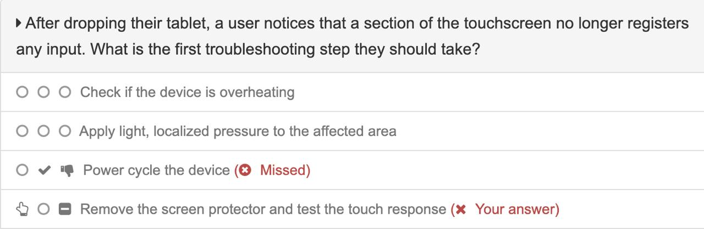

**题干：** After dropping their tablet, a user notices that a section of the touchscreen no longer registers any input. What is the first troubleshooting step they should take?

|  |  |
| --- | --- |
| ❌ 我的答案 | Remove the screen protector and test the touch response |
| ✅ 正确答案 | Power cycle the device |

### 为什么答案是 Power cycle the device
这题考的是：
### **first troubleshooting step**

即使题目里提到是“摔过”，考试逻辑通常还是先从：
- 最基础
- 最低风险
- 最简单
的步骤开始

所以第一步先：
## **重启设备 / power cycle**

因为有时触控失灵不一定完全是物理损坏，
也可能是：
- 临时触控驱动异常
- 系统卡住
- 触控服务出问题

先重启是标准起手式。

### 为什么你选的 screen protector 不对
你选的：
- **Remove the screen protector and test the touch response**

这个不是完全不合理，
因为保护膜确实可能影响触控。 
但题目重点是：
> **first troubleshooting step**

考试会优先选：
### **power cycle**
而不是一上来就去拆贴膜或动外部配件。

### 其他选项为什么不对
- **Check if the device is overheating**：和“摔后局部触控失灵”不够直接相关
- **Apply light, localized pressure to the affected area**：风险更高，也不是标准 first step

### 最简单记忆
题目只要问：
- **first troubleshooting step**

先想：
- **重启 / 重新上电 / power cycle**

如果题目后面再问下一步，
才去排查：
- 屏幕保护膜
- 物理损伤
- digitizer 问题

**一句话：**
这题关键不是你选项完全离谱，而是考试特别强调 **first step** —— 先 power cycle，再考虑更具体的物理排查。
---

## 降低 digitizer 问题风险：保护设备，不是加厚贴膜
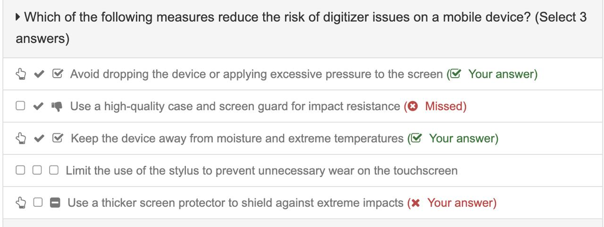

**题干：** Which of the following measures reduce the risk of digitizer issues on a mobile device? (Select 3 answers)

**正确答案：**
- **Avoid dropping the device or applying excessive pressure to the screen**
- **Use a high-quality case and screen guard for impact resistance**
- **Keep the device away from moisture and extreme temperatures**

### 你这题错在哪里
你前两个正确点其实已经抓到了：
- 不要摔、不压屏幕
- 远离潮湿和极端温度

你错在把：
- **Use a thicker screen protector to shield against extreme impacts**
选进去了
而漏掉了：
- **Use a high-quality case and screen guard for impact resistance**

### 为什么“high-quality case and screen guard”是对的
digitizer 问题很多和：
- 跌落
- 冲击
- 挤压
- 外部损伤
有关

所以正确的预防思路是：
### **整体保护设备**
也就是：
- 用靠谱的保护壳
- 配合合适的屏幕保护方案

这比“单纯变厚”更合理，也更符合考试标准答案。

### 为什么“thicker screen protector”不对
这个选项很迷惑人，因为听起来像：
> 更厚 = 更安全

但考试这里不认可这种说法，原因是：
- “更厚”不等于更好
- 过厚保护膜反而可能影响触控体验
- 也不是 digitizer protection 的标准表述

题目更接受的是：
### **high-quality case + screen guard**
而不是：
### **thicker protector**

### 为什么另外两个正确选项成立
#### 1. Avoid dropping / excessive pressure
- digitizer 很怕冲击和挤压
- 这是最直接的预防措施

#### 2. Keep away from moisture and extreme temperatures
- 湿气、温度异常会影响触控层和设备稳定性
- 也会增加故障风险

### 为什么 stylus 那项不是答案
- 正常使用 stylus 并不是导致 digitizer 问题的核心风险
- 题目更关注的是：
  - 冲击
  - 环境损伤
  - 物理防护

### 最简单记忆
digitizer 预防就记三件事：
- **别摔别压**
- **用好壳 + 屏幕保护**
- **远离潮湿和极端温度**

**一句话：**
这题关键不是“贴更厚的膜”，而是用更合理的整体防护方案：高质量保护壳 + 屏幕保护，并避免冲击和恶劣环境。
---

## 手机进水后别漏掉：取出 SIM 卡和存储卡
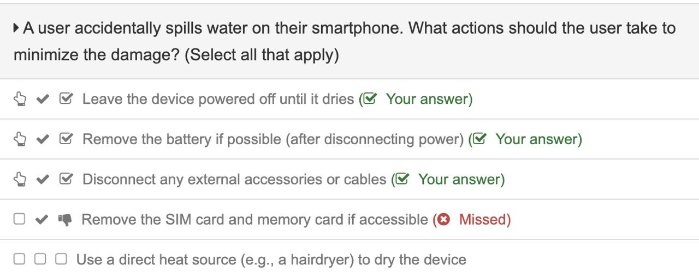

**题干：** A user accidentally spills water on their smartphone. What actions should the user take to minimize the damage? (Select all that apply)

**正确答案：**
- **Leave the device powered off until it dries**
- **Remove the battery if possible (after disconnecting power)**
- **Disconnect any external accessories or cables**
- **Remove the SIM card and memory card if accessible**

### 你这题其实做得已经很好
你前面三项都答对了：
- 保持关机直到干燥
- 能拆电池就拆电池
- 断开外部配件和线缆

你唯一漏掉的是：
### **Remove the SIM card and memory card if accessible**

### 为什么这个也要做
手机进水后，除了保护主板和供电，
还要尽量：
- 减少接口/卡槽处残留水分
- 保护 SIM 卡和存储卡本身
- 让设备更容易彻底干燥

所以如果能安全取出：
- **SIM 卡**
- **memory card**

也属于标准的减损步骤。

### 为什么吹风机不对
题目里那个错误选项：
- **Use a direct heat source (e.g., a hairdryer)**

这个不推荐，因为：
- 热风可能把水分吹到更深处
- 可能导致元件受热损伤
- 不是标准安全做法

### 最简单记忆
手机进水先做四件事：
- **断电 / 不要开机**
- **拆掉可拆电池**
- **拔掉线缆和配件**
- **能拿出来的卡（SIM / memory card）先拿出来**

**一句话：**
你这题差一点点，核心补充就是：手机进水后，别忘了把可取出的 **SIM 卡和存储卡** 也拿出来，减少损伤并帮助干燥。
---

## 手机 Wi‑Fi 断连先重置 Wi‑Fi adapter，不是先整机硬重启
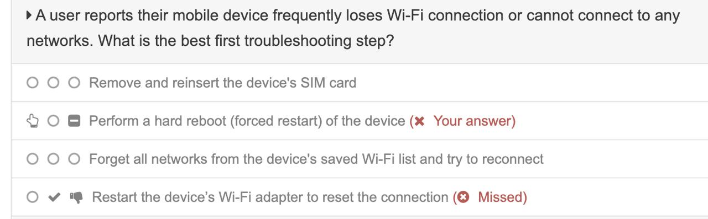

**题干：** A user reports their mobile device frequently loses Wi-Fi connection or cannot connect to any networks. What is the best first troubleshooting step?

|  |  |
| --- | --- |
| ❌ 我的答案 | Perform a hard reboot (forced restart) of the device |
| ✅ 正确答案 | Restart the device’s Wi‑Fi adapter to reset the connection |

### 为什么答案是重启 Wi‑Fi adapter
题目问的是：
### **best first troubleshooting step**

而故障点很明确：
- **Wi‑Fi connection**
- **cannot connect to any networks**

所以最直接、最有针对性的 first step 应该是：
## **先重置 Wi‑Fi 本身**
也就是：
- 关掉再打开 Wi‑Fi
- 重启 Wi‑Fi adapter
- 刷新无线连接状态

### 为什么整机 hard reboot 不是最佳答案
你选的：
- **Perform a hard reboot**

这个不是完全不能做，
但它范围更大、更笼统。
考试这里更偏好：
### **先做最贴近问题本身的最小排查动作**

问题是 Wi‑Fi，
那就先动：
### **Wi‑Fi adapter**
而不是一上来先整机强制重启。

### 为什么其他选项不对
- **Remove and reinsert the SIM card**：SIM 卡和 Wi‑Fi 故障不直接相关
- **Forget all networks and try to reconnect**：这通常是后续步骤，不如先重置 Wi‑Fi adapter 更基础

### 最简单记忆
题目如果是：
- **某个特定功能失灵**
- 又问 **best first step**

先想：
### **先重置那个功能本身**

所以：
- Wi‑Fi 出问题 → 先重启 Wi‑Fi
- 蓝牙出问题 → 先重启蓝牙
- 不是先整机硬重启

**一句话：**
这题关键是“先局部重置，再全局重启”：Wi‑Fi 有问题，考试里最标准的第一步是先重置 Wi‑Fi adapter。
---

## 现代手机电池别老是完全放空再充满
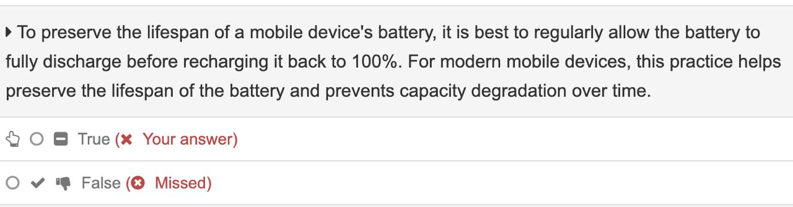

**题干：** Why is the following statement incorrect? “To keep the battery in good condition, it is best to regularly allow it to fully discharge before recharging it back to 100%, as this practice helps preserve the lifespan of modern mobile device batteries.”

### 为什么这段话是错的
这段话把：
- **老式电池时代的习惯**
错误地套到了：
- **现代移动设备常见的锂电池**
上。

现代手机/平板最常见的是：
- **Lithium-ion (Li-ion)**
- **Lithium-polymer (Li-polymer)**

这类电池通常：
## **不喜欢频繁深度放电**

也就是说：
- 不应该经常故意用到 0%
- 再从 0% 充回 100%
- 这种做法并不会“保养寿命”
- 反而可能增加电池压力

### 为什么很多人会误会
这个误区很多来自以前的：
- **NiCd（镍镉）电池**
- 以及“memory effect（记忆效应）”的旧观念

但现代锂电池并不适用这套逻辑。

### 现代电池更合理的使用思路
考试里不用死背具体百分比，
但大方向要记住：
- **不用刻意完全放空**
- **随用随充通常没问题**
- **尽量避免长期极端状态（比如长期 0% 或长期高温满电）**

### 最简单记忆
- **老观念**：用到没电再充
- **现代锂电池**：别老是完全放空

**一句话：**
这题错在把“完全放空再充满”当成现代手机电池保养原则；但对今天常见的锂电池来说，频繁深度放电并不会延长寿命，反而更伤电池。
---

## 随机花屏和彩色闪烁像素：先想 GPU 过热或故障
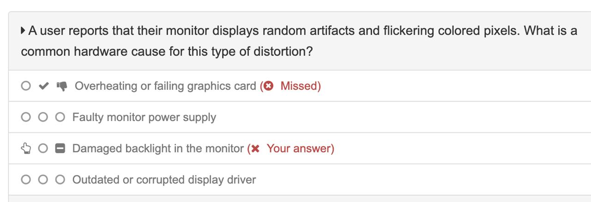

**题干：** A user reports that their monitor displays random artifacts and flickering colored pixels. What is a common hardware cause for this type of distortion?

|  |  |
| --- | --- |
| ❌ 我的答案 | Damaged backlight in the monitor |
| ✅ 正确答案 | Overheating or failing graphics card |

### 为什么答案是 failing / overheating graphics card
题目里的关键词：
- **random artifacts**
- **flickering colored pixels**

这非常像：
## **GPU / graphics card 输出异常**

常见原因包括：
- 显卡过热
- 显卡显存出问题
- GPU 本身故障
- 显卡老化

这些都会导致：
- 花屏
- 彩色噪点
- 闪烁像素
- 图像失真

### 为什么 damaged backlight 不对
**背光（backlight）** 出问题更常见的现象是：
- 画面变暗
- 屏幕局部发黑
- 亮度不均
- 背光闪烁

但它通常不会导致这种：
### **随机彩色像素 / artifacts / 花屏**

这种更像是视频信号或 GPU 渲染输出问题，
不是单纯背光照明问题。

### 为什么驱动不是最佳答案
- **Outdated or corrupted display driver** 也可能导致显示异常
- 但题目问的是：
  > **common hardware cause**
- 所以这里更应该优先选硬件层面的：
### **graphics card**

### 最简单记忆
- **Backlight 问题** → 暗、黑、亮度异常
- **GPU 问题** → 花屏、彩点、随机 artifacts

**一句话：**
看到随机花屏和彩色闪烁像素，优先想到显卡过热或故障，而不是显示器背光坏掉。
---

## 画面比屏幕小、四周黑边：先查 native resolution 和显示器缩放
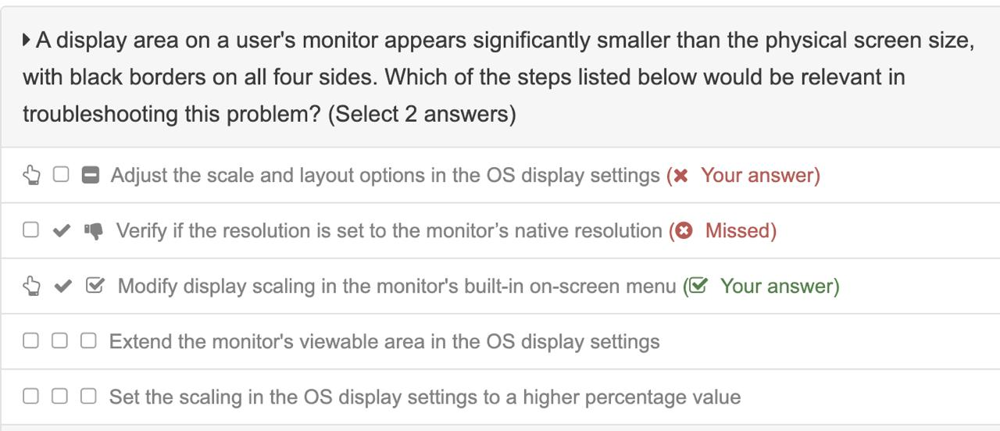

**题干：** A display area on a user's monitor appears significantly smaller than the physical screen size, with black borders on all four sides. Which of the steps listed below would be relevant in troubleshooting this problem? (Select 2 answers)

**正确答案：**
- **Verify if the resolution is set to the monitor's native resolution**
- **Modify display scaling in the monitor's built-in on-screen menu**

### 为什么答案是这两个
题目描述的是：
- 画面明显比屏幕小
- 四边都有黑边

这类问题最常见的两个方向就是：
## 1. 分辨率不对
如果没有设到显示器的：
### **native resolution（原生分辨率）**
就可能出现：
- 图像缩在中间
- 黑边
- 不能铺满屏幕

所以先确认：
> **resolution 是否设为显示器原生分辨率**

## 2. 显示器自身的缩放/显示模式不对
有些显示器 OSD 菜单里会有：
- scaling
- aspect ratio
- display mode
- 1:1 / full / auto

如果这里设置不对，
也会出现：
- 四周黑边
- 图像没铺满

所以：
> **在显示器内建菜单中调整显示缩放**
也是标准答案。

### 为什么你选的 OS scale and layout 不对
你选的是：
- **Adjust the scale and layout options in the OS display settings**

这个容易错，因为 Windows/macOS 里的 scale（125%、150%）听起来像能把画面变大。
但它主要影响的是：
- UI 元素大小
- 字体大小
- 图标/界面缩放

它不等于解决：
### **画面没有正确填满物理屏幕**

所以这题更关键的是：
- **分辨率**
- **显示器自身缩放模式**
而不是 OS 的界面缩放比例。

### 为什么“set scaling to a higher percentage”更不对
这个更明显是在调 UI 放大比例，
不是在解决屏幕黑边 / 画面尺寸没铺满的问题。

### 最简单记忆
看到：
- **画面缩在中间**
- **四边黑边**

先查两个东西：
- **native resolution**
- **monitor OSD scaling / aspect setting**

**一句话：**
这题不是在考操作系统 UI 缩放，而是在考“分辨率是否原生”和“显示器自身缩放模式是否正确”。
---

## 花屏 + 颜色错位 + 文字锯齿：先查视频线，不是电源线
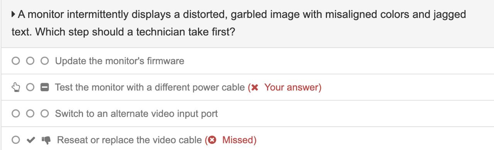

**题干：** A monitor intermittently displays a distorted, garbled image with misaligned colors and jagged text. Which step should a technician take first?

|  |  |
| --- | --- |
| ❌ 我的答案 | Test the monitor with a different power cable |
| ✅ 正确答案 | Reseat or replace the video cable |

### 为什么答案是 video cable
题目描述的是：
- **distorted / garbled image**
- **misaligned colors**
- **jagged text**
- 而且是 **intermittently**（间歇性）发生

这组症状最像的是：
## **视频信号传输有问题**
也就是：
- 视频线松动
- 视频线损坏
- 接口接触不良
- 信号链路不稳定

所以第一步最标准的排查就是：
### **Reseat or replace the video cable**

### 为什么 power cable 不对
你选的是：
- **Test the monitor with a different power cable**

电源线问题更常导致的是：
- 显示器断电
- 黑屏
- 完全不亮
- 闪断

但题目这里不是“没电”或“亮不起来”，
而是：
### **图像内容本身被扭曲、乱码、颜色错位**

这更像视频信号问题，不像供电问题。

### 为什么 alternate video input port 不是 first step
- 换另一个视频输入口当然也可能是后续排查步骤
- 但考试问的是：
  > **first**
- 更基础、更直接的第一步还是先：
  - 重新插紧视频线
  - 或直接换一根视频线

### 为什么 firmware 不是首选
- firmware 太靠后了
- 这种间歇性花屏、颜色错位，考试里先想物理连接和线缆
- 不会一上来先更新固件

### 最简单记忆
看到：
- **garbled image**
- **misaligned colors**
- **jagged text**
- **intermittent**

先想：
### **video cable / video signal path**

不要先想：
- power cable
- firmware

**一句话：**
这题关键是区分“供电问题”和“视频信号问题”：花屏、颜色错位、乱码文字更像视频线或视频信号链路异常，所以 first step 是先重插或更换视频线。
---

## VoIP 声音断断续续/失真：最常见是 jitter
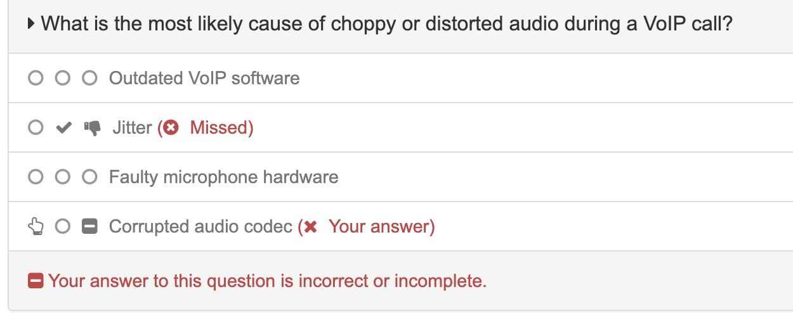

**题干：** What is the most likely cause of choppy or distorted audio during a VoIP call?

|  |  |
| --- | --- |
| ❌ 我的答案 | Corrupted audio codec |
| ✅ 正确答案 | Jitter |

### 为什么答案是 jitter
在 VoIP 通话里，**jitter** 指的是：
- 数据包到达时间不稳定
- 有的包快，有的包慢
- 音频流不均匀

这会直接导致：
- 声音断断续续
- 语音卡顿
- 音频失真
- 通话不流畅

所以题目里说的：
> **choppy or distorted audio during a VoIP call**
最典型先想到的就是：
### **jitter**

### 为什么 corrupted audio codec 不对
- codec 出问题当然也可能引发音频异常
- 但题目问的是：
  > **most likely cause**
- 在 VoIP 题里，最经典、最标准的网络型原因就是：
  - **latency**
  - **packet loss**
  - **jitter**

而“断断续续、失真”最常考的就是：
### **jitter**

### 顺手区分一下
- **Latency** → 延迟大，讲话有明显滞后
- **Jitter** → 包到达不均匀，声音断断续续、发抖、失真
- **Packet loss** → 丢字、声音缺块、突然听不清

### 最简单记忆
VoIP 题里：
- **jitter** → 声音卡、抖、断续
- **latency** → 延迟
- **packet loss** → 掉字/缺失

**一句话：**
VoIP 通话里如果声音断断续续、听起来失真，考试里最标准的答案通常是 **jitter**。
---

## VoIP 听到自己声音延迟回声：更像 high latency，不是 jitter
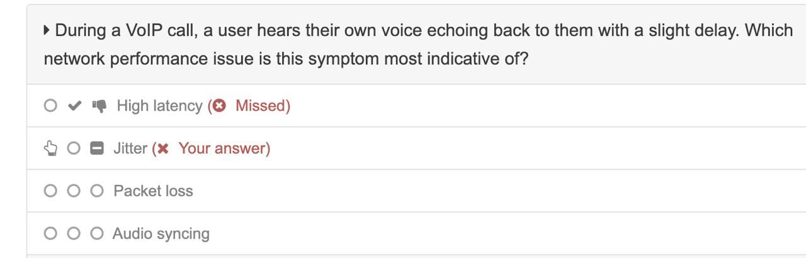

**题干：** During a VoIP call, a user hears their own voice echoing back to them with a slight delay. Which network performance issue is this symptom most indicative of?

|  |  |
| --- | --- |
| ❌ 我的答案 | Jitter |
| ✅ 正确答案 | High latency |

### 为什么答案是 high latency
题目关键词是：
- **hears their own voice echoing back**
- **with a slight delay**

这道题考的重点是：
## **延迟（latency）**

因为声音经过网络传输、再返回到自己耳朵里，如果延迟明显变大，
就会听到：
- 自己声音的回声
- 而且会“慢半拍”回来

所以这种：
### **echo + delay**
最标准先想到的是：
### **high latency**

### 为什么 jitter 不对
你前一题选 jitter 是对“声音断断续续、失真”那种描述。
但这题不一样，
它不是说：
- choppy
- broken
- stuttering

而是说：
- **echoing back**
- **slight delay**

这更像：
## **网络延迟过高**
不是包到达时间抖动不均匀。

### 顺手区分一下
- **High latency** → 声音延迟、对话有回声感、讲话对不上拍
- **Jitter** → 声音卡、抖、断续、不平滑
- **Packet loss** → 丢字、听不全、声音缺块

### 最简单记忆
VoIP 题里：
- **echo + delay** → **latency**
- **choppy / distorted** → **jitter**
- **cutting out / missing words** → **packet loss**

**一句话：**
这题和上一题要成对记：
### **回声+延迟看 latency；断续失真看 jitter。**
---

## Limited connectivity + 红叉：先查网卡状态和物理连接
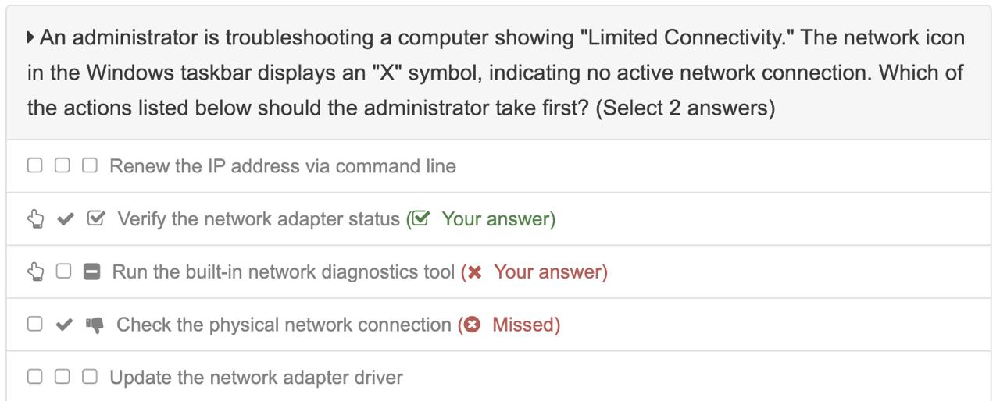

**题干：** An administrator is troubleshooting a computer showing "Limited Connectivity." The network icon in the Windows taskbar displays an "X" symbol, indicating no active network connection. Which of the actions listed below should the administrator take first? (Select 2 answers)

**正确答案：**
- **Verify the network adapter status**
- **Check the physical network connection**

### 为什么答案是这两个
题目给出的最关键线索是：
- **taskbar 显示 X symbol**
- **no active network connection**

这说明问题更偏向：
### **链路层 / 设备层 / 物理连接层**

所以 first steps 应该优先查：

#### 1. Verify the network adapter status
- 网卡有没有被禁用
- 网卡有没有正常识别
- 网卡状态是否异常

#### 2. Check the physical network connection
- 网线有没有插好
- 接口有没有松
- 物理链路是不是根本没起来

### 为什么 run network diagnostics 不是 first answer
你选的：
- **Run the built-in network diagnostics tool**

这个不能说完全没用，
但题目问的是：
### **should take first**

而当系统已经明确显示：
- **没有活动连接**
- **X symbol**

考试更偏向先做最基础的：
- 物理连接检查
- 网卡状态确认

而不是一上来先跑软件诊断工具。

### 为什么 renew IP address 不对
- 如果连路都没起来，
- 还没到 DHCP / IP 续租那一步
- 所以 `renew IP` 太靠后了

### 为什么 update driver 不是 first step
- 驱动问题当然可能存在
- 但它不是这种“完全没活动连接”场景下的首选起手步骤

### 最简单记忆
看到：
- **network icon 红叉 / X**
- **no active network connection**

先想：
- **网卡状态**
- **物理连接**

不是先想：
- IP 续租
- diagnostics
- driver

**一句话：**
红叉 + 没活动连接，先查“网卡有没有起来”和“网线有没有接好”，这是最标准的 first steps。
---

## 游戏高延迟/lag spikes：先想后台进程和带宽占用
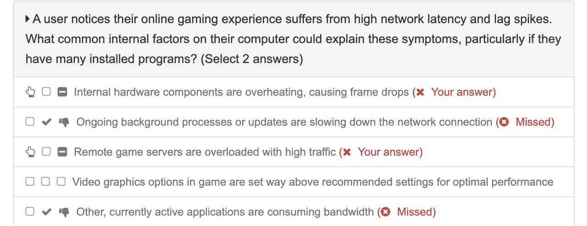

**题干：** A user notices their online gaming experience suffers from high network latency and lag spikes. What common internal factors on their computer could explain these symptoms, particularly if they have many installed programs? (Select 2 answers)

**正确答案：**
- **Ongoing background processes or updates are slowing down the network connection**
- **Other, currently active applications are consuming bandwidth**

### 这题为什么容易错
因为你看到：
- **lag spikes**
- **gaming performance**

很容易联想到：
- 过热
- 服务器问题
- 帧率下降

但题目真正的关键词是：
### **high network latency**
而且还特别提示：
### **particularly if they have many installed programs**

这就是在暗示：
- 后台程序多
- 更新服务多
- 同时运行的应用多
- 带宽被别的进程抢走了

### 为什么正确答案是这两个
#### 1. Ongoing background processes or updates are slowing down the network connection
很多安装的软件会在后台：
- 自动更新
- 同步数据
- 上传下载
- 检查服务

这些都会让网络变慢，造成：
- latency 升高
- lag spikes
- 游戏延迟不稳定

#### 2. Other, currently active applications are consuming bandwidth
比如：
- 浏览器下载
- 云同步
- 视频播放
- 后台更新器
- 其他联网应用

这些会直接吃掉带宽，导致在线游戏延迟变高。

### 为什么 overheating 不对
- 过热更容易导致：
  - 掉帧
  - 降频
  - 性能下降
- 但题目强调的是：
  ### **network latency**
- 所以它不是最佳答案

### 为什么 remote game servers overloaded 不对
- 这个选项确实可能导致游戏卡
- 但题目问的是：
  > **common internal factors on their computer**
- 服务器过载是外部因素，不是电脑内部因素

### 为什么 graphics options 太高也不对
- 图形设置太高会影响 FPS
- 但不会是题目这里想考的“高网络延迟”的核心解释

### 最简单记忆
看到：
- **network latency**
- **lag spikes**
- **many installed programs**

先想：
- **后台更新/后台进程**
- **其他程序占带宽**

**一句话：**
这题不是在考显卡或服务器，而是在考电脑内部哪些程序正在偷偷吃网络带宽，导致游戏高延迟和卡顿尖峰。
---

## 判断网络拥塞：看“多设备一起慢” + “高峰时段变慢”
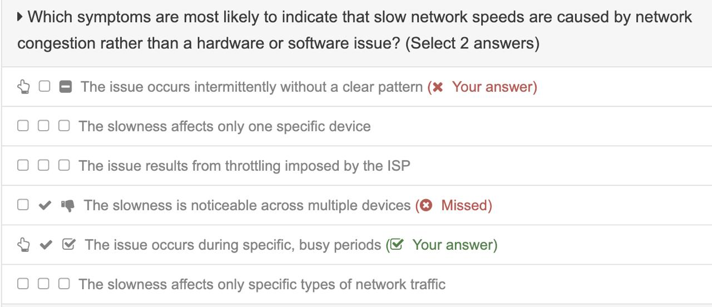

**题干：** Which symptoms are most likely to indicate that slow network speeds are caused by network congestion rather than a hardware or software issue? (Select 2 answers)

**正确答案：**
- **The slowness is noticeable across multiple devices**
- **The issue occurs during specific, busy periods**

### 为什么这两个是对的
网络拥塞（network congestion）的核心特征就是：
- **不是单一设备的问题**
- 而是网络整体在某些时段被挤满了

#### 1. The slowness is noticeable across multiple devices
如果：
- 手机慢
- 电脑也慢
- 平板也慢

那就更像：
### **整个网络路径都在堵**
而不是某一台设备硬件、驱动或系统出问题。

#### 2. The issue occurs during specific, busy periods
如果网络问题总在：
- 晚上高峰
- 大家都在用网的时候
- 某些忙碌时段
出现，
这非常符合：
### **network congestion**

### 为什么你选的 intermittently without a clear pattern 不对
你选的是：
- **The issue occurs intermittently without a clear pattern**

这个描述太泛了。
它可能对应很多情况：
- 网卡接触不良
- 驱动异常
- 路由器偶发问题
- ISP 抖动
- 无线信号不稳

它并不能特别有力地指向：
### **network congestion**

### 为什么“only one device”不对
如果只有一台设备慢，
那更该怀疑：
- 该设备的网卡
- 驱动
- 设置
- 本机软件问题

而不是网络整体拥塞。

### 为什么 ISP throttling 不是答案
ISP throttling 当然也可能导致慢，
但题目问的是：
> **most likely indicate network congestion**

所以更标准的线索还是：
- 多设备一起慢
- 在高峰期慢

### 最简单记忆
判断“是网络拥塞，不是单机问题”时，先看：
- **是不是多台设备都慢**
- **是不是忙的时候才慢**

**一句话：**
网络拥塞最典型的两个信号就是：**多设备一起慢**，而且**总在高峰时段慢**。
---

## 只有这台笔记本 Wi‑Fi 老掉线：优先查无线网卡驱动
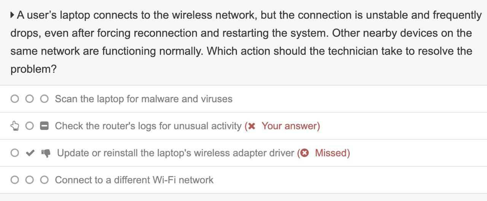

**题干：** A user's laptop connects to the wireless network, but the connection is unstable and frequently drops, even after forcing reconnection and restarting the system. Other nearby devices on the same network are functioning normally. Which action should the technician take to resolve the problem?

|  |  |
| --- | --- |
| ❌ 我的答案 | Check the router's logs for unusual activity |
| ✅ 正确答案 | Update or reinstall the laptop's wireless adapter driver |

### 为什么答案是无线网卡驱动
题目里的关键线索是：
- 只有 **这台 laptop** 有问题
- 其他 nearby devices 在同一个网络上都正常
- 说明问题更像是：
  ## **单机问题**
  而不是路由器整体问题

再加上：
- 已经试过重新连接
- 也已经重启系统
- 但还是频繁掉线

这时很合理的下一步就是：
### **更新或重装无线网卡驱动**

因为驱动异常、兼容性问题、驱动损坏，都可能导致：
- Wi‑Fi 不稳定
- 反复断连
- 时好时坏

### 为什么你选的 router logs 不对
你选的是：
- **Check the router's logs for unusual activity**

如果：
- 多台设备都出问题
- 整个网络都不稳定
- 路由器本身明显异常

那查 router logs 会更有意义。

但这题已经明确告诉你：
### **其他设备都正常**
所以这不太像是路由器整体故障。

### 为什么不是 connect to a different Wi‑Fi network
- 这当然也可以帮助进一步验证
- 但题目问的是：
  > **Which action should the technician take to resolve the problem?**
- 在已知“只有这台机器异常”的前提下，考试更标准的答案还是：
### **处理本机无线网卡驱动**

### 为什么 malware scan 不对
- 恶意软件可能影响网络
- 但这不是这类“单机无线不稳定”题里最典型、最标准的优先处理点

### 最简单记忆
- **只有一台设备 Wi‑Fi 不稳，其他设备正常**
  → 先想 **本机无线网卡 / 驱动**
- **多台设备一起不稳**
  → 才更像路由器/网络侧问题

**一句话：**
这题关键是分清“单机问题”和“网络整体问题”：既然别的设备都正常，就该优先修这台笔记本自己的无线网卡驱动。
---

## 手机越来越慢、卡顿、冻结：先清缓存 + 卸载不用的 App
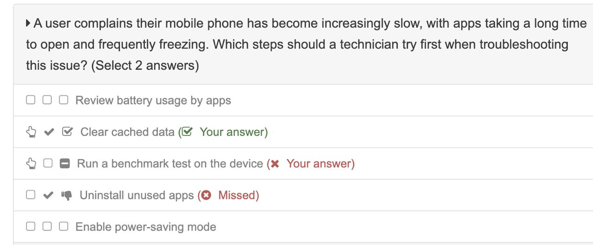

**题干：** A user complains their mobile phone has become increasingly slow, with apps taking a long time to open and frequently freezing. Which steps should a technician try first when troubleshooting this issue? (Select 2 answers)

**正确答案：**
- **Clear cached data**
- **Uninstall unused apps**

### 为什么答案是这两个
题目强调的是：
- 手机越来越慢
- App 打开很久
- 经常冻结
- 而且问的是：
### **should try first**

这类题的 first steps 通常优先选：
- 最基础
- 最低风险
- 最常见、最直接
的优化动作。

#### 1. Clear cached data
- App 缓存堆积太多时，确实可能导致：
  - 打开慢
  - 运行卡
  - 反应迟钝
- 清缓存是标准 first step 之一

#### 2. Uninstall unused apps
- 很多没用的 App 会：
  - 占存储
  - 吃后台资源
  - 占内存或同步资源
- 所以卸载不用的 App，也是一种非常典型的初步排查/优化动作

### 为什么 benchmark test 不对
你错选了：
- **Run a benchmark test on the device**

benchmark 更像是：
- 测性能
- 对比跑分
- 诊断深层硬件能力

但题目问的是：
### **first troubleshooting steps**
所以考试不会优先让你先跑基准测试，
而会先做更实际、更基础的处理。

### 为什么 battery usage 不是答案
- 查看 battery usage 有时能发现耗电异常 App
- 但它不是这题“卡顿/打开慢/冻结”最标准的 first response
- 不如清缓存和卸载没用 App 更直接

### 为什么 power-saving mode 不对
- 省电模式有时反而可能限制性能
- 它不是解决“已经变慢”的标准 first-step troubleshooting 动作

### 最简单记忆
手机越来越慢时，先想：
- **清缓存**
- **删没用的 App**

不要先想：
- benchmark
- 跑分
- 省电模式

**一句话：**
这题考的是手机变慢时最基础的 first-step 处理：先清缓存，再删掉不用的 App，而不是先跑 benchmark。
---

## Port flapping 先查物理连接，不是先重启设备
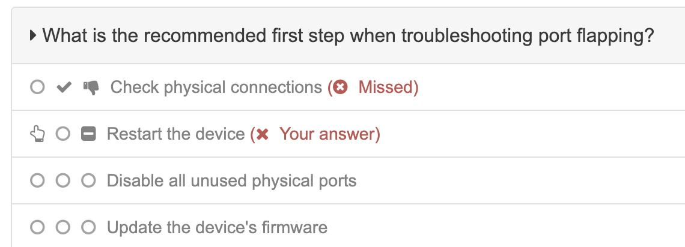

**题干：** What is the recommended first step when troubleshooting port flapping?

|  |  |
| --- | --- |
| ❌ 我的答案 | Restart the device |
| ✅ 正确答案 | Check physical connections |

### 为什么答案是 Check physical connections
**Port flapping** 通常指的是：
- 端口一会儿 up
- 一会儿 down
- 链路反复跳动

这种情况最先该怀疑的就是：
### **物理层问题**
比如：
- 网线松动
- 接口接触不良
- 模块没插牢
- 线缆损坏
- 端口本身物理不稳定

所以 first step 最标准的就是：
## **先检查 physical connections**

### 为什么 restart the device 不对
重启设备不是绝对不能做，
但它不是最基础、最直接的第一步。

题目问的是：
### **recommended first step**

而 port flapping 是很典型的：
### **先查线、查口、查连接**

不是一上来先重启。

### 为什么其他选项更靠后
- **Disable all unused physical ports**：和当前这个 flapping 端口不直接相关
- **Update the device's firmware**：属于更后面的排查/修复动作，不是最初步的检查

### 最简单记忆
看到：
- **port flapping**

第一反应就记：
### **物理层先查**
也就是：
- 线
- 口
- 接头
- 模块

**一句话：**
port flapping 最常见先从物理层入手，所以 first step 是先检查 physical connections，而不是先重启设备。
---

## UTP 最容易受干扰，但现实里也最常见
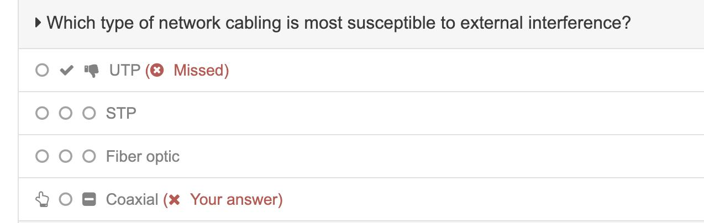

**题干：** Which of the following cable types is most susceptible to external interference?

|  |  |
| --- | --- |
| ❌ 我的答案 | [用户原题截图中的误选项] |
| ✅ 正确答案 | UTP |

### 为什么答案是 UTP
**UTP = Unshielded Twisted Pair**
重点就在：
### **Unshielded（没有屏蔽层）**

所以在这些常见线材里：
- **UTP**：没有额外屏蔽，最容易受 EMI / RFI 干扰
- **STP**：有屏蔽层，比 UTP 更抗干扰
- **Coaxial**：本身有屏蔽结构，抗干扰比 UTP 强
- **Fiber optic**：走光信号，几乎不受电磁干扰

所以考试里一旦问：
> **most susceptible to external interference**
标准答案就是：
## **UTP**

### 为什么现实里我们却最常见 UTP
这题容易让人困惑的点就在这里：
- **最容易受干扰**
并不等于
- **不能用 / 不常见**

现实里 UTP 反而最常见，因为它：
- 更便宜
- 更轻、更软、好布线
- 一般家庭和办公室环境下通常已经够用
- 双绞结构本身也能抵消一部分干扰

### 为什么不是大家都用 STP
因为 STP 虽然更抗干扰，但也有代价：
- 更贵
- 更硬
- 安装更麻烦
- 接地要求更高

所以不是所有场景都值得上 STP。

### 最简单记忆
- **UTP** → 最常见，但也最怕外部干扰
- **STP** → 更抗干扰，但更贵更麻烦
- **Fiber** → 最不怕 EMI

**一句话：**
UTP 之所以是这题答案，是因为它在常见线材里最容易受外部干扰；但现实里它仍最常见，是因为便宜、好装，而且普通环境下通常已经够用了。
---

## Fiber optic 对外部电磁干扰几乎免疫
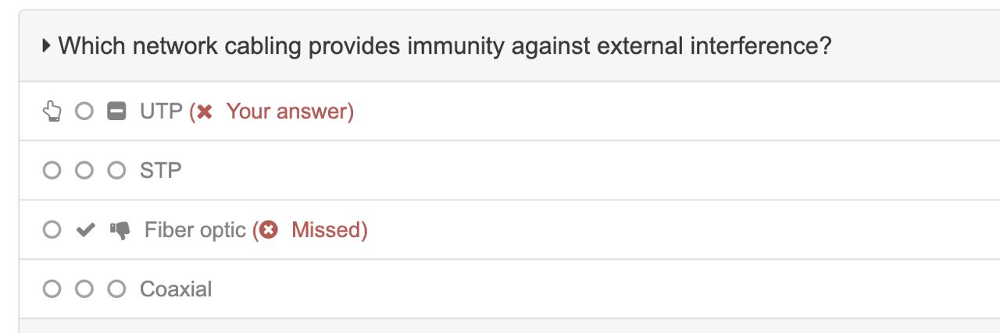

**题干：** Which network cabling provides immunity against external interference?

|  |  |
| --- | --- |
| ❌ 我的答案 | UTP |
| ✅ 正确答案 | Fiber optic |

### 对，你这里可以直接这样记
## **光纤线最抗电磁干扰**
更准确一点说：
### **Fiber optic 对外部电磁干扰几乎免疫**

### 为什么答案是 Fiber optic
因为光纤传输的不是电信号，
而是：
## **光信号**

所以它不像铜缆那样会受到：
- EMI（electromagnetic interference，电磁干扰）
- RFI（radio frequency interference，射频干扰）

影响。

也正因为这样，考试里只要看到：
> **immunity against external interference**
最标准答案通常就是：
## **Fiber optic**

### 和上一题怎么配对记
你前一题是：
> **most susceptible to external interference**
答案是：
### **UTP**

这一题是：
> **provides immunity against external interference**
答案是：
### **Fiber optic**

所以你可以成对背：
- **UTP** → 最怕外部干扰
- **Fiber optic** → 最不怕外部干扰

### 顺手比较一下
- **UTP** → 无屏蔽，最容易受干扰
- **STP** → 有屏蔽，比 UTP 更抗干扰
- **Coaxial** → 也有屏蔽，抗干扰比 UTP 强
- **Fiber optic** → 走光，不走电，几乎不受 EMI 影响

### 最简单记忆
- **most susceptible** → UTP
- **most immune / immunity** → Fiber optic

**一句话：**
对，光纤线可以直接记成：**最抗电磁干扰**；因为它传的是光，不是电。
---

## 局域网正常但 WAN 反复掉线：下一步联系 ISP
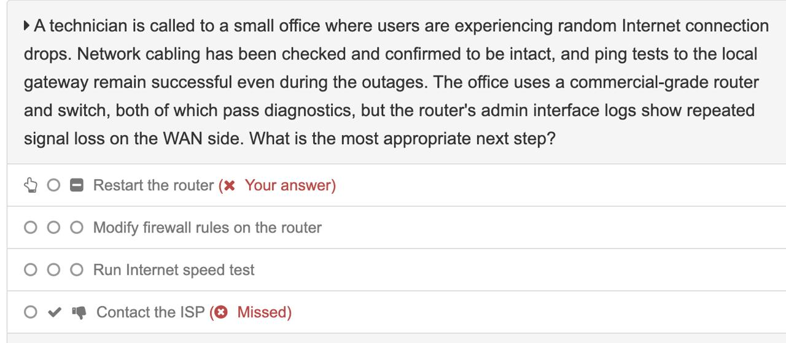

**题干：** A technician is called to a small office where users are experiencing random Internet connection drops. Network cabling has been checked and confirmed to be intact, and ping tests to the local gateway remain successful even during the outages. The office uses a commercial-grade router and switch, both of which pass diagnostics, but the router's admin interface logs show repeated signal loss on the WAN side. What is the most appropriate next step?

|  |  |
| --- | --- |
| ❌ 我的答案 | Restart the router |
| ✅ 正确答案 | Contact the ISP |

### 为什么答案是 Contact the ISP
这题其实线索已经给得很完整了：
- **内网线缆已经检查过，完好**
- **ping 本地网关在故障期间仍然成功**
- **路由器和交换机诊断也通过**
- 但 **WAN side 日志反复显示 signal loss**

这说明什么？
## **局域网内部基本没问题，问题更像出在 ISP / 外线 / WAN 侧**

所以最合适的下一步就是：
### **联系 ISP**

### 为什么 restart the router 不对
你选的：
- **Restart the router**

如果前面还没做基础排查，重启当然常见。 
但这题已经明确告诉你：
- 本地网关没问题
- 设备诊断也通过
- WAN side 明确报 signal loss

这种时候再去重启路由器，
不是最合适的“下一步”。

### 为什么 firewall rules 不对
- 防火墙规则问题更可能导致：
  - 某些流量被拦
  - 特定服务不通
- 但题目是：
  - **random Internet connection drops**
  - **WAN signal loss**
- 这不是 firewall 典型表现。

### 为什么 speed test 不对
- speed test 更适合测快慢
- 但这里已经不是“慢不慢”的问题，
而是：
### **WAN 侧反复掉线 / 丢信号**
- 所以 speed test 并不是最合适下一步。

### 最简单记忆
看到：
- **local gateway 正常**
- **LAN 没问题**
- **WAN logs show signal loss**

就优先想到：
### **联系 ISP**

**一句话：**
这题关键是分清“内网正常、外网异常”：既然问题已经明确落在 WAN side signal loss，上一步排查完成后，最合理的下一步就是联系 ISP。
---

## 喷墨打印机 grinding noise 别漏掉：paper feed rollers
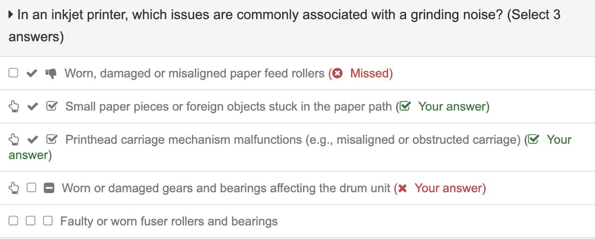

**题干：** In an inkjet printer, which issues are commonly associated with a grinding noise? (Select 3 answers)

**正确答案：**
- **Worn, damaged or misaligned paper feed rollers**
- **Small paper pieces or foreign objects stuck in the paper path**
- **Printhead carriage mechanism malfunctions (e.g., misaligned or obstructed carriage)**

### 这题你这次错在哪里
你这次其实已经抓到两项了：
- 纸路里有异物
- 喷头小车机构异常

你漏掉的是：
### **Worn, damaged or misaligned paper feed rollers**

而你错选的是：
- **Worn or damaged gears and bearings affecting the drum unit**

### 为什么 paper feed rollers 是对的
喷墨打印机如果出现 grinding noise，
很常见的机械来源就是：
- 进纸滚轮磨损
- 滚轮错位
- 滚轮损坏
- 滚轮摩擦异常

所以：
### **paper feed rollers**
是非常典型的正确答案。

### 为什么 drum unit 不对
这题的关键还是：
## **题目说的是 inkjet printer**

而：
- **drum unit**
- **fuser rollers**

这些更偏：
### **laser printer（激光打印机）**
的思路，
不是喷墨打印机这题的正确方向。

### 最简单记忆
喷墨打印机 grinding noise 先想三件事：
- **paper feed rollers**
- **paper path 里有异物**
- **printhead carriage 小车机构**

不要先想：
- drum unit
- fuser

**一句话：**
这题核心还是“先分清 inkjet 还是 laser”：只要是喷墨打印机 grinding noise，优先查进纸滚轮、纸路异物、喷头小车，不要跳到 drum unit 上去。
---

## IMAP 不是发信，SMTP 才是发信
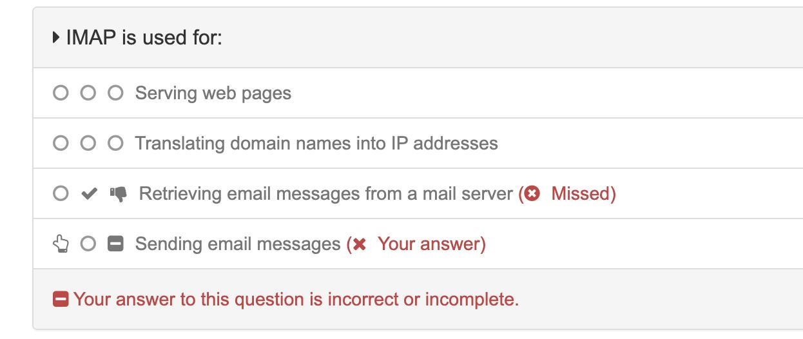

**题干：** IMAP is used for:

|  |  |
| --- | --- |
| ❌ 我的答案 | Sending email messages |
| ✅ 正确答案 | Retrieving email messages from a mail server |

### 为什么这题容易混
因为：
- **IMAP**
- **POP3**
- **SMTP**

这三个都是邮件相关协议，
最容易在考试里串掉。

### 最核心先记住
- **SMTP = 发信**
- **POP3 / IMAP = 收信**

所以这题：
### **IMAP**
不是拿来发送邮件的，
而是用来：
### **从邮件服务器读取 / 同步邮件**

### 为什么答案是 IMAP = retrieving email
IMAP 的典型用途是：
- 从邮件服务器查看邮件
- 保持邮件在服务器上
- 多设备同步邮箱状态

所以标准答案是：
> **Retrieving email messages from a mail server**

### 为什么 sending email 是 SMTP
发送邮件对应的是：
## **SMTP = Simple Mail Transfer Protocol**

考试里只要看到：
- **send email**
- **outgoing mail**

就先想：
### **SMTP**

### POP3 和 IMAP 顺手区分
- **POP3** → 收邮件，偏下载到本地
- **IMAP** → 收邮件，偏服务器同步
- **SMTP** → 发邮件

### 最简单记忆法
- **SMTP** → **S = Send**
- **POP3** → **P = Pull**（拉下来）
- **IMAP** → **邮件留在服务器同步看**

### 一句话口诀
## **SMTP 发，POP3 收，IMAP 也是收，但更偏同步。**

**一句话：**
这题错在把 IMAP 和 SMTP 混了；IMAP 用来从服务器读取/同步邮件，真正负责发邮件的是 SMTP。
---

## 最不容易被攻击的加密算法：AES
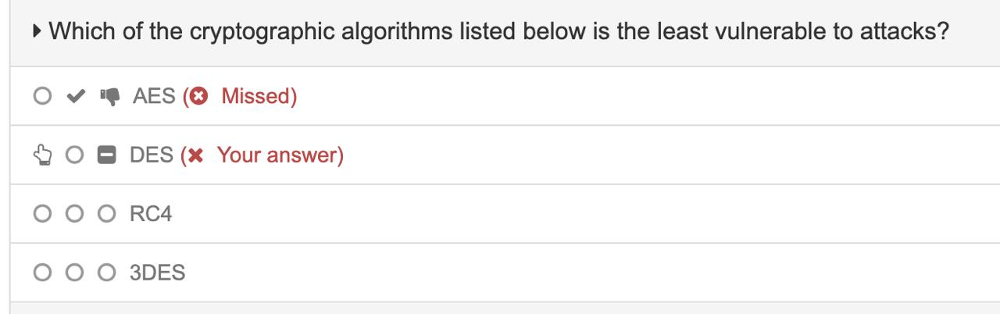

**题干：** Which of the cryptographic algorithms listed below is the least vulnerable to attacks?

|  |  |
| --- | --- |
| ❌ 我的答案 | DES |
| ✅ 正确答案 | AES |

### 这题其实不用死抠原理，先记“新旧强弱”就够了
考试里这几个算法你可以先按安全性粗分成这样：

### 最强、最现代、最该选
## **AES**

### 老旧、弱、容易被淘汰
- **DES**
- **RC4**
- **3DES**（比 DES 强一点，但也已经过时）

### 为什么答案是 AES
**AES = Advanced Encryption Standard**
它是现代对称加密里的主流标准，
相较于题目里的其他选项：
- 更现代
- 更安全
- 更广泛被采用
- 不像 DES / RC4 那样已经被认为明显过时

所以题目问：
> **least vulnerable to attacks**
标准答案就是：
## **AES**

### 为什么 DES 不对
**DES** 是很老的算法，
关键太短（56-bit effective key），
早就被认为不够安全，
所以它反而是这几个里面最不该选成“最安全”的。

### RC4 为什么也不对
**RC4** 是老流加密算法，
有已知弱点，
很多现代安全场景都不再推荐。

### 3DES 为什么也不是最佳答案
**3DES** 可以理解成：
- 比 DES 强一些
- 是过渡时代用来补救 DES 的方案

但它依然：
- 老
- 慢
- 也逐渐被淘汰

所以跟 AES 比，
还是 AES 更安全、更现代。

### 最简单记忆法
直接背：
## **AES 新且强**
## **DES / RC4 / 3DES 旧且弱**

你可以先这样排：
### **AES > 3DES > DES / RC4**

考试里一旦问：
- 最安全
- 最不容易被攻击
- 现代推荐

优先先想：
## **AES**

### 一句话记忆
**AES 是现代主流强加密；DES、RC4、3DES 都是更老、更弱或已过时的方案。**
---

## 防静电用品防的是 ESD，不是 EMI
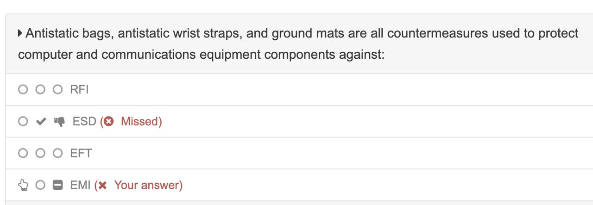

**题干：** Antistatic bags, antistatic wrist straps, and ground mats are all countermeasures used to protect computer and communications equipment components against:

|  |  |
| --- | --- |
| ❌ 我的答案 | EMI |
| ✅ 正确答案 | ESD |

### 这题你卡住的点
你已经知道这题在说：
### **防静电**
但一时没想起来英文缩写是什么。

答案是：
## **ESD = Electrostatic Discharge**
中文就是：
### **静电放电**

### 为什么答案是 ESD
题目里的这些东西：
- **antistatic bags**
- **antistatic wrist straps**
- **ground mats**

都是典型的：
## **防静电措施**

它们的作用是保护电脑零件，避免被：
### **ESD（静电放电）**
打坏。

### 为什么 EMI 不对
你选的：
## **EMI = Electromagnetic Interference**
中文是：
### **电磁干扰**

EMI 更多是：
- 信号受干扰
- 通信受影响
- 线缆、设备之间的电磁影响

而不是“人身上的静电把电子元件打坏”这种场景。

### 顺手把几个缩写区分一下
- **ESD** = Electrostatic Discharge = 静电放电
- **EMI** = Electromagnetic Interference = 电磁干扰
- **RFI** = Radio Frequency Interference = 射频干扰
- **EFT** = Electrical Fast Transient = 快速电瞬变

### 最简单记忆
看到：
- 防静电袋
- 防静电手环
- 接地垫

就直接想到：
## **ESD**

你可以这样背：
### **Static → ESD**
### **Interference → EMI / RFI**

**一句话：**
防静电用品防的是 **ESD（Electrostatic Discharge，静电放电）**，不是 EMI。
---

## BIOS/UEFI 设置保存在 CMOS，不是 ROM
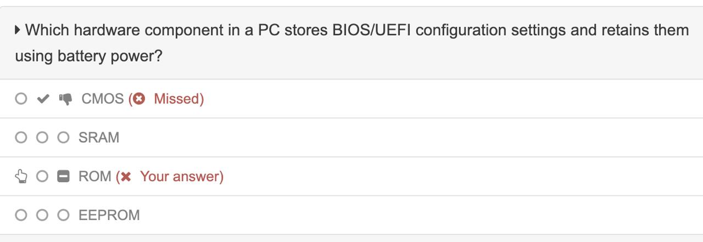

**题干：** Which hardware component in a PC stores BIOS/UEFI configuration settings and retains them using battery power?

|  |  |
| --- | --- |
| ❌ 我的答案 | ROM |
| ✅ 正确答案 | CMOS |

### 这题核心怎么理解
题目问的不是：
- BIOS/UEFI 程序代码本身存在哪

而是问：
- **BIOS/UEFI 的配置设置（configuration settings）存在哪**
- 而且还强调：
  > **retains them using battery power**

这里的关键词已经直接在提示：
## **CMOS**

### 为什么答案是 CMOS
CMOS 在考试语境里通常就是：
- 存放 BIOS/UEFI 设置参数
- 比如日期时间、启动顺序、硬件配置选项等
- 靠主板上的电池维持这些设置不丢失

所以一看到：
- **settings**
- **battery power**

就应该优先想到：
### **CMOS**

### 为什么 ROM 不对
你选的 ROM 更像是：
- 固件程序本体所在的位置（更偏只读固件存储概念）
- 不是这题要考的“靠电池维持的 BIOS 配置参数”

也就是说：
- **ROM / flash** → 更偏 BIOS/UEFI 程序代码
- **CMOS** → 更偏 BIOS/UEFI 设置参数

### 另外两个为什么不对
- **SRAM**：虽然有些底层实现会涉及，但考试里标准答案不是这样答
- **EEPROM**：也更偏存储技术类型，不是这题 A+ 最标准的概念答案

### 最简单记忆
- **BIOS 程序** → 想固件/flash/ROM
- **BIOS 设置 + 电池供电保持** → 想 **CMOS**

### 一句话口诀
## **程序看 BIOS，设置看 CMOS。**

**一句话：**
这题错在把“BIOS 程序本体”和“BIOS 设置参数”混了；考试里凡是问“靠电池维持的 BIOS/UEFI 设置”，标准答案几乎都是 **CMOS**。
---

## 保护机密信息不被乱传：DLP，不是 EDR
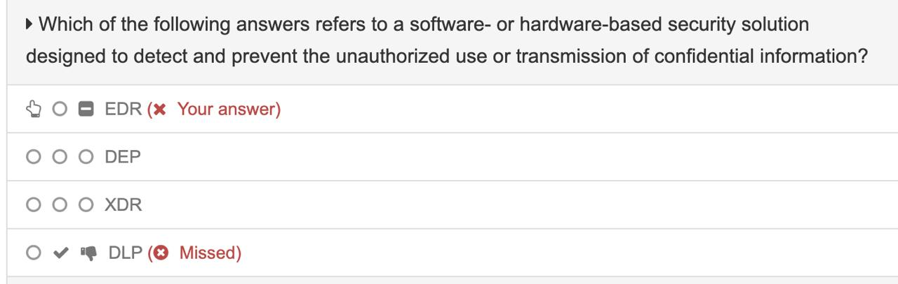

**题干：** Which of the following answers refers to a software- or hardware-based security solution designed to detect and prevent the unauthorized use or transmission of confidential information?

|  |  |
| --- | --- |
| ❌ 我的答案 | EDR |
| ✅ 正确答案 | DLP |

### 为什么答案是 DLP
这题的关键词非常明确：
- **detect and prevent**
- **unauthorized use or transmission**
- **confidential information**

这其实就是在描述：
## **DLP = Data Loss Prevention**

中文可以理解成：
### **数据泄露防护 / 数据丢失防护**

它的核心目标就是：
- 识别敏感数据
- 防止敏感数据被未授权地复制、发送、上传、外传

比如防止：
- 员工把公司机密发到私人邮箱
- 把敏感文件拷到 U 盘
- 把机密内容上传到外部云盘

### 为什么 EDR 不对
你选的：
## **EDR = Endpoint Detection and Response**

它更偏向：
- 端点安全
- 检测恶意行为
- 响应攻击
- 发现终端被入侵、异常进程、可疑活动

EDR 的重点是：
### **检测和响应终端威胁**
不是重点防止机密信息外泄。

### 另外两个为什么不对
- **DEP** = Data Execution Prevention，偏内存执行保护，防止恶意代码在不该执行的内存区域运行
- **XDR** = Extended Detection and Response，偏跨多个安全层面的威胁检测与响应

它们都不是这题说的“防止敏感信息被未授权传输”的标准答案。

### 最简单记忆
- **DLP** → 防数据泄露
- **EDR** → 查终端威胁
- **XDR** → 更广范围的检测与响应
- **DEP** → 防止恶意代码执行

### 一句话口诀
## **机密数据外泄看 DLP，终端被黑看 EDR。**

**一句话：**
这题错在把“端点威胁检测”当成了“敏感数据防外泄”；题目描述的其实是 **DLP（Data Loss Prevention）**。
---

## 图像和视频数据给 GPU 快速访问：VRAM，不是 DRAM
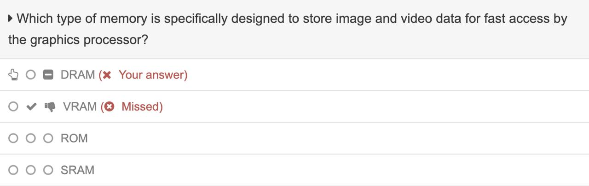

**题干：** Which type of memory is specifically designed to store image and video data for fast access by the graphics processor?

|  |  |
| --- | --- |
| ❌ 我的答案 | DRAM |
| ✅ 正确答案 | VRAM |

### 这题核心
题目问的是：
> **专门为图像和视频数据设计，供 GPU 快速访问的内存**

标准答案就是：
## **VRAM**

因为：
- **V = Video**
- 它就是显卡 / 图形处理相关的专用显存

---

## SRAM、DRAM、VRAM 怎么区分

### 1. VRAM（Video RAM）
这是这题的答案。

#### 用途：
- 存图像数据
- 存纹理、帧缓冲、视频数据
- 给 GPU 高速访问

#### 关键词：
- **graphics**
- **video**
- **GPU**
- **image rendering**

#### 最简单记忆：
## **VRAM = 显卡用的内存 / 显存**

---

### 2. DRAM（Dynamic RAM）
这是电脑最常见的：
## **主内存 / 系统内存（RAM）**

#### 用途：
- 给 CPU 运行程序时临时存数据
- 也就是我们平时说的内存条，大多就是 DRAM 类

#### 特点：
- 容量大
- 成本较低
- 需要不断刷新（refresh）

#### 最简单记忆：
## **DRAM = 电脑主内存**

你这题会错，就是因为 DRAM 也是 RAM，
但它不是“专门给 GPU 存图像视频数据”的那种内存。

---

### 3. SRAM（Static RAM）
SRAM 通常更常见于：
## **cache（缓存）**

#### 用途：
- CPU cache
- 高速缓冲
- 对速度要求很高的小容量存储

#### 特点：
- 比 DRAM 更快
- 不需要像 DRAM 那样刷新
- 但更贵、容量更小

#### 最简单记忆：
## **SRAM = 快，但小，常用来做缓存**

---

## 最好记的三者对照
| 类型 | 主要用途 | 最简单记忆 |
| --- | --- | --- |
| **VRAM** | 显卡/GPU 处理图像视频数据 | **显存** |
| **DRAM** | 电脑主内存 | **内存条** |
| **SRAM** | CPU 高速缓存 | **缓存 Cache** |

---

## 为什么 ROM 不对
ROM 是：
- 只读存储
- 固件、启动代码之类

不是拿来给 GPU 高速存图像视频数据的。

---

## 一句话口诀
## **VRAM 看显卡，DRAM 看主内存，SRAM 看缓存。**

**一句话：**
这题错在把“通用系统内存 DRAM”和“显卡专用显存 VRAM”混了；凡是题目提到 **image/video data + GPU fast access**，优先选 **VRAM**。
---

## 让程序以另一用户权限运行：UAC（不是 OTP / MMC / GPO）
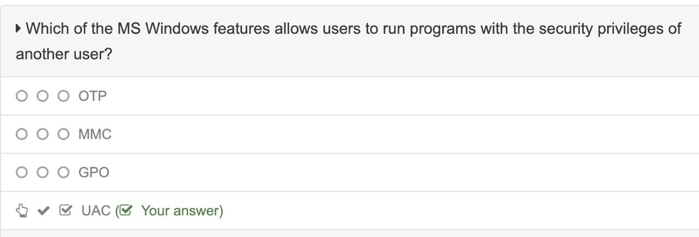

**题干：** Which of the MS Windows features allows users to run programs with the security privileges of another user?

|  |  |
| --- | --- |
| ❌ 我的答案 | UAC |
| ✅ 正确答案 | UAC |

> 这题你是瞎猜猜对了，但你想把几个缩写都搞清楚，这个很值。

### 为什么这题答案是 UAC
## **UAC = User Account Control**
中文一般就是：
### **用户帐户控制**

它的作用是：
- 控制权限提升
- 在需要管理员权限时弹出确认
- 允许程序以更高权限运行（在合适授权下）

所以这题里最接近“让程序以另一层级/更高权限的安全权限运行”的 Windows 功能，考试会指向：
## **UAC**

---

## 其他几个缩写分别是什么

### 1. OTP = One-Time Password
中文：
### **一次性密码**

#### 用途：
- 多因素认证
- 登录验证码
- 短时有效密码

#### 关键词：
- 认证
- 验证码
- MFA

它和“Windows 权限控制功能”不是一类东西。

---

### 2. MMC = Microsoft Management Console
中文：
### **微软管理控制台**

#### 用途：
- 打开管理工具的框架
- 例如：
  - Device Manager
  - Event Viewer
  - Disk Management
  - Local Users and Groups

MMC 更像一个：
### **管理工具容器 / 管理框架**
不是权限提升功能本身。

---

### 3. GPO = Group Policy Object
中文：
### **组策略对象**

#### 用途：
- 在 Windows 域环境或本地策略中统一下发配置
- 控制用户和计算机策略
- 安全设置、脚本、桌面策略、系统限制等

GPO 更像：
### **管理规则 / 策略配置机制**
也不是这题说的“让程序以另一用户权限运行”的功能。

---

## 最简单对照记忆
| 缩写 | 全称 | 中文 | 你先记成什么 |
| --- | --- | --- | --- |
| **UAC** | User Account Control | 用户帐户控制 | **权限提升 / 管理员确认** |
| **OTP** | One-Time Password | 一次性密码 | **验证码** |
| **MMC** | Microsoft Management Console | 微软管理控制台 | **管理工具框架** |
| **GPO** | Group Policy Object | 组策略对象 | **统一策略配置** |

---

## 最简单口诀
- **UAC** → 提权确认
- **OTP** → 一次性密码
- **MMC** → 管理控制台
- **GPO** → 组策略

### 一句话总结
**这题的关键不是背缩写外形，而是分清类别：UAC 管权限提升，OTP 管认证，MMC 是管理工具框架，GPO 是策略配置。**
---

## UTM = Unified Threat Management
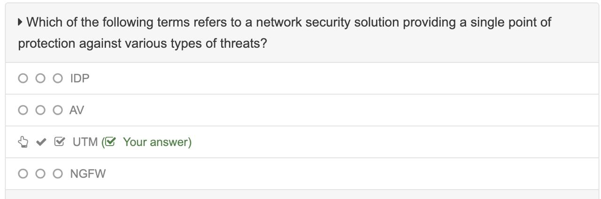

**题干：** Which of the following terms refers to a network security solution providing a single point of protection against various types of threats?

✅ **正确答案：UTM**

### UTM 是什么
## **UTM = Unified Threat Management**
中文可以理解成：
### **统一威胁管理**

它的核心意思是：
> **把多种网络安全功能整合到一个统一的安全设备/平台里**

也就是“单点保护、多种功能”。

### 为什么这题答案是 UTM
题目关键词是：
- **single point of protection**
- **various types of threats**

这正是 UTM 的典型定义：
- 一个设备 / 一个网关
- 同时提供多种安全能力
- 一起防御不同类型威胁

### UTM 常见集成功能
UTM 常常会整合：
- Firewall
- IDS / IPS
- Antivirus / antimalware
- Content filtering
- VPN
- Web filtering
- Spam filtering

所以你可以把它理解成：
### **安全功能大杂烩，一台设备全包**

### 其他几个为什么不是最佳答案
#### IDP
- 更偏 **Intrusion Detection/Prevention**
- 只是其中一种安全能力，不是“统一整合平台”

#### AV
- 只是 **Antivirus**
- 不是整套网络安全平台

#### NGFW
- **Next-Generation Firewall**
- 很强，也会集成一些高级能力
- 但题目这种最标准、最广义“单点整合多种威胁防护”的说法，考试更常对应 **UTM**

### 最简单记忆
- **UTM** → 安全大合集 / 一体化安全网关
- **AV** → 杀毒
- **IDP** → 入侵检测/防御
- **NGFW** → 下一代防火墙

### 一句话口诀
## **UTM 管一揽子安全，AV 只管杀毒。**

**一句话：**
UTM 就是 **Unified Threat Management**，意思是一台设备/平台统一提供多种安全防护，是“单点整合多种威胁防护”的典型答案。
---

## Peripheral devices 在这题里指扩展卡类设备，所以答案是 PCI
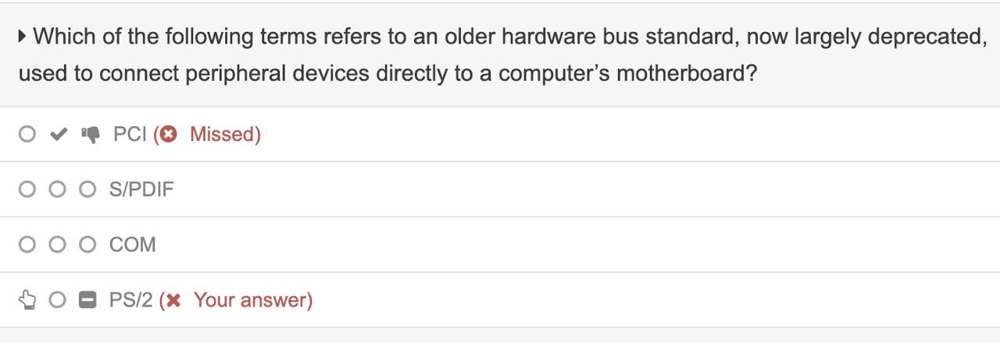

**题干：** Which of the following terms refers to an older hardware bus standard, now largely deprecated, used to connect peripheral devices directly to a computer’s motherboard?

|  |  |
| --- | --- |
| ❌ 我的答案 | PS/2 |
| ✅ 正确答案 | PCI |

### 你这题真正卡住的点
不是单纯不知道 PCI，
而是：
## **没完全理解 peripheral devices 在这题里的意思**

### peripheral device 一般指什么
**Peripheral device** 广义上就是：
> **围绕主机工作的外设 / 外围设备**

常见包括：
- 键盘
- 鼠标
- 打印机
- 显示器
- 声卡
- 网卡
- 显卡
- 存储控制卡

但在这道题里，
它不是在强调“键盘鼠标接口”那种外设，
而是在说：
### **直接接到主板扩展总线上的外围设备/扩展卡**

这时候最符合题意的就是：
## **PCI**

### 为什么答案是 PCI
**PCI = Peripheral Component Interconnect**
中文可以理解成：
### **外围组件互连总线**

它就是一种比较老的主板扩展总线标准，
用来把各种扩展卡直接插到主板上。

例如以前常见用 PCI 接的：
- 声卡
- 网卡
- 电视卡
- USB 扩展卡
- 某些控制卡

所以题目说：
- **older hardware bus standard**
- **used to connect peripheral devices directly to a computer’s motherboard**

最标准答案就是：
### **PCI**

### 为什么 PS/2 不对
你选的：
## **PS/2**
它更多是：
- 键盘/鼠标接口标准
- 不是主板扩展总线（bus standard）

也就是说：
- **PS/2** 是一种外设接口
- **PCI** 是一种主板扩展总线

这题考的是后者。

### 另外两个为什么不对
- **S/PDIF**：数字音频接口，不是主板扩展总线
- **COM**：串口（serial port），也不是主板扩展总线

### 最简单记忆
- **PCI** → 主板扩展总线，插扩展卡
- **PS/2** → 键盘鼠标接口
- **COM** → 串口
- **S/PDIF** → 数字音频接口

### 一句话口诀
## **PCI 是总线，PS/2 是接口。**

**一句话：**
这题里的 peripheral devices 更偏“扩展卡类外围设备”，所以问到“老的主板总线标准”，答案是 **PCI**，不是 PS/2。
---

## 这题虽然写 network，但真正考的是 IoT 设备生态，不是 PAN 范围
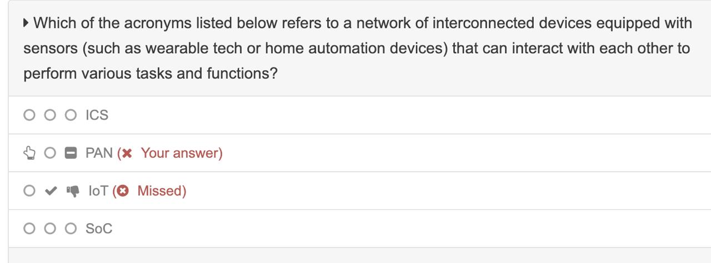

**题干：** Which of the following terms refers to a network of interconnected devices equipped with sensors, such as wearable technology and home automation devices, that can interact with each other and perform various tasks and functions?

|  |  |
| --- | --- |
| ❌ 我的答案 | PAN |
| ✅ 正确答案 | IoT |

### 为什么这题容易误导
你会选 PAN 很正常，
因为题目一开头就写：
### **refers to a network**

这很容易让人直接往：
- PAN
- LAN
- WAN

这种“网络类型”上想。

但这题真正决定答案的，不是前面的 **network**，
而是后面这些关键词：
- **interconnected devices**
- **equipped with sensors**
- **wearable technology**
- **home automation devices**
- **interact with each other**
- **perform tasks and functions**

这些合在一起，其实是在描述：
## **IoT = Internet of Things**

### 为什么答案是 IoT
IoT 的核心就是：
- 很多带传感器的设备联网
- 设备彼此交互
- 执行自动化任务

典型例子正好就是：
- 可穿戴设备
- 智能家居设备
- 传感器网络

所以题目虽然用了 **network** 这个词，
但它在考的是：
### **智能设备互联生态**
也就是 **IoT**。

### 为什么不是 PAN
## **PAN = Personal Area Network**
PAN 更强调的是：
- 个人周边的小范围网络
- 短距离连接
- 例如手机 + 蓝牙耳机 + 智能手表

它强调的是：
### **网络范围类型**
而不是“智能设备、传感器、自动化功能”这种场景。

### 顺手对比一下
- **PAN** → 小范围、个人设备网络
- **IoT** → 传感器 + 智能设备 + 自动化互联
- **ICS** → 工业控制系统
- **SoC** → 片上系统，不是网络

### 最简单记忆
如果看到：
- **wearables**
- **smart home**
- **sensors**
- **devices interact and perform tasks**

先想：
## **IoT**

如果看到：
- **short-range personal devices**
- **around one person**
- **Bluetooth-like personal network**

才更像：
## **PAN**

**一句话：**
这题错在被 “network” 这个词带偏了；真正决定答案的是后半句那些“传感器、可穿戴、智能家居、设备协作”的描述，它们明显指向 **IoT**，不是 **PAN**。
---

## WEP / WPA / TKIP / AES / CCMP 很容易混：先分“标准”和“算法/机制”
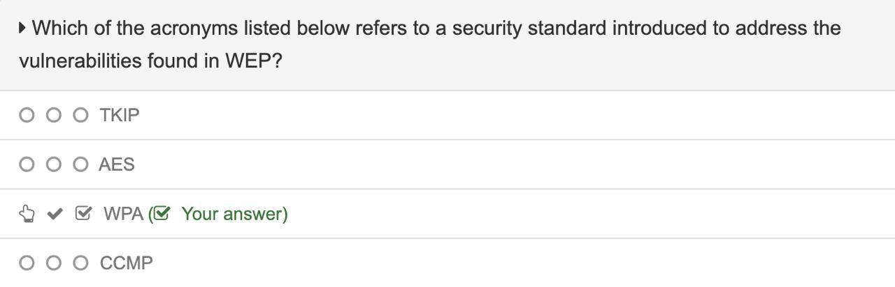

**题干：** Which of the acronyms listed below refers to a security standard introduced to address the vulnerabilities found in WEP?

✅ **正确答案：WPA**

### 为什么答案是 WPA
题目问的是：
> **a security standard introduced to address the vulnerabilities found in WEP**

这里问的是：
## **哪一个是“标准（standard）”**

答案就是：
### **WPA = Wi‑Fi Protected Access**

它是为了修补 **WEP** 漏洞而推出的安全标准。

---

## 这些缩写怎么区分
你最容易混，是因为它们不是同一层级的东西。
最简单先这样分：

### 一、标准 / 协议家族
- **WEP**
- **WPA**
- **WPA2**
- **WPA3**

这些更像：
## **整套无线安全标准**

---

### 二、标准内部使用的加密/保护机制
- **TKIP**
- **CCMP**
- **AES**

这些更像：
## **标准里面用到的算法或保护机制**

所以这题问“标准”，
你就要优先从：
- WEP
- WPA
这类里选，
而不是去选 TKIP / AES / CCMP。

---

## 每个缩写最简单理解

### 1. WEP
**WEP = Wired Equivalent Privacy**
- 很老
- 很弱
- 漏洞多
- 现在基本视为不安全

#### 记忆：
## **WEP = 老旧、已破**

---

### 2. WPA
**WPA = Wi‑Fi Protected Access**
- 为了解决 WEP 问题推出
- 是过渡性的更安全标准
- 常和 **TKIP** 联系在一起

#### 记忆：
## **WPA = 修补 WEP 的第一代改进版**

---

### 3. TKIP
**TKIP = Temporal Key Integrity Protocol**
- 主要和 **WPA** 绑定在一起想
- 是 WPA 时代的重要保护机制
- 比 WEP 强，但也已经老了

#### 记忆：
## **TKIP = WPA 时代的旧方案**

---

### 4. AES
**AES = Advanced Encryption Standard**
- 现代强加密算法
- 比旧方案更安全
- 常和 WPA2 / 更现代无线安全联系起来

#### 记忆：
## **AES = 新且强的加密算法**

---

### 5. CCMP
**CCMP = Counter Mode with Cipher Block Chaining Message Authentication Code Protocol**
- 很拗口，不用硬背全称
- 考试里主要记它和 **AES** 连在一起
- 常作为 WPA2 安全机制的代表

#### 记忆：
## **CCMP = WPA2 常见搭档，背后靠 AES**

---

## 最好记的关系图
### 第一层：标准
- **WEP** → 最老最弱
- **WPA** → 为修补 WEP 而来
- **WPA2** → 更强、更现代

### 第二层：机制/算法
- **TKIP** → WPA 常配套
- **CCMP / AES** → WPA2 常配套

---

## 最简单考试记忆法
### 一句话版本
- **WEP** = 老旧不安全
- **WPA** = 修 WEP 的标准
- **TKIP** = WPA 常搭档
- **AES/CCMP** = WPA2 常搭档

---

## 你这题为什么会选错/容易乱
因为题目问的是：
### **security standard**

只有：
- **WPA**
符合“标准”这个描述。

而：
- **TKIP**
- **AES**
- **CCMP**

更偏加密/保护机制，
不是题目要的“标准名称”。

---

## 超短口诀
## **WEP 老，WPA 补，TKIP 跟 WPA，AES/CCMP 跟 WPA2。**

**一句话：**
这题关键不是背所有全称，而是先分层：**WPA 是标准，TKIP/AES/CCMP 是标准里用到的机制。** 所以题目问“修补 WEP 的安全标准”，答案就是 **WPA**。
---

## 经典模拟显示接口先想 VGA，不要被 DVI-I 迷惑
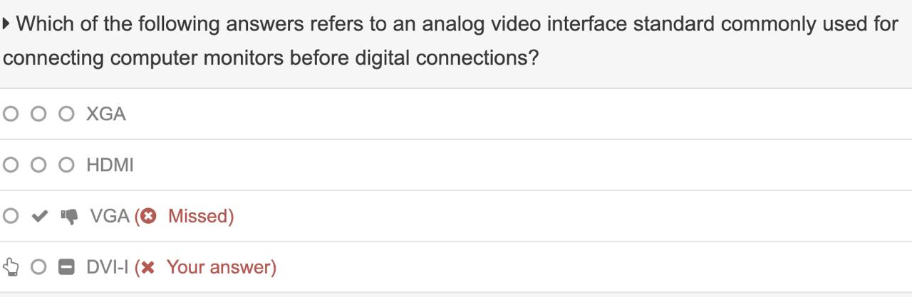

**题干：** Which of the following answers refers to an analog video interface standard commonly used for connecting computer monitors before digital connections?

|  |  |
| --- | --- |
| ❌ 我的答案 | DVI-I |
| ✅ 正确答案 | VGA |

### 为什么这题容易在 VGA 和 DVI-I 之间犹豫
因为：
- **VGA** 是纯模拟视频接口
- **DVI-I** 里面也带有模拟信号

所以看到 **analog video interface** 时，很容易觉得 DVI-I 好像也说得通。

但题目还有一个更关键的限定：
### **commonly used for connecting computer monitors before digital connections**

这句其实在提示：
## **传统、经典、在数字接口普及前最常见的模拟显示器接口**

这个标准答案就是：
### **VGA**

### 为什么答案是 VGA
**VGA = Video Graphics Array**
在很长一段时间里，它就是最常见的电脑显示器模拟接口。

你可以把它直接联想到：
- 老显示器蓝色接口
- 15-pin D-sub
- 传统模拟显示输出

考试里只要问：
- **老式模拟显示器接口**
- **digital connections 之前常用**

优先就选：
## **VGA**

### 为什么 DVI-I 不是这题标准答案
**DVI-I = Digital Visual Interface - Integrated**
它的特点是：
- **同时支持数字 + 模拟**
- 不是“经典老式纯模拟标准”的代表答案

也就是说：
- DVI-I 确实能带模拟信号
- 但它不是题目想考的那个“最典型、最传统、数字接口普及前最常见的模拟显示标准”

这题更像在考：
### **VGA = 经典模拟显示接口**

### 其他两个为什么更不对
- **HDMI** → 数字接口
- **XGA** → 分辨率标准，不是物理视频接口

### 最简单记忆
- **VGA** → 经典老式模拟显示接口
- **DVI-I** → 兼容数字+模拟，但不是这题最标准答案
- **HDMI** → 数字接口
- **XGA** → 分辨率，不是接口

### 一句话口诀
## **老式模拟显示器接口看 VGA；DVI-I 虽带模拟，但更像过渡型接口。**

**一句话：**
你会纠结很正常，因为 DVI-I 也带模拟；但只要题目强调“before digital connections 常用的经典模拟显示接口”，考试标准答案通常就是 **VGA**。
---

## PUP = Potentially Unwanted Program，不一定算明确恶意软件
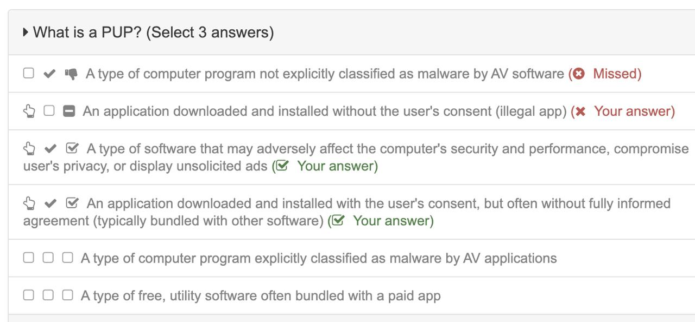

**题干：** What is a PUP? (Select 3 answers)

**正确答案：**
- **A type of computer program not explicitly classified as malware by AV software**
- **A type of software that may adversely affect the computer's security and performance, compromise user's privacy, or display unsolicited ads**
- **An application downloaded and installed with the user's consent, but often without fully informed agreement (typically bundled with other software)**

### 先把缩写记住
## **PUP = Potentially Unwanted Program**
中文可以理解成：
### **潜在不受欢迎程序 / 潜在有害但未必算恶意的软件**

### 为什么你会觉得陌生
因为 PUP 不是像：
- virus
- trojan
- worm
那种经典恶意软件词。

它更像是一个：
## **灰色地带的分类**

意思是：
- 它不一定被明确判定为 malware
- 但它很烦、很脏、很可疑
- 可能影响性能、隐私、安全
- 常常夹带安装、弹广告、改浏览器设置

### 为什么正确答案里第一条很关键
#### **not explicitly classified as malware by AV software**
这正是 PUP 的核心。
它常常不是“明确病毒”，
所以很多杀毒软件不会把它直接当作传统 malware，
但仍然会：
- 提醒你它不受欢迎
- 建议移除
- 归类为 PUP/PUA

### 为什么第三条也是对的
#### **installed with the user's consent, but often without fully informed agreement**
这也很典型。
PUP 常常：
- 不是偷偷黑进来
- 而是你安装别的软件时顺手被带进来
- 用户 technically 点了同意
- 但其实没有真正看懂或明确想装它

比如：
- 软件安装包捆绑工具栏
- 默认勾选附加软件
- 浏览器首页被改
- 弹广告插件跟着进来

### 为什么 “downloaded without consent” 不对
你错选了：
- **An application downloaded and installed without the user's consent (illegal app)**

这个更像：
### **恶意软件 / 非法程序 / 未授权安装行为**

而 PUP 的特点恰恰常常是：
- **形式上有 consent**
- 但不是 fully informed consent

也就是说：
### **你点过“下一步”，但你未必真的知道它会装进来什么**

### 最简单记忆
PUP 你就记三点：
1. **不一定被明确定义成 malware**
2. **可能影响隐私、安全、性能，还会弹广告**
3. **常常是捆绑安装、半哄半骗装进去的**

### 一句话口诀
## **PUP = 不是明确病毒，但很烦、很脏、常捆绑、可能伤隐私和性能。**

**一句话：**
PUP 不是“纯恶意软件”那种黑白分明的东西，而是那种用户表面上点了安装、但实际上并不真正想要，而且可能影响安全、性能和隐私的灰色软件。
---

## 产品不再生产或销售：EOL，不是 EOS
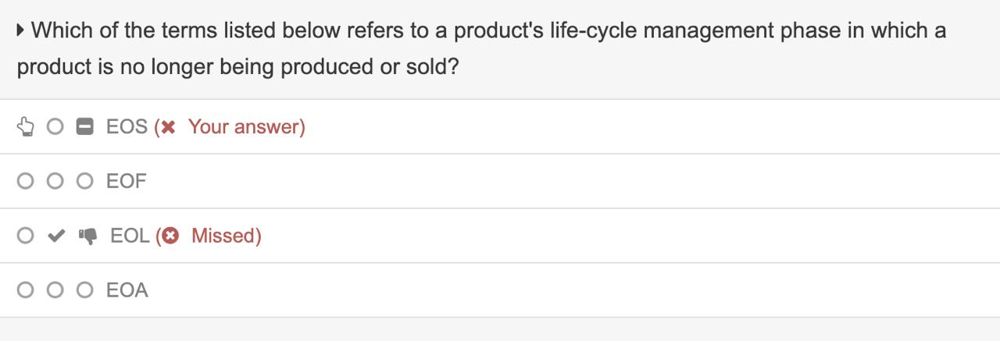

**题干：** Which of the terms listed below refers to a product's life-cycle management phase in which a product is no longer being produced or sold?

|  |  |
| --- | --- |
| ❌ 我的答案 | EOS |
| ✅ 正确答案 | EOL |

### 对，这题本质上就是记忆题
但它不是纯死背，
你可以顺手把几个缩写一起分清：

### 1. EOL = End of Life
这是这题正确答案。

#### 含义：
- 产品生命周期结束
- 不再生产
- 不再继续销售
- 厂商把它视为走到生命周期尾声

所以题目说：
> **no longer being produced or sold**
最标准答案就是：
## **EOL**

### 2. EOS = End of Support
你这题错在把它和 EOL 混了。

#### 含义：
- 厂商不再提供支持
- 可能不再提供补丁、技术支持、维护

它更偏：
### **支持结束**
不是这题问的“停止生产和销售”。

### 3. EOF
这个选项在 IT 语境里常见的是：
### **End of File**
不是产品生命周期里这题最标准的答案。

### 4. EOA
有时会看到：
### **End of Availability**
意思更偏：
- 不再可购买/不再可下单

但在 A+ 这种题里，
看到“产品生命周期结束，不再生产或销售”，
最标准、最常见的答案通常还是：
## **EOL**

### 最简单记忆法
- **EOL** → 产品寿命结束
- **EOS** → 厂商支持结束

### 一句话口诀
## **Life 看 EOL，Support 看 EOS。**

### 为什么这题容易错
因为：
- EOL
- EOS
- EOA
这些都很像“结束了”

所以一旦题目问：
- **产品本身生命周期结束**
- **不再生产销售**

先想：
## **EOL**

如果题目问的是：
- 不再打补丁
- 不再提供技术支持

才更像：
## **EOS**

**一句话：**
这题虽然是记忆题，但最实用的分法就是：**产品寿命结束看 EOL，厂商支持结束看 EOS。**
---

## 远程交付各种计算服务的大概念：XaaS
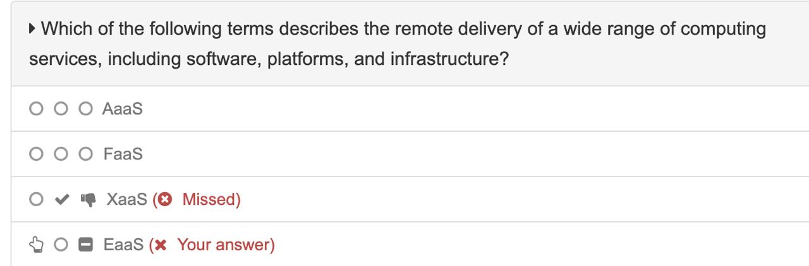

**题干：** Which of the following terms describes the remote delivery of a wide range of computing services, including software, platforms, and infrastructure?

|  |  |
| --- | --- |
| ❌ 我的答案 | EaaS |
| ✅ 正确答案 | XaaS |

### 这题为什么会让人懵
因为这几个缩写平时确实不常一起见：
- **XaaS**
- **FaaS**
- **EaaS**
- **AaaS**

它们都长得很像，
但这题真正想考的是：
## **“总称” vs “某一种具体服务”**

### 为什么答案是 XaaS
## **XaaS = Anything as a Service**
也常理解成：
### **Everything as a Service**

它是一个：
## **总称 / 大概念**

意思是：
- 软件可以作为服务交付（SaaS）
- 平台可以作为服务交付（PaaS）
- 基础设施可以作为服务交付（IaaS）
- 甚至更多东西都可以 as a service 方式远程提供

所以题目里说：
> **a wide range of computing services, including software, platforms, and infrastructure**

这明显是在描述：
## **XaaS**

### 你可以怎么理解 XaaS
它其实就是：
### **“各种东西都可以打包成云服务提供”**

所以只要题目出现：
- 很广泛
- 包括软件、平台、基础设施
- 各种计算服务的远程交付

先想：
## **XaaS**

---

## 其他几个分别是什么
