### 1. FaaS = Function as a Service
这个比较常见。

#### 含义：
- 把某个函数/代码执行能力作为服务提供
- 属于 serverless 的常见概念
- 例如：事件触发某段函数运行

#### 记忆：
## **FaaS = 函数级服务 / serverless 函数**

---

### 2. EaaS
这个缩写在不同场景下可能会有不同解释，
常见比如：
- **Everything as a Service**
- **Endpoint as a Service**
- **Education as a Service**
- **Energy as a Service**

所以在考试里如果题目问的是：
### **总的、广义的“各种计算服务远程交付”**
更标准、最常见的答案还是：
## **XaaS**

也正因为 EaaS 语义不够稳定，
它不是这题最标准的答案。

---

### 3. AaaS
这个也比较泛，常见可能有：
- **Authentication as a Service**
- **Analytics as a Service**
- **Application as a Service**

总之它通常不是这题要的“总称答案”。

---

## 最简单记忆法
### 大总称
- **XaaS** → 各种 as-a-service 的总称

### 具体一种
- **FaaS** → Function as a Service
- 其他像 AaaS / EaaS 常常语义更具体或更不稳定

---

## 一句话口诀
## **XaaS 是大总称，FaaS 是具体一种。**

### 再压缩成一句
- **SaaS / PaaS / IaaS 都能被装进 XaaS 这个大筐里**

---

## 一句话总结
**这题的关键不是逐个猜缩写，而是分清层级：题目问的是“软件、平台、基础设施等各种服务的远程交付总称”，所以答案是 XaaS；FaaS 只是其中某一种具体服务形态。**
---

## 题目说 parallel interface standards，就想到 SCSI，不是 PCIe
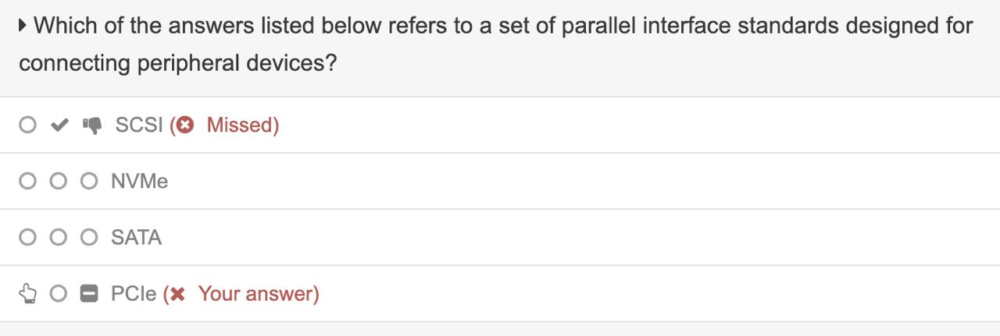

**题干：** Which of the answers listed below refers to a set of parallel interface standards designed for connecting peripheral devices?

|  |  |
| --- | --- |
| ❌ 我的答案 | PCIe |
| ✅ 正确答案 | SCSI |

### 这题为什么容易错
因为你前面刚学了：
- **PCI = Peripheral Component Interconnect**
- peripheral devices

所以这题一看到：
### **connecting peripheral devices**
很容易又往 PCI / PCIe 那边跑。

但这题真正决定答案的关键词不是 peripheral，
而是：
## **a set of parallel interface standards**

### 为什么答案是 SCSI
## **SCSI = Small Computer System Interface**
它是一组接口标准，
历史上常用于连接：
- 硬盘
- 扫描仪
- 磁带机
- 光驱
- 其他外围设备

而且经典 SCSI 很重要的一个特征就是：
### **早期/经典 SCSI 是并行接口（parallel）**

所以题目问：
> **a set of parallel interface standards**
这正好对应：
## **SCSI**

### 为什么 PCIe 不对
## **PCIe = PCI Express**
它是：
- 主板扩展总线
- 串行（serial）高速互连
- 给显卡、网卡、NVMe 扩展卡等用

重点是：
### **Express = 现代高速串行总线**

所以它和题目里的：
### **parallel interface standards**
不匹配。

### 为什么 SATA 不对
- SATA 也是串行接口
- 它的名字就有：
### **Serial ATA**
- 所以也不可能是 parallel

### 为什么 NVMe 不对
- NVMe 是存储协议 / 接口生态里的现代方案
- 更偏基于 PCIe 的高速存储
- 也不是题目说的“parallel interface standards”

### 最简单记忆
如果题目出现：
- **parallel**
- **older peripheral interface**

先想：
## **SCSI**

如果题目出现：
- **PCIe**
- **Express**
- **high-speed expansion**

就记住：
## **它是串行，不是并行**

### 一句话口诀
## **SCSI 老并行，SATA/PCIe 都是串行。**

**一句话：**
这题错在被 “peripheral devices” 带偏了；真正决定答案的是 **parallel interface standards**，而经典符合这个描述的是 **SCSI**，不是 PCIe。
---

## IPS 的特点：颜色好、视角广，但响应偏慢
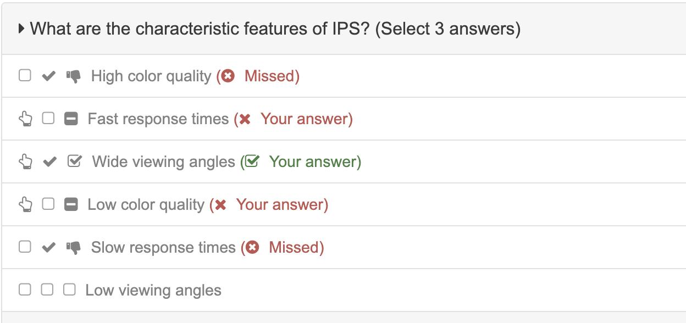

**题干：** What are the characteristic features of IPS? (Select 3 answers)

**正确答案：**
- **High color quality**
- **Wide viewing angles**
- **Slow response times**

### 为什么 IPS 这题老容易记混
因为显示器面板题本质上就在考：
### **“优点是哪几个，代价是哪几个”**

而 IPS 最典型的一组特征就是：
## **颜色好 + 视角广 + 响应相对慢**

### 1. High color quality
IPS 面板一直最常被提到的优点之一就是：
- 颜色表现好
- 色准更好
- 适合图片、设计、日常观感

所以：
### **High color quality**
是标准答案。

### 2. Wide viewing angles
IPS 的另一个经典优点就是：
- 从侧面看颜色和亮度变化没那么严重
- 视角宽

所以：
### **Wide viewing angles**
也是标准答案。

### 3. Slow response times
这题最容易错在这里。
很多人一看到“好面板”，就下意识觉得它各方面都更强。

但考试里 IPS 常见的“代价”是：
- 响应时间通常不如更偏速度型的面板
- 所以在经典对比里，
### **slow response times**
会被当成 IPS 的典型特征之一。

### 你为什么会错
你选了：
- **Fast response times**
- **Low color quality**

这两个刚好都和 IPS 的经典印象相反：
- IPS 不是以“最快响应”出名
- IPS 也不是低色质

### 最简单记忆法
你可以直接把 IPS 背成：
## **IPS = Image Pretty Stable**
虽然这不是正式全称，
但非常好记：
- **Image Pretty** → 颜色好
- **Stable** → 视角看着更稳定
- 代价：**速度不算最快**

### 再和其他面板顺手区分
- **IPS** → 颜色好、视角广、速度偏慢
- **TN** → 速度快、颜色和视角差一些
- **VA** → 对比度高，处于中间路线

### 一句话口诀
## **IPS 看色彩和视角，别看速度。**

**一句话：**
这题最值得死记的就是：**IPS = 高色质 + 广视角 + 响应偏慢**。
---

## LC 光纤接口：小、像 RJ-45 卡扣、适合高密度环境
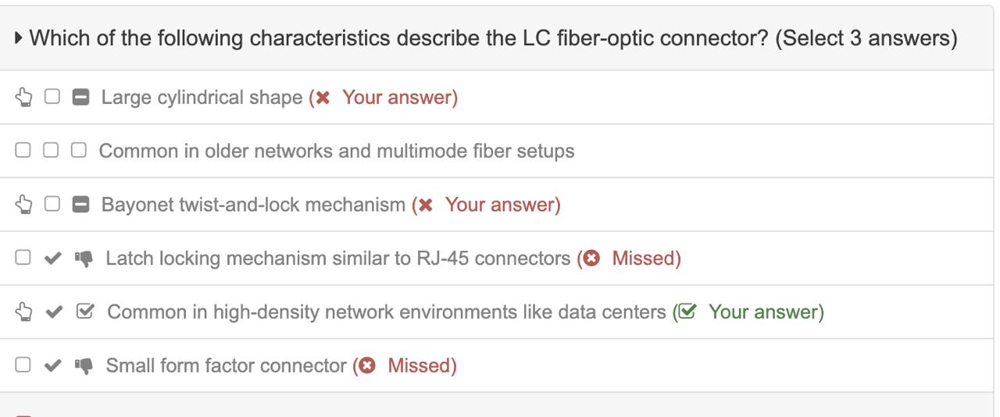

**题干：** Which of the following characteristics describe the LC fiber-optic connector? (Select 3 answers)

**正确答案：**
- **Latch locking mechanism similar to RJ-45 connectors**
- **Common in high-density network environments like data centers**
- **Small form factor connector**

### 这题为什么会错
你把 LC 和那种更老、更大、带旋转锁定的光纤接口混了。
你选了：
- **Large cylindrical shape**
- **Bayonet twist-and-lock mechanism**

这两个更像是在描述：
## **ST connector**
不是 LC。

### LC 到底长什么样
## **LC = Lucent Connector**
它最典型的三个记忆点就是：

### 1. Small form factor connector
- LC 是小型化光纤接口
- 体积比 SC、ST 这类老接口更小
- 很适合高密度布线

### 2. Latch locking mechanism similar to RJ-45
- LC 的卡扣感觉很像网线头（RJ-45）那种按压卡扣
- 所以考试很爱拿这个来当辨识点

### 3. Common in high-density network environments like data centers
- 因为它小，所以在：
  - 机房
  - 数据中心
  - 高密度光纤配线环境
  很常见

### 为什么你选的两个不对
#### Large cylindrical shape
- LC 不是“大圆柱头”
- 它恰恰是：
### **small form factor**

#### Bayonet twist-and-lock mechanism
- 这种“旋转卡口 / twist-and-lock”更像 ST 接头
- LC 不是这种锁定方式
- LC 是更像 RJ-45 的卡扣式

### 最简单记忆法
你可以把 LC 直接记成：
## **LC = Little Connector**
虽然这不是正式全称，
但考试里特别好用：
- **Little** → 小型接口
- **Clip** → 像 RJ-45 卡扣
- **Crowded racks** → 适合高密度机房/数据中心

### 顺手和 ST 区分
- **LC** → 小、卡扣像 RJ-45、数据中心常见
- **ST** → 更老、更大、圆柱、旋转锁定

### 一句话口诀
## **LC 小而精，像网线卡扣；ST 大而圆，要拧着锁。**

**一句话：**
这题的关键是把 LC 和 ST 分开：**LC 是小型、高密度、RJ-45 风格卡扣；你错选的“大圆柱 + 旋转锁定”更像 ST。**
---

## OLED：不要背成“更亮”，考试里先记“无背光 + 对比更好 + 亮度偏低”
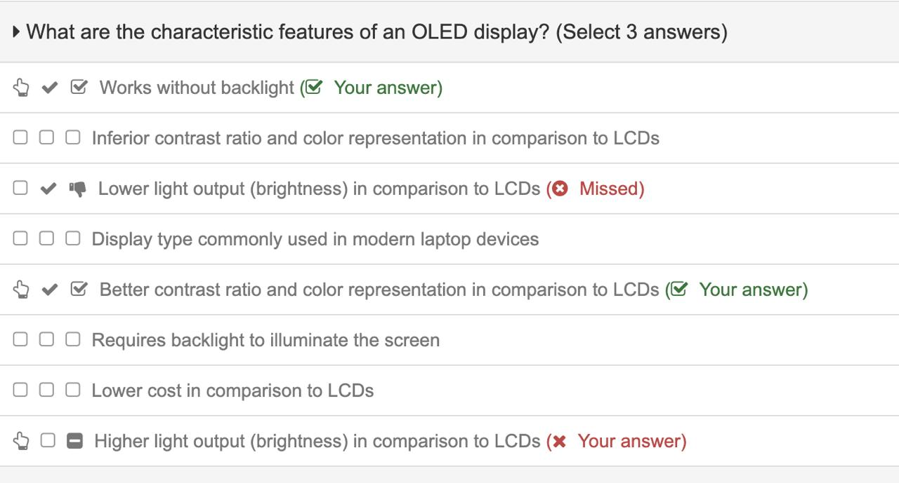

**题干：** What are the characteristic features of an OLED display? (Select 3 answers)

**正确答案：**
- **Works without backlight**
- **Lower light output (brightness) in comparison to LCDs**
- **Better contrast ratio and color representation in comparison to LCDs**

### 为什么这题容易错
因为你前面已经记住 OLED 的优点：
- 对比度好
- 颜色表现好
- 不需要背光

于是很容易顺手把它也想成：
### **亮度也更强**

但这套题里，它要你记的特征是：
## **OLED 不用背光，画质更好，但亮度不如 LCD 那样高**

### 1. Works without backlight
这是 OLED 最核心的标志性特点。
OLED 每个像素自己发光，
所以：
### **不需要背光层**

这也是为什么它能做到：
- 真黑
- 高对比度
- 更薄

### 2. Better contrast ratio and color representation
这也是 OLED 最典型优点：
- 黑色更纯
- 对比度更高
- 颜色表现更漂亮

所以这项你选对了。

### 3. Lower light output (brightness) in comparison to LCDs
你错在这里。
这套题想让你记的是：
- OLED 虽然画质好
- 但亮度这项不一定占优势
- 所以考试里这里给的标准答案是：
### **Lower light output**

### 为什么 higher light output 不对
因为这题不是在考“主观观感更艳丽”，
而是在考这套资料里的典型面板特性记忆点。

它要你形成的对比是：
- **OLED** → 无背光、对比强、色彩好、亮度较低
- **LCD** → 靠背光，亮度表现通常更稳定/更高

### 最简单记忆法
你可以直接背成：
## **OLED = 自发光、黑得深、颜色好，但别默认它更亮。**

### 再压缩一点
- **OLED** → no backlight
- **OLED** → better contrast/color
- **OLED** → brightness 不要背成最强

### 一句话口诀
## **OLED 看黑和色，不看背光；亮度别瞎选更高。**

**一句话：**
这题最值得记住的是：**OLED 的核心优势是无背光和高对比度/好色彩，但这套题里亮度并不是它的加分项，标准答案反而是 lower light output。**
---

## 规定用户如何使用电脑和网络资源的文件：AUP
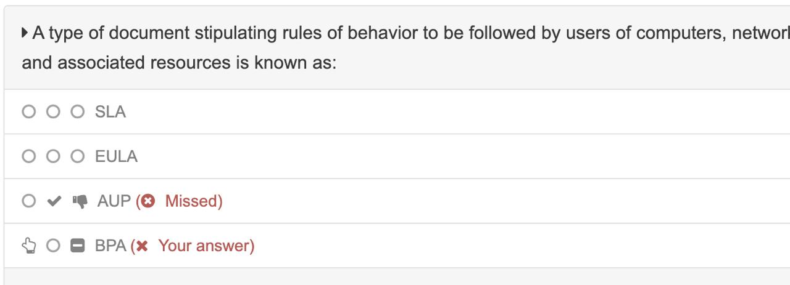

**题干：** A type of document stipulating rules of behavior to be followed by users of computers, networks, and associated resources is known as:

|  |  |
| --- | --- |
| ❌ 我的答案 | BPA |
| ✅ 正确答案 | AUP |

### 正确答案先记住
## **AUP = Acceptable Use Policy**
中文可以理解成：
### **可接受使用政策 / 使用规范**

它的作用就是：
- 规定用户怎么使用电脑、网络、邮箱、系统资源
- 哪些行为允许
- 哪些行为不允许

所以题目里说：
> **rules of behavior to be followed by users of computers, networks, and associated resources**

这就是非常标准的：
## **AUP**

---

## 这几个缩写分别是什么

### 1. AUP = Acceptable Use Policy
#### 中文：
- 可接受使用政策
- 使用规范

#### 干什么：
- 规定用户使用 IT 资源时的行为规则
- 比如：
  - 不能乱装软件
  - 不能访问违规网站
  - 不能滥用公司网络
  - 不能把公司资源拿去做私人违规用途

#### 记忆：
## **AUP = 用户行为规则**

---

### 2. SLA = Service Level Agreement
#### 中文：
- 服务级别协议

#### 干什么：
- 约定服务质量
- 比如：
  - 可用性 99.9%
  - 响应时间
  - 维修恢复时间
  - 服务承诺

#### 记忆：
## **SLA = 服务承诺 / 服务质量协议**

它不是讲“用户行为规范”的。

---

### 3. EULA = End User License Agreement
#### 中文：
- 终端用户许可协议

#### 干什么：
- 软件授权条款
- 告诉你：
  - 你能不能装
  - 能装几台
  - 能不能复制/商用/转售

#### 记忆：
## **EULA = 软件使用授权协议**

它不是网络行为规范。

---

### 4. BPA
这个缩写在 IT 场景里并不是这题的标准答案，
常见语境也不如前面三个稳定。
你这题只要记住：
### **它不是规定用户网络行为规则的标准文件名**
就够了。

---

## 最简单对照记忆
| 缩写 | 全称 | 中文 | 你先记成什么 |
| --- | --- | --- | --- |
| **AUP** | Acceptable Use Policy | 可接受使用政策 | **用户行为规则** |
| **SLA** | Service Level Agreement | 服务级别协议 | **服务承诺** |
| **EULA** | End User License Agreement | 终端用户许可协议 | **软件授权条款** |
| **BPA** | （这题里不是标准答案） | - | **先别选它** |

---

## 一句话口诀
## **AUP 管行为，SLA 管服务，EULA 管授权。**

### 一句话总结
**这题错在把“用户行为规范文件”和别的协议类缩写混了；凡是题目提到用户如何使用电脑、网络和资源的规则，优先想到 AUP（Acceptable Use Policy）。**
---

## 备份轮换方案看 GFS，不是 LIFO / FIFO / EFS
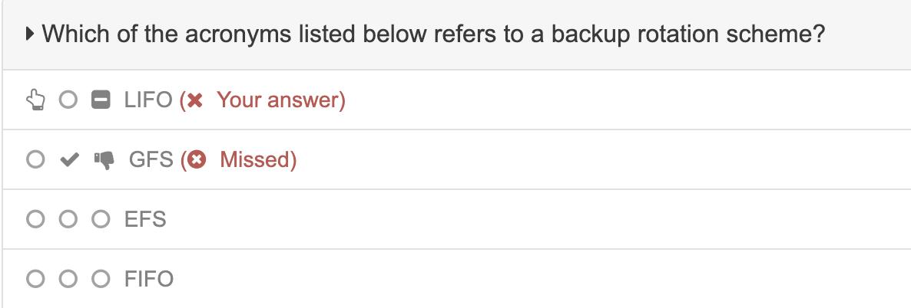

**题干：** Which of the acronyms listed below refers to a backup rotation scheme?

|  |  |
| --- | --- |
| ❌ 我的答案 | LIFO |
| ✅ 正确答案 | GFS |

### 正确答案先记住
## **GFS = Grandfather-Father-Son**
这是一种：
### **备份轮换方案（backup rotation scheme）**

它的核心思想是把备份分成不同时间层级来轮换保留：
- **Son** → 每日/最近的备份
- **Father** → 每周备份
- **Grandfather** → 每月备份

所以它就是很典型的：
## **备份轮换策略名称**

### 为什么这题容易错
因为另外几个缩写看起来也像“规则”。
尤其：
- **LIFO**
- **FIFO**

它们确实是规则，
但不是 IT 备份轮换方案里这题要考的那个标准名词。

---

## 其他几个缩写分别是什么

### 1. GFS = Grandfather-Father-Son
#### 含义：
- 祖父-父-子备份轮换法

#### 用途：
- 组织不同时间层级的备份保留
- 平衡：
  - 最近恢复需求
  - 历史版本保留
  - 存储空间使用

#### 最简单记忆：
## **GFS = 备份轮换法**

---

### 2. LIFO = Last In, First Out
#### 含义：
- 后进先出

#### 用途：
- 更像数据结构 / 仓储 / 栈（stack）逻辑

#### 记忆：
## **LIFO = 栈 / 后进先出**

它不是备份轮换方案名字。

---

### 3. FIFO = First In, First Out
#### 含义：
- 先进先出

#### 用途：
- 更像队列（queue）逻辑
- 仓储、排队、缓冲处理也常见

#### 记忆：
## **FIFO = 队列 / 先进先出**

它也不是这题说的备份轮换法。

---

### 4. EFS = Encrypting File System
#### 含义：
- 加密文件系统

#### 用途：
- Windows 文件加密功能
- 用来保护文件内容

#### 记忆：
## **EFS = 文件加密**

和备份轮换无关。

---

## 最简单对照记忆
| 缩写 | 全称 | 你先记成什么 |
| --- | --- | --- |
| **GFS** | Grandfather-Father-Son | **备份轮换法** |
| **LIFO** | Last In, First Out | **后进先出 / 栈** |
| **FIFO** | First In, First Out | **先进先出 / 队列** |
| **EFS** | Encrypting File System | **文件加密** |

---

## 一句话口诀
## **备份轮换看 GFS，栈看 LIFO，队列看 FIFO，加密看 EFS。**

### 一句话总结
**这题错在把“通用顺序规则”当成了“备份轮换方案名”。真正专门指备份轮换策略的是 GFS（Grandfather-Father-Son）。**
---

## 冒充公司联系人发邮件骗转账/泄密：BEC，不是 CSRF
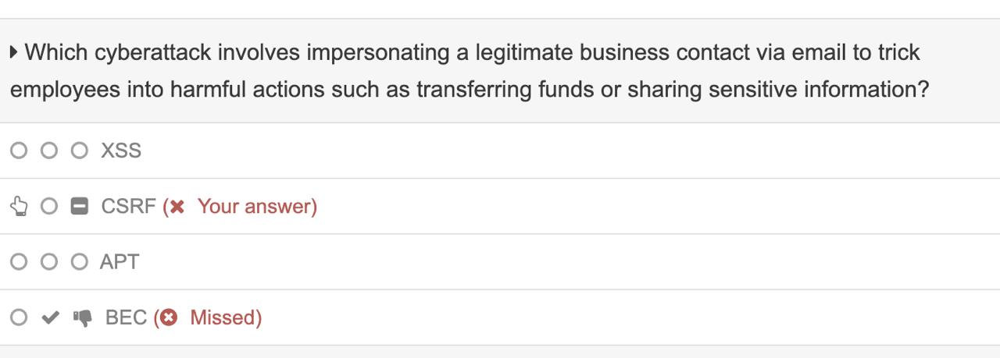

**题干：** Which cyberattack involves impersonating a legitimate business contact via email to trick employees into harmful actions such as transferring funds or sharing sensitive information?

|  |  |
| --- | --- |
| ❌ 我的答案 | CSRF |
| ✅ 正确答案 | BEC |

### 为什么答案是 BEC
## **BEC = Business Email Compromise**
中文可以理解成：
### **商业邮件诈骗 / 商务邮件入侵欺骗**

它的典型特点就是：
- 冒充老板、财务、客户、供应商等合法商务联系人
- 通过 email 骗员工：
  - 转账
  - 改打款账户
  - 发敏感资料
  - 泄露内部信息

而题目里的关键词几乎就是 BEC 的定义：
- **impersonating a legitimate business contact via email**
- **transferring funds**
- **sharing sensitive information**

所以标准答案一定是：
## **BEC**

### 为什么 CSRF 不对
你选的：
## **CSRF = Cross-Site Request Forgery**
中文就是：
### **跨站请求伪造**

它是一种：
- Web 攻击
- 利用用户已登录状态，诱导浏览器替用户发请求

比如：
- 你登录着某网站
- 攻击者诱导你点一个恶意链接/页面
- 浏览器帮你偷偷执行操作

所以 CSRF 的重点是：
### **网站请求伪造**
不是冒充商务邮件联系人。

### 为什么 XSS 不对
## **XSS = Cross-Site Scripting**
- 跨站脚本攻击
- 主要是往网页里注入恶意脚本
- 不是商务邮件诈骗

### 为什么 APT 不对
## **APT = Advanced Persistent Threat**
- 高级持续性威胁
- 更偏长期、有组织、持续渗透攻击
- 范围太大，不是题目里这种很具体的“冒充商务联系人发邮件骗钱”场景

### 最简单记忆法
- **BEC** → 冒充商务联系人发邮件骗钱/骗资料
- **CSRF** → 伪造网站请求
- **XSS** → 网页脚本注入
- **APT** → 长期高级渗透威胁

### 一句话口诀
## **邮件冒充骗转账看 BEC，网页伪造请求看 CSRF。**

**一句话：**
这题错在把“邮件商务诈骗”看成了“网页请求伪造”；题目描述的是典型 **BEC（Business Email Compromise）**，不是 CSRF。
---

## 化学品安全信息文档看 MSDS，不是 SOP
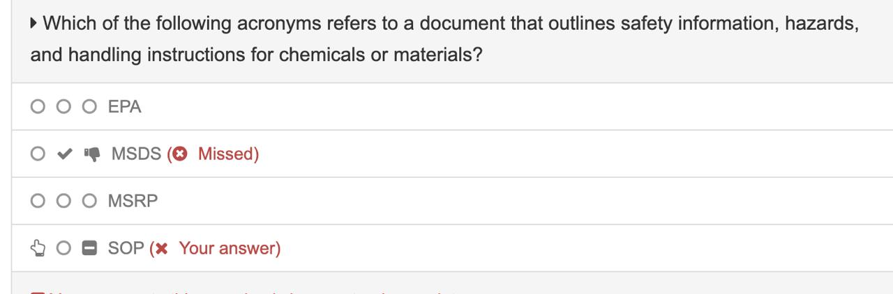

**题干：** Which of the following acronyms refers to a document that outlines safety information, hazards, and handling instructions for chemicals or materials?

|  |  |
| --- | --- |
| ❌ 我的答案 | SOP |
| ✅ 正确答案 | MSDS |

### 正确答案先记住
## **MSDS = Material Safety Data Sheet**
中文可以理解成：
### **材料安全数据表 / 化学品安全说明书**

它的作用就是：
- 列出化学品或材料的危险信息
- 说明怎么安全处理
- 告诉你储存、接触、防护、泄漏处理等要求

所以题目说：
> **safety information, hazards, and handling instructions for chemicals or materials**

标准答案就是：
## **MSDS**

### 为什么 SOP 不对
你选的：
## **SOP = Standard Operating Procedure**
中文就是：
### **标准操作流程 / 标准作业程序**

SOP 讲的是：
- 某项工作应该怎么做
- 步骤是什么
- 操作规范是什么

它可以用于很多场景：
- 维修流程
- 开机流程
- 备份流程
- 实验流程

但它不是专门针对：
### **化学品安全信息和危害说明**
所以这题不能选 SOP。

### 另外两个顺手看一下
- **EPA** → 通常联想到美国环境保护署（Environmental Protection Agency），不是这种文档名称
- **MSRP** → Manufacturer's Suggested Retail Price，厂商建议零售价，更不相关

### 最简单记忆法
- **MSDS** → 化学品安全说明书
- **SOP** → 标准操作流程

### 一句话口诀
## **化学品安全看 MSDS，做事流程看 SOP。**

**一句话：**
这题错在把“化学品安全文档”和“操作流程文档”混了；前者是 **MSDS**，后者是 **SOP**。
---

## SMB/CIFS 不是“面向互联网优化”的，它是局域网文件共享协议
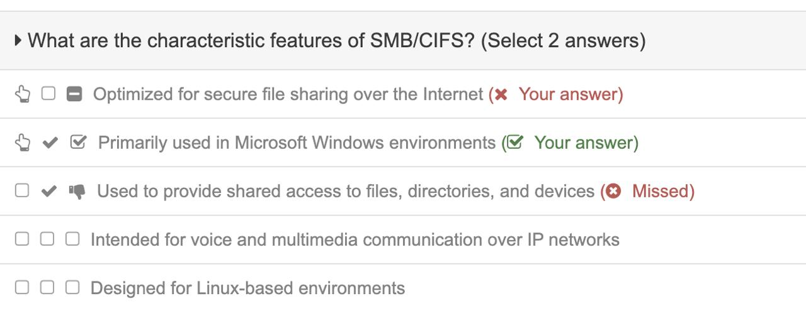

**题干：** What are the characteristic features of SMB/CIFS? (Select 2 answers)

**正确答案：**
- **Primarily used in Microsoft Windows environments**
- **Used to provide shared access to files, directories, and devices**

### 你问的重点：为什么第一个选项错
你选的第一个是：
## **Optimized for secure file sharing over the Internet**

它错的关键在于：
### **SMB/CIFS 的典型使用场景不是“面向互联网优化”**
而是：
## **局域网 / 内网文件共享**

### SMB/CIFS 到底是干什么的
**SMB = Server Message Block**
**CIFS = Common Internet File System**

虽然名字里有个 **Internet**，
但考试里你不要被这个词骗了。

它更典型的用途是：
- Windows 共享文件夹
- 网络磁盘共享
- 共享打印机
- 共享目录 / 设备访问

也就是：
### **在内网里提供文件、目录和设备共享**

### 为什么“optimized for secure file sharing over the Internet”不对
这句话错在两层：

#### 1. 不是“专门为互联网优化”
SMB/CIFS 更多是：
- 局域网协议
- 企业/家庭内网共享协议
- 不是那种专门拿来做公网文件共享的“互联网友好型”协议

#### 2. 也不是这题想表达的“安全互联网共享方案”
如果题目强调：
- 安全地通过互联网共享文件
- 公网远程安全访问

考试里你更容易想到：
- VPN
- SFTP
- HTTPS-based 方案
而不是先想 SMB/CIFS。

### 为什么第二个正确答案是对的
#### **Used to provide shared access to files, directories, and devices**
这才是 SMB/CIFS 最标准的描述。
它的核心作用就是：
- 文件共享
- 目录共享
- 打印机/设备共享

### 最简单记忆
- **SMB/CIFS** → Windows 内网共享
- **不是** → “为互联网安全文件共享优化”的协议

### 一句话口诀
## **SMB/CIFS 看共享，不看互联网优化。**

### 再压缩成一句
- **Windows 文件共享** → SMB/CIFS
- **安全公网传文件** → 不优先想 SMB/CIFS

**一句话：**
第一个选项错，是因为 SMB/CIFS 的典型定位是 **Windows/局域网文件共享协议**，不是“专门为互联网安全文件共享优化”的协议。
---

## Authentication process 更贴近 MFA，不是 SSO
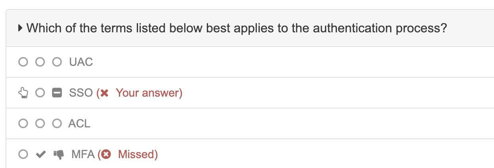

**题干：** Which of the terms listed below best applies to the authentication process?

|  |  |
| --- | --- |
| ❌ 我的答案 | SSO |
| ✅ 正确答案 | MFA |

### 为什么答案是 MFA
这题问的是：
## **authentication process（认证过程）**

在这几个选项里，最直接和“认证怎么进行”相关的是：
### **MFA = Multi-Factor Authentication**

也就是：
- 多因素认证
- 用多个认证要素来验证身份

例如：
- 密码
- 手机验证码
- 指纹/面容
- 安全令牌

这显然就是非常典型的：
## **身份认证过程**

### 为什么 SSO 不对
你选的是：
## **SSO = Single Sign-On**
中文就是：
### **单点登录**

SSO 的重点不是“认证有几个因素”，
而是：
- 用户登录一次
- 可以访问多个系统
- 不用每个系统都重新登录

所以 SSO 更偏：
### **登录体验 / 身份联用机制**
而不是这题在考的“认证过程本身最典型的术语”。

### 为什么 UAC 不对
## **UAC = User Account Control**
- 用户帐户控制
- 更偏权限提升、管理员确认
- 不是认证过程本身

### 为什么 ACL 不对
## **ACL = Access Control List**
- 访问控制列表
- 决定谁能访问什么资源
- 更偏授权（authorization）
- 不是认证（authentication）

### 最简单区分
- **MFA** → 你是谁？怎么证明你是你？（认证）
- **SSO** → 登一次能进多个系统（登录联用）
- **ACL** → 你能访问什么（授权）
- **UAC** → 提权确认

### 最简单记忆法
如果题目问：
- **authentication process**
- 验证身份怎么做

优先想：
## **MFA**

如果题目问：
- 登录一次进入多个系统

才更像：
## **SSO**

### 一句话口诀
## **MFA 管认证，SSO 管一次登录多处通行，ACL 管权限。**

**一句话：**
这题错在把“认证方式”选成了“登录联用机制”；题目问 authentication process，本质更贴近 **MFA（多因素认证）**，不是 SSO。
---

## DRM：控制数字内容使用，防止盗版/版权侵权
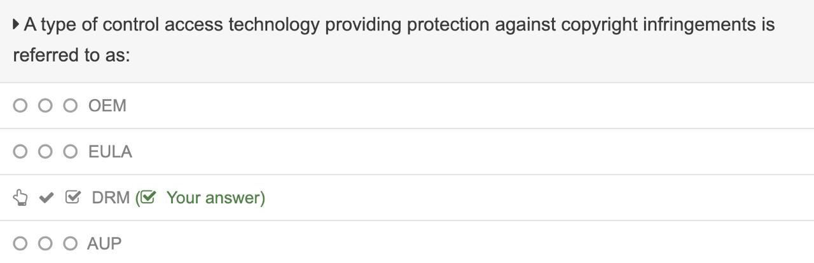

**题干：** A type of control access technology providing protection against copyright infringements is referred to as:

✅ **正确答案：DRM**

### 先记缩写
## **DRM = Digital Rights Management**
中文可以理解成：
### **数字版权管理**

### 它到底是干什么的
DRM 的核心就是：
- 控制数字内容怎么被使用
- 限制未授权复制、分享、播放、下载
- 保护版权方的内容不被随便传播

常见场景比如：
- 电影/音乐平台限制下载和复制
- 电子书限制复制、转发
- 软件或游戏限制盗版使用

所以题目说：
> **control access technology**
> **protection against copyright infringements**

这就是非常标准的：
## **DRM**

### 为什么不是别的
#### OEM
- **Original Equipment Manufacturer**
- 原始设备制造商
- 讲厂商身份/授权来源，不是版权内容访问控制技术

#### EULA
- **End User License Agreement**
- 终端用户许可协议
- 是法律/授权条款文件
- 不是“技术控制手段”

#### AUP
- **Acceptable Use Policy**
- 可接受使用政策
- 讲用户行为规范
- 也不是版权保护技术

### 最简单记忆法
看到：
- **数字内容**
- **版权保护**
- **限制复制/分享/使用**

先想：
## **DRM**

### 一句话口诀
## **DRM 管数字版权，EULA 管授权条款，AUP 管使用行为。**

**一句话：**
DRM 就是通过技术手段控制数字内容的访问和使用，防止未授权复制和传播，所以它是“防版权侵权”的标准答案。
---

## FAT32 / exFAT / NTFS：考试看到关键词就这样选

### 1. FAT32
#### 关键词：
- **USB flash drive 常见**
- **兼容性最好**
- **老设备/多设备支持**
- **4 GB maximum file size**

#### 先记成：
## **最通用，但卡 4GB**

---

### 2. exFAT
#### 关键词：
- **大容量 U 盘 / SDXC**
- **跨平台移动存储**
- **支持大文件**
- **比 FAT32 更适合现代移动存储**

#### 先记成：
## **大文件 U 盘优先 exFAT**

---

### 3. NTFS
#### 关键词：
- **Windows hard drive / system drive**
- **permissions**
- **journaling**
- **Windows 功能更强**

#### 先记成：
## **Windows 硬盘常用**

---

## 最简单总对比
- **FAT32** → 最通用，但单文件不能超过 4GB
- **exFAT** → U 盘/移动存储装大文件更合适
- **NTFS** → Windows 硬盘/系统盘最常见

### 一句话口诀
## **小U盘老兼容看 FAT32，大文件U盘看 exFAT，Windows硬盘看 NTFS。**
---

## “optimized for flash drives” 这种题更偏 exFAT，不是 FAT32
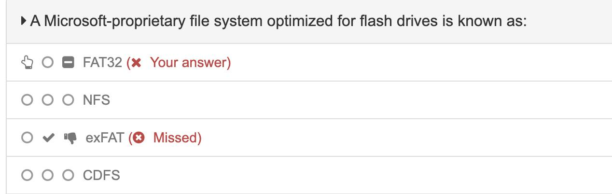

**题干：** A Microsoft-proprietary file system optimized for flash drives is known as:

|  |  |
| --- | --- |
| ❌ 我的答案 | FAT32 |
| ✅ 正确答案 | exFAT |

### 这题和你刚刚问的那个点要分开记
如果题目只是问：
- **flash drive 常见文件系统**
- **兼容性最好**

很多时候你会想到：
## **FAT32**

但这题问得更精确：
> **Microsoft-proprietary**
> **optimized for flash drives**

这两个关键词一出来，
更标准的答案就是：
## **exFAT**

### 为什么答案是 exFAT
**exFAT = Extended File Allocation Table**
它是微软推出、
专门更适合闪存和移动存储设备的文件系统。

它的典型特点是：
- 适合 **flash drives / SDXC / 外接移动存储**
- 支持 **大文件**
- 没有 FAT32 那个 **4GB 单文件限制**
- 比 FAT32 更现代

所以题目如果强调：
### **optimized for flash drives**
优先想到：
## **exFAT**

### 为什么 FAT32 这题不对
因为 FAT32 更像：
- 老牌、兼容性高
- 通用性强
- 但不是这题想考的“微软专门为 flash drive 优化”的那个标准答案

而且 FAT32 还有：
- **4GB 单文件限制**

所以这题用词更偏向：
## **exFAT**

### 另外两个为什么不对
- **NFS** → 网络文件系统（Network File System），不是 U 盘文件系统
- **CDFS** → 光盘文件系统（CD File System），不是 flash drive 文件系统

### 最简单区分
- **FAT32** → 通用兼容，老设备友好，但卡 4GB
- **exFAT** → 更适合闪存/大文件/现代移动存储
- **NTFS** → Windows 硬盘常见

### 一句话口诀
## **问“最通用”常想 FAT32；问“flash drive 优化”优先 exFAT。**

**一句话：**
你刚刚那个泛化记忆没错，但这道题问得更具体：它强调的是 **Microsoft-proprietary + optimized for flash drives**，所以标准答案要选 **exFAT**。
---

## SC 接头别和 ST/LC 混：SC 是 push-pull，常见于 datacom / telecom
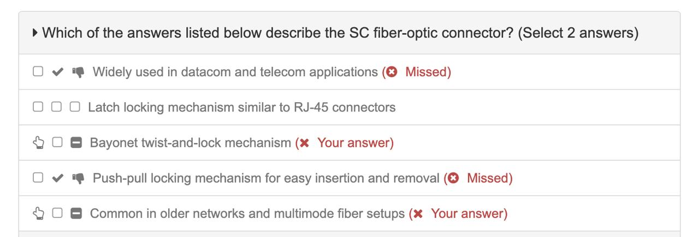

**题干：** Which of the answers listed below describe the SC fiber-optic connector? (Select 2 answers)

**正确答案：**
- **Widely used in datacom and telecom applications**
- **Push-pull locking mechanism for easy insertion and removal**

### 你为什么会“之前做过又错”
因为光纤接头这几种真的很容易串：
- **LC**
- **SC**
- **ST**

它们都在考：
- 外形
- 锁定方式
- 应用场景

你这次错，其实是把 **SC** 又和 **ST** 混了。

### 这题最关键的区分
## **SC = push-pull**
也就是：
- 直接推入
- 拉出拔掉
- 不是旋转卡口

所以：
### **Push-pull locking mechanism**
是对的。

而你选的：
### **Bayonet twist-and-lock mechanism**
这个更像：
## **ST**

### SC 常见场景
SC 是很常见的光纤接头，
经常用于：
- 数据通信（datacom）
- 电信（telecom）

所以：
### **Widely used in datacom and telecom applications**
也是对的。

### 你错选的另一个为什么不对
#### **Common in older networks and multimode fiber setups**
这更像在往 **ST** 那类老一点的场景靠。
SC 不用这么记。

### 顺手把三种最容易混的放一起
#### LC
- 小型（small form factor）
- 像 RJ-45 卡扣
- 常见于高密度环境/数据中心

#### SC
- **Push-pull**
- 常用于 datacom / telecom
- 方头、插拔方便

#### ST
- 圆形
- **Bayonet twist-lock**
- 更老一些

### 最简单记忆口诀
## **LC 小卡扣，SC 推拉插，ST 圆头拧。**

**一句话：**
你这题不是不会，是把 **SC** 和 **ST** 又串了：**SC 看 push-pull + datacom/telecom；ST 才是 bayonet twist-lock + 老网络风格。**
---

## IPS / TN / VA 三兄弟最容易串：VA 记“高对比 + 颜色不错 + 视角也不错”
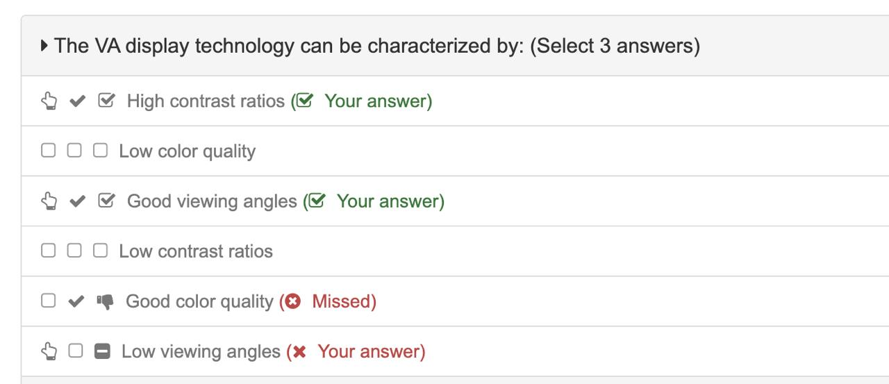

**题干：** The VA display technology can be characterized by: (Select 3 answers)

**正确答案：**
- **High contrast ratios**
- **Good viewing angles**
- **Good color quality**

### 为什么你又会错
因为显示器面板题真的就是三兄弟互相打架：
- **TN**
- **IPS**
- **VA**

你这次错在把：
### **VA 的“还不错 viewing angles”**
记成了：
### **low viewing angles**

其实更该这样记：
## **VA = 对比度强，颜色不错，视角也不错（但速度通常不如 TN）**

### VA 这题怎么记
#### 1. High contrast ratios
这是 VA 最标志性的强项。
### **VA 最爱考的就是高对比度**
黑位通常比 IPS/TN 更有优势。

#### 2. Good color quality
VA 不是低色质。
它的颜色表现是不错的，
虽然考试里很多人会更先把“好颜色”联想到 IPS，
但 VA 也不是差色彩。

#### 3. Good viewing angles
VA 的视角也不该直接打成“low viewing angles”。
它通常比 TN 好，
虽然很多资料会说它不如 IPS 那么强，
但考试里这里给的是：
### **good viewing angles**

### 你怎么防止再混
不要把三兄弟都背成“谁都差不多”。
要硬拆成：

#### TN
- **速度快**
- **颜色一般**
- **视角差**

#### IPS
- **颜色最好**
- **视角最好**
- **速度偏慢（考试记忆）**

#### VA
- **对比度最好/很强**
- **颜色不错**
- **视角不错**
- 夹在 IPS 和 TN 中间，但更偏“画面对比强”

### 最简单暴力记忆法
## **TN 看速度，IPS 看色彩和视角，VA 看对比度。**

然后再补一句：
## **VA 不是低视角、也不是低色质。**

### 一句话口诀
## **TN 快但差，IPS 美但慢，VA 黑得深。**

**一句话：**
这题最该记的是：**VA 的主标签是高对比度，不要把它误记成低视角面板；在这套题里，VA = 高对比 + 好颜色 + 好视角。**
---

## 这题考的是安全芯片 TPM，不是启动固件 UEFI
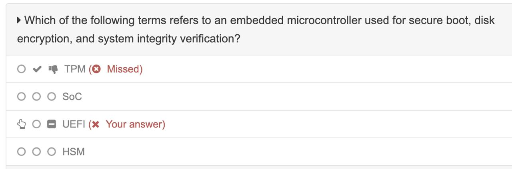

**题干：** Which of the following terms refers to an embedded microcontroller used for secure boot, disk encryption, and system integrity verification?

|  |  |
| --- | --- |
| ❌ 我的答案 | UEFI |
| ✅ 正确答案 | TPM |

### 为什么答案是 TPM
## **TPM = Trusted Platform Module**
它就是主板上/系统里的：
### **安全微控制器 / 安全芯片**

题目里的关键词是：
- **embedded microcontroller**
- **secure boot**
- **disk encryption**
- **system integrity verification**

这几个关键词加在一起，
最标准答案就是：
## **TPM**

### TPM 主要干什么
你可以先记 TPM 负责这些安全底层能力：
- 存储加密密钥
- 支持 BitLocker 这类磁盘加密
- 支持 secure boot / platform trust
- 做系统完整性校验

所以它更像：
### **硬件级安全根（root of trust）**

### 为什么 UEFI 不对
你选的：
## **UEFI = Unified Extensible Firmware Interface**
它是：
- 现代固件接口
- BIOS 的现代替代/扩展
- 负责启动流程、硬件初始化、启动管理

它确实和 **secure boot** 有关系，
所以你会被带偏很正常。

但这题问的不是：
### **哪个技术参与启动流程**
而是：
### **哪一个是 embedded microcontroller**

这一点就把答案锁死到：
## **TPM**

### 其他两个顺手区分
#### SoC = System on a Chip
- 片上系统
- 把很多功能集成到一块芯片里
- 不是这题说的安全微控制器名称

#### HSM = Hardware Security Module
- 硬件安全模块
- 也是安全相关硬件
- 但更常见于企业/服务器/密钥管理环境
- 不是 PC 里这题最典型的答案

### 最简单记忆法
- **TPM** → 主板/电脑里的安全芯片
- **UEFI** → 启动固件接口
- **HSM** → 更大更专用的企业级安全模块
- **SoC** → 集成式芯片平台

### 一句话口诀
## **TPM 是安全芯片，UEFI 是启动固件。**

**一句话：**
你错在把“参与安全启动的固件”选成了“安全微控制器”；题目只要看到 **embedded microcontroller + disk encryption + integrity verification**，优先想到 **TPM**。
---

## 微软强调 resilience / integrity / enterprise storage 时，先想 ReFS，不是 ZFS
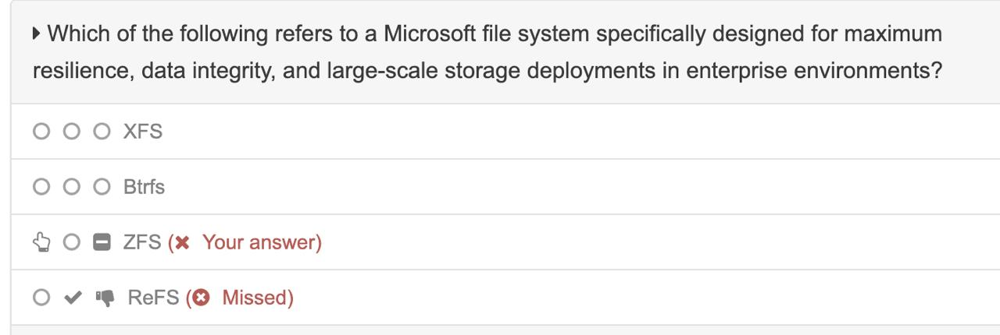

**题干：** Which of the following refers to a Microsoft file system specifically designed for maximum resilience, data integrity, and large-scale storage deployments in enterprise environments?

|  |  |
| --- | --- |
| ❌ 我的答案 | ZFS |
| ✅ 正确答案 | ReFS |

### 为什么这题容易错
因为你抓到的那几个关键词：
- resilience
- data integrity
- large-scale storage

这些描述确实也很像：
## **ZFS**

所以你选 ZFS 其实不是瞎选，
而是：
### **抓对了“特性”，但没抓住“Microsoft”这个限定词**

### 为什么答案是 ReFS
## **ReFS = Resilient File System**
它是：
### **微软的文件系统**

而且名字里就已经把关键词写出来了：
- **Resilient**

它就是为了：
- 更强的数据完整性
- 更强的容错/抗损能力
- 更适合企业级、大规模存储场景

所以题目一旦写：
- **Microsoft file system**
- **maximum resilience**
- **data integrity**
- **large-scale storage deployments**

标准答案就是：
## **ReFS**

### 为什么 ZFS 不对
## **ZFS** 也确实很强调：
- 数据完整性
- 大容量存储
- 企业/服务器场景

但它不是微软的文件系统。
它更常和：
- Solaris
- BSD
- Linux / OpenZFS 生态
联系起来。

所以这题错就错在：
### **忘了题目限定的是 Microsoft file system**

### 另外两个顺手区分
#### Btrfs
- Linux 常见现代文件系统之一
- 也强调快照、校验、现代存储特性
- 不是微软文件系统

#### XFS
- Linux/Unix 常见高性能文件系统
- 不是微软文件系统

### 最简单记忆法
- **ReFS** → Microsoft 企业级弹性文件系统
- **ZFS** → 很强的大存储/完整性文件系统，但不是 Microsoft
- **Btrfs / XFS** → 也都不是 Microsoft

### 一句话口诀
## **题目只要写 Microsoft + resilience，就优先选 ReFS。**

### 再压缩成一句
## **微软看 ReFS，类企业大存储但非微软常见看 ZFS。**

**一句话：**
你这题不是不会，而是被 ZFS 的特性吸引过去了；但题目已经明确说了 **Microsoft file system**，所以必须选 **ReFS（Resilient File System）**。
---

## 第三方持续监控+检测+响应服务看 MDR，不是 EDR
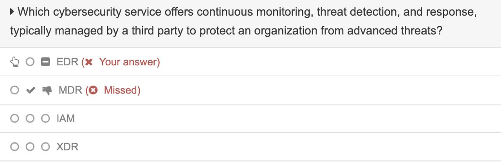

**题干：** Which cybersecurity service offers continuous monitoring, threat detection, and response, typically managed by a third party to protect an organization from advanced threats?

|  |  |
| --- | --- |
| ❌ 我的答案 | EDR |
| ✅ 正确答案 | MDR |

### 为什么答案是 MDR
题目最关键的限定词是：
- **service**
- **continuous monitoring, threat detection, and response**
- **typically managed by a third party**

这里的重点不是单纯一个产品功能，
而是：
## **由第三方托管/代管的安全监控与响应服务**

这就是：
## **MDR = Managed Detection and Response**

### MDR 到底是什么
你可以先把 MDR 记成：
### **外包型 / 托管型的检测与响应服务**

也就是：
- 有持续监控
- 有威胁检测
- 有响应处置
- 常由第三方安全团队来做

### 为什么 EDR 不对
## **EDR = Endpoint Detection and Response**
它重点是：
- 终端（endpoint）层面的检测和响应
- 更像产品/能力类别
- 焦点在设备端点安全

它不一定自带：
### **third-party managed service**

所以题目如果强调：
- **managed by a third party**

答案更该选：
## **MDR**
不是 EDR。

### XDR 为什么也不对
## **XDR = Extended Detection and Response**
它更偏：
- 跨多个安全层面整合检测与响应
- 不是这题最关键的“第三方托管服务”概念

### IAM 为什么不对
## **IAM = Identity and Access Management**
- 身份与访问管理
- 完全不是这题要的“检测与响应服务”

### 最简单记忆法
- **EDR** → 终端检测与响应
- **XDR** → 扩展/跨层检测与响应
- **MDR** → **托管检测与响应服务**
- **IAM** → 身份和权限管理

### 一句话口诀
## **EDR 看终端，XDR 看扩展整合，MDR 看第三方托管服务。**

**一句话：**
这题错在把“安全产品/能力”当成了“第三方托管服务”；题目只要强调 **managed by a third party**，优先想到 **MDR**。
---

## 管理高权限账户看 PAM，不是 IAM
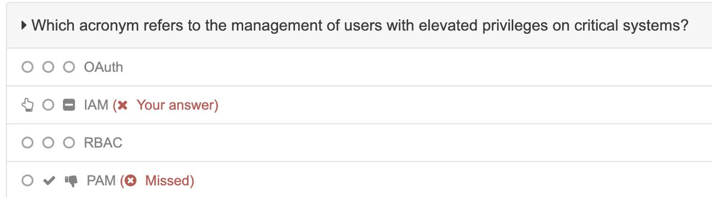

**题干：** Which acronym refers to the management of users with elevated privileges on critical systems?

|  |  |
| --- | --- |
| ❌ 我的答案 | IAM |
| ✅ 正确答案 | PAM |

### 为什么这题容易错
因为 **IAM** 和 **PAM** 都跟“身份和权限”有关，
很容易一看到 user management 就选 IAM。

但这题真正的关键词是：
- **elevated privileges**
- **critical systems**

这不是泛泛地管理所有用户身份，
而是在说：
## **高权限账号 / 特权账号管理**

所以答案是：
## **PAM = Privileged Access Management**

### PAM 到底是什么
PAM 专门管的是：
- 管理员账号
- root / domain admin / 高权限服务账号
- 对关键系统的特权访问
- 减少滥用和被盗用风险

所以只要题目提：
- 高权限用户
- 特权账号
- 关键系统

优先想到：
## **PAM**

### 为什么 IAM 不对
## **IAM = Identity and Access Management**
它更大、更泛：
- 用户身份管理
- 登录认证
- 权限分配
- 访问控制

它是大框架，
但这题问的是更具体的：
### **高权限账户管理**
所以要选 PAM，不是 IAM。

### 另外两个顺手区分
#### RBAC = Role-Based Access Control
- 基于角色的访问控制
- 讲“按角色分权限”
- 不是专门的特权账户管理

#### OAuth
- 授权框架
- 常见于第三方登录/授权访问
- 更不是这题答案

### 最简单记忆法
- **IAM** → 管所有身份和访问的大框架
- **PAM** → 管高权限账户
- **RBAC** → 按角色给权限
- **OAuth** → 授权协议/框架

### 一句话口诀
## **IAM 管大盘，PAM 管特权，RBAC 管角色，OAuth 管授权。**

**一句话：**
你这题错在把“通用身份访问管理”选成了“特权账户管理”；只要看到 **elevated privileges / critical systems**，优先选 **PAM**。
---

## 题目写“hardware + cryptographic key management + encryption functions”时，这题偏 HSM，不是 TPM
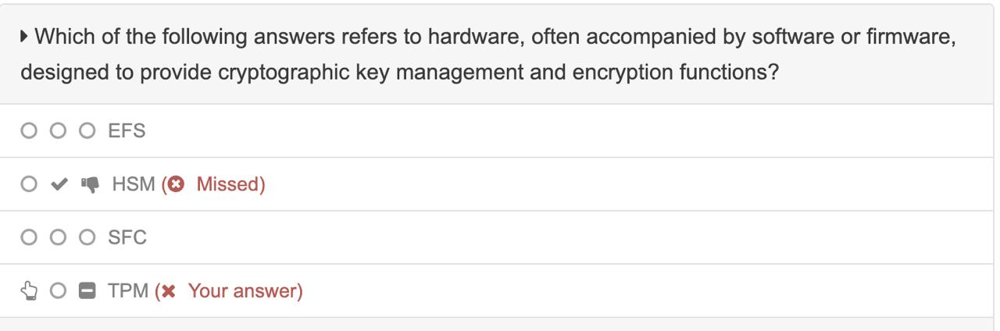

**题干：** Which of the following answers refers to hardware, often accompanied by software or firmware, designed to provide cryptographic key management and encryption functions?

|  |  |
| --- | --- |
| ❌ 我的答案 | TPM |
| ✅ 正确答案 | HSM |

### 为什么这题会和上一题混
因为上一题刚讲过：
- TPM
- secure boot
- disk encryption
- integrity verification

所以你这题很容易继续惯性选：
## **TPM**

但这题的关键词已经换了，
它强调的是：
- **hardware, often accompanied by software or firmware**
- **cryptographic key management**
- **encryption functions**

这套描述更偏：
## **HSM = Hardware Security Module**

### HSM 到底是什么
HSM 是：
### **专门做密钥管理和加密操作的硬件安全模块**

它的核心任务是：
- 安全存储加密密钥
- 执行加密/解密操作
- 支持证书、签名、密钥生命周期管理
- 常用于高安全要求环境

你可以把它理解成：
## **更偏专业密钥管理的加密保险柜/安全盒子**

### 为什么 TPM 这题不对
## **TPM** 也是安全硬件，
也跟密钥和加密有关系，
所以你错得很正常。

但 TPM 更典型的考试定位是：
- PC/主板上的安全芯片
- secure boot
- BitLocker / platform trust
- integrity verification

而题目如果明显强调：
### **cryptographic key management and encryption functions**
而且把它描述成一种专门硬件模块，
更标准的答案就是：
## **HSM**

### 另外两个为什么不对
#### EFS = Encrypting File System
- Windows 文件系统加密功能
- 不是硬件模块

#### SFC = System File Checker
- Windows 系统文件检查工具
- 更不相关

### 最简单区分
- **TPM** → PC 里的安全芯片，偏 secure boot / disk encryption trust
- **HSM** → 专门管理密钥、做加密操作的安全硬件模块
- **EFS** → 文件系统加密功能
- **SFC** → 系统文件检查

### 一句话口诀
## **TPM 像电脑里的安全芯片，HSM 像专门管密钥的硬件保险柜。**

**一句话：**
这题错在把“PC 安全芯片”选成了“专用密钥管理硬件模块”；题目只要突出 **cryptographic key management**，更标准答案通常就是 **HSM**。
---

## 老式串行铜缆连接器看 DB-9，不是 RG-59
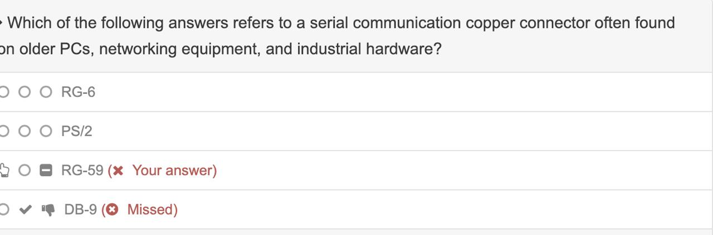

**题干：** Which of the following answers refers to a serial communication copper connector often found on older PCs, networking equipment, and industrial hardware?

|  |  |
| --- | --- |
| ❌ 我的答案 | RG-59 |
| ✅ 正确答案 | DB-9 |

### 为什么答案是 DB-9
题目最关键的词是：
- **serial communication**
- **copper connector**
- **older PCs, networking equipment, industrial hardware**

这几个关键词组合起来，
最典型的答案就是：
## **DB-9**

### DB-9 是什么
DB-9 是一种老式串行接口连接器，
经常和：
- RS-232 串口
- 老电脑串口设备
- 工业控制/网络设备控制台口
联系在一起。

你可以把它先记成：
### **老式串口头 / 串行通信接口头**

### 为什么 RG-59 不对
你选的：
## **RG-59**
它是：
### **同轴电缆类型**

常见用途更偏：
- 视频监控
- 有线电视/视频信号
- 射频/同轴传输

它不是“串行通信连接器”。

### 另外两个顺手排除
#### RG-6
- 也是同轴电缆类型
- 不是串行接口连接器

#### PS/2
- 键盘鼠标接口
- 不是这题说的老式串行通信连接器

### 最简单记忆法
- **DB-9** → 老式串口连接器
- **RG-59 / RG-6** → 同轴电缆
- **PS/2** → 键盘鼠标接口

### 一句话口诀
## **串口看 DB-9，同轴看 RG，键鼠看 PS/2。**

**一句话：**
这题错在把“同轴电缆型号”选成了“串行通信连接器”；题目只要出现 **serial communication on older PCs**，优先想到 **DB-9**。
---

## CMDB：记录配置项（CI）的数据库，像 IT 资产和系统关系总账本
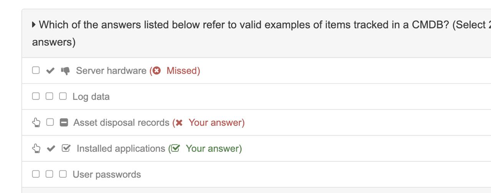

**题干：** Which of the answers listed below refer to valid examples of items tracked in a CMDB? (Select 2 answers)

**正确答案：**
- **Server hardware**
- **Installed applications**

### CMDB 是什么
## **CMDB = Configuration Management Database**
中文可以理解成：
### **配置管理数据库**

它的作用是：
- 记录 IT 环境里的配置项（Configuration Items, CI）
- 追踪这些东西是什么、在哪里、彼此怎么关联

你可以把它理解成：
## **IT 资产 / 系统配置 / 依赖关系的总账本**

### CMDB 里通常会记录什么
典型会记录：
- 服务器硬件
- 安装的软件 / 应用
- 网络设备
- 虚拟机
- 数据库实例
- 服务之间依赖关系
- 配置项的版本/归属/状态

所以这题的正确答案：
- **Server hardware**
- **Installed applications**

都很合理，
因为它们都是：
### **配置项（CI）**

### 为什么 Asset disposal records 不对
你选的：
## **Asset disposal records**
这个更像：
- 资产报废记录
- 生命周期末端处理文档
- 资产管理流程记录

它不是 CMDB 最核心想追踪的“当前配置项”。

### 为什么其他两个也不对
#### Log data
- 日志数据属于监控/审计/运维数据
- 不是 CMDB 的核心配置项

#### User passwords
- 用户密码属于敏感凭据
- 不应作为 CMDB 里这种配置项示例去记

### 最简单记忆法
CMDB 你先记一句：
## **CMDB 记录“系统里有什么、怎么配、彼此怎么连”。**

所以最像 CMDB 的通常是：
- 服务器
- 应用
- 网络设备
- 服务依赖

而不像的是：
- 日志
- 密码
- 报废记录

### 一句话口诀
## **CMDB 管配置项，不管日志、密码、报废单。**

**一句话：**
CMDB 就是用来记录 IT 环境里各类配置项和它们关系的数据库，所以 **server hardware** 和 **installed applications** 属于 CMDB 典型跟踪对象。
---

## 跟 WPA 一起出来、用来替代 WEP 的协议看 TKIP，不是 EAP
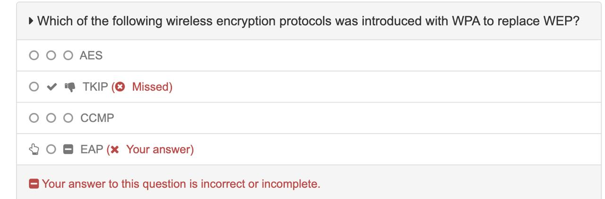

**题干：** Which of the following wireless encryption protocols was introduced with WPA to replace WEP?

|  |  |
| --- | --- |
| ❌ 我的答案 | EAP |
| ✅ 正确答案 | TKIP |

### 为什么这题又容易混
因为你脑子里现在已经有这些词：
- WPA
- TKIP
- AES
- CCMP
- EAP

它们都经常跟无线安全一起出现，
所以特别容易串。

### 为什么答案是 TKIP
## **TKIP = Temporal Key Integrity Protocol**
它就是：
### **WPA 时代用来替代 WEP 的过渡性加密/保护机制**

所以题目说：
> **introduced with WPA to replace WEP**

标准答案就是：
## **TKIP**

### 你最该记的关系
- **WEP** → 老旧、不安全
- **WPA** → 为修补 WEP 而来
- **TKIP** → **WPA 搭档**，用来替代 WEP 的旧机制
- **WPA2** → 更现代
- **AES / CCMP** → 常和 WPA2 绑一起记

### 为什么 EAP 不对
## **EAP = Extensible Authentication Protocol**
它是：
### **认证框架 / 认证协议体系**

它管的是：
- 身份验证
- 认证流程

而不是题目问的这种：
### **with WPA introduced to replace WEP 的无线加密协议/机制**

所以不能选 EAP。

### 为什么 AES / CCMP 这题不选
- **AES** → 更偏加密算法
- **CCMP** → 常和 WPA2 相关

如果题目问：
- WPA2 使用什么更现代机制
那更容易想到它们。

但题目明确说的是：
### **introduced with WPA to replace WEP**
这更典型就是：
## **TKIP**

### 最简单记忆法
## **WPA 配 TKIP，WPA2 配 AES/CCMP。**

### 一句话口诀
## **WEP 老，WPA 补，TKIP 跟 WPA，AES/CCMP 跟 WPA2。**

**一句话：**
这题错在把“认证框架 EAP”和“WPA 时代替代 WEP 的加密机制 TKIP”混了；看到 **WPA + replace WEP**，优先想 **TKIP**。
---

## TN 面板：快，但颜色差、视角差
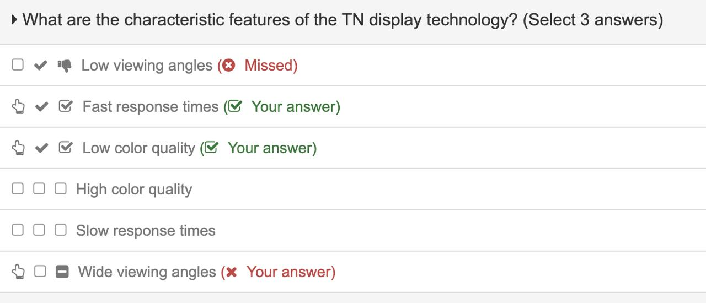

**题干：** What are the characteristic features of the TN display technology? (Select 3 answers)

**正确答案：**
- **Low viewing angles**
- **Fast response times**
- **Low color quality**

### TN 最核心的三件事
你可以直接死记：
## **TN = 快，但颜色差、视角差**

也就是：
- **Fast response times**
- **Low color quality**
- **Low viewing angles**

### 你这题错在哪里
你前两项其实已经对了：
- **Fast response times** ✅
- **Low color quality** ✅

你错在第三项把：
- **Low viewing angles**
看成了：
- **Wide viewing angles**

但 TN 最典型的弱点之一，
恰恰就是：
## **视角差**

### 为什么 TN 容易记混
因为你最近一直在做：
- IPS
- VA
- OLED
- TN

这几个面板一起考时，
最容易串的就是：
- 谁视角好
- 谁色彩好
- 谁速度快

### 最简单暴力对比
#### TN
- **速度最快/快**
- **颜色较差**
- **视角较差**

#### IPS
- **颜色最好**
- **视角最好**
- **响应偏慢（考试记忆）**

#### VA
- **对比度强**
- **颜色不错**
- **视角不错**

### 最短口诀
## **TN 快但差，IPS 美但慢，VA 黑得深。**

再专门补一句：
## **TN 不是 wide viewing angles，而是 low viewing angles。**

**一句话：**
TN 你以后就固定背成：**快、便宜、但颜色和视角都差**；看到 wide viewing angles 就别选 TN。
---

## 给一群用户交付虚拟桌面平台：VDI，不是 VDE
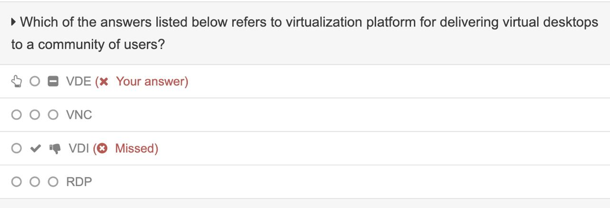

**题干：** Which of the answers listed below refers to virtualization platform for delivering virtual desktops to a community of users?

|  |  |
| --- | --- |
| ❌ 我的答案 | VDE |
| ✅ 正确答案 | VDI |

### 先说你问的：VDE 是什么？
说实话，**在 CompTIA A+ 这种常见考试语境里，VDE 不是你应该优先记的标准答案**。

这题真正该记的是：
## **VDI = Virtual Desktop Infrastructure**

也就是：
### **虚拟桌面基础设施**

它指的是：
- 在服务器/数据中心统一运行桌面环境
- 把虚拟桌面交付给很多用户
- 用户远程访问自己的虚拟 Windows 桌面/工作环境

所以题目说：
> **virtualization platform for delivering virtual desktops to a community of users**

标准答案就是：
## **VDI**

### 为什么 VDI 对，VNC/RDP 不对
#### VDI
- 是“虚拟桌面平台/架构”
- 讲的是整套交付方式

#### RDP
- **Remote Desktop Protocol**
- 远程桌面协议
- 是“连接方式/协议”
- 不是整套虚拟桌面平台

#### VNC
- 也是远程控制/远程桌面方式
- 不是 VDI 平台概念

### 那 VDE 怎么看
你这题里可以先把它当成：
## **干扰项 / 非标准答案项**

至少在 A+ 复习里，
你不用把它当核心知识点死记。

你真正要稳稳记住的是：
### **交付一群用户的虚拟桌面平台 = VDI**

### 最简单记忆法
- **VDI** → 虚拟桌面基础设施（平台/架构）
- **RDP** → 远程桌面协议
- **VNC** → 远程控制/远程桌面工具
- **VDE** → 这题里别选它

### 一句话口诀
## **平台看 VDI，连接看 RDP/VNC。**

**一句话：**
这题关键不是搞懂所有缩写，而是分清层级：**VDI 是“给很多用户交付虚拟桌面”的平台/架构；RDP/VNC 只是连接方式，而 VDE 在这题里不是标准答案。**
---

## CAC：美国国防部发的智能卡，用于身份识别、认证和门禁/系统访问
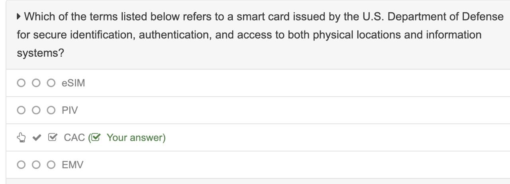

**题干：** Which of the terms listed below refers to a smart card issued by the U.S. Department of Defense for secure identification, authentication, and access to both physical locations and information systems?

✅ **正确答案：CAC**

### CAC 是什么
## **CAC = Common Access Card**
它是：
### **美国国防部（DoD）使用的智能身份证卡 / 访问卡**

它的作用包括：
- 身份识别（identification）
- 身份认证（authentication）
- 进入实体场所（physical access）
- 访问信息系统（logical / system access）

所以题目里说：
- **issued by the U.S. Department of Defense**
- **smart card**
- **identification, authentication, and access**

这几个关键词一出来，
答案就是：
## **CAC**

### 为什么这题你虽然是猜的，但其实抓对了
因为它最显眼的限定词就是：
### **U.S. Department of Defense**

只要和 DoD + smart card + access 放在一起，
考试里基本就是：
## **CAC**

### 其他几个顺手区分
#### PIV = Personal Identity Verification
- 也是政府相关身份验证卡概念
- 但更偏联邦政府广泛身份验证标准/卡体系
- 这题明确写 **DoD**，所以更标准是 **CAC**

#### EMV
- 银行卡芯片支付标准
- 和 DoD 身份卡无关

#### eSIM
- 嵌入式 SIM 卡
- 移动通信相关
- 更不相关

### 最简单记忆法
- **CAC** → DoD 智能卡
- **PIV** → 政府身份验证卡/标准
- **EMV** → 银行卡芯片支付
- **eSIM** → 手机通信 SIM

### 一句话口诀
## **DoD 智能卡看 CAC，银行卡芯片看 EMV，手机虚拟卡看 eSIM。**

**一句话：**
CAC 就是 **Common Access Card**，是美国国防部发放的智能卡，用来做身份识别、认证，以及进入建筑和访问信息系统。
---

## 这题按 CompTIA A+ 题库标准答案应记为 XDR，不是 SIEM
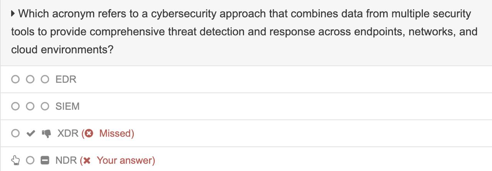

**题干：** Which acronym refers to a cybersecurity approach that combines data from multiple security tools to provide comprehensive threat detection and response across endpoints, networks, and cloud environments?

|  |  |
| --- | --- |
| ❌ 我的答案 | NDR |
| ✅ 正确答案 | XDR |

### 修正说明
这道题我之前在错题本里写成了 **SIEM**，这是错的。
按你现在提供的 **CompTIA A+ 题库标准答案**，这题应该改成：
## **XDR**

### 为什么这题按题库应选 XDR
## **XDR = Extended Detection and Response**
它更强调：
- 跨多个安全层面整合检测与响应
- 不只看 endpoint
- 也覆盖 network、cloud 等环境
- 提供更统一、更综合的威胁检测与响应能力

题目里的关键词是：
- **comprehensive threat detection and response**
- **across endpoints, networks, and cloud environments**
- **combines data from multiple security tools**

这套描述按这份题库标准，更贴近：
## **XDR**

### 为什么不是 NDR
## **NDR = Network Detection and Response**
它重点还是：
- 网络层检测与响应

但题目明确写了：
- endpoints
- networks
- cloud

所以范围比 NDR 更广，
NDR 太窄了。

### 为什么我之前会误写成 SIEM
因为题目里有一句：
### **combines data from multiple security tools**

这很容易让人想到：
- 日志汇总
- 事件集中分析
- 多工具数据关联

也就是 **SIEM** 的味道。

但这题库最后落点更强调的是：
## **跨 endpoint / network / cloud 的统一检测与响应**
所以按题库标准答案应记：
## **XDR**

### 最简单区分
- **EDR** → 终端检测与响应
- **NDR** → 网络检测与响应
- **SIEM** → 汇总日志/事件并集中关联分析
- **XDR** → 跨端点/网络/云的统一检测与响应

### 一句话口诀
## **跨端点/网络/云联动检测响应看 XDR；只盯网络看 NDR；集中收日志分析看 SIEM。**

**一句话：**
这题以后按你的题库直接记：**XDR = 跨 endpoints、networks、cloud 的综合检测与响应。**
---

## 能唯一识别个人的信息看 PII，不是 PKI
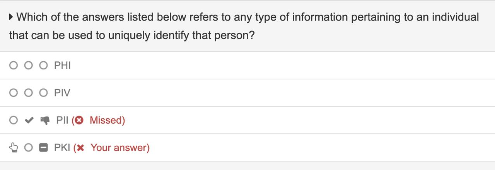

**题干：** Which of the answers listed below refers to any type of information pertaining to an individual that can be used to uniquely identify that person?

|  |  |
| --- | --- |
| ❌ 我的答案 | PKI |
| ✅ 正确答案 | PII |

### 为什么答案是 PII
## **PII = Personally Identifiable Information**
中文就是：
### **个人可识别信息**

它指的是：
- 任何能识别某个人身份的信息

比如：
- 姓名
- 社安号
- 驾照号
- 住址
- 电话
- 邮箱
- 出生日期
- 其他可单独或组合识别个人的信息

所以题目说：
> **information pertaining to an individual that can be used to uniquely identify that person**

这就是非常标准的：
## **PII**

### 为什么 PKI 不对
## **PKI = Public Key Infrastructure**
它是：
### **公钥基础设施**

用于：
- 证书
- 公钥/私钥
- 数字签名
- 加密信任体系

它是安全基础设施，
不是“个人身份信息”的类型。

### 另外几个顺手区分
#### PHI = Protected Health Information
- 受保护健康信息
- 是医疗健康相关的敏感个人信息
- 可以看作更特定场景下的信息类型
- 但题目问的是更广义、通用的“可识别个人信息”
所以更标准答案是 **PII**

#### PIV = Personal Identity Verification
- 政府身份验证卡/体系相关概念
- 不是“个人信息类别”

### 最简单记忆法
- **PII** → 个人可识别信息
- **PHI** → 医疗健康相关个人信息
- **PKI** → 公钥基础设施
- **PIV** → 身份验证卡/体系

### 一句话口诀
## **PII 是个人信息，PHI 是健康信息，PKI 是密钥体系。**

**一句话：**
这题错在把“个人可识别信息”选成了“公钥基础设施”；看到 **identify a person**，优先想到 **PII**。
---

## 通过网卡走网络安装操作系统看 PXE，不是 NFS
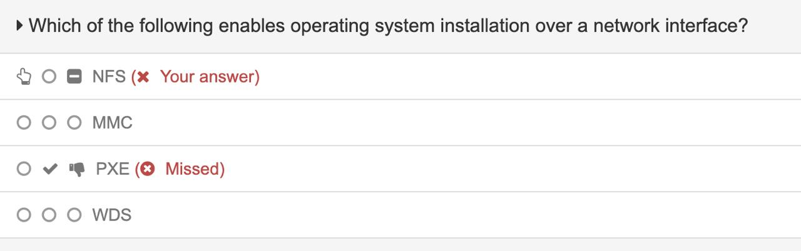

**题干：** Which of the following enables operating system installation over a network interface?

|  |  |
| --- | --- |
| ❌ 我的答案 | NFS |
| ✅ 正确答案 | PXE |

### 为什么答案是 PXE
## **PXE = Preboot eXecution Environment**
它的作用就是：
### **让电脑通过网卡/网络启动，并从网络获取启动或安装环境**

所以题目说：
> **operating system installation over a network interface**

这个最标准的答案就是：
## **PXE**

### PXE 最简单怎么理解
你可以把 PXE 先记成：
## **网卡启动 / 网络装系统**

也就是电脑不用先从本地硬盘或 U 盘启动，
而是：
- 通过网卡启动
- 从网络服务器拿启动文件
- 进入部署/安装流程

### 为什么 NFS 不对
## **NFS = Network File System**
它是：
### **网络文件系统 / 网络共享文件协议**

它的作用更像：
- 共享目录
- 让远程机器访问文件

它不是“让机器通过网卡启动并安装操作系统”的那个核心技术名词。

所以这题不能选 NFS。

### 另外两个也顺手区分
#### MMC = Microsoft Management Console
- 管理工具框架
- 不是网络装系统

#### WDS = Windows Deployment Services
- Windows 部署服务
- 它确实和网络部署 Windows 有关
- 但题目问的是更底层、通用的：
### **enables installation over a network interface**
这更核心地指向 **PXE**

你可以理解成：
- **PXE** → 网络启动机制
- **WDS** → 利用 PXE 等机制做 Windows 网络部署的服务

### 最简单记忆法
- **PXE** → 网卡启动 / 网络装系统
- **WDS** → Windows 网络部署服务
- **NFS** → 网络文件共享
- **MMC** → 管理控制台

### 一句话口诀
## **PXE 管网启装系统，WDS 管 Windows 部署，NFS 管共享文件。**

**一句话：**
这题错在把“网络文件共享协议”选成了“网络启动装系统机制”；只要看到 **over a network interface 安装操作系统**，优先想到 **PXE**。
---

## 交换认证和授权数据的标记语言看 SAML，不是 XHTML
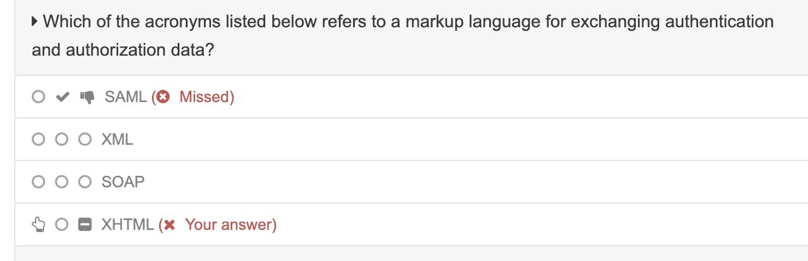

**题干：** Which of the acronyms listed below refers to a markup language for exchanging authentication and authorization data?

|  |  |
| --- | --- |
| ❌ 我的答案 | XHTML |
| ✅ 正确答案 | SAML |

### 为什么答案是 SAML
## **SAML = Security Assertion Markup Language**
它就是：
### **用来交换认证（authentication）和授权（authorization）数据的标记语言/标准**

题目里几乎直接把定义写出来了：
- **markup language**
- **exchanging authentication and authorization data**

这就是：
## **SAML**

### SAML 最简单怎么理解
你可以把它先记成：
## **单点登录/身份联邦里常见的“认证声明交换格式”**

常见场景比如：
- 企业单点登录（SSO）
- 身份提供者（IdP）和服务提供者（SP）之间传递登录/身份信息

### 为什么 XHTML 不对
## **XHTML = Extensible HyperText Markup Language**
它是：
### **网页标记语言**

也就是 HTML 的更严格 XML 风格版本，
和网页结构/页面描述有关，
不是拿来交换认证和授权数据的安全标准。

### 另外两个顺手区分
#### XML
- 通用标记语言格式/元语言
- 很多东西可以基于 XML 表达
- 但题目问的是“专门用来交换认证授权数据的 acronym”
更具体标准答案是 **SAML**

#### SOAP
- 协议/消息交换框架
- 用于 Web services
- 不是这题问的身份认证授权标记语言

### 最简单记忆法
- **SAML** → 认证/授权数据交换，SSO 常见
- **XHTML** → 网页语言
- **XML** → 通用标记格式
- **SOAP** → Web 服务消息协议/框架

### 一句话口诀
## **登录身份声明交换看 SAML，网页结构看 XHTML。**

**一句话：**
这题错在把“网页标记语言”选成了“认证授权数据交换语言”；看到 **authentication + authorization + markup language**，优先想到 **SAML**。
---

## 美国联邦政府员工/承包商智能卡身份认证标准看 PIV
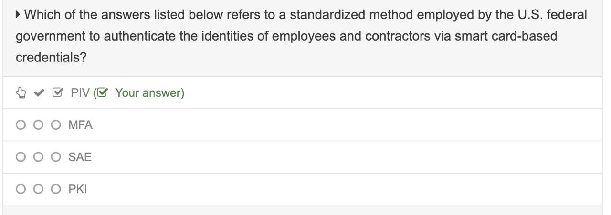

**题干：** Which of the answers listed below refers to a standardized method employed by the U.S. federal government to authenticate the identities of employees and contractors via smart card-based credentials?

✅ **正确答案：PIV**

### 为什么答案是 PIV
## **PIV = Personal Identity Verification**
它指的是：
### **美国联邦政府用于员工和承包商身份验证的标准化方法/体系**

题目里的关键词几乎就是 PIV 的定义：
- **U.S. federal government**
- **authenticate identities of employees and contractors**
- **smart card-based credentials**

所以答案就是：
## **PIV**

### PIV 最简单怎么理解
你可以把它先记成：
## **美国联邦政府通用的身份验证智能卡标准/体系**

它强调的是：
- 联邦政府身份认证
- 标准化
- 智能卡凭证

### 和 CAC 怎么区分
这个最容易混，
因为两者都跟政府/智能卡/身份认证有关。

#### CAC
- **Common Access Card**
- 更偏 **美国国防部（DoD）**
- 是具体那张卡

#### PIV
- **Personal Identity Verification**
- 更偏 **美国联邦政府范围的标准化身份验证体系/方法**
- 是标准/验证框架概念更强

### 为什么其他几个不对
#### MFA
- 多因素认证
- 太泛了，不是题目说的联邦政府智能卡标准

#### SAE
- 常见于 Wi-Fi 安全（Simultaneous Authentication of Equals）等语境
- 不相关

#### PKI
- 公钥基础设施
- 是底层信任/证书体系
- 不是题目问的那个联邦政府智能卡身份验证标准名称

### 最简单记忆法
- **PIV** → 联邦政府智能卡身份验证标准
- **CAC** → DoD 智能卡
- **PKI** → 公钥基础设施
- **MFA** → 多因素认证

### 一句话口诀
## **联邦政府标准看 PIV，国防部卡片看 CAC。**

**一句话：**
这题虽然你答对了，但特别值得记：**PIV 是美国联邦政府员工/承包商使用智能卡凭证做身份认证的标准化方法；DoD 那张具体卡更常叫 CAC。**
---

## 评估和改进软件开发流程的框架看 SPICE，不是 SDLC
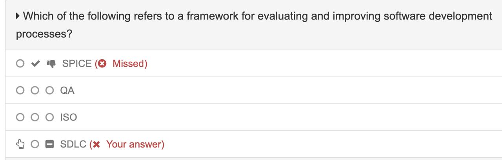

**题干：** Which of the following refers to a framework for evaluating and improving software development processes?

|  |  |
| --- | --- |
| ❌ 我的答案 | SDLC |
| ✅ 正确答案 | SPICE |

### 为什么答案是 SPICE
## **SPICE = Software Process Improvement and Capability Determination**
它本身就是：
### **用来评估和改进软件开发过程的框架/模型**

题目里写的是：
- **framework**
- **evaluating and improving software development processes**

这基本就是在描述：
## **SPICE**

### 为什么 SDLC 不对
## **SDLC = Software Development Life Cycle**
它是：
### **软件开发生命周期**

也就是软件开发通常经历的阶段，比如：
- 需求
- 设计
- 开发
- 测试
- 部署
- 维护

所以 SDLC 更像：
## **开发流程本身 / 生命周期阶段模型**
而不是题目说的：
### **用来评估和改进这些流程的框架**

### 其他两个顺手区分
#### QA = Quality Assurance
- 质量保证
- 是一个质量相关概念/活动领域
- 不是这里特指的框架名称

#### ISO
- 国际标准化组织，或者泛指某些标准体系
- 太宽泛
- 不是这题最具体的答案

### 最简单记忆法
- **SDLC** → 软件开发过程本身
- **SPICE** → 评估/改进软件开发过程的框架
- **QA** → 质量保证
- **ISO** → 标准体系/标准组织

### 一句话口诀
## **SDLC 是流程本身，SPICE 是给流程做体检和改进。**

**一句话：**
这题错在把“软件开发生命周期”选成了“评估和改进开发流程的框架”；题目只要出现 **evaluating and improving software development processes**，优先想到 **SPICE**。
---

## NFC：近距离通信，可支付/配对/门禁，但不是无线充电
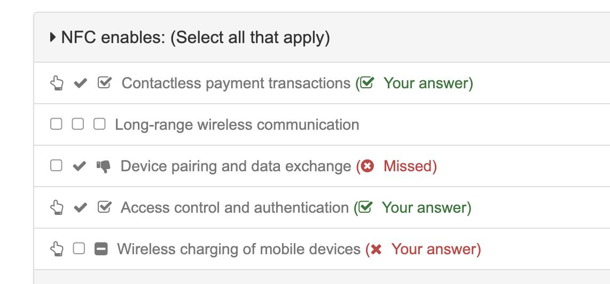

**题干：** NFC enables: (Select all that apply)

**正确答案：**
- **Contactless payment transactions**
- **Device pairing and data exchange**
- **Access control and authentication**

### 你这题错在哪
你已经选对了两项：
- **Contactless payment transactions** ✅
- **Access control and authentication** ✅

漏掉的是：
- **Device pairing and data exchange** ✅

错选的是：
- **Wireless charging of mobile devices** ❌

### NFC 到底是什么
## **NFC = Near Field Communication**
中文就是：
### **近场通信**

它的核心特点是：
- **距离很短**
- 设备靠得很近才能通信
- 适合快速识别、触碰配对、短距离数据交换

### NFC 常见能做什么
#### 1. Contactless payment transactions
这个你已经记对了。
比如：
- Apple Pay
- Google Pay
- 刷手机/卡支付

#### 2. Device pairing and data exchange
这个你漏了。
NFC 很常用于：
- 设备快速配对
- 小量数据交换
- 触碰建立连接（比如帮蓝牙快速配对）

所以这项是对的。

#### 3. Access control and authentication
这个你也选对了。
比如：
- 门禁卡
- 手机刷门
- 身份验证标签

### 为什么 wireless charging 不对
这个最容易被误选。
因为手机“贴上去”这个动作很像 NFC，
但：
## **无线充电通常是 Qi / 电磁感应充电，不是 NFC 的核心功能**

也就是说：
- **NFC** → 通信
- **Qi / wireless charging** → 供电/充电

所以题目问 NFC enables，
不能选：
### **Wireless charging of mobile devices**

### 为什么 long-range wireless communication 不对
因为 NFC 就是：
## **Near Field**
也就是近距离，
不是长距离无线通信。

### 最简单记忆法
NFC 你就记三件事：
- **支付**
- **配对/短距数据交换**
- **门禁/认证**

不要记成：
- 长距离通信
- 无线充电

### 一句话口诀
## **NFC 管近距离“碰一碰”通信，不管远距离，也不负责充电。**

**一句话：**
NFC 的核心是近距离通信，所以它能做 **支付、配对/数据交换、门禁认证**，但 **不能把“无线充电”当成 NFC 功能**。
---

## 这题要分 headset 和 speakers：AUX 3.5mm 更放在 speakers 这栏记
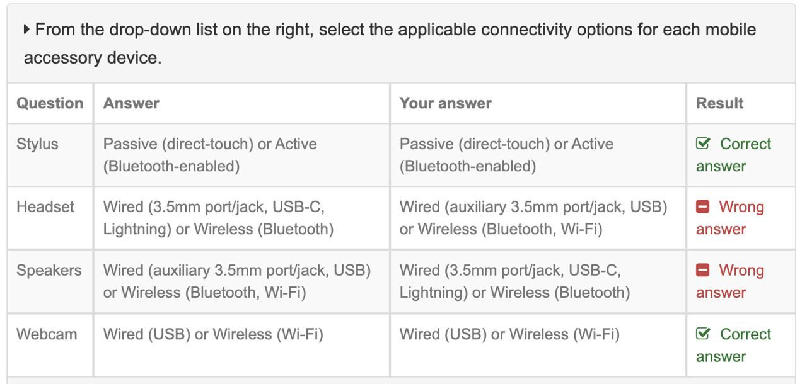

**题干：** Select the applicable connectivity options for each mobile accessory device.

### 这题里正确配对是
- **Stylus** → Passive (direct-touch) or Active (Bluetooth-enabled)
- **Headset** → Wired (**3.5mm port/jack, USB-C, Lightning**) or Wireless (**Bluetooth**)
- **Speakers** → Wired (**auxiliary 3.5mm port/jack, USB**) or Wireless (**Bluetooth, Wi-Fi**)
- **Webcam** → Wired (**USB**) or Wireless (**Wi-Fi**)

### 先回答你
对，**在这道题的出题逻辑里，auxiliary 3.5mm 更是放在 speakers 这边记的。**

但更准确一点说：
- **AUX 本质上就是一种 3.5mm 音频连接方式**
- 现实里耳机和音箱都可能用 3.5mm
- **只是这道题的分类把 auxiliary 3.5mm 归给了 speakers**

所以考试时你要按这题的“标准配法”记，
不要完全按现实世界自由发挥。

### 这题为什么你会错
因为你是按现实直觉在选：
- 耳机/耳麦也会想到 auxiliary 3.5mm
- 音箱也可能想到 USB-C / Lightning / Bluetooth

但这套题在故意做“固定归类”：

#### Headset 这栏记法
- **3.5mm port/jack**
- **USB-C**
- **Lightning**
- **Bluetooth**

它更偏“手机耳机/耳麦”的常见连接方式。

#### Speakers 这栏记法
- **auxiliary 3.5mm port/jack**
- **USB**
- **Bluetooth**
- **Wi-Fi**

它更偏“外接音箱/扬声器”的连接方式。

### 最容易混的点
#### Headset
你要记成：
- 有线：**3.5mm / USB-C / Lightning**
- 无线：**Bluetooth**

#### Speakers
你要记成：
- 有线：**auxiliary 3.5mm / USB**
- 无线：**Bluetooth / Wi-Fi**

### 为什么 Speakers 这里有 Wi‑Fi
因为有些智能音箱/无线音箱会通过：
- Wi‑Fi 网络播放
- 局域网串流

所以题库会把 **Wi‑Fi** 放进 speakers。

而 headset 这题标准答案就不把 Wi‑Fi 放进去。

### 最简单记忆法
- **Headset** → 手机耳机：3.5mm / USB-C / Lightning / Bluetooth
- **Speakers** → 音箱：AUX 3.5mm / USB / Bluetooth / Wi‑Fi

### 一句话口诀
## **耳机看 3.5、USB-C、Lightning、蓝牙；音箱看 AUX、USB、蓝牙、Wi‑Fi。**

**一句话：**
你可以先按这套题死记：**AUX 3.5mm 归 speakers；USB-C/Lightning 更归 headset。** 现实里边界会重叠，但考试先按题库标准来。
---

## 常见端口号速记表：A+ / 基础网络必背版

Stone 这块你说得对，**端口号就是硬骨头，但同时也是最值得集中背熟的一组送分题。**

下面这版直接作为考前速记：

### 一、Web / 基础服务
| 端口 | 协议 | 服务 | 记忆口诀 |
| --- | --- | --- | --- |
| **80** | TCP | **HTTP** | 上网默认 |
| **443** | TCP | **HTTPS** | 安全网站 |
| **53** | TCP/UDP | **DNS** | 查 IP |
| **67** | UDP | **DHCP Server** | 发 IP |
| **68** | UDP | **DHCP Client** | 收 IP |

---

### 二、文件传输
| 端口 | 协议 | 服务 | 记忆 |
| --- | --- | --- | --- |
| **20** | TCP | **FTP Data** | 传数据 |
| **21** | TCP | **FTP Control** | 控制连接 |
| **22** | TCP | **SSH / SFTP** | 安全远程 |
| **69** | UDP | **TFTP** | 简化版 FTP |

#### 最重要口诀
## **FTP：21 管控制，20 传数据。**

---

### 三、邮件
| 端口 | 协议 | 服务 | 记忆 |
| --- | --- | --- | --- |
| **25** | TCP | **SMTP** | 发邮件 |
| **110** | TCP | **POP3** | 收邮件（下载） |
| **143** | TCP | **IMAP** | 收邮件（同步） |

#### 记忆技巧
- **POP3 = 110** → 短、偏下载
- **IMAP = 143** → 复杂、偏同步

#### 一句话口诀
## **25 发信，110 收，143 同步走。**

---

### 四、远程连接
| 端口 | 协议 | 服务 |
| --- | --- | --- |
| **22** | TCP | **SSH** |
| **23** | TCP | **Telnet**（不安全） |
| **3389** | TCP | **RDP** |

#### 一句话口诀
## **22 安全登，23 老 Telnet，3389 远程桌面。**

---

### 五、文件共享 / 目录服务
| 端口 | 协议 | 服务 | 记忆 |
| --- | --- | --- | --- |
| **137** | UDP | **NetBIOS Name** | |
| **138** | UDP | **NetBIOS Datagram** | |
| **139** | TCP | **NetBIOS Session** | |
| **445** | TCP | **SMB** | Windows 共享 |
| **389** | TCP/UDP | **LDAP** | 目录服务 |
| **636** | TCP | **LDAPS** | 加密 LDAP |

#### 考试坑点
- **389 = LDAP**
- **445 = SMB**
- **137-139 = NetBIOS**

#### 一句话口诀
## **137-139 是 NetBIOS，445 是 SMB，389 是 LDAP，636 是加密 LDAP。**

---

### 六、其他常见
| 端口 | 协议 | 服务 |
| --- | --- | --- |
| **161** | UDP | **SNMP** |
| **123** | UDP | **NTP**（时间同步） |

#### 一句话口诀
## **123 校时间，161 管设备。**

---

## 一分钟总复盘（考前速杀版）
### 你最容易错的这些直接死记：
- **FTP 控制 = 21**
- **FTP 数据 = 20**
- **SMTP = 25**
- **POP3 = 110**
- **IMAP = 143**
- **DNS = 53**
- **DHCP Server = 67**
- **DHCP Client = 68**
- **LDAP = 389**
- **SMB = 445**
- **RDP = 3389**

### 最后压缩成 5 句
## **20 数据 21 控，22 安全登录。**
## **25 发信，110 收，143 同步走。**
## **53 查 IP，67 发 68 收。**
## **137-139 是 NetBIOS，445 是 SMB。**
## **389 是 LDAP，3389 远程桌面。**
---

## 收集网络设备诊断和监控数据的服务器看 Syslog server，不是 ICS server
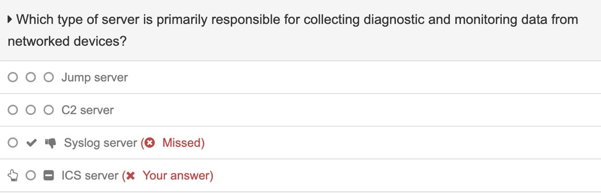

**题干：** Which type of server is primarily responsible for collecting diagnostic and monitoring data from networked devices?

|  |  |
| --- | --- |
| ❌ 我的答案 | ICS server |
| ✅ 正确答案 | Syslog server |

### 对，这题本身其实挺明显
因为题目问的是：
- **collecting diagnostic and monitoring data**
- **from networked devices**

这基本就是：
## **Syslog server**

也就是：
### **负责接收和集中保存设备日志、诊断信息、监控相关事件的服务器**

你可以先把 syslog server 记成：
## **网络设备“吐日志”的地方**

比如：
- 交换机
- 路由器
- 防火墙
- 服务器
- 各种网络设备

都会把日志、错误、告警、状态信息发到 syslog server。

---

## 其他几个也顺手解释清楚

### 1. Jump server
## **Jump server = 跳板机 / 堡垒入口机**

它的作用是：
- 作为进入内网/敏感环境的中转点
- 管理员先连 jump server
- 再从那里访问内部服务器/设备

#### 关键词：
- **secure administrative access**
- **intermediate host**
- **bastion / jump host**

#### 最简单记忆：
## **Jump server = 进内网前先踩的一块跳板**

它不是拿来集中收集日志的。

---

### 2. C2 server
## **C2 = Command and Control server**

这个词大多出现在：
### **恶意软件 / 黑客攻击 / botnet 控制**

它的作用通常是：
- 攻击者远程控制被感染主机
- 下发命令
- 接收回传数据

#### 最简单记忆：
## **C2 = 黑客远程指挥中心**

当然不是正常运维里“收集诊断监控数据”的服务器。

---

### 3. ICS server
## **ICS = Industrial Control Systems server**

它更偏：
- 工业控制环境
- 工厂/生产线/SCADA/自动化系统
- 管理工业设备、控制流程

#### 最简单记忆：
## **ICS server = 工业控制系统里的服务器**

它不是泛指“收网络设备日志”的服务器。

---

## 最简单对照记忆
- **Syslog server** → 收日志 / 诊断 / 监控数据
- **Jump server** → 跳板机 / 中转访问
- **C2 server** → 黑客控制中心
- **ICS server** → 工业控制系统服务器

---

## 一句话口诀
## **日志看 Syslog，跳板看 Jump，黑客指挥看 C2，工业控制看 ICS。**

**一句话：**
这题关键很直接：**只要看到 collecting diagnostic and monitoring data，就优先想到 Syslog server；其他选项分别属于跳板访问、攻击控制、工业控制，不是日志汇聚服务器。**
---

## AAA 里这题选 RADIUS：UDP、认证授权合一、常见于 VPN 和 Wi‑Fi
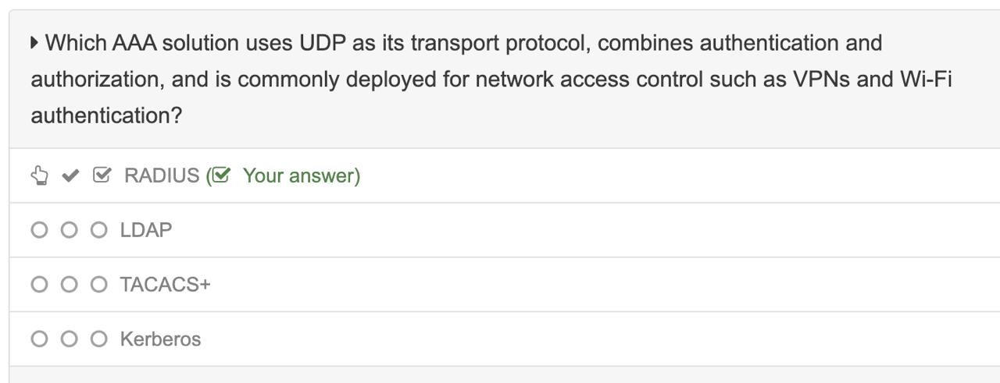

**题干：** Which AAA solution uses UDP as its transport protocol, combines authentication and authorization, and is commonly deployed for network access control such as VPNs and Wi‑Fi authentication?

✅ **正确答案：RADIUS**

### 为什么答案是 RADIUS
## **RADIUS = Remote Authentication Dial-In User Service**
它最经典的考试特征就是：
- **AAA 方案**
- **使用 UDP**
- **authentication + authorization 合在一起**
- 常见于：
  - **VPN**
  - **Wi‑Fi / 802.1X**
  - 网络接入控制

所以题目里这几个关键词一组合：
- **UDP**
- **combines authentication and authorization**
- **VPNs and Wi‑Fi authentication**

标准答案就是：
## **RADIUS**

---

## 这几个选项怎么区分

### 1. RADIUS
#### 你先记成：
## **网络接入认证老熟人：Wi‑Fi / VPN 常见**

#### 核心点：
- 用 **UDP**
- 认证和授权常放一起
- AAA 常见方案
- VPN / Wi‑Fi 很常见

#### 最短记忆：
## **RADIUS = UDP + Wi‑Fi/VPN**

---

### 2. TACACS+
#### 你先记成：
## **更偏网络设备管理员登录控制**

#### 核心点：
- 通常用 **TCP 49**
- 常见于路由器/交换机/防火墙管理访问
- 把 AAA 分得更清楚（尤其认证、授权、记账控制更细）

#### 和 RADIUS 最好对比：
- **RADIUS** → 网络接入（Wi‑Fi / VPN）
- **TACACS+** → 设备管理登录（admin access）

#### 最短记忆：
## **TACACS+ = TCP + 管理员登录控制**

---

### 3. LDAP
#### 你先记成：
## **目录服务，不是 AAA 接入协议本体**

#### 核心点：
- **LDAP = Lightweight Directory Access Protocol**
- 用来访问目录服务
- 常查：
  - 用户信息
  - 组织结构
  - 账号属性
- 常和 Active Directory 这类目录体系联系在一起

#### 最短记忆：
## **LDAP = 查目录/账号信息**

它不是这题这种“UDP + Wi‑Fi/VPN AAA”答案。

---

### 4. Kerberos
#### 你先记成：
## **票据式认证（ticket-based authentication）**

#### 核心点：
- 强调单点登录/域环境认证
- 常见于 Windows 域 / Active Directory
- 用票据（ticket）来证明身份

#### 最短记忆：
## **Kerberos = 域登录票据认证**

它也不是这题要的“Wi‑Fi / VPN AAA 接入协议”。

---

## 最简单总对照
- **RADIUS** → UDP，Wi‑Fi/VPN 接入认证
- **TACACS+** → TCP，网络设备管理员登录控制
- **LDAP** → 目录查询/账号信息
- **Kerberos** → 域环境票据认证

---

## 一句话口诀
## **RADIUS 管接入，TACACS+ 管管控，LDAP 管目录，Kerberos 管票据。**

### 再压缩成考试速记版
- **Wi‑Fi / VPN / UDP** → **RADIUS**
- **Admin device login / TCP** → **TACACS+**
- **Directory service** → **LDAP**
- **Ticket authentication / AD** → **Kerberos**

**一句话：**
这题最稳的抓法就是：**只要出现 UDP + Wi‑Fi/VPN + AAA 接入认证，就优先选 RADIUS；TACACS+ 更偏管理员设备访问，LDAP 是目录，Kerberos 是票据认证。**
---

## DHCP 两个高频概念：给单个设备固定 IP 是 Reservation；可分配地址池整体叫 Scope
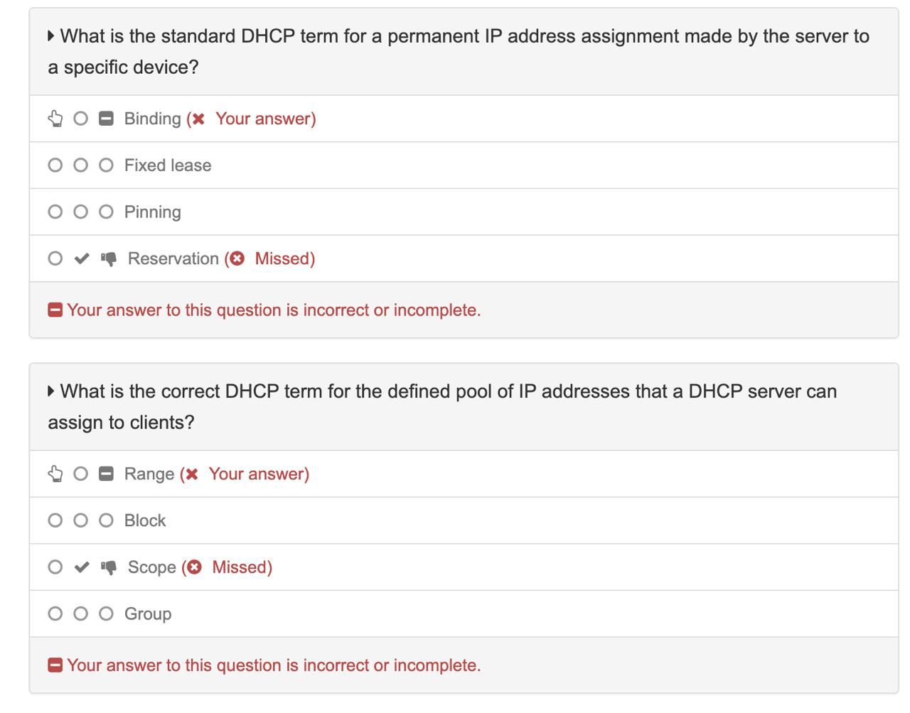

**题目 1：** What is the standard DHCP term for a permanent IP address assignment made by the server to a specific device?

|  |  |
| --- | --- |
| ❌ 我的答案 | Binding |
| ✅ 正确答案 | Reservation |

**题目 2：** What is the correct DHCP term for the defined pool of IP addresses that a DHCP server can assign to clients?

|  |  |
| --- | --- |
| ❌ 我的答案 | Range |
| ✅ 正确答案 | Scope |

### 这两个为什么容易混
因为它们都跟 DHCP 分配 IP 有关，
而且现实里你脑子里会自然冒出这些词：
- binding
- range
- pool
- fixed IP

但考试要的是：
## **标准 DHCP 术语**

所以这两题不能按“意思差不多”来选，
要按题库标准名词背。

---

## 1. Reservation 是什么
### **Reservation = 给某个特定设备保留固定 IP**

也就是：
- DHCP 服务器仍然发 IP
- 但它总是把同一个 IP 发给同一台设备
- 通常根据 **MAC 地址** 绑定

所以题目说：
> **permanent IP address assignment made by the server to a specific device**

标准答案就是：
## **Reservation**

### 你为什么会选 Binding
因为 “binding” 在 DHCP 语境里也不是完全陌生，
它能让人联想到：
- 设备和 IP 的绑定关系

但考试里问这种“给特定设备固定发同一个 IP”的标准术语，
更规范的答案是：
## **Reservation**

### 最简单记忆
## **Reservation = 给某台设备预留固定 IP。**

---

## 2. Scope 是什么
### **Scope = DHCP 可分配地址池 / 地址范围整体定义**

也就是：
- 这个 DHCP 服务器可以发哪些 IP
- 子网掩码是什么
- 网关、租期等相关配置可能也属于这个范围定义的一部分

所以题目说：
> **defined pool of IP addresses that a DHCP server can assign to clients**

标准答案就是：
## **Scope**

### 为什么你会选 Range
因为从自然语言角度看，
“地址范围”确实很像 range。

但这题问的是：
### **correct DHCP term**

在 DHCP 标准/管理术语里，
这个更正式地叫：
## **Scope**

### 最简单记忆
## **Scope = DHCP 整个可发号池。**

---

## 最简单一口气区分
- **Reservation** → 给一台特定设备保留固定 IP
- **Scope** → DHCP 整个地址池/可分配范围

### 一句话口诀
## **单机固定看 Reservation，整池发号看 Scope。**

### 再压缩成考试秒杀版
- **specific device + permanent IP** → **Reservation**
- **defined pool of IPs for clients** → **Scope**

**一句话：**
这两题的关键是把“给单个设备固定发同一个地址”和“整个 DHCP 可分配地址池”分开：前者是 **Reservation**，后者是 **Scope**。
---

## Cable modem 和 DSL 最容易混的点：Cable = TV/coax/shared；DSL = 电话线/twisted pair/dedicated
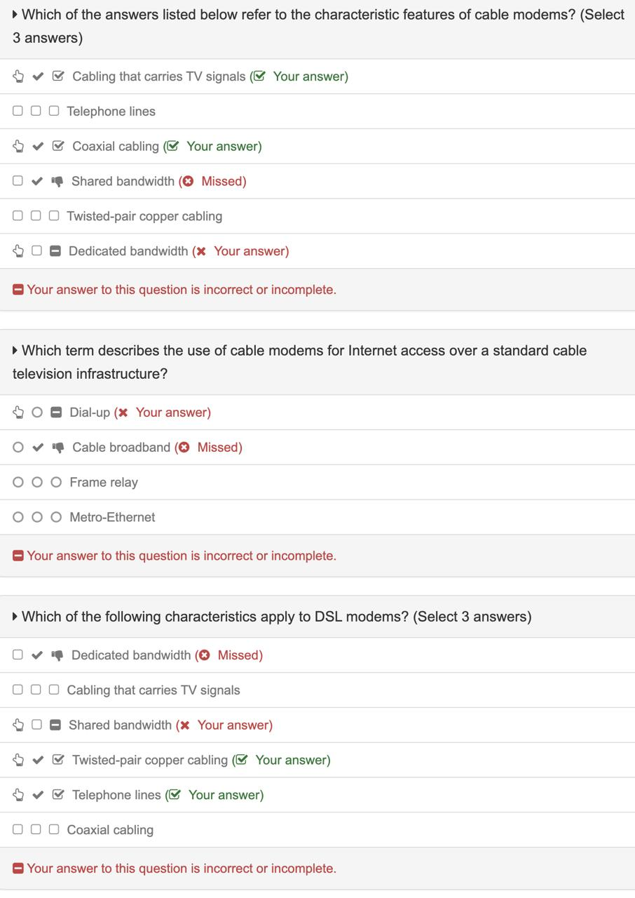

### 题 1：Cable modem 的特征（选 3）
**正确答案：**
- **Cabling that carries TV signals**
- **Coaxial cabling**
- **Shared bandwidth**

#### 为什么你会错
你前两项其实选对了：
- 走 **TV signals** ✅
- 走 **coaxial cabling** ✅

你错在第三项把：
- **Shared bandwidth**
看成了：
- **Dedicated bandwidth**

#### 这题最该记的点
## **Cable modem = 走有线电视同轴网络，而且带宽是共享的。**

也就是说，同一个区域/节点的用户会共享带宽资源。

---

### 题 2：通过标准有线电视基础设施上网叫什么
**正确答案：**
- **Cable broadband**

#### 为什么不是 Dial-up
- **Dial-up** 是老式电话拨号上网
- 用电话线路，不是 cable TV infrastructure

#### 最简单记忆
## **电视线宽带 = Cable broadband，不是 Dial-up。**

---

### 题 3：DSL modem 的特征（选 3）
**正确答案：**
- **Dedicated bandwidth**
- **Twisted-pair copper cabling**
- **Telephone lines**

#### 为什么你会错
你后两项其实选对了：
- **Twisted-pair copper cabling** ✅
- **Telephone lines** ✅

你错在把：
- **Dedicated bandwidth**
选漏了，
反而选了：
- **Shared bandwidth** ❌

#### 这题最该记的点
## **DSL = 走电话双绞线，而且更偏 dedicated bandwidth。**

考试里通常这样区分：
- **Cable** → shared bandwidth
- **DSL** → dedicated bandwidth

---

## 这三题其实是一组联动记忆
### Cable modem
- **TV signals**
- **Coaxial cabling**
- **Shared bandwidth**
- 关键词：**Cable broadband**

### DSL modem
- **Telephone lines**
- **Twisted-pair copper cabling**
- **Dedicated bandwidth**

---

## 最简单一口气背法
## **Cable 走电视同轴、共享带宽；DSL 走电话双绞线、独享带宽。**

### 一句话口诀
## **Cable 看 TV/coax/shared；DSL 看 phone/twisted pair/dedicated。**

### 再压缩成考试秒杀版
- **有线电视基础设施上网** → **Cable broadband**
- **Cable modem** → **Coax + TV + Shared**
- **DSL modem** → **Phone line + Twisted pair + Dedicated**

**一句话：**
这三题其实就是同一组对照：**Cable modem 走电视同轴并共享带宽；DSL 走电话双绞线并更偏独享带宽。**
---

## 对，color gamut 就是“色域”；这几个显示术语要分清
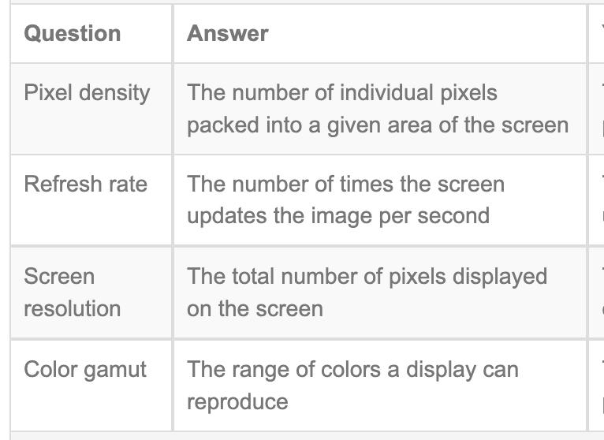

### 先直接回答你
对，## **color gamut = 色域**。

也就是：
### **显示器能够呈现/覆盖的颜色范围**

如果一个显示器色域更广，
通常表示它能显示更丰富、更完整的颜色范围。

---

## 这几个词最简单一起记

### 1. Pixel density
## **像素密度**
意思是：
### **单位面积里塞了多少像素**

你可以理解成：
- 越密 → 看起来越细腻
- 常和 PPI 这类概念联系在一起

#### 最短记忆：
## **Pixel density = 每一小块面积里像素有多挤。**

---

### 2. Refresh rate
## **刷新率**
意思是：
### **屏幕每秒更新图像多少次**

比如：
- 60Hz
- 120Hz
- 144Hz

刷新率越高，
通常画面看起来越顺。

#### 最短记忆：
## **Refresh rate = 一秒刷新几次。**

---

### 3. Screen resolution
## **屏幕分辨率**
意思是：
### **屏幕总共显示多少像素**

比如：
- 1920 × 1080
- 2560 × 1440
- 3840 × 2160

#### 最短记忆：
## **Resolution = 总像素数/像素排布规模。**

---

### 4. Color gamut
## **色域**
意思是：
### **显示器能覆盖/重现的颜色范围**

它不是：
- 分辨率
- 刷新率
- 像素密度

而是在讲：
## **颜色范围广不广**

#### 最短记忆：
## **Color gamut = 颜色能到哪一圈。**

---

## 最简单一口气区分
- **Pixel density** → 单位面积像素有多密
- **Refresh rate** → 一秒刷新几次
- **Resolution** → 总共多少像素
- **Color gamut** → 颜色范围有多广

---

## 一句话口诀
## **密度看细腻，刷新看顺滑，分辨率看总像素，色域看颜色范围。**

**一句话：**
对，**color gamut 就是色域**；你以后看到 “the range of colors a display can reproduce” 就直接对应 **色域**。
---

## OLED 这题又错在“亮度”上：考试更稳的三个点是无背光、超薄可弯、黑位/对比度极强
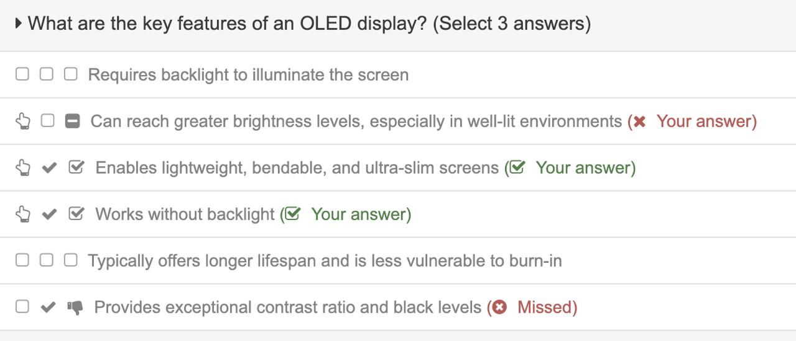

**题干：** What are the key features of an OLED display? (Select 3 answers)

**正确答案：**
- **Enables lightweight, bendable, and ultra-slim screens**
- **Works without backlight**
- **Provides exceptional contrast ratio and black levels**

### 你这次为什么又错
你前两项其实已经对了：
- **Enables lightweight, bendable, and ultra-slim screens** ✅
- **Works without backlight** ✅

你错在第三项又被：
### **greater brightness levels**
带偏了。

但考试里更稳、更核心的 OLED 特征是：
## **黑位特别好，对比度特别强**

所以应该选：
### **Provides exceptional contrast ratio and black levels**

---

## OLED 最稳的三个核心标签
### 1. Works without backlight
这个你已经记住了。

因为 OLED 每个像素自己发光，
所以：
## **不需要背光**

---

### 2. Enables lightweight, bendable, and ultra-slim screens
因为没有传统 LCD 那套背光结构，
所以 OLED 更容易做成：
- 更薄
- 更轻
- 可弯曲

这个你也答对了。

---

### 3. Provides exceptional contrast ratio and black levels
这才是你这次漏掉的最核心考点。

因为像素可以单独关闭，
所以 OLED 的：
- 黑色更纯
- 黑位更深
- 对比度更强

这基本就是 OLED 最有代表性的卖点之一。

---

## 为什么 greater brightness levels 这题不选
这类题你最近已经被坑过一次了。
原因就是：
### **考试题库更稳地把 OLED 记成“对比和黑位强”，而不是“亮度最强”**

现实世界里不同 OLED / LCD 面板亮度表现会有差异，
但在这类 A+ 题库里，
更稳定的正确标签通常是：
- **no backlight**
- **excellent contrast / black levels**
- **thin / bendable**

而不是把 “greater brightness” 当作首选特征。

---

## 为什么 longer lifespan / less burn-in 不对
这个其实和 OLED 的常见印象相反。
题库更常记的是：
- OLED 可能更容易有烧屏/burn-in 风险
- 寿命并不是它相对 LCD 的绝对强项

