所以这项不能选。

---

## 最简单记忆法
你以后就把 OLED 死记成这三个：
## **无背光 + 超薄可弯 + 黑位/对比度极强**

不要优先记成：
- 亮度更高
- 寿命更长
- 更不容易 burn-in

---

## 一句话口诀
## **OLED 看黑、看薄、看自发光；亮度别乱选，寿命别瞎吹。**

**一句话：**
你这题不是不会，而是又被“亮度更高”这个很像优点的选项带偏了；考试里 OLED 最稳的正确三件套是：**无背光、超薄可弯、黑位和对比度极强。**
---

## Mini-LED 不是自发光：它还是背光 LCD，只是背光更细、更亮、控光更强
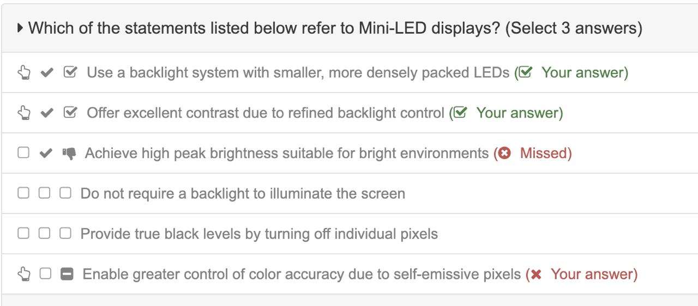

**题干：** Which of the statements listed below refer to Mini-LED displays? (Select 3 answers)

**正确答案：**
- **Use a backlight system with smaller, more densely packed LEDs**
- **Offer excellent contrast due to refined backlight control**
- **Achieve high peak brightness suitable for bright environments**

### 你这题错在哪里
你前两项已经对了：
- **Use a backlight system with smaller, more densely packed LEDs** ✅
- **Offer excellent contrast due to refined backlight control** ✅

你错在把：
- **Enable greater control of color accuracy due to self-emissive pixels**
选进去了

而漏掉了：
- **Achieve high peak brightness suitable for bright environments**

### 这题最核心的判断点
## **Mini-LED 不是自发光面板。**

它本质上还是：
### **LCD + 更先进的 LED 背光系统**

也就是说：
- 它 **需要背光**
- 它不是 OLED / MicroLED 那种像素自发光路线

所以只要题目出现：
- **self-emissive pixels**
- **do not require a backlight**
- **true black by turning off individual pixels**

这些都更像：
## **OLED / MicroLED**
而不是 Mini-LED。

### Mini-LED 最稳的三个核心点
#### 1. Smaller, more densely packed LEDs
Mini-LED 的本质就是：
- 背光 LED 更小
- 排列更密
- 分区控光更精细

#### 2. Excellent contrast due to refined backlight control
因为控光分区更细，
所以对比度表现会更强。

但注意：
### 它是“更好的背光控光”，不是“像素自己关掉”

#### 3. High peak brightness
这就是你这题漏掉的关键。
Mini-LED 很常见的优势之一就是：
## **高亮度 / 高 peak brightness**

所以在亮环境下表现更有优势。

### 为什么 self-emissive 那项不对
因为 Mini-LED 不是：
### **self-emissive pixels**

像素自己发光这套，更像：
- OLED
- MicroLED

Mini-LED 仍然是背光 LCD 路线。

### 最简单记忆法
你以后直接这样背：
## **Mini-LED = 背光更小更密，控光更好，更亮，但不是自发光。**

### 再和 OLED 顺手区分
#### Mini-LED
- 要背光
- 高亮度
- 更强分区控光
- 对比好，但不是像素级自发光真黑

#### OLED
- 不要背光
- 像素自发光
- 真黑、对比极强
- 更容易和“self-emissive”绑定

### 一句话口诀
## **Mini-LED 看背光更细更亮；OLED 看自发光和真黑。**

**一句话：**
这题错在把 Mini-LED 误记成自发光技术；它其实还是 **背光 LCD**，所以正确记法是：**更小更密的背光 LED、控光更强、峰值亮度更高。**
---

## Cable adapter 主要做“接口形态调整”和“信号转换”，不等于自带热插拔能力
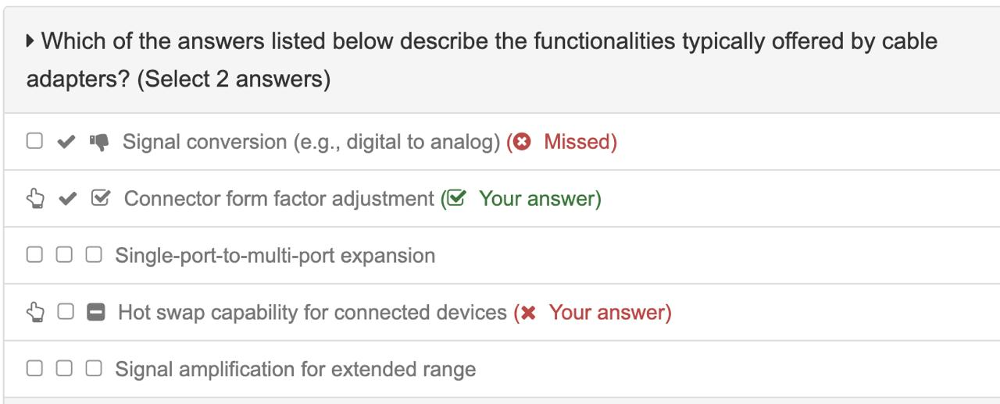

**题干：** Which of the answers listed below describe the functionalities typically offered by cable adapters? (Select 2 answers)

**正确答案：**
- **Signal conversion (e.g., digital to analog)**
- **Connector form factor adjustment**

### 先回答你：为什么不能选 hot swap？
因为：
## **热插拔能力主要是接口/总线/设备标准本身的特性，不是 cable adapter 的“典型功能”。**

也就是说，
一个转接头/适配器本身通常负责的是：
- 物理接口转换
- 形态匹配
- 有时做信号转换

但它**不负责定义设备能不能在开机状态下安全插拔**。

### 这题最核心的判断点
你要先分清：
## **adapter 是“转换/适配”工具，不是“能力赋予器”。**

所以 cable adapter 最典型做的是两件事：

### 1. Connector form factor adjustment
这个你答对了。
就是：
- 一边这个口
- 一边那个口
- 帮你把插头形态适配起来

比如：
- USB-C 转 USB-A
- HDMI 转 DVI
- 3.5mm 转 6.35mm

### 2. Signal conversion
这个你漏了。
有些 adapter 不只是改插头形状，
还会负责：
### **信号类型转换**

比如：
- 数字转模拟
- 某种显示信号转另一种信号

所以：
### **Signal conversion**
是对的。

### 为什么 hot swap capability 不对
#### hot swap 是什么
**Hot swap / hot plug** 指的是：
- 设备在系统通电/运行状态下
- 可以安全插入/移除
- 不需要关机

这更取决于：
- 接口标准
- 硬件设计
- 驱动/系统支持

比如：
- USB 常见支持热插拔
- SATA 在某些场景也支持 hot swap
- 但这不是因为“转接头会提供热插拔能力”

所以题目问：
### **cable adapters typically offered functionalities**

hot swap 不是 adapter 的典型功能，
而是连接标准/设备平台的属性。

### 为什么 single-port-to-multi-port expansion 也不对
因为那更像：
- hub
- dock
- splitter
- expansion device

不属于 cable adapter 最典型、最基础的功能定义。

### 为什么 signal amplification 也不对
因为放大信号更像：
- repeater
- active booster
- amplifier

不是一般 cable adapter 的核心功能。

### 最简单记忆法
## **Adapter 主要做两件事：改接口、转信号。**

不要优先记成它能：
- 赋予热插拔
- 扩展多口
- 放大信号

### 一句话口诀
## **转接头管“接得上”和“信号通”，不管热插拔，也不负责放大和扩口。**

**一句话：**
你这题错在把“接口标准/设备支持的热插拔能力”当成了“转接头本身的功能”；考试里 cable adapter 最典型的功能还是：**接口形态调整 + 信号转换。**
---

## USB 2.0 = 480 Mbps，别和 3.x 搞混
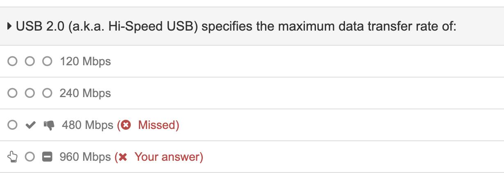

**题干：** USB 2.0 (a.k.a. Hi-Speed USB) specifies the maximum data transfer rate of:

|  |  |
| --- | --- |
| ❌ 我的答案 | 960 Mbps |
| ✅ 正确答案 | 480 Mbps |

### 正确答案先死记
## **USB 2.0 = 480 Mbps**

这个就是标准考点，
没什么花活，
就是：
### **Hi-Speed USB = 480 Mbps**

### 你为什么会错成 960 Mbps
因为 USB 速度数字很容易串，
尤其：
- 480
- 5 Gbps
- 10 Gbps

看久了会下意识往更大的数字靠。

但：
## **960 Mbps 不是 USB 2.0 的标准答案**

### 最简单顺手一起记
#### USB 1.1
- **12 Mbps**
- Full-Speed

#### USB 2.0
- **480 Mbps**
- Hi-Speed

#### USB 3.0 / USB 3.1 Gen 1
- **5 Gbps**
- SuperSpeed

#### USB 3.1 Gen 2
- **10 Gbps**

### 最简单记忆法
## **1.1 = 12，2.0 = 480，3.0 = 5G，3.1 Gen2 = 10G**

### 一句话口诀
## **USB2 记 480，USB3 起步 5G。**

### 再压缩成考试秒杀版
- **USB 2.0 / Hi-Speed** → **480 Mbps**
- **USB 3.0 / SuperSpeed** → **5 Gbps**

**一句话：**
这题就是纯记忆点：**USB 2.0 = 480 Mbps**，你这次是把它往更高代 USB 的速度上带偏了。
---

## USB 3.0 这题别被 10Gbps 带偏：USB 3.0 = SuperSpeed = 5 Gbps，并向下兼容
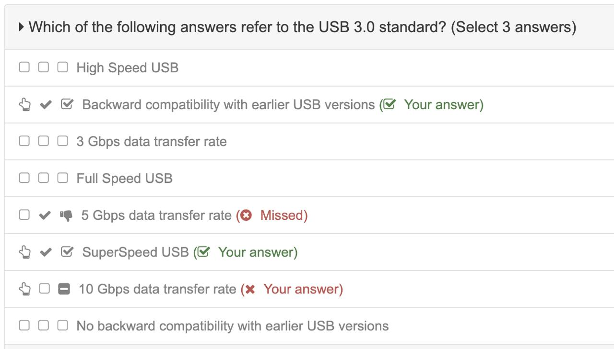

**题干：** Which of the following answers refer to the USB 3.0 standard? (Select 3 answers)

**正确答案：**
- **Backward compatibility with earlier USB versions**
- **5 Gbps data transfer rate**
- **SuperSpeed USB**

### 先回答你
对，## **USB 3.0 = 5 Gbps**。

你刚才问的“多少米”，
这里题目里的 **Gbps** 不是“米”，
而是：
### **Gigabits per second（每秒多少十亿位）**

也就是：
## **传输速度单位**
不是长度单位。

所以：
- **5 Gbps** = 速度
- **不是 5 米**

---

## 为什么这题会错
你已经选对了两个：
- **Backward compatibility with earlier USB versions** ✅
- **SuperSpeed USB** ✅

你错在把：
- **10 Gbps data transfer rate**
选进去了

而漏掉了：
- **5 Gbps data transfer rate**

### 这题最核心记忆
## **USB 3.0 = SuperSpeed = 5 Gbps**

不是：
- 3 Gbps
- 10 Gbps

---

## 最简单一起对比
### USB 1.1
- **12 Mbps**
- **Full-Speed USB**

### USB 2.0
- **480 Mbps**
- **Hi-Speed USB**

### USB 3.0 / USB 3.1 Gen 1
- **5 Gbps**
- **SuperSpeed USB**

### USB 3.1 Gen 2
- **10 Gbps**

---

## 为什么你会被 10 Gbps 带偏
因为现在 USB 命名特别容易乱：
- USB 3.0
- USB 3.1 Gen 1
- USB 3.1 Gen 2

其中：
- **USB 3.0 = USB 3.1 Gen 1 = 5 Gbps**
- **USB 3.1 Gen 2 = 10 Gbps**

所以题目只要明确说：
## **USB 3.0**
就先锁：
### **5 Gbps + SuperSpeed**

---

## 最简单记忆法
## **USB 2.0 = 480 Mbps**
## **USB 3.0 = 5 Gbps**
## **USB 3.1 Gen 2 = 10 Gbps**

### 一句话口诀
## **USB2 记 480，USB3 记 5G，3.1 Gen2 才 10G。**

### 再压缩成考试秒杀版
- **Hi-Speed** → **USB 2.0**
- **SuperSpeed** → **USB 3.0 / 3.1 Gen 1**
- **5 Gbps** → **USB 3.0**
- **10 Gbps** → **USB 3.1 Gen 2**

**一句话：**
这题错在把 **USB 3.1 Gen 2 的 10 Gbps** 记成了 **USB 3.0**；标准记法是：**USB 3.0 = SuperSpeed = 5 Gbps，并且向下兼容。**
---

## 这题不是并口，是老式串口：RS-232；RG-59 还是同轴线
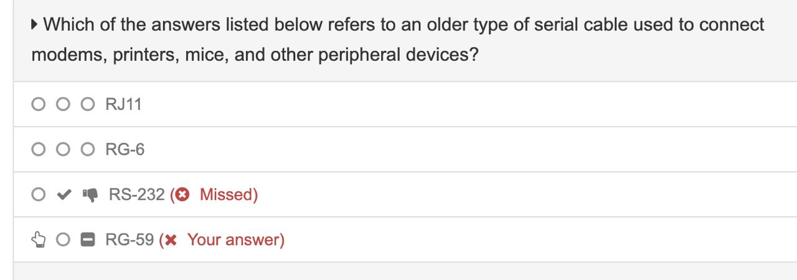

**题干：** Which of the answers listed below refers to an older type of serial cable used to connect modems, printers, mice, and other peripheral devices?

|  |  |
| --- | --- |
| ❌ 我的答案 | RG-59 |
| ✅ 正确答案 | RS-232 |

### 先纠正你一句
这个不是“并口”，
这题考的是：
## **串口 / serial cable**

标准答案是：
## **RS-232**

### RS-232 是什么
**RS-232** 是一种老式串行通信标准，
以前很常用于连接：
- modem（调制解调器）
- 串口鼠标
- 一些老式打印机
- 工业设备
- 网络设备控制台/串口通信

你可以先把它记成：
## **老电脑上那种串口通信标准**

常见会配合：
- **DB-9** 连接器

也就是说：
- **RS-232** 更像“串行通信标准/接口类型”
- **DB-9** 更像常见物理连接头

### 为什么 RG-59 不对
**RG-59** 不是串口通信标准，
它是：
## **同轴电缆类型**

常见用于：
- 视频监控
- 射频/视频信号
- 同轴传输

所以这题一旦看到：
- **serial cable**
- **used to connect modems, printers, mice**

就该往：
## **RS-232**
想，
而不是 RG-59。

### 另外两个为什么不对
#### RJ11
- 电话线接口
- 更偏电话/DSL/拨号线路
- 不是老式串口标准

#### RG-6
- 也是同轴电缆类型
- 不是串行通信标准

### 最简单记忆法
- **RS-232** → 老式串口通信标准
- **DB-9** → 常见串口接头
- **RG-59 / RG-6** → 同轴电缆
- **RJ11** → 电话线接口

### 一句话口诀
## **串口标准看 RS-232，串口接头常见 DB-9；RG 是同轴，RJ11 是电话。**

**一句话：**
你这题错在把“同轴电缆型号”选成了“老式串口标准”；题目只要出现 **serial cable + modems/printers/mice**，优先想到 **RS-232**。
---

## Thunderbolt 铜缆最大长度先记 3 米，不要往 6 米猜
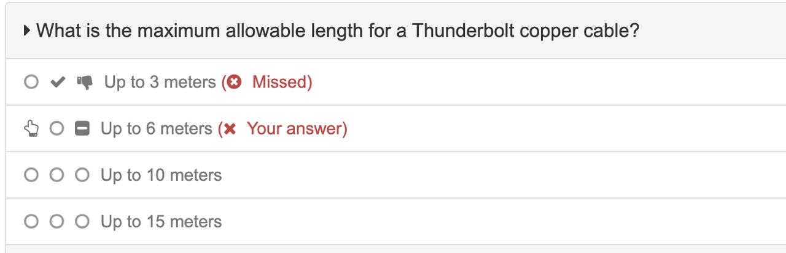

**题干：** What is the maximum allowable length for a Thunderbolt copper cable?

|  |  |
| --- | --- |
| ❌ 我的答案 | Up to 6 meters |
| ✅ 正确答案 | Up to 3 meters |

### 这题就是纯记忆点
标准记法先直接背：
## **Thunderbolt copper cable = up to 3 meters**

你这次错在把长度往更长的方向猜了。

### 为什么不是 6 米
因为题库这里考的是：
### **Thunderbolt 铜缆的最大允许长度**

标准答案就是：
## **3 meters**

不是：
- 6 m
- 10 m
- 15 m

### 最简单记忆法
你可以把它直接压成：
## **Thunderbolt 铜线短，3 米封顶。**

### 顺手提醒
这类题很容易和：
- USB 长度
- HDMI 长度
- 以太网 100 米
- 光纤更长距离
混在一起。

但这题不要展开想太多，
考试里先硬记：
## **Thunderbolt copper = 3 m**

### 一句话口诀
## **Thunderbolt 铜缆不长，3 米就是上限。**

**一句话：**
这题就是送分记忆题：**Thunderbolt copper cable 的最大长度 = 3 meters。**
---

## Thunderbolt 长度题一起记：铜缆 3 米，光纤 60 米
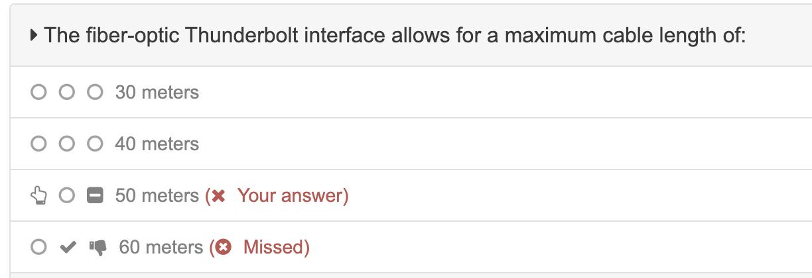

**题干：** The fiber-optic Thunderbolt interface allows for a maximum cable length of:

|  |  |
| --- | --- |
| ❌ 我的答案 | 50 meters |
| ✅ 正确答案 | 60 meters |

### 这题最好和上一题一起背
你刚刚那题是：
## **Thunderbolt copper cable = up to 3 meters**

这一题则是：
## **Thunderbolt fiber-optic interface = up to 60 meters**

所以这两个一起记最稳。

### 最简单对照
- **Thunderbolt copper** → **3 m**
- **Thunderbolt fiber** → **60 m**

### 为什么你会错成 50 米
因为这种长度题很容易靠感觉猜一个“差不多的整数字”。
但这题就是纯记忆点，
标准答案要死记成：
## **60 meters**

### 最简单记忆法
## **铜短光长：铜 3 米，光 60 米。**

### 一句话口诀
## **Thunderbolt 铜缆 3 米，光纤 60 米。**

**一句话：**
这题别单独记，最好和上一题捆绑：**Thunderbolt 铜缆最远 3 m，光纤版本最远 60 m。**
---

## SATA 数据线接口是 7 pins；别和电源口的 15 pins 混了
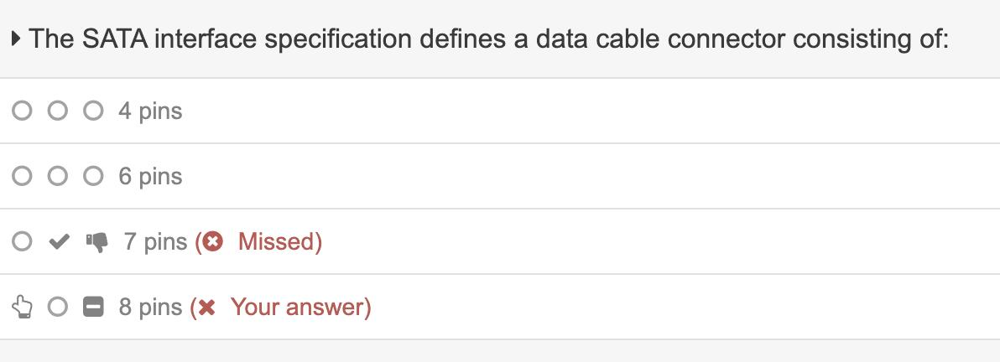

**题干：** The SATA interface specification defines a data cable connector consisting of:

|  |  |
| --- | --- |
| ❌ 我的答案 | 8 pins |
| ✅ 正确答案 | 7 pins |

### 这题为什么容易错
因为 SATA 很容易把：
- **数据接口**
和
- **电源接口**
混在一起。

### 正确记法
## **SATA data connector = 7 pins**

这个就是数据线那一排。

### 最容易一起混的另一个点
## **SATA power connector = 15 pins**

所以你以后最好成对记：
- **SATA 数据口** → **7 pins**
- **SATA 电源口** → **15 pins**

这样就不容易再错成 8 pins。

### 最简单记忆法
## **数据 7，供电 15。**

### 一句话口诀
## **SATA 数据线 7 针，SATA 电源线 15 针。**

**一句话：**
这题就是纯记忆点：**SATA data connector = 7 pins**，不要和 **SATA power connector = 15 pins** 混掉。
---

## F-type connector：同轴 + 螺纹拧上去 + cable TV / cable modem
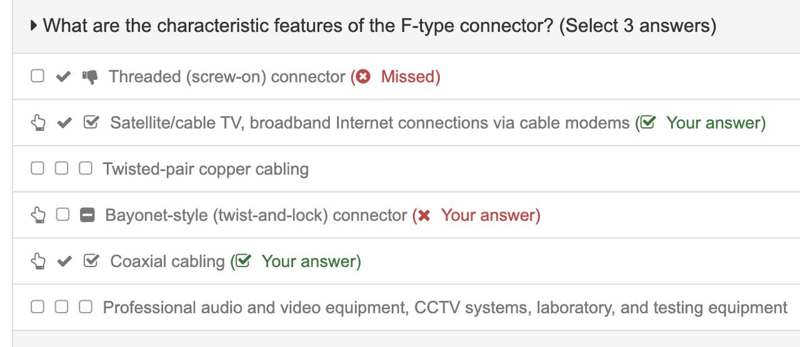

**题干：** What are the characteristic features of the F-type connector? (Select 3 answers)

**正确答案：**
- **Threaded (screw-on) connector**
- **Satellite/cable TV, broadband Internet connections via cable modems**
- **Coaxial cabling**

### F-type connector 是什么
你可以先把它直接记成：
## **有线电视/同轴宽带那种拧上去的接头**

它最典型的三个标签就是：
### 1. Coaxial cabling
- 用在 **同轴电缆** 上

### 2. Threaded (screw-on) connector
- 是 **螺纹式 / 拧上去** 的
- 不是卡口扭锁那种

### 3. Satellite / cable TV / cable modem
- 常见于：
  - 有线电视
  - 卫星电视
  - cable modem 宽带

---

## 你这题错在哪里
你已经选对了两项：
- **Coaxial cabling** ✅
- **Satellite/cable TV, broadband Internet via cable modems** ✅

你错在把：
- **Threaded (screw-on) connector**
漏掉了

反而选了：
- **Bayonet-style (twist-and-lock) connector** ❌

### 为什么 bayonet-style 不对
因为这种：
- **twist-and-lock / bayonet-style**
更像：
## **BNC connector**

也就是说：
- **F-type** → 螺纹拧紧（screw-on）
- **BNC** → 卡口旋锁（bayonet twist-lock）

这两个特别容易混。

---

## 最简单区分
### F-type
- 同轴
- 螺纹拧上去
- cable TV / satellite / cable modem

### BNC
- 同轴
- 卡口式旋锁
- 更常见于测试设备 / CCTV / 专业视频环境

---

## 一句话口诀
## **F 头拧着上，BNC 扭着锁。**

### 再补一句
## **F-type 看 cable TV，BNC 看测试/CCTV。**

**一句话：**
F-type connector 就是 **用在同轴线上的螺纹式接头**，常见于 **有线电视、卫星电视、cable modem 宽带**；你这次是把它和 **BNC 的 bayonet twist-lock** 搞混了。
---

## 这种题别被“none of the above”骗：能打印时直接生成副本的是 multipart paper
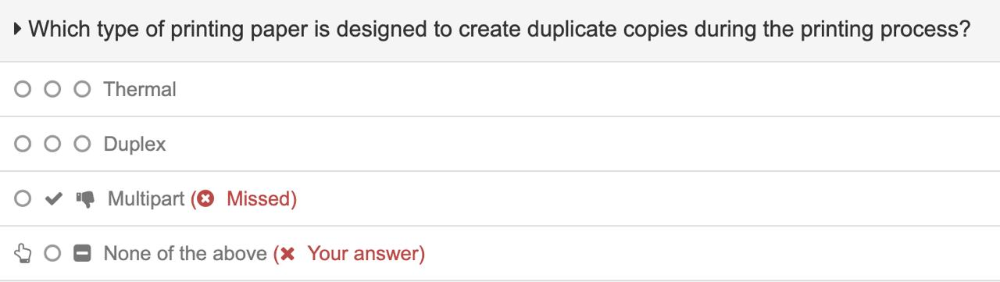

**题干：** Which type of printing paper is designed to create duplicate copies during the printing process?

|  |  |
| --- | --- |
| ❌ 我的答案 | None of the above |
| ✅ 正确答案 | Multipart |

### 对，这题正确答案就是
## **Multipart paper**

也就是：
### **多联纸 / 复写联单纸**

它的用途就是：
- 一次打印
- 同时得到多份副本

最典型场景比如：
- 发票
- 收据
- 出货单
- 仓库联单
- 老式针式打印机场景

### 为什么不是 none of the above
因为：
## **multipart 本来就是“专门为了打印时直接生成多联副本”设计的纸**

所以这题并不是“前面都不对”，
而是第三个选项本身就是标准答案。

---

## 其他几个为什么不对
### Thermal
- **热敏纸**
- 常见于小票/收银纸
- 是靠受热显色
- 不是“为了生成 duplicate copies”设计的

### Duplex
- **双面打印**
- 指纸张两面都打印，或者打印模式支持双面
- 这和“多联副本”不是一回事

### Multipart
- **多联纸 / 多层复写纸**
- 才是这题要的“打印时直接产生副本”

---

## 最简单记忆法
- **Thermal** → 热敏小票纸
- **Duplex** → 双面打印
- **Multipart** → 一打就出多联副本

### 一句话口诀
## **Thermal 出小票，Duplex 打双面，Multipart 出多联。**

**一句话：**
这题不能选 none of the above，因为 **multipart paper** 本身就是“用于打印过程中直接生成 duplicate copies”的标准答案。
---

## Impact printer printhead 故障：缺点缺线 + 打印发虚/深浅不一，不是“噪音大”
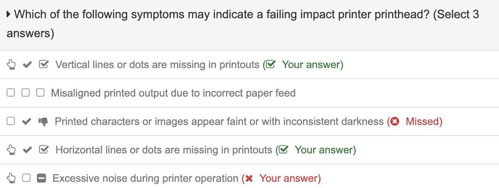

**题干：** Which of the following symptoms may indicate a failing impact printer printhead? (Select 3 answers)

**正确答案：**
- **Vertical lines or dots are missing in printouts**
- **Printed characters or images appear faint or with inconsistent darkness**
- **Horizontal lines or dots are missing in printouts**

### 你这题为什么会错
你已经选对了两项：
- **Vertical lines or dots are missing in printouts** ✅
- **Horizontal lines or dots are missing in printouts** ✅

你漏掉的是：
- **Printed characters or images appear faint or with inconsistent darkness** ✅

你错选的是：
- **Excessive noise during printer operation** ❌

### 为什么“faint / inconsistent darkness”是对的
impact printer 的 printhead 如果开始故障，
常见表现就是：
- 有些针打得不够有力
- 某些位置击打不稳定
- 打印出来发虚
- 深浅不一致

所以：
## **Printed characters or images appear faint or with inconsistent darkness**
很符合 printhead 变差的症状。

### 为什么“excessive noise”不对
因为 impact printer 本来就：
## **很吵**

它靠机械击打打印，
天生噪音就比较大。

所以“噪音大”不够特异，
不能直接当成 printhead failing 的标准故障症状。

换句话说：
- **impact printer noisy** ≠ 一定 printhead 坏了

### 最值得记的三个症状
你可以直接记成：
## **缺点、缺线、发虚/深浅不一**

也就是：
- **Vertical lines or dots missing**
- **Horizontal lines or dots missing**
- **Faint / inconsistent darkness**

### 为什么纸张走偏那项不对
**Misaligned printed output due to incorrect paper feed**
更像：
- 进纸问题
- 走纸机构问题
- 对位/输纸问题

不是 printhead 自己故障的最核心表现。

### 最简单记忆法
## **Printhead 坏 → 打不全、打不匀；不是单纯更吵。**

### 一句话口诀
## **针头坏，缺点缺线还发虚；本来就吵别乱选噪音。**

**一句话：**
这题关键是抓住 printhead 故障会直接影响“打出来的质量”——**缺线、缺点、深浅不一**；而 **impact printer 本来就很吵**，所以噪音大不是这题该选的核心症状。
---

## 虚拟化环境里的存储性能先看 IOPS 和 latency，不要跑去选 hypervisor type / file system type
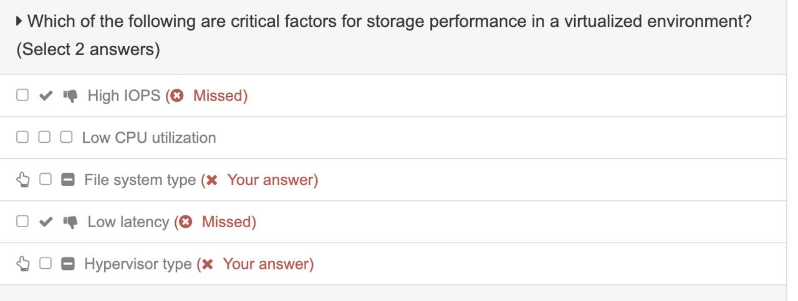

**题干：** Which of the following are critical factors for storage performance in a virtualized environment? (Select 2 answers)

|  |  |
| --- | --- |
| ❌ 我的答案 | File system type / Hypervisor type |
| ✅ 正确答案 | High IOPS / Low latency |

### 对，这题确实错得有点离谱，但好消息是：它很好修正
因为你这题不是知识不会，
而是：
## **题目问“storage performance”，你却选成了“平台/实现细节”**

### 这题最核心的关键词
题目问的是：
## **critical factors for storage performance**

只要是“存储性能”，
你第一反应就该看：
- **IOPS**
- **latency**
- throughput（如果在选项里）

而不是先去看：
- hypervisor 种类
- 文件系统名字

---

## 为什么正确答案是 High IOPS + Low latency
### 1. High IOPS
## **IOPS = Input/Output Operations Per Second**
也就是：
### **每秒能处理多少次读写操作**

虚拟化环境下常常有很多 VM 同时读写存储，
所以：
- IOPS 越高
- 存储能扛住的随机读写负载越强

这当然是核心性能指标。

#### 最短记忆
## **IOPS 看“忙不忙得过来”。**

---

### 2. Low latency
## **Latency = 延迟**
也就是：
### **一次存储请求从发出到得到响应花多久**

存储延迟高，
VM 就会感觉：
- 卡
- 慢
- 响应拖沓

所以：
## **低延迟 = 好的存储性能关键指标**

#### 最短记忆
## **Latency 看“反应快不快”。**

---

## 为什么 file system type 不对
**File system type** 当然会影响一些实现方式，
但这题问的是：
### **critical factors for storage performance**

更直接、更核心、更通用的性能指标，
是：
- IOPS
- latency

而不是先看你用 NTFS、ext4、ReFS 还是别的。

也就是说：
### 文件系统可能有影响，但不是这题最直接的“关键性能指标答案”

---

## 为什么 hypervisor type 不对
**Hypervisor type** 影响整体虚拟化架构，
但题目问的是：
### **storage performance**

这时候真正决定“存储快不快”的一线指标，
仍然是：
- IOPS
- latency

所以不能把“平台类别”当成存储性能指标本身。

---

## 为什么 low CPU utilization 也不对
CPU 负载低当然整体可能更轻松，
但它不是专门的：
### **storage performance factor**

题目要你选的是和存储性能直接相关的指标，
所以还是：
## **IOPS + latency**

---

## 最简单记忆法
### 题目一旦问 storage performance
先找：
## **IOPS**
## **latency**
## **throughput（如果有）**

不要优先选：
- file system type
- hypervisor type
- CPU utilization

---

## 一句话口诀
## **存储看 IOPS 和 latency，不先看 hypervisor 和文件系统。**

### 再压缩成一句
## **IOPS 管吞吐忙闲，latency 管响应快慢。**

**一句话：**
这题最大的修正点就是：**“storage performance” 先想性能指标本身——IOPS 和 latency；不要被 hypervisor type / file system type 这种平台词带跑。**
---

## 升级高性能 GPU 后一高负载就黑屏重启/关机，先想 PSU 扛不住，不要先怪显卡坏
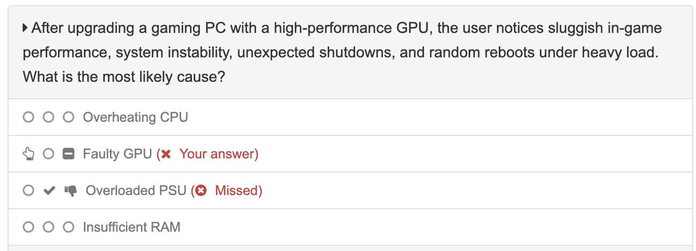

**题干：** After upgrading a gaming PC with a high-performance GPU, the user notices sluggish in-game performance, system instability, unexpected shutdowns, and random reboots under heavy load. What is the most likely cause?

|  |  |
| --- | --- |
| ❌ 我的答案 | Faulty GPU |
| ✅ 正确答案 | Overloaded PSU |

### 为什么答案是 PSU
这题最关键的线索是：
- **upgrading ... with a high-performance GPU**
- **unexpected shutdowns**
- **random reboots under heavy load**
- **system instability**

这几个放在一起，
最典型就像：
## **电源带不动 / PSU 功率不够 / PSU 负载过高**

因为高性能 GPU 一上去，
整机功耗会明显增加。
如果原来的 PSU 余量不够，
最常见的症状就是：
- 游戏高负载时不稳
- 突然关机
- 随机重启
- 压力一上来就出问题

所以最可能答案就是：
## **Overloaded PSU**

---

## 为什么不是 Faulty GPU
你选 Faulty GPU 也不算瞎猜，
因为升级后立刻出问题，
很容易第一反应就怀疑新显卡。

但如果题目重点是：
- **heavy load 才出问题**
- **unexpected shutdowns / reboots**

那它更像是：
### **供电不稳 / 功率不足**

而不是单纯显卡本体损坏。

因为“显卡坏了”更常让你联想到：
- 花屏
n- artifact
- 驱动崩溃
- 无法输出视频
- 特定图形错误

而这题给的是：
## **整机级别的断电/重启/不稳**
这更像 PSU。

---

## 其他两个为什么不对
### Overheating CPU
如果是 CPU 过热，
题目通常更容易给你：
- 温度高
- 风扇狂转
- 降频
- CPU-heavy task 出现问题

这里特地强调“换了高性能 GPU 后、高负载下出事”，
更偏电源不足。

### Insufficient RAM
内存不够更常见表现是：
- 卡顿
- 程序开太多变慢
- 游戏加载吃力

但不会那么典型地导致：
- **unexpected shutdowns**
- **random reboots under heavy load**

所以 RAM 不是这题最合理答案。

---

## 最简单记忆法
### 题目一旦出现：
- **升级了高性能显卡**
- **高负载下重启/关机/不稳**

优先想到：
## **PSU 不够 / Overloaded PSU**

---

## 一句话口诀
## **换大显卡后高负载就重启关机，先查 PSU，不先怪 GPU。**

**一句话：**
这题的核心不是“新显卡有问题”，而是“新显卡让整机功耗上去后，电源扛不住了”，所以最可能原因是 **Overloaded PSU**。
---

## 主板电容鼓包/顶部鼓起：默认视为硬件故障，最佳做法是更换主板或受影响部件
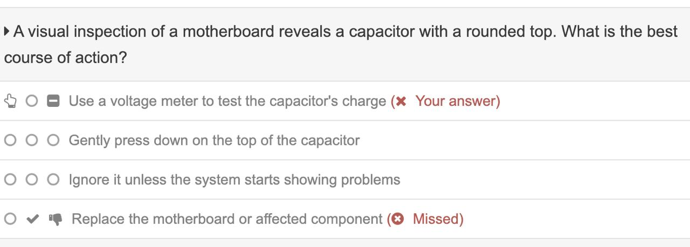

**题干：** A visual inspection of a motherboard reveals a capacitor with a rounded top. What is the best course of action?

|  |  |
| --- | --- |
| ❌ 我的答案 | Use a voltage meter to test the capacitor's charge |
| ✅ 正确答案 | Replace the motherboard or affected component |

### 先回答你
对，**考试语境里基本就是直接判定为坏件处理。**

因为主板上的电容如果：
## **顶部鼓起 / rounded top / bulging**
这通常就是：
### **电容失效或正在失效的典型肉眼故障征兆**

所以标准处理就是：
## **Replace the motherboard or affected component**

---

## 为什么这么直接
正常电容顶部应该是：
- 平整
- 没有鼓包
- 没有泄漏

如果已经看到：
- 顶部鼓起
- 鼓包
- 甚至有漏液

那说明它很可能已经：
- 老化
- 受热损坏
- 电解液异常
- 电容参数漂移/失效

这时候它不是“再观察一下”的级别，
而是：
## **明显硬件故障征兆**

---

## 为什么你选“拿电压表测”不对
因为这题问的是：
### **best course of action**

看到鼓包电容，最关键不是先测一测“现在还有没有电”，
而是：
### **这颗电容已经有明确物理损坏迹象了**

也就是说：
- 就算你去量
- 也改变不了“它已经不可靠”这个事实

考试里这种题更强调：
## **肉眼可见损坏 = 直接更换**

---

## 为什么其他两个更不对
### Gently press down on the top of the capacitor
这当然不对，
既不安全也不专业。

### Ignore it unless the system starts showing problems
也不对，
因为鼓包本身就已经是故障征兆，
不是“先放着看看”的状态。

---

## 最简单记忆法
### 主板电容题就记一句：
## **鼓包 = 坏，换。**

如果看到：
- bulging capacitor
- rounded top
- leaking capacitor

优先想：
## **replace the board / replace the affected component**

---

## 一句话口诀
## **电容一鼓包，不测不按，直接换。**

**一句话：**
这题考试思路很直接：**主板电容顶部鼓起就是明显故障征兆，最佳做法不是继续测、按、等，而是更换主板或受影响部件。**
---

## RAID 文件损坏先看系统日志，不是先备份；题目问的是“先判断盘是不是坏”
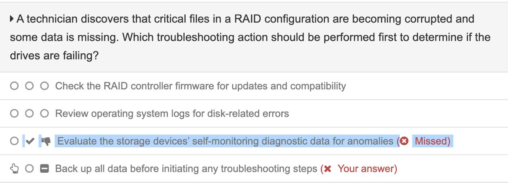

**题干：** A technician discovers that critical files in a RAID configuration are becoming corrupted and some data is missing. Which troubleshooting action should be performed first to determine if the drives are failing?

|  |  |
| --- | --- |
| ❌ 我的答案 | Back up all data before initiating any troubleshooting steps |
| ✅ 正确答案 | Review operating system logs for disk-related errors |

### 这题为什么你会选备份
因为从现实处置角度，
你想到：
## **先保数据**
这个思路其实一点都不离谱，甚至很像真实工作中会做的事。

但这题问得非常窄，
它问的是：
> **Which troubleshooting action should be performed first to determine if the drives are failing?**

注意重点是：
## **为了先判断硬盘是不是坏了，第一步该做什么**

在这个出题逻辑里，
最先要做的是：
## **Review operating system logs for disk-related errors**

---

## 为什么正确答案是看 OS logs
因为如果 RAID 里的盘开始出问题，
最先、最直接、最常见能提供线索的就是：
- 系统日志
- 磁盘 I/O 错误
- controller / timeout / read/write failure 信息
- 事件查看器里的 disk / storage / controller 错误

所以题目如果强调：
### **determine if the drives are failing**
最合理的第一步就是：
## **先看 disk-related errors in OS logs**

这比直接去做更深入、更定向的硬件层检查更符合“first troubleshooting step”。

---

## 为什么 SMART 那项没中
你漏掉的是：
### **Evaluate the storage devices’ self-monitoring diagnostic data for anomalies**

这个其实也很合理，
因为它就是：
## **看 SMART / 自检诊断数据**

但这题标准答案没有选它，
原因通常是考试会把它看成：
### **比先查系统日志再深入一步的动作**

也就是说：
- **先看系统日志** → 最初步、最通用、最快定位
- **再看 SMART/self-monitoring** → 更深入针对磁盘本体

所以这题不是说 SMART 不重要，
而是：
## **题库认为 first step 更偏 OS logs**

---

## 为什么备份不是标准答案
因为题目不是问：
- 最安全的动作是什么
- 风险控制第一步是什么

而是问：
- **为了判断 drive failing，先做哪一步 troubleshooting**

在考试思路里：
### **backup 是保护动作，不是诊断动作。**

所以虽然现实里很值得做，
但不是这道题要的标准答案。

---

## 为什么 firmware update 不是第一步
因为：
- firmware compatibility 属于后续排查方向
- 不是最直接判断“drive failing”的第一线动作

---

## 最简单记忆法
### RAID / 磁盘故障题如果问：
## **first troubleshooting step to determine if drives are failing**

优先想：
## **看 OS logs**

如果再往下一步，
再想到：
## **SMART / self-monitoring data**

---

## 一句话口诀
## **先看日志找报错，再看 SMART 查硬盘；备份很重要，但这题问的是诊断第一步。**

**一句话：**
你这题不是思路差，而是把“现实中先保护数据”带进了“考试问诊断第一步”的场景里；这道题标准答案更偏：**先查 OS logs 判断有没有 disk-related errors。**
---

## 机械硬盘文件传输变慢，第一反应先想碎片整理；不是查网卡
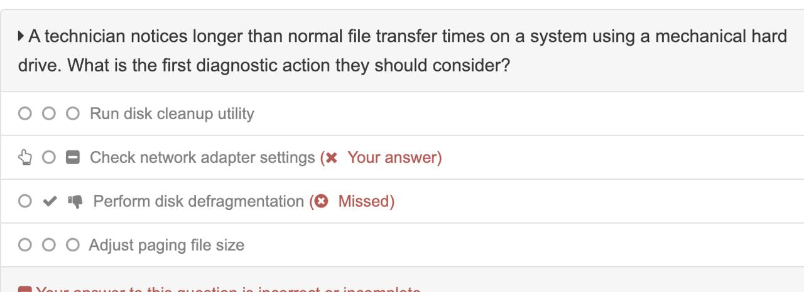

**题干：** A technician notices longer than normal file transfer times on a system using a mechanical hard drive. What is the first diagnostic action they should consider?

|  |  |
| --- | --- |
| ❌ 我的答案 | Check network adapter settings |
| ✅ 正确答案 | Perform disk defragmentation |

### 先直接回答你
对，**这题题库标准答案就是：先考虑做磁盘碎片整理（disk defragmentation）。**

不过更准确地说，
它不是在说“无脑立刻做一切类型磁盘整理”，
而是在这个题目语境里：
## **机械硬盘（mechanical hard drive）+ 文件传输变慢**
最先想到的典型动作是：
## **disk defragmentation**

---

## 为什么答案是 defragmentation
因为机械硬盘和 SSD 不一样，
机械硬盘读写要靠磁头移动。

如果文件碎片很多：
- 数据被拆散在盘面很多位置
- 磁头要来回找
- 读写效率会下降
- 文件传输可能变慢

所以对：
## **mechanical HDD**
来说，
碎片整理是一个非常经典的性能优化/诊断思路。

### 最简单理解
## **机械硬盘怕碎片，碎片多了读写慢。**

---

## 为什么你选网卡不对
你选的是：
### **Check network adapter settings**

这个思路更像：
- 网络传输异常
- 网络共享速度慢
- 网卡协商有问题
- 网络链路瓶颈

但题目没有强调：
- network transfer over LAN/WAN
- 网络丢包
- 网络连接异常

它说的是：
### **system using a mechanical hard drive**
这明显在把你往本地存储性能问题上引。

所以比起先查网卡，
题库更希望你想到：
## **disk defragmentation**

---

## 其他两个为什么不优先
### Run disk cleanup utility
清理垃圾文件能腾空间，
但不一定直接针对“机械盘文件碎片导致的传输慢”。

### Adjust paging file size
分页文件更偏内存/虚拟内存调优，
不是这题最直接的磁盘传输慢首选动作。

---

## 最简单记忆法
### 题目如果出现：
- **mechanical hard drive**
- **file transfer slower than normal**

优先想到：
## **disk defragmentation**

但顺手也要记一个现实补充：
## **碎片整理是给机械 HDD 的，不是给 SSD 乱做的。**

---

## 一句话口诀
## **机械盘传输慢，先想碎片整理；SSD 不按这套背。**

**一句话：**
这题的核心就是：**机械硬盘性能下降常和文件碎片有关，所以题库标准答案是先考虑做磁盘碎片整理，而不是先查网卡设置。**
---

## 硬盘在 BIOS/UEFI 和 Disk Management 都看不到时，第一步先查物理连接，不是 initialize
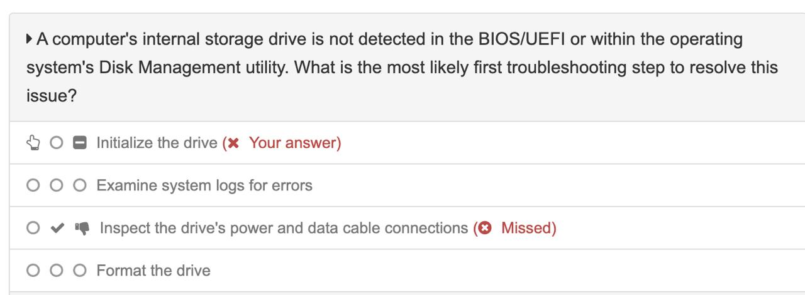

**题干：** A computer's internal storage drive is not detected in the BIOS/UEFI or within the operating system's Disk Management utility. What is the most likely first troubleshooting step to resolve this issue?

|  |  |
| --- | --- |
| ❌ 我的答案 | Initialize the drive |
| ✅ 正确答案 | Inspect the drive's power and data cable connections |

### 对，你这次说得对
这题的标准答案确实是：
## **Inspect the drive's power and data cable connections**

也就是：
### **先检查硬盘的供电线和数据线有没有接好**

---

## 为什么这题第一步一定是查连接
因为题目给的线索非常关键：
- **not detected in BIOS/UEFI**
- **not detected in Disk Management**

这说明问题很可能发生在：
## **比操作系统更底层的地方**

如果 BIOS/UEFI 都看不到这块盘，
你就应该先怀疑：
- 供电没接好
- SATA / data cable 松了
- 接口接触不良
- 盘根本没被系统底层识别到

所以第一步最合理的就是：
## **先查物理连接**

---

## 为什么 initialize 不对
你选的：
### **Initialize the drive**
这个动作只有在：
## **系统已经识别到硬盘**
但它还没被初始化/分区时，
才有意义。

可这题说的是：
- BIOS/UEFI 看不到
- Disk Management 也看不到

那说明：
### **连“这块盘存在”这件事都还没确认**

既然还没识别到，
你当然没法先去 initialize。

---

## 为什么 examine system logs 不是第一步
日志也可能有帮助，
但如果连 BIOS/UEFI 都看不到，
比起先翻日志，
更基础、更直接、更典型的第一步还是：
## **检查供电和数据连接**

---

## 为什么 format 更不对
format 更是建立在：
- 系统识别到盘
- 分区可见
- 设备在线

这些前提之上。

这题里盘连识别都没有，
更不可能先 format。

---

## 最简单记忆法
### 题目一旦出现：
- **drive not detected in BIOS/UEFI**
- **Disk Management 也看不到**

优先想到：
## **先查 power cable + data cable**

### 一句话口诀
## **BIOS 都看不到，先查线，不先初始化。**

**一句话：**
这题的判断关键就在于：**如果 BIOS/UEFI 和系统里都看不到硬盘，问题大概率在物理层或底层识别阶段，所以第一步应先检查供电线和数据线连接。**
---

## RAID 阵列整个消失时，先查 RAID controller 和物理连接；不是先看普通盘正不正常
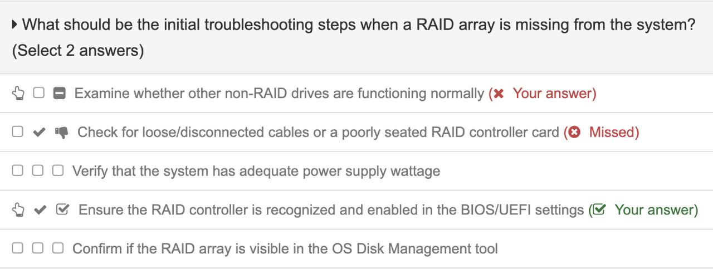

**题干：** What should be the initial troubleshooting steps when a RAID array is missing from the system? (Select 2 answers)

**正确答案：**
- **Check for loose/disconnected cables or a poorly seated RAID controller card**
- **Ensure the RAID controller is recognized and enabled in the BIOS/UEFI settings**

### 这题最核心的判断点
题目不是说：
- 某个普通盘慢
- 某个分区有问题

而是说：
## **RAID array is missing from the system**

只要整个 RAID 阵列都不见了，
你第一反应就应该先查：
### **RAID controller 有没有工作**
和
### **物理连接有没有问题**

所以标准答案就是这两项：
1. **Check for loose/disconnected cables or a poorly seated RAID controller card**
2. **Ensure the RAID controller is recognized and enabled in the BIOS/UEFI settings**

---

## 为什么你错的那项不对
你选的是：
### **Examine whether other non-RAID drives are functioning normally**

这个思路不算完全离谱，
因为它属于“系统里其他盘工作正常吗”的排查方向。

但问题是：
### 这不是 RAID 阵列消失时最直接、最初始的排查动作。

因为如果 RAID 阵列整个没了，
更优先怀疑的是：
- RAID controller 没识别
- BIOS/UEFI 里 RAID 没启用
- controller card 松了
- 线松了

而不是先去看普通 non-RAID drives。

---

## 为什么“OS Disk Management 里可见”没中
这项也很像你会想选的答案：
### **Confirm if the RAID array is visible in the OS Disk Management tool**

但题库更强调的是：
## **initial troubleshooting steps**

也就是说先看更底层：
- 控制器
- BIOS/UEFI
- 线缆/卡是否插好

如果这些底层东西都没确认，
那去 OS 里看 Disk Management，
通常会被视作后面一步。

所以不是这题最优先的两个答案。

---

## 为什么 power supply wattage 不对
电源功率当然会影响整机稳定性，
但“RAID 阵列整个 missing”这种题，
最典型的第一步还是：
- controller
- cable
- BIOS/UEFI recognition

不是先去估算瓦数。

---

## 最简单记忆法
### RAID 阵列整个不见了 → 先查两件事：
## **控制器在不在 / BIOS 认不认**
## **线松没松 / RAID 卡插好没**

不要先分散去看：
- 普通盘
- OS Disk Management
- 电源瓦数

---

## 一句话口诀
## **RAID 阵列消失先查卡和线，再看 BIOS 认不认。**

**一句话：**
这题的关键是把“阵列整体 missing”当成控制器/连接层级的问题来想：**先查 RAID 卡和线缆，再确认 BIOS/UEFI 是否识别并启用了 RAID controller。**
---

## RAID 发出报警声，最典型先想：drive failure 或 array degradation
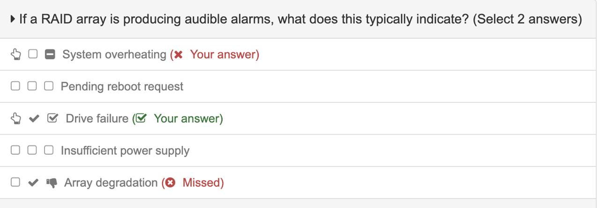

**题干：** If a RAID array is producing audible alarms, what does this typically indicate? (Select 2 answers)

**正确答案：**
- **Drive failure**
- **Array degradation**

### 对，你这个总结是对的
这题最该记的一句话就是：
## **RAID 报警 = 先想磁盘故障，或者阵列降级。**

也就是：
- **Drive failure**
- **Array degradation**

---

## 为什么会这样
RAID 阵列发出 audible alarms，
最常见就是在提示：
- 某块盘掉了 / 坏了
- 阵列失去冗余
- 阵列状态变差（degraded）
- 需要管理员尽快处理

所以这类报警更偏：
## **存储子系统本身的故障或风险状态**

而不是一般系统层面的别的问题。

---

## 为什么 system overheating 不对
你选了：
### **System overheating**

但 RAID 阵列题里的 audible alarms，
题库更典型地指向：
- drive failure
- degraded array

而不是把它当作通用整机过热报警。

也就是说：
### 过热可以导致别的报警场景，
但这道题在 RAID 语境里更标准的答案不是它。

---

## 为什么 pending reboot request 不对
这显然不是 RAID 阵列硬件发声报警的典型原因。
这更像软件/系统状态提示，
不是 RAID 控制器或存储阵列的故障警报逻辑。

---

## 为什么 insufficient power supply 不对
电源不足当然会导致系统异常，
但如果题目问的是：
### **RAID array is producing audible alarms**

考试最标准、最直接的联想仍然是：
## **drive failure / array degradation**

不是优先选 PSU 问题。

---

## 最简单记忆法
### RAID 一报警，先想两件事：
## **盘坏了**
## **阵列降级了**

---

## 一句话口诀
## **RAID 一叫，先查盘坏，再看阵列是否 degraded。**

**一句话：**
对，这题你可以直接压成一句话背：**RAID audible alarm 最典型表示 drive failure 或 array degradation。**
---

## 投影仪灯泡彻底烧坏最常见是“开机但没图像”，不是只是变暗
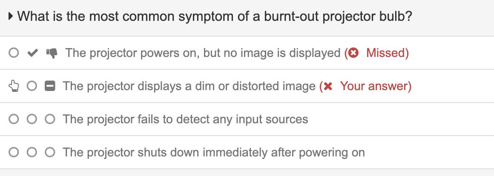

**题干：** What is the most common symptom of a burnt-out projector bulb?

|  |  |
| --- | --- |
| ❌ 我的答案 | The projector displays a dim or distorted image |
| ✅ 正确答案 | The projector powers on, but no image is displayed |

### 为什么这题容易错
因为你选的：
### **dim or distorted image**
听起来也很像灯泡老化的症状，
所以这个误区很常见。

但题目问的是：
## **burnt-out projector bulb**
也就是：
### **灯泡已经烧坏 / 彻底挂掉**

这时候更典型的表现是：
## **投影机能上电，但没有图像输出**

所以标准答案是：
### **The projector powers on, but no image is displayed**

---

## 为什么不是 dim or distorted image
因为：
- **dim image** 更像灯泡老化、亮度衰减、快不行了
- 但 **burnt-out** 更像已经彻底失效

也就是说：
### 灯泡“快坏了”可能会变暗，
### 灯泡“已经烧坏了”更可能直接没图像。

所以这题考的是更后面的那个阶段。

---

## 为什么其他两个也不对
### Fails to detect any input sources
这更像：
- 输入源问题
- 信号线/输入口问题
- source selection 问题

不是灯泡烧坏的典型症状。

### Shuts down immediately after powering on
这可能和：
- 过热
- 保护机制
- 电源问题
- 其他硬件故障
有关，
但不是这题最典型的“burnt-out bulb”表现。

---

## 最简单记忆法
### Projector bulb 你分两阶段记：
- **老化** → 画面变暗
- **烧坏** → 开机没图像

### 一句话口诀
## **灯泡老了会变暗，灯泡烧了就没画面。**

**一句话：**
这题错在把“灯泡老化”当成了“灯泡烧坏”；考试里如果明确写 **burnt-out projector bulb**，更标准的答案通常是：**机器能开机，但没有图像显示。**
---

## 静态画面长期停留后留下“残影/幽灵 logo”，先想 display burn-in，不是 inverter
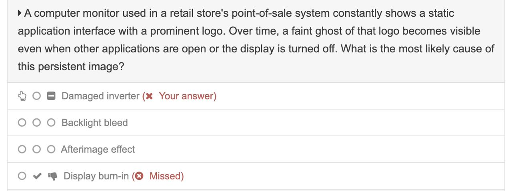

**题干：** A computer monitor used in a retail store's point-of-sale system constantly shows a static application interface with a prominent logo. Over time, a faint ghost of that logo becomes visible even when other applications are open or the display is turned off. What is the most likely cause of this persistent image?

|  |  |
| --- | --- |
| ❌ 我的答案 | Damaged inverter |
| ✅ 正确答案 | Display burn-in |

### 对，这个考点你之前确实做过同一路的
而且你这次又被显示器相关词带偏了。

但这题真正最关键的线索只有两个：
- **static application interface with a prominent logo**
- **faint ghost of that logo remains visible**

这几乎就是在直接描述：
## **display burn-in**

---

## 为什么答案是 display burn-in
### **Display burn-in**
就是：
- 某个固定图像长期停留在屏幕上
- 久了之后留下持久残影
- 就算切换到别的画面也还能隐约看到

题目里的：
- **POS 系统长期显示固定界面**
- **logo 残影持续可见**

都是 burn-in 的标准描述。

### 最简单理解
## **同一个画面长期不动 → 屏幕留下残影 = burn-in**

---

## 为什么 damaged inverter 不对
你这次选的是：
### **Damaged inverter**

但 inverter 更常关联的是：
- 背光问题
- 屏幕发暗
- 无背光
- 亮度异常

它不会最典型地造成：
### **固定 logo 的幽灵残影长期留在屏幕上**

所以这题不能往 inverter 想。

---

## 为什么 backlight bleed 不对
### **Backlight bleed**
更像：
- 屏幕边缘漏光
- 黑屏时边角不均匀发亮
- 屏幕边缘泛白/发亮

它不是“某个固定 logo 残留在屏幕里”。

---

## 为什么 afterimage effect 不对
这个是最容易干扰你的项。

### **Afterimage effect**
更像短暂残影/视觉暂留
有时会是临时的、可恢复的图像残留概念。

但这题描述的是：
- 长期 POS 静态界面
- prominent logo
- persistent image

这更典型是：
## **burn-in**

也就是更持久、更严重、更固定的残留。

---

## 最简单记忆法
### 题目一旦出现：
- **static image / static logo**
- **ghost image remains**
- **persistent image**

优先想到：
## **Display burn-in**

不要先选：
- inverter
- backlight bleed
- 一般 afterimage

---

## 一句话口诀
## **固定画面留残影，先想 burn-in，不想 inverter。**

### 再压一句
## **Logo 长期不动 → 残影留下 = burn-in。**

**一句话：**
你这题之所以又错，是因为把“显示异常”泛化成了 inverter 问题；但只要看到 **静态 logo 长期停留 + persistent ghost image**，就该直接锁定 **display burn-in**。
---

## LCD 像素一直黑不变色 = dead pixel；这题所有给的“修复动作”都不靠谱，所以选 None of the above
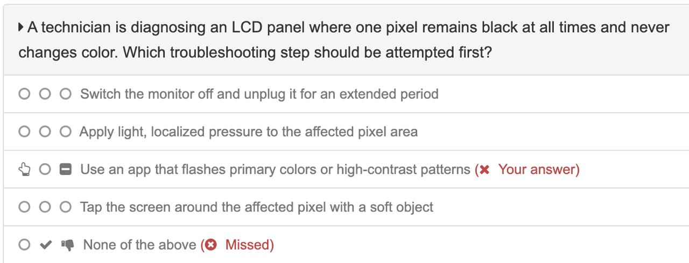

**题干：** A technician is diagnosing an LCD panel where one pixel remains black at all times and never changes color. Which troubleshooting step should be attempted first?

|  |  |
| --- | --- |
| ❌ 我的答案 | Use an app that flashes primary colors or high-contrast patterns |
| ✅ 正确答案 | None of the above |

### 先回答你
对，这题的关键就是：
## **如果所有给定动作都不适合这个症状，那就要敢选 None of the above。**

这题描述的是：
- **one pixel remains black at all times**
- **never changes color**

这更像：
## **dead pixel（坏点）**

而不是：
## **stuck pixel（卡住的像素）**

---

## 为什么你会被“flashing colors app”带偏
因为你脑子里记的是：
### 用快速闪烁颜色的程序，有时能尝试修 stuck pixel

这个记忆本身没错，
但前提是：
## **stuck pixel**

比如：
- 卡在某个颜色
- 还可能有机会恢复
- 可能通过颜色切换/像素刺激重新唤醒

### 但这题说的是：
## **一直黑、从不变色**

这更偏：
### **dead pixel**

dead pixel 通常意味着该像素已经失效，
不是靠闪屏 app 就能合理“先尝试修”的那类。

所以这题里，
你选的那个方法不成立。

---

## 为什么其他几个也都不对
### 1. Switch the monitor off and unplug it for an extended period
这不是 dead pixel 的标准优先处理办法。

### 2. Apply light, localized pressure to the affected pixel area
这类“按压像素”的做法本身就不稳，
而且题目这里给的是一直黑的 dead pixel，
更不适合当标准答案。

### 3. Tap the screen around the affected pixel with a soft object
同样属于不靠谱/高风险/非标准的做法，
题库这里显然不接受。

所以这题才会变成：
## **所有给定修复动作都不该选**

于是标准答案就是：
## **None of the above**

---

## 最关键的考点其实是
### **stuck pixel ≠ dead pixel**

#### Stuck pixel
- 常卡在某个颜色
- 可能还有一定恢复机会
- 有时才会想到：
  - flashing colors app
  - 某些轻度像素恢复方法

#### Dead pixel
- 一直黑
- 不变色
- 更像硬件失效
- 不要轻易往“软件/轻按/敲击就能修”上想

---

## 最简单记忆法
- **一直黑、不变色** → **dead pixel**
- **卡在某个颜色** → **stuck pixel**

### 一句话口诀
## **黑着不动是 dead，卡着变色才像 stuck。**

### 再压缩一句
## **stuck 才可能刷颜色试试；dead 往往修不好，这题就选 none of the above。**

**一句话：**
这题的核心不是“该试哪个修复技巧”，而是先识别症状：**一直黑且不变色更像 dead pixel，不是 stuck pixel，所以题目给的那些动作都不合适，标准答案才是 None of the above。**
---

## 外接显示器没出声，先确认显示器/输入源支不支持音频，再把它设为默认输出设备
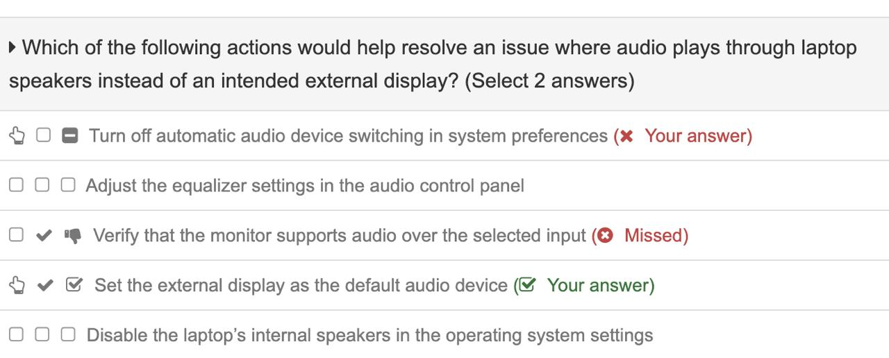

**题干：** Which of the following actions would help resolve an issue where audio plays through laptop speakers instead of an intended external display? (Select 2 answers)

**正确答案：**
- **Verify that the monitor supports audio over the selected input**
- **Set the external display as the default audio device**

### 这题最关键的两个判断点
如果声音没有走到外接显示器，
最先要确认两件事：

## 1. 这台显示器 / 当前输入口到底支不支持音频
也就是：
### **Verify that the monitor supports audio over the selected input**

因为不是所有外接显示器都能播声音，
而且就算显示器本身带扬声器，
也要看：
- 当前连接方式（HDMI / DP / USB-C）
- 当前输入源
- 当前接口是否承载音频

所以这一步非常关键。

---

## 2. 把外接显示器设为默认音频输出
也就是：
### **Set the external display as the default audio device**

这一步你已经做对了。

因为很多时候电脑虽然接上显示器了，
但系统默认音频输出仍然停留在：
- laptop speakers
- internal audio device

所以要手动把外接显示器选成默认播放设备。

---

## 为什么你选的 automatic audio device switching 不对
你选的是：
### **Turn off automatic audio device switching in system preferences**

这个不是这题最典型、最直接的标准修复动作。

因为题目更核心的问题是：
- 显示器有没有音频能力
- 系统默认输出是不是指到那个显示器

而不是先去改一个泛化的“自动切换”设置。

换句话说，
这题不是在考系统偏好里的策略微调，
而是在考：
## **先确认显示器支持音频 + 正确选输出设备**

---

## 为什么其他两个也不对
### Adjust the equalizer settings in the audio control panel
均衡器只会改声音效果，
不会决定声音到底从哪台设备输出。

### Disable the laptop's internal speakers in the operating system settings
这个做法太粗暴，
而且不是最优先的标准排查方法。

如果外接显示器本身不支持音频，
你把笔记本喇叭禁掉反而更糟。

---

## 最简单记忆法
### 外接显示器没声音，先查两件事：
## **显示器/接口支不支持音频**
## **系统默认输出是不是它**

---

## 一句话口诀
## **外屏没声先看口，再把外屏设默认。**

**一句话：**
这题标准思路很直白：**先确认外接显示器和当前输入方式支持音频，再把外接显示器设成默认音频输出设备。**
---

## 显示器画面发暗，先查亮度/省电模式/线缆连接；不要先动 saturation
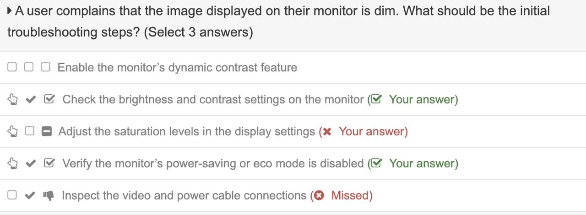

**题干：** A user complains that the image displayed on their monitor is dim. What should be the initial troubleshooting steps? (Select 3 answers)

**正确答案：**
- **Check the brightness and contrast settings on the monitor**
- **Verify the monitor's power-saving or eco mode is disabled**
- **Inspect the video and power cable connections**

### 你这题错在哪里
你前两项已经对了：
- **Check the brightness and contrast settings on the monitor** ✅
- **Verify the monitor's power-saving or eco mode is disabled** ✅

你错在把：
- **Adjust the saturation levels in the display settings**
选进去了

而漏掉了：
- **Inspect the video and power cable connections**

---

## 为什么 saturation 不对
### **Saturation = 饱和度**
它管的是：
- 颜色浓不浓
- 颜色鲜艳程度

它更偏：
## **颜色表现**
而不是：
## **整体亮不亮**

所以屏幕发暗时，
先去调 saturation 并不是标准的初始排查动作。

---

## 为什么线缆连接是对的
因为：
- 电源线松动
- 视频线接触不良
- 接口问题
- 供电异常

都可能造成：
- 屏幕亮度异常
- 图像发暗
- 显示不稳定

而且题目问的是：
## **initial troubleshooting steps**

这就意味着：
### **先做最基础、最常见、最直接的检查**

线缆连接当然属于这一层。

---

## 这题最正确的思路
显示器发暗先想三件事：

### 1. 亮度/对比度
最直接的显示设置问题。

### 2. Eco / power-saving mode
很多显示器开了省电模式就会自动压亮度。

### 3. Video / power cable connections
供电或视频连接不良也可能导致显示异常。

---

## 为什么 dynamic contrast 不是优先项
dynamic contrast 更像显示效果功能，
不是最基础的 dim screen 初始排查动作。

题目问的是：
### **initial troubleshooting**
所以更偏基础排查而不是功能增强。

---

## 最简单记忆法
### 画面发暗先查：
## **亮度/对比度**
## **省电模式**
## **电源线和视频线**

不要先调：
## **saturation**

---

## 一句话口诀
## **画面发暗先查亮度、省电、线；颜色淡不淡才看 saturation。**

**一句话：**
这题的关键就是区分“亮度问题”和“颜色问题”：**dim image 先查 brightness、eco mode、线缆连接；saturation 是颜色浓淡，不是亮度的第一排查项。**
---

## 投影机间歇性关机最“不像”的原因是视频线没插好；散热/供电问题才更像会关机
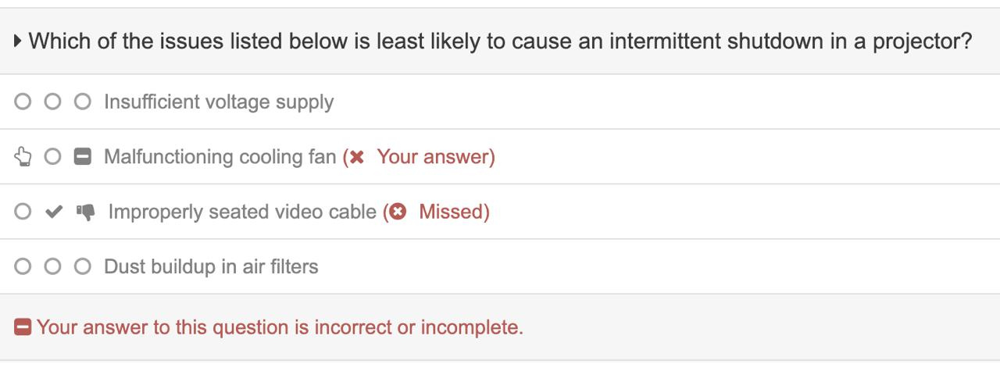

**题干：** Which of the issues listed below is least likely to cause an intermittent shutdown in a projector?

|  |  |
| --- | --- |
| ❌ 我的答案 | Malfunctioning cooling fan |
| ✅ 正确答案 | Improperly seated video cable |

### 这题最关键的词是
## **least likely to cause an intermittent shutdown**

也就是说题目不是问：
- 哪个会导致投影仪整体异常
- 哪个会让画面有问题

而是在问：
### **哪个最不像会让投影机“自己关机”**

---

## 为什么正确答案是 improperly seated video cable
因为视频线没插好更常导致的是：
- 没信号
- 画面闪断
- 图像丢失
- source/input 异常

但它：
## **不太会直接导致 projector 整机间歇性 shutdown**

所以如果问“least likely cause intermittent shutdown”，
最合理的就是：
## **Improperly seated video cable**

---

## 为什么你选的 cooling fan 反而不像错项
### **Malfunctioning cooling fan**
这个其实很可能会导致投影机：
- 过热
- 触发保护机制
- 自动关机 / 间歇性 shutdown

所以它反而是：
## **很像会导致 intermittent shutdown 的原因**

也就是说，
你把“很像原因”的那个选成了“最不像原因”的那个。

---

## 另外两个为什么也都比视频线更可能导致关机
### Insufficient voltage supply
供电不足会让设备：
- 工作不稳
- 间歇性掉电
- 自动重启/关机

这当然比视频线更像“shutdown 原因”。

### Dust buildup in air filters
灰尘堵塞滤网会导致：
- 散热变差
- 温度升高
- 触发过热保护
- 间歇性关机

这也比视频线更像 shutdown 原因。

---

## 最简单记忆法
### 投影机“自己关机”先想：
- **散热**
- **风扇**
- **灰尘堵塞**
- **供电问题**

不要先想：
- **视频线没插好**

因为视频线更偏：
## **图像信号问题，不是整机关机问题**

---

## 一句话口诀
## **会关机先查热和电；视频线更多影响画面，不太会让投影机自己关。**

**一句话：**
这题的核心是区分“画面问题”和“整机关机问题”：**视频线没插好更像没画面/信号异常，风扇故障、滤网积灰、供电不足才更像 intermittent shutdown 的原因。**
---

## 预防投影机间歇性关机，重点是散热通风：清滤网 + 保持通风口不堵
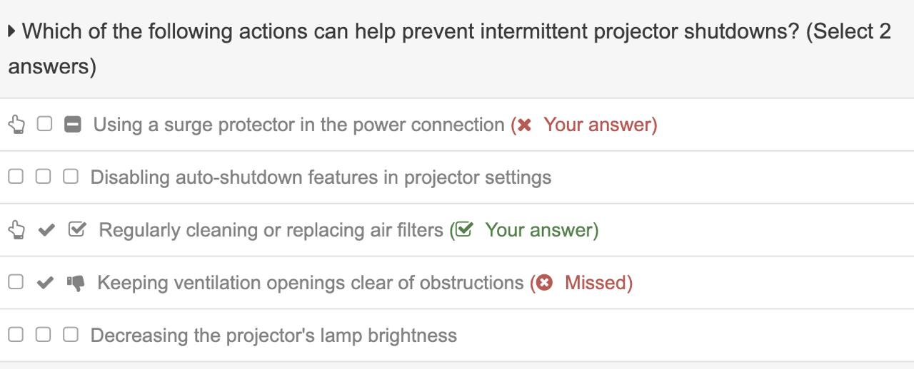

**题干：** Which of the following actions can help prevent intermittent projector shutdowns? (Select 2 answers)

**正确答案：**
- **Regularly cleaning or replacing air filters**
- **Keeping ventilation openings clear of obstructions**

### 这题和上一题其实是一组
上一题你已经碰到：
## **projector intermittent shutdown**
最像：
- 过热
- 散热问题
- 风扇/灰尘/通风问题

所以这题问“怎么预防”，
答案自然就会回到：
## **改善散热条件**

---

## 为什么正确答案是这两个
### 1. Regularly cleaning or replacing air filters
这个你答对了。

因为投影机滤网如果太脏：
- 进风受阻
- 散热变差
- 温度升高
- 容易触发保护关机

所以定期清洁/更换滤网，
是非常标准的预防动作。

### 2. Keeping ventilation openings clear of obstructions
这个你漏掉了，
但它其实和滤网是同一思路：
## **保证空气流通**

如果通风口被挡住：
- 热气散不掉
- 机器温度上升
- 容易间歇性关机

所以这项也是标准答案。

---

## 为什么 surge protector 不对
你选的是：
### **Using a surge protector in the power connection**

这个做法当然有价值，
但它更偏：
- 防电涌
- 保护设备供电安全

它不是最直接针对：
## **projector intermittent shutdown caused by overheating**

所以在这道题里，
它不是最优先的答案。

换句话说：
### 它保护供电，
### 但不直接解决投影机最常见的“热导致间歇性关机”。

---

## 为什么另外两个也不对
### Disabling auto-shutdown features in projector settings
这看起来像“不要让它自动关机”，
但如果机器是因为过热在保护自己，
你去关掉相关自动保护并不是标准预防思路。

### Decreasing the projector's lamp brightness
这在某些现实情境里可能会影响发热，
但不是这题最标准、最基础、最直接的预防动作。

题库更喜欢你先想到：
- **滤网**
- **通风口**

---

## 最简单记忆法
### 投影机防止间歇性关机先记两件事：
## **清滤网**
## **别挡住通风口**

本质就一句：
## **让它散热顺畅。**

---

## 一句话口诀
## **投影机怕热，预防关机先清滤网、保通风。**

**一句话：**
这题的核心就是把 projector intermittent shutdown 直接和散热联系起来：**预防最标准的两招就是清理/更换滤网，以及保持通风口不被遮挡。**
---

## 随机 artifacts + 彩色像素闪烁，最常见硬件原因先想 GPU 过热或故障，不是背光
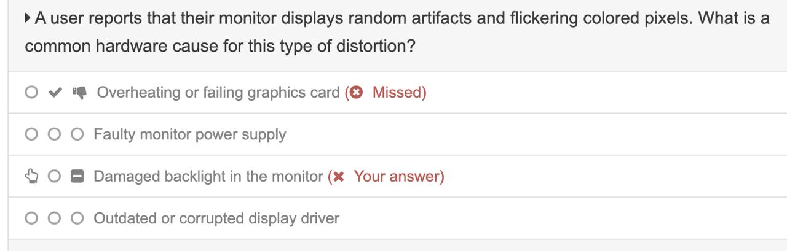

**题干：** A user reports that their monitor displays random artifacts and flickering colored pixels. What is a common hardware cause for this type of distortion?

|  |  |
| --- | --- |
| ❌ 我的答案 | Damaged backlight in the monitor |
| ✅ 正确答案 | Overheating or failing graphics card |

### 这题最关键的症状词
- **random artifacts**
- **flickering colored pixels**

只要看到这两个放在一起，
最先要联想到的就是：
## **GPU / graphics card 问题**

尤其是：
- 显卡过热
- 显卡显存/GPU 核心异常
- 显卡即将故障

所以标准答案是：
## **Overheating or failing graphics card**

---

## 为什么你选的 backlight 不对
### **Damaged backlight**
更常见的表现是：
- 屏幕整体发暗
- 局部暗
- 无背光但隐约有图像
- 亮度异常

它不太会典型地造成：
### **随机彩色噪点 / 彩色闪烁像素 / artifacts**

也就是说：
- **backlight 问题** → 更像亮度/照明问题
- **GPU 问题** → 更像图像渲染异常、彩块、花屏、闪烁像素

所以这题不能往背光想。

---

## 为什么 GPU 更像这类问题
因为显卡一旦：
- 过热
- 显存出错
- GPU 核心不稳
- 焊点/硬件老化

常见就会出现：
- 花屏（artifacts）
- 彩色方块
- 异常像素闪烁
- 图形输出错误

这就是题目描述的典型画风。

---

## 另外两个为什么不是最好答案
### Faulty monitor power supply
电源故障更可能让你想到：
- 显示器忽明忽暗
- 断电
- 闪屏
- 无法稳定开机

但“random artifacts and flickering colored pixels”
还是更像 GPU 输出问题。

### Outdated or corrupted display driver
驱动问题当然也可能让画面异常，
但题目问的是：
## **common hardware cause**

所以它要的不是软件层，
而是硬件层原因，
于是更标准的答案就是：
## **overheating or failing graphics card**

---

## 最简单记忆法
### 看到这些词：
- **artifacts**
- **colored pixels flickering**
- **花屏 / 彩块 / 渲染异常**

优先想到：
## **GPU / VRAM / graphics card fault**

不要先想：
- backlight
- 亮度问题
- 一般显示器照明问题

---

## 一句话口诀
## **花屏彩点找显卡，发暗无光才想背光。**

**一句话：**
这题的关键是把“亮度问题”和“图像渲染异常”分开：**随机 artifacts + 彩色像素闪烁最像显卡过热或故障，不像显示器背光损坏。**
---

## 显示器画面扭曲/乱码/颜色错位，第一步先重插或更换视频线，不先刷 firmware
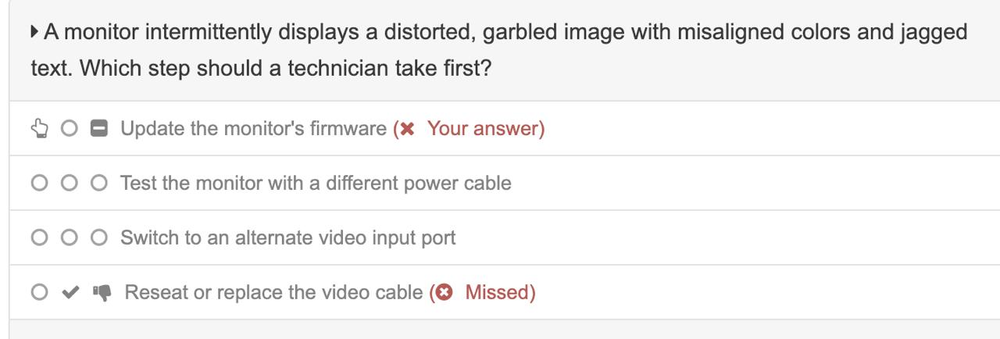

**题干：** A monitor intermittently displays a distorted, garbled image with misaligned colors and jagged text. Which step should a technician take first?

|  |  |
| --- | --- |
| ❌ 我的答案 | Update the monitor's firmware |
| ✅ 正确答案 | Reseat or replace the video cable |

### 这题为什么答案是视频线
题目给的症状是：
- **distorted / garbled image**
- **misaligned colors**
- **jagged text**
- **intermittently**

这种“间歇性图像异常”最先应该想到的是：
## **视频信号传输问题**

也就是：
- 视频线松动
- 视频线损坏
- 接头接触不良
- 信号不稳定

所以第一步最合理就是：
## **Reseat or replace the video cable**

---

## 为什么 firmware update 不对
firmware update 属于：
- 更深一层
- 更少见
- 没那么像“first step”

而题目问的是：
## **Which step should a technician take first?**

考试里只要看到：
- intermittent display corruption
- 颜色错位
- 文字锯齿/乱码

一般先排：
### **线缆 / 接口 / 连接问题**
而不是上来就刷 firmware。

换句话说：
### **先查简单常见项，再考虑高级修复。**

---

## 为什么电源线不是首选
电源线如果有问题，
更常想到：
- 断电
- 亮灭
- 无法开机
- 间歇性掉电

但题目重点是：
### **图像信号异常**
所以更优先查视频线，
不是电源线。

---

## 为什么 alternate input port 也没先中
换输入口也可能是后续排查方向，
但在“first step”里，
题库更基础、更直接地要求你先：
## **重插/更换视频线**

因为那是最简单、最常见、最直接针对信号异常的动作。

---

## 最简单记忆法
### 看到这些词：
- **garbled image**
- **misaligned colors**
- **jagged text**
- **intermittent display issue**

优先想到：
## **视频线 / 连接问题**

### 一句话口诀
## **画面乱、颜色歪、文字锯齿先查视频线，不先刷 firmware。**

**一句话：**
这题的核心是：**间歇性画面扭曲/乱码通常先按信号链路问题处理，所以第一步应先重插或更换视频线，而不是直接更新显示器固件。**
---

## 手机充电异常查供电问题，优先用 USB multimeter，不是 cable continuity tester
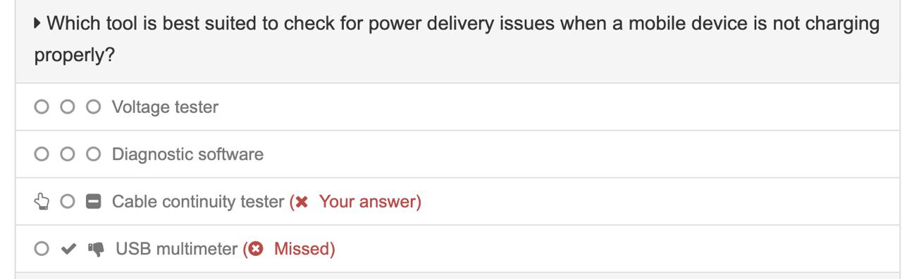

**题干：** Which tool is best suited to check for power delivery issues when a mobile device is not charging properly?

|  |  |
| --- | --- |
| ❌ 我的答案 | Cable continuity tester |
| ✅ 正确答案 | USB multimeter |

### 为什么答案是 USB multimeter
题目关键词是：
- **power delivery issues**
- **mobile device not charging properly**

这时候你最需要知道的是：
## **USB 口到底有没有正常输出电压、电流，充电协商/供电情况正不正常**

而：
## **USB multimeter**
正是拿来量：
- 电压（V）
- 电流（A）
- 有时还包括功率（W）

所以它最适合判断：
### **充电供电到底有没有问题**

---

## 为什么 continuity tester 不对
你选的：
### **Cable continuity tester**
更适合检查的是：
- 导线是不是断了
- 线路是不是通
- 某根线有没有开路/短路类问题

它更偏：
## **“线有没有连通”**

但题目问的是：
## **power delivery issues**

也就是说重点不只是“线通不通”，
而是：
- 供电电压够不够
- 电流有没有输出
- 充电表现正常不正常

这种时候 continuity tester 信息不够，
所以不是最佳答案。

---

## 为什么另外两个也不对
### Voltage tester
只测电压的话信息太有限，
不像 USB multimeter 那样直接面向 USB 供电场景，
也不如它适配充电问题诊断。

### Diagnostic software
软件可以看电池状态或系统报告，
但题目问的是：
### **check for power delivery issues**

更直接的硬件层工具当然还是：
## **USB multimeter**

---

## 最简单记忆法
### 题目一旦出现：
- 手机不正常充电
- power delivery issue
- USB 供电异常

优先想到：
## **USB multimeter**

不要先选：
- continuity tester
- 软件
- 普通 voltage tester

---

## 一句话口诀
## **查充电供电看 USB multimeter，查线通不通才看 continuity tester。**

**一句话：**
这题关键是分清“线路连通”和“供电输出”不是一回事：**手机充电异常要看 USB 供电的电压/电流，最佳工具是 USB multimeter，不是 cable continuity tester。**
---

## 手机性能突然变差：先想后台程序、缓存堆积、恶意软件、系统过旧；battery saver 不是这题标准答案
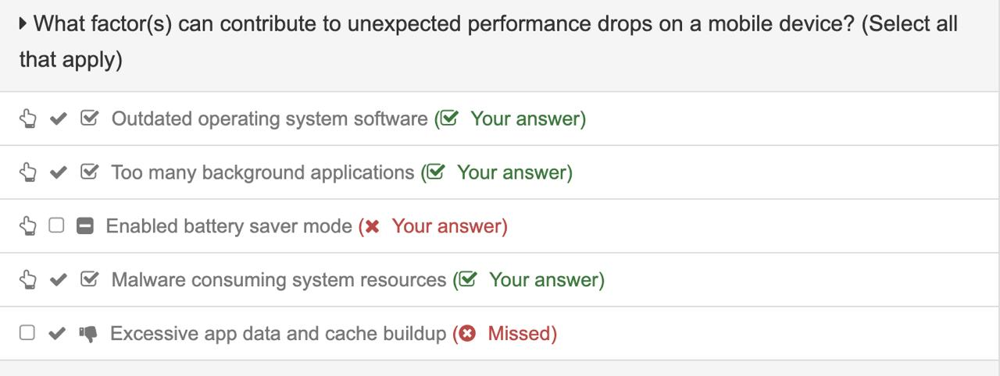

**题干：** What factor(s) can contribute to unexpected performance drops on a mobile device? (Select all that apply)

**正确答案：**
- **Outdated operating system software**
- **Too many background applications**
- **Malware consuming system resources**
- **Excessive app data and cache buildup**

### 这题你其实大部分都做对了
你已经选对了：
- **Outdated operating system software** ✅
- **Too many background applications** ✅
- **Malware consuming system resources** ✅

你错在：
- 选了 **Enabled battery saver mode** ❌
- 漏了 **Excessive app data and cache buildup** ✅

---

## 为什么 cache buildup 是对的
手机用久了如果：
- app data 太多
- cache 堆得很多
- 临时文件越来越乱

就可能导致：
- 应用加载变慢
- 系统响应迟钝
- 存储压力变大
- 整体性能下降

所以：
## **Excessive app data and cache buildup**
确实会导致 unexpected performance drops。

### 最简单理解
## **缓存太多、垃圾太多，也会把手机拖慢。**

---

## 为什么 battery saver 这题不选
你会选它很正常，
因为现实里 battery saver mode 有时确实会：
- 降低后台活动
- 限制性能
- 压低处理器行为

所以从现实经验说，
它看起来很像会影响性能。

但这套题的标准答案没有把它算进去，
题库更偏向把“unexpected performance drops”理解成：
### **异常或不健康因素导致的性能下降**

也就是像：
- 后台程序太多
- 恶意软件
- 缓存/数据堆积
- 系统过旧

而 **battery saver mode** 更像：
## **一种人为启用的节能模式**
不是题库这题最想考的“异常性能下降成因”。

所以考试里你要按题库标准收敛，
不要完全按现实经验放大解释。

---

## 最简单记忆法
### 手机突然变卡先想四件事：
## **后台太多**
## **缓存堆积**
## **恶意软件**
## **系统过旧**

不要把这题先记成：
## **battery saver = 标准答案**

---

## 一句话口诀
## **手机变慢先查后台、缓存、木马、系统旧；省电模式别在这题里乱选。**

**一句话：**
这题你差一点就全对了：**unexpected performance drops 的标准答案更偏后台程序、缓存堆积、恶意软件和系统过旧；battery saver 虽然现实里可能影响性能，但这题不把它算作标准答案。**
---

## 游戏高延迟/lag spikes，题目问“电脑内部因素”时先想后台进程和其他应用占带宽，不先想过热
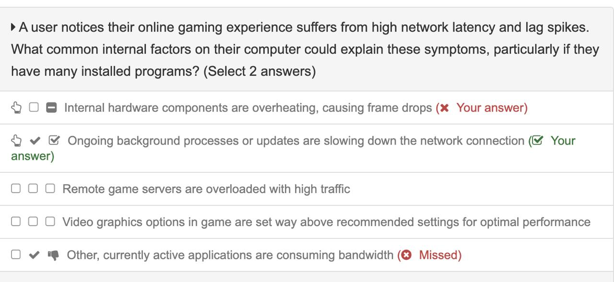

**题干：** A user notices their online gaming experience suffers from high network latency and lag spikes. What common internal factors on their computer could explain these symptoms, particularly if they have many installed programs? (Select 2 answers)

**正确答案：**
- **Ongoing background processes or updates are slowing down the network connection**
- **Other, currently active applications are consuming bandwidth**

### 这题最关键的词
- **high network latency**
- **lag spikes**
- **internal factors on their computer**
- **many installed programs**

这几个词放一起，
最该优先想到的就是：
## **带宽被别的程序抢走了 / 后台程序在占网络资源**

所以标准答案就是：
- **Ongoing background processes or updates are slowing down the network connection**
- **Other, currently active applications are consuming bandwidth**

---

## 为什么 overheating 不对
你选了：
### **Internal hardware components are overheating, causing frame drops**

这个选项看起来也挺合理，
因为现实里过热确实会造成：
- 掉帧
- 性能下降
- 卡顿感

但题目这里强调的是：
## **network latency and lag spikes**

这更偏：
### **网络层问题**
不是：
### **本地渲染性能问题**

也就是说：
- **过热** 更像 FPS / performance 问题
- **带宽占用** 更像 network latency / lag spikes 问题

所以这题标准答案不会选 overheating。

---

## 为什么 remote game servers overloaded 也不对
这个当然有可能让游戏 lag，
但题目问的是：
## **common internal factors on their computer**

而远程游戏服务器过载属于：
### **外部因素**
不是电脑内部因素。

所以不能选。

---

## 为什么高画质设置也不对
### **Video graphics options set too high**
这更像：
- 本地显卡负担重
- 帧数低
- 画面不流畅

但题目核心还是：
## **network latency / lag spikes**

所以它不是最标准答案。

---

## 最简单记忆法
### 题目如果写：
- **latency**
- **lag spikes**
- **many installed programs**

优先想到：
## **后台更新/后台程序占网络**
## **其他应用在吃带宽**

不要先想到：
- 过热
- 高画质
- 远端服务器

---

## 一句话口诀
## **高延迟看带宽，高帧率看显卡；后台程序抢网，游戏就会 lag。**

**一句话：**
这题的核心是区分“网络卡”和“画面卡”：**latency / lag spikes 更像后台更新和其他应用占带宽，而不是硬件过热导致的 frame drops。**
---

## VoIP 通话音频断断续续/失真，最常见先想 jitter，不先怪 codec
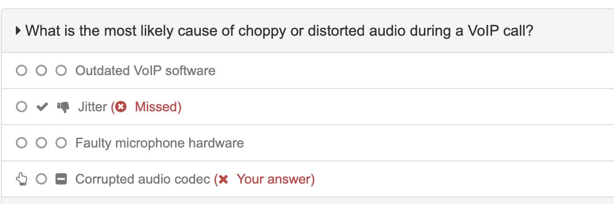

**题干：** What is the most likely cause of choppy or distorted audio during a VoIP call?

|  |  |
| --- | --- |
| ❌ 我的答案 | Corrupted audio codec |
| ✅ 正确答案 | Jitter |

### 对，这题也是同一条线
你说得对，
它还是在考：
## **抖动 / jitter**

而且是非常经典的 VoIP 症状题。

---

## 为什么答案是 jitter
### **Jitter = 网络传输延迟不稳定 / 到包时间忽快忽慢**

VoIP 是实时语音，
最怕的不是单纯“慢一点”，
而是：
## **每个语音包到达的间隔不稳定**

这样就会导致：
- 声音断断续续
- 音频忽快忽慢
- 失真
- choppy audio

所以题目说：
### **choppy or distorted audio during a VoIP call**
最典型答案就是：
## **jitter**

---

## 为什么你选的 corrupted audio codec 不对
codec 出问题当然也可能让音频异常，
所以你会想到它不奇怪。

但题目问的是：
## **most likely cause**

在 VoIP 场景里，
最经典、最常考、最标准的网络原因就是：
### **jitter**

换句话说：
- **codec 问题** 不是完全不可能
- 但考试最爱考的、最有代表性的答案是：
## **jitter**

---

## 另外两个为什么也没中
### Outdated VoIP software
可能有兼容性问题，
但不是“最经典导致 choppy/distorted VoIP audio”的首选答案。

### Faulty microphone hardware
麦克风坏了更像：
- 声音录不进去
- 杂音
- 输入质量差

但题目更像在说：
### **通话过程中网络传输品质不稳定**

所以还是 jitter 最符合。

---

## 最简单记忆法
### 看到这些词：
- **VoIP**
- **choppy audio**
- **distorted audio**
- **voice breaks up**

优先想到：
## **jitter**

### 顺手再对比
- **latency** → 延迟高，反应慢/对话有迟滞
- **jitter** → 包到达不稳，声音断断续续
- **packet loss** → 掉包，声音缺字缺段

---

## 一句话口诀
## **VoIP 声音一卡一卡先想 jitter；对话反应慢才更像 latency。**

**一句话：**
对，这题和前面你做过的是同一路：**VoIP 中 choppy / distorted audio 最典型先想 jitter，因为它代表语音包到达时间不稳定。**
---

## Port flapping 最常见先想：线有问题，或者 speed/duplex 不匹配；不是拓扑设计
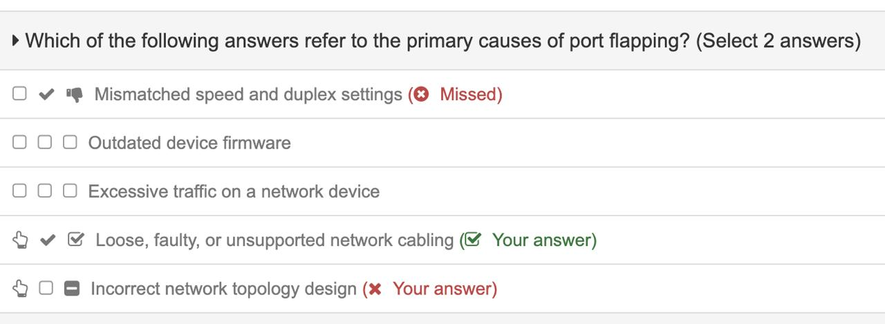

**题干：** Which of the following answers refer to the primary causes of port flapping? (Select 2 answers)

**正确答案：**
- **Mismatched speed and duplex settings**
- **Loose, faulty, or unsupported network cabling**

### 这题的核心先记一句
## **port flapping = 端口一会儿 up、一会儿 down，反复抖动。**

所以最常见原因通常是：
### **链路本身不稳定**

也就是这两类：
- **speed / duplex 不匹配**
- **线缆或物理连接问题**

---

## 为什么正确答案是这两个
### 1. Loose, faulty, or unsupported network cabling
这个你答对了。

如果网线：
- 松了
- 坏了
- 质量不行
- 类型不支持

那端口链路就可能：
- 一下连上
- 一下断开

这就是非常典型的：
## **port flapping**

---

### 2. Mismatched speed and duplex settings
这个是你漏掉的重点。

如果两端协商不一致，
比如：
- 一边 speed/duplex 配置不匹配
- 一边全双工，一边半双工
- 协商异常

就可能导致：
- 链路不稳定
- 错误率上升
- 端口反复 up/down

所以：
## **Mismatched speed and duplex settings**
是非常经典的标准答案。

---

## 为什么 incorrect network topology design 不对
你选这个不算离谱，
因为拓扑设计不好确实会引发很多网络问题。

但题目问的是：
## **primary causes of port flapping**

port flapping 更直接、更典型的是：
### **物理层/链路层不稳定**

而不是宏观的拓扑设计不好。

也就是说：
- **拓扑问题** 可能造成环路、拥塞、广播风暴等
- 但 **port flapping** 最优先还是先查：
  - 线
  - 口
  - duplex/speed

---

## 为什么其他两个也不对
### Outdated device firmware
可能导致兼容性问题，
但不是这题最常见、最基础的 primary cause。

### Excessive traffic on a network device
流量大可能会造成：
- 拥塞
- 丢包
- 延迟

但不属于 port flapping 的最典型根因。

---

## 最简单记忆法
### Port flapping 先查两件事：
## **线缆/物理连接**
## **speed/duplex 设置**

不要先想：
- 拓扑设计
- 流量太大
- firmware 太旧

---

## 一句话口诀
## **端口一抖，先查线；再看 speed / duplex 配没配对。**

**一句话：**
这题的核心就是把 port flapping 当成“链路自己反复掉又起”的问题来看：**最先查线缆物理层和 speed/duplex mismatch，不先怪拓扑设计。**
---

## 喷墨打印机出现竖线，先想喷头堵塞/脏了 → cleaning printheads；不要选 toner
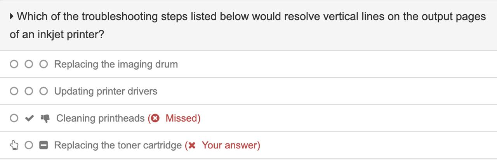

**题干：** Which of the troubleshooting steps listed below would resolve vertical lines on the output pages of an inkjet printer?

|  |  |
| --- | --- |
| ❌ 我的答案 | Replacing the toner cartridge |
| ✅ 正确答案 | Cleaning printheads |

### 这题最关键的词
## **inkjet printer**

你这题错得不在“竖线”这个症状本身，
而是在：
### **把 inkjet 和 laser printer 的耗材体系混了。**

---

## 为什么答案是 cleaning printheads
喷墨打印机（inkjet）是靠：
- 喷头（printhead）
- 喷墨
来成像的。

如果喷头：
- 堵了
- 脏了
- 某些喷嘴出墨不均

就很容易造成：
## **打印页上出现线条、缺线、竖线、条纹**

所以题目说：
### **vertical lines on output pages of an inkjet printer**
最典型的修复动作就是：
## **Cleaning printheads**

---

## 为什么你选 toner cartridge 不对
因为：
## **toner 是激光打印机（laser printer）那套东西**

而这题明确写的是：
### **inkjet printer**

喷墨打印机用的是：
- ink / ink cartridge
- printhead

不是：
- toner cartridge
- imaging drum

所以一旦题目明确写：
## **inkjet**
就要立刻把脑子切到：
### **喷头 / 墨盒 / 喷嘴清洁**
这一套。

---

## 为什么 imaging drum 也不对
### **imaging drum**
也是更偏：
## **laser printer**

它和 toner 一样，
都不属于 inkjet 这题的核心部件。

---

## 为什么 updating printer drivers 不对
驱动问题更像：
- 打印机无法识别
- 任务异常
- 功能不正常

但“竖线”这种打印输出质量问题，
在 inkjet 里更典型就是：
## **printhead / nozzle / ink flow**
而不是先去怪驱动。

---

## 最简单记忆法
### 题目只要写：
## **inkjet + lines / streaks / missing lines**

优先想到：
## **clean printheads**

### 题目如果写 laser printer
再去想：
- toner
- drum
- fuser

---

## 一句话口诀
## **喷墨看喷头，激光看 toner / drum。**

### 再压缩一句
## **Inkjet 出线条，先洗喷头；laser 才轮到 toner。**

**一句话：**
这题的关键就是别把喷墨和激光打印机混掉：**喷墨打印机出现竖线，最典型先做 printhead cleaning，不是更换 toner cartridge。**
---

## Inkjet grinding noise 先想进纸滚轮、卡纸异物、carriage 机构；不要选 drum / fuser 那套激光打印机部件
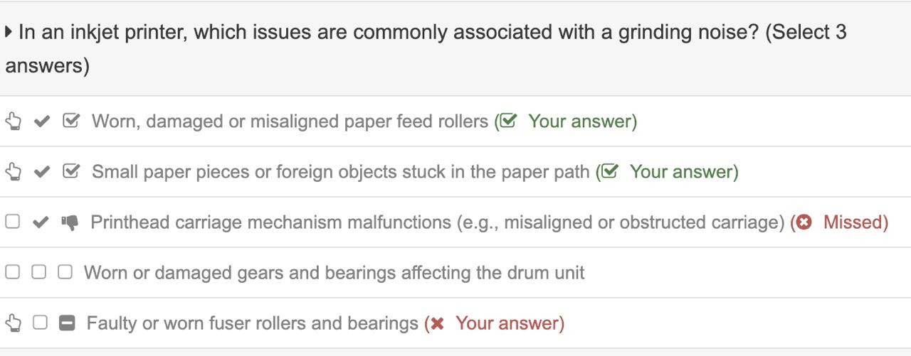

**题干：** In an inkjet printer, which issues are commonly associated with a grinding noise? (Select 3 answers)

**正确答案：**
- **Worn, damaged or misaligned paper feed rollers**
- **Small paper pieces or foreign objects stuck in the paper path**
- **Printhead carriage mechanism malfunctions (e.g., misaligned or obstructed carriage)**

### 你这题其实已经抓到一大半了
你答对了两项：
- **Worn, damaged or misaligned paper feed rollers** ✅
- **Small paper pieces or foreign objects stuck in the paper path** ✅

你错在：
- 漏了 **Printhead carriage mechanism malfunctions** ✅
- 反而选了 **Faulty or worn fuser rollers and bearings** ❌

---

## 这题最关键的词
## **inkjet printer**

这就意味着你要优先想到：
- paper feed rollers
- paper path obstruction
- printhead carriage

而不是：
- drum
- fuser

因为：
## **drum / fuser 是 laser printer 那套更典型的部件。**

---

## 为什么 carriage malfunction 是对的
喷墨打印机里，
printhead carriage（喷头小车）会左右移动。

如果它：
- 卡住
- 偏了
- 被异物挡住
- 机构不顺

就很容易出现：
## **grinding noise（摩擦/咔咔/磨齿声）**

所以：
### **Printhead carriage mechanism malfunctions**
是这题很标准的答案。

---

## 为什么你选的 fuser rollers 不对
### **fuser**
是激光打印机里负责：
- 加热
- 把 toner 熔到纸上

的部件。

但题目明确写的是：
## **inkjet printer**

喷墨打印机不按 toner / drum / fuser 这套路工作。

所以一旦题目写 inkjet，
你就应该马上把脑子从：
- toner
- imaging drum
- fuser

切换到：
- ink
- printhead
- carriage
- rollers
- paper path

---

## 为什么 drum 那项也不对
题目里的：
### **gears and bearings affecting the drum unit**
也一样更偏 laser printer 语境，
不是这题最合理的 inkjet grinding noise 选项。

---

## 最简单记忆法
### Inkjet 出 grinding noise 先查三件事：
## **滚轮**
## **卡纸/异物**
## **喷头 carriage 机构**

不要先选：
## **drum / fuser**

---

## 一句话口诀
## **喷墨有异响，先查滚轮、卡纸、carriage；drum 和 fuser 先留给激光机。**

**一句话：**
这题的本质还是同一个坑：**题目写 inkjet，就别再往 laser printer 的 drum / fuser 那套跑；grinding noise 最常见还是 rollers、paper path 异物、以及 printhead carriage 机构问题。**
---

## Laser printer grinding noise：fuser、drum 齿轮/轴承、卡纸异物、paper feed rollers 都要查；printhead carriage 是喷墨那套
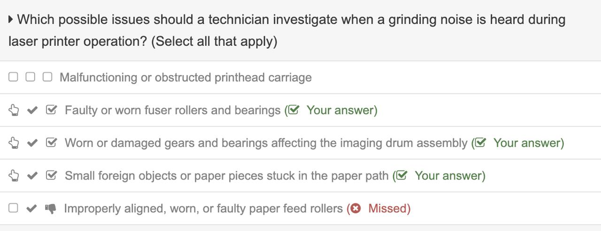

**题干：** Which possible issues should a technician investigate when a grinding noise is heard during laser printer operation? (Select all that apply)

**正确答案：**
- **Faulty or worn fuser rollers and bearings**
- **Worn or damaged gears and bearings affecting the imaging drum assembly**
- **Small foreign objects or paper pieces stuck in the paper path**
- **Improperly aligned, worn, or faulty paper feed rollers**

### 这题和上一题正好成对比
上一题考的是：
## **inkjet printer grinding noise**
所以重点是：
- rollers
- paper path
- printhead carriage

而这题明确写的是：
## **laser printer operation**

所以现在脑子要切到 laser 那一套：
- **fuser**
- **imaging drum assembly**
- **gears / bearings**
- **paper path / feed rollers**

---

## 为什么你这次会漏掉 paper feed rollers
因为你已经抓到了 laser printer 的典型部件：
- **fuser rollers and bearings** ✅
- **drum assembly gears / bearings** ✅
- **paper path foreign objects** ✅

这已经很好了。

你漏掉的是：
### **Improperly aligned, worn, or faulty paper feed rollers**

其实它和“异物卡纸”属于同一层很常见的机械异响来源：
## **进纸机构本身**

所以这题最后一项也要一起选。

---

## 为什么 printhead carriage 不对
这个选项是：
### **Malfunctioning or obstructed printhead carriage**

它是上一题喷墨机那边的典型答案，
因为：
## **printhead carriage 是 inkjet 那套**

而 laser printer 没有像喷墨打印机那样左右跑的 printhead carriage 结构作为核心部件，
所以这题不能选它。

---

## 最简单对照记忆
### Inkjet grinding noise
优先查：
- **printhead carriage**
- **paper feed rollers**
- **paper path foreign objects**

### Laser grinding noise
优先查：
- **fuser rollers / bearings**
- **drum assembly gears / bearings**
- **paper path foreign objects**
- **paper feed rollers**

---

## 最简单记忆法
### 看到 grinding noise 先分机器类型：
- **Inkjet** → 想喷头 carriage
- **Laser** → 想 fuser / drum / gears
- **两边都别忘了** → paper path / feed rollers

---

## 一句话口诀
## **喷墨有异响找 carriage，激光有异响找 fuser / drum；两边都要查 rollers 和卡纸。**

**一句话：**
这题最值得记的是“先按打印机类型切脑子”：**laser printer grinding noise 要查 fuser、drum、齿轮轴承、进纸滚轮和卡纸异物；printhead carriage 是 inkjet 那边的答案。**

