# CompTIA A+ 错题笔记

## Telnet 核心特性
**题干：** “Which of the following statements describe an important feature or service provided by Telnet? (Select three.)”

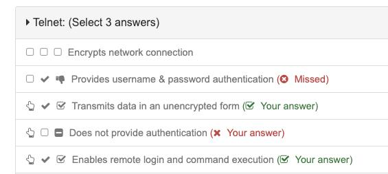

**正确选项：**
- Provides username and password authentication（提供用户名/密码认证）
- Transmits data in an unencrypted form（明文传输）
- Enables remote login and command execution（远程登录执行命令）

**说明：** Telnet 虽然要输入账号密码，但整条链路都是明文，任何人抓包都能看到凭证和命令。因此只适合实验或内网环境；需要安全远程必用 SSH。题目里“Telnet 不提供认证”是常见陷阱。

---

## 服务器角色：文件存储 vs 文档输出
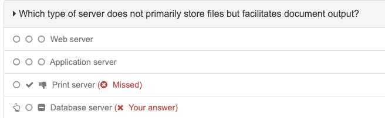

**题干：** 哪种服务器主要负责文档输出而不是存储文件？

|  |  |
| --- | --- |
| ❌ 我的答案 | database server |
| ✅ 正确答案 | print server |

**说明：** Print server 的职责是接收打印作业、排队、发送到指定打印机；本身不负责长期存储文件。数据库/应用服务器或文件服务器才负责数据存储。

---

## 无线基础：信道宽度 / 蓝牙 / 802.11
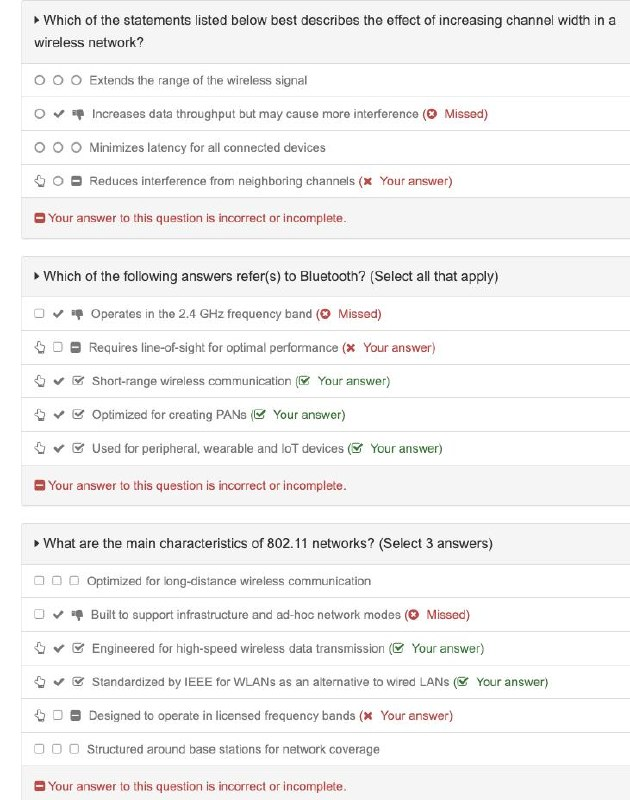

### 1. 信道宽度
- ❌ 我的答案：增大信道宽度会减少干扰
- ✅ 正解：增大信道宽度可提升吞吐，但更容易与邻近信道重叠、引入干扰

### 2. 蓝牙特性（多选）
- ✅ 正确：工作在 2.4 GHz ISM 频段、短距离通信、构建 PAN、连接外设/穿戴/IoT
- ❌ 错误：认为需要视距（LOS）。蓝牙是跳频射频，不需要 LOS，视距是红外的特性

### 3. 802.11 WLAN 特性（多选）
- ✅ 正确：支持 Infrastructure 与 Ad-hoc 拓扑、由 IEEE 制定、用于高速无线局域网
- ❌ 错误：说它运行在“许可频段”。实际上 802.11 使用 ISM/UNII 等免许可频段

**记忆：**
- 信道宽度 ↑ ⇒ 带宽 ↑ 但干扰 ↑
- 蓝牙 = 2.4 GHz PAN + 外设，不需要视距
- 802.11 = IEEE WLAN，免许可频段，可基础设施或临时网络

---

## 2.4 GHz 与高频段对比
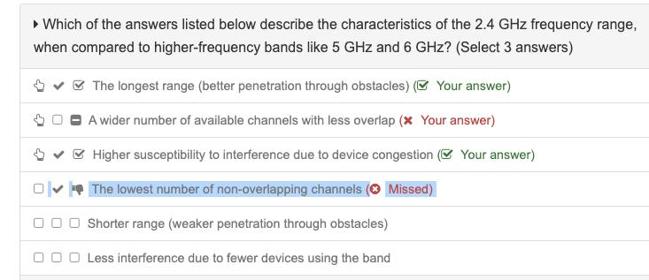

| 特性 | 2.4 GHz | 5/6 GHz |
| --- | --- | --- |
| 覆盖 | ✅ 最远，穿墙最好 | 较近 |
| 干扰 | ❌ 设备多、最容易受干扰 | 更干净 |
| 非重叠信道数量 | ❌ 只有 3 个（1/6/11） | 更多信道 |

**记忆：** “2.4 = far but few”——覆盖远，但干净信道少。

---

## TCP 445 = SMB/CIFS
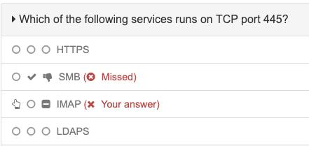

|  |  |
| --- | --- |
| ❌ 我的答案 | IMAP |
| ✅ 正确答案 | SMB / CIFS |

**说明：** 445/TCP 是 Windows SMB (文件/打印共享)。IMAP 是 143/993，HTTPS 是 443，LDAPS 是 636。记住 “143/443/445/636” 这组即可。

---

## LDAP 389 & NetBIOS 137/138/139
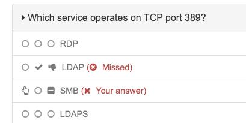

- LDAP 明文端口 = 389（TCP/UDP）
- LDAPS 加密端口 = 636
- HTTPS = 443

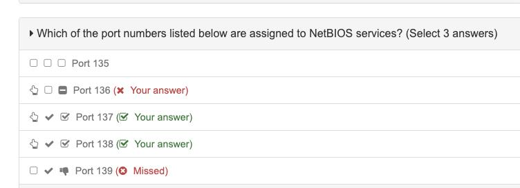

| 端口 | 服务 |
| --- | --- |
| 137 | NetBIOS Name Service |
| 138 | NetBIOS Datagram Service |
| 139 | NetBIOS Session Service |

**记忆：** NetBIOS = 137-139 连续区间；135 是 RPC，445 是 SMB。

---

## POP3 vs SMTP；DHCP 客户端端口
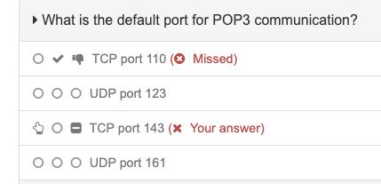

- SMTP（25/587）负责“发”邮件
- POP3（110/995）或 IMAP（143/993）负责“收”邮件
- 题目问“客户端下载邮件” ⇒ 应选 POP3

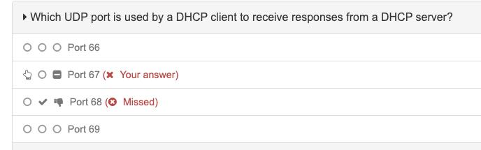

- DHCP Server 监听 UDP 67
- DHCP Client 监听 UDP 68 接收 OFFER/ACK
- 记法：Server=67、Client=68，数字递增

---

## LDAP 389 再确认

同上，LDAP 明文端口始终是 389；HTTPS/POP/SMTP 等各有固定端口，勿混淆。

---

## POP3 下载邮件

客户端从服务器下载邮件 → POP3（或 IMAP）。SMTP 仅用于发信。

---

## DHCP 客户端端口 68

DHCP 客户端接收响应使用 UDP 68；服务器监听 67。记成 “67→Server，68→Client”。
---

## 卫星网络特性
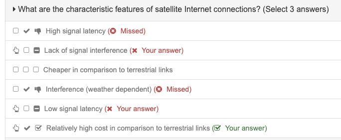

**正确特性（选 3）：**
- 高延迟（High signal latency）
- 易受天气影响（Interference / weather dependent）
- 成本高于地面链路（Relatively high cost vs terrestrial）

**错误选项：**
- Lack of signal interference（卫星恰好容易被雨雪衰减）
- Low signal latency（绕地轨道距离 3.6 万 km，往返延迟 500 ms 级别）
- Cheaper…（建造/发射卫星成本极高）

**记忆：** “卫星：贵、慢、怕天气”。
---

## MAN / WAN / SAN / CAN 对比（巩固题）
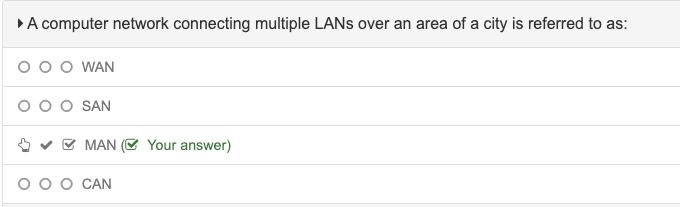

**题干：** “连接一座城市范围内多条 LAN 的网络称为什么？”
- ✅ MAN（Metropolitan Area Network）：覆盖城市/区域
- WAN（Wide Area Network）：跨城市/国家甚至全球（例如互联网、企业广域网）
- SAN（Storage Area Network）：专用存储网络（光纤通道/iSCSI）
- CAN（Campus/Controller Area Network）：校园/企业园区或车载总线

**记忆：**
- LAN → 单一建筑/楼层
- MAN → 城市级（地铁、城域光环）
- WAN → 跨城/跨国
- SAN → 和“存储”相关，不是地理范围
- CAN → “校园/车载”专用

虽然本题答对，但放进笔记方便以后回顾命名区别。
---

## SAN / NAS / iSCSI / SDN 区分
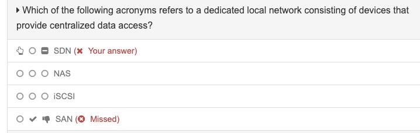

**题干：** 哪个缩写表示“专用的本地网络，由多个设备组成，提供集中式数据访问”？

| 选项 | 说明 |
| --- | --- |
| SDN | Software-Defined Networking，指控制面/数据面解耦的网络架构，不是“存储网络” |
| NAS | Network Attached Storage，通常是一台设备，通过 NFS/SMB 提供文件级共享 |
| iSCSI | 一种基于 IP 的块级传输协议，可用来构建 SAN，但本身不是网络类型 |
| **SAN** ✅ | Storage Area Network，独立的高速网络，用于在服务器和存储设备之间提供块级数据访问 |

**记忆：**
- NAS = “设备”→ 文件级共享
- SAN = “网络”→ 块级访问（常用 FC/iSCSI）
- iSCSI = 协议，SDN = 架构
---

## 线缆追踪工具：Toner & Probe
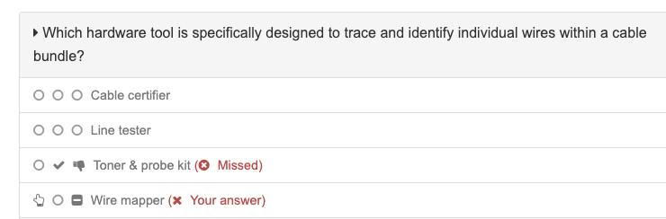

**题干：** 哪种工具专门用来在一束电缆中追踪、识别单根线？

|  |  |
| --- | --- |
| ❌ 我的答案 | Wire mapper |
| ✅ 正确答案 | Toner & probe kit |

**说明：**
- Toner（发生器）给目标线缆注入音频信号，Probe（探头）沿束线寻找并通过蜂鸣声定位那根线，非常适合“从机柜追到墙面”的场景。
- Wire mapper 侧重检测双绞线的线序是否正确（T568A/B），无法追踪线缆走向。
- Cable certifier/line tester 则是用于带宽认证、阻抗/衰减测试，功能不同。

**记忆：** 追线 = Toner+Probe，“听声音找线”；查线序 = Wire mapper。
---

## Network tap 用途
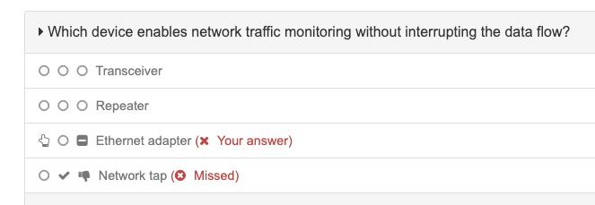

**题干：** 哪种设备可以在不中断数据流的情况下监听网络流量？

|  |  |
| --- | --- |
| ❌ 我的答案 | Ethernet adapter |
| ✅ 正确答案 | Network tap |

**说明：**
- Network tap（TAP）是一个被动分流设备，把线上通讯复制一份给监控/IDS，原有链路不受影响。
- 普通网卡需要把设备串入链路，会中断/改变流量；Repeater/Transceiver 也不是为监控设计。
- 在交换机时代，SPAN/Port Mirroring 也能做到类似效果，但 TAP 的优点是“物理被动、不会掉包”。

**记忆：** 想监听又不影响业务，首选 **Network TAP**。
---

## 显示面板三兄弟：IPS / TN / VA
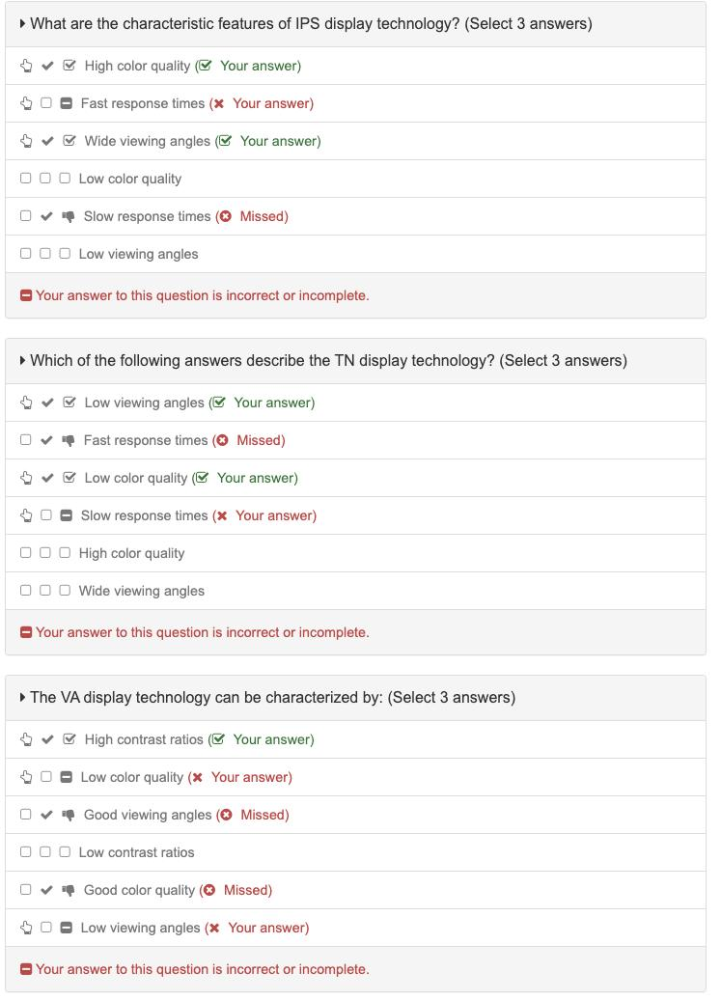

### IPS（In-Plane Switching）
- ✅ 高色彩精度（High color quality）
- ✅ 宽广视角（Wide viewing angles ≈ 178°）
- ❗ 缺点：响应时间偏慢（Slow response time） ⇒ 不是游戏最佳，但细腻、色准好

### TN（Twisted Nematic）
- ✅ 响应时间最快（Fast response times）
- ✅ 成本低，但色彩一般（Low color quality）
- ✅ 视角最差（Low viewing angles，上下偏色明显）
- ❗ 常用于电竞/办公显示器

### VA（Vertical Alignment）
- ✅ 对比度极高（High contrast ratios，黑位深）
- ✅ 色彩比 TN 好（Good color quality），但不如 IPS
- ✅ 视角比 TN 好、比 IPS 略差（Good viewing angles）
- ❗ 响应时间介于 TN 与 IPS 之间

**速记：**
- *IPS* = Image Perfect & Stable → 色准/视角最好，响应慢
- *TN* = Turbo & Narrow → 响应快，视角窄，色彩弱
- *VA* = Very Amazing Blacks → 对比度王者，综合型选手
---

## 显示面板类型：IPS / TN / VA

### IPS（In-Plane Switching）
- ✅ 高色彩准确度（High color quality）
- ✅ 宽视角（Wide viewing angles）
- ⚠︎ 响应时间相对慢（Slow response times）

### TN（Twisted Nematic）
- ✅ 响应时间快（Fast response times）
- ✅ 成本低、常见于电竞显示器
- ❌ 视角窄、色彩偏灰（Low color quality）

### VA（Vertical Alignment）
- ✅ 高对比度（High contrast ratios）
- ✅ 色彩与视角介于 IPS 与 TN 之间（Good color quality + Good viewing angles）
- ⚠︎ 响应时间中等，黑场表现优秀

**记忆口诀：**
- IPS = 色准 + 视角；缺点是慢
- TN = 速度快；缺点是色彩/视角差
- VA = 对比度王；折中
---

## 显示参数术语巩固
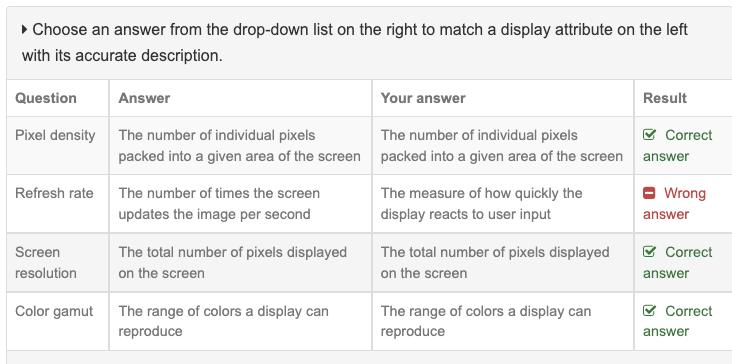

| 概念 | 正确认知 | 记忆重点 |
| --- | --- | --- |
| Pixel density（像素密度） | 同尺寸下像素越多 ⇒ 图像越清晰 | 以 PPI 表示，与“锐利度”直接相关 |
| Refresh rate（刷新率） | 每秒刷新多少次（Hz）⇒ 越高越流畅 | 与动画/游戏流畅度有关 |
| Color depth（色深） | 每像素可显示的色彩数量（bit/pixel） | 8-bit = 16.7M 色，10-bit = 10.7 亿色 |
| **Color gamut（色域）** | 屏幕能覆盖的颜色空间范围（sRGB、DCI-P3 等） | 色域越大，可显示的颜色范围越广、色彩越饱满 |

**Color gamut 补充：**
- 常见色域：sRGB（网页标准）、Adobe RGB（摄影）、DCI-P3（影视）。
- 广色域面板（如 95% DCI-P3）在看 HDR 内容或做设计时更准确。
- 色域 ≠ 色深：一个是“覆盖范围”，一个是“每个颜色点的细腻程度”。
---

## 显示参数匹配：像素密度 / 颜色位深 / 刷新率 / 色域

| 概念 | 解释 | 题目正确匹配 |
| --- | --- | --- |
| Color Gamut（色域） | 显示器能覆盖的颜色范围，通常用 sRGB / Adobe RGB / DCI-P3 等标准衡量 | 显示器可呈现的颜色范围 |
| Color Bit Depth（颜色位深） | 每个颜色通道的比特数，决定颜色阶梯数（8-bit=16.7M 色，10-bit=10.7 亿色） | 每像素颜色信息位数 |
| Refresh Rate（刷新率） | 每秒刷新画面的次数（Hz），决定运动画面的流畅度 | 显示器刷新画面的速度 |
| Pixel Density（像素密度） | PPI，单位面积内的像素数量，分辨率 ÷ 尺寸决定清晰度 | 给定显示尺寸和分辨率时的像素数 |

**色域 Color Gamut 补充：**
- 色域越大，可显示的颜色越多，颜色更饱满。
- 常见标准：sRGB（网页）、Adobe RGB（摄影）、DCI-P3（影视）。
- 题目要你匹配“能显示的颜色范围” ⇒ 选 Color Gamut。
---

## 多模光纤特性
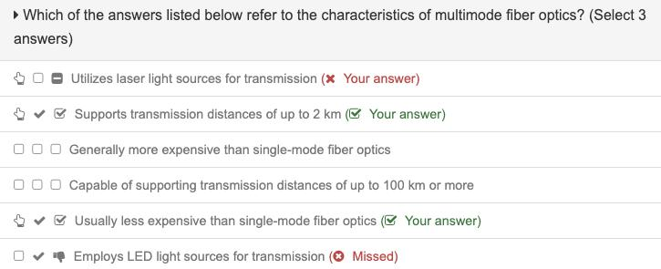

**正确特征（选 3）：**
- 典型传输距离 ≤ 2 km（取决于 OM 级别）
- 成本通常低于单模光纤（接收器/发射器更便宜）
- 使用 **LED**（或 VCSEL）作为光源

**错误认知：**
- “Utilizes laser light” → 这是单模常用（激光/LC laser），多模更多使用 LED/VCSEL。
- “Supports 100 km” → 只有单模才能跑这么远。
- “More expensive” → 实际上多模核心大、器件便宜，成本低。

**记忆：** 多模 = “短距 + LED + 便宜”；单模 = “长距 + 激光 + 贵”。
---

## Direct Burial STP 电缆特性
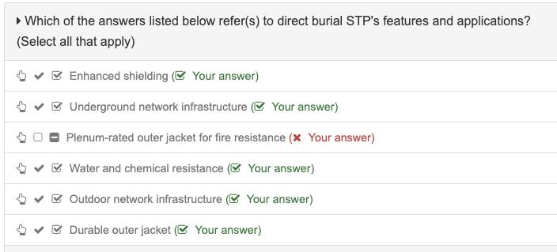

**正确特征：**
- Enhanced shielding（加强屏蔽）
- Water & chemical resistance（防水/防化学腐蚀）
- Durable outer jacket（抗撕裂、抗压）
- Outdoor / Underground network use（户外/直埋场景）

**为什么不是 Plenum-rated？**
- Plenum 等级是针对建筑内部空气回风层（防火低烟），而直埋电缆关注的是 **防潮 / 防腐 / 防压**；两者应用场景不同。
- 真正要过风管、吊顶才选 Plenum (CMP) 或 Riser (CMR)。

**记忆：** 直埋 = “走地下 / 户外”，关键词是防水、防腐、厚外被；若题目提“火灾、吊顶”，那才是 Plenum。
---

## USB 版本与速率
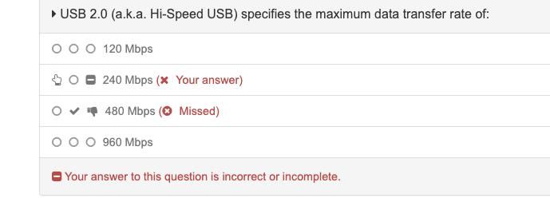

| 标称 | 别名 | 理论速率 |
| --- | --- | --- |
| USB 1.1 | Full Speed | 12 Mbps |
| **USB 2.0** | **Hi-Speed** | **480 Mbps** |
| USB 3.2 Gen 1 | SuperSpeed USB | 5 Gbps |
| USB 3.2 Gen 2 | SuperSpeed+ | 10 Gbps |
| USB 3.2 Gen 2x2 | SuperSpeed++ | 20 Gbps |

**记忆：** “2 = 480 Mbps” → 把 2 和 480 组成“2480”方便记忆。越往后代号越乱，建议记住“2=480、3=5G、3.1=10G”。
---

## USB 2.0 线缆最大长度
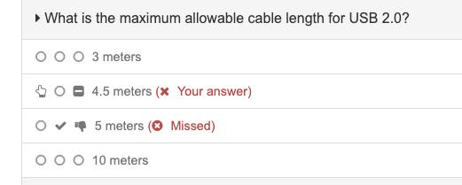

- USB 2.0 规范规定：**单段线缆最长 5 米**（16.4 英尺）。
- 超过 5 米需要使用有源延长线 / USB Hub 进行再生放大。
- USB 3.x 因速率更高，推荐长度更短（一般 3 米）。

**记忆：** “2.0 = 5 米，3.0 = 3 米” ——数字反过来方便记。
---

## USB 3.0 (SuperSpeed) 特性
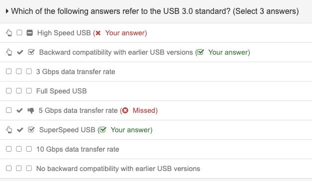

**记住三件事：**
- 速率：**5 Gbps**（SuperSpeed）
- 向下兼容：可以接 USB 2.0/1.1 设备（速度降级）
- 市面会用 “SuperSpeed USB” 标识（蓝色端口）

**不是 USB 3.0 的：**
- High Speed USB = 480 Mbps（USB 2.0）
- 3 Gbps 是 SATA/Thunderbolt 的数字
- 10 Gbps 是 USB 3.1 Gen2 / USB 3.2 Gen2
---

## USB 3.1 最大速率
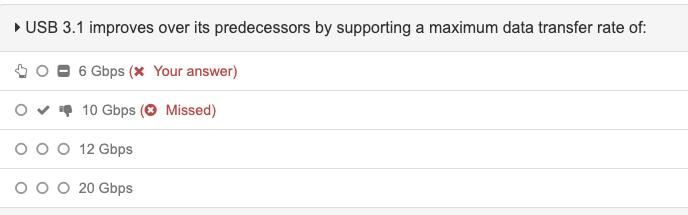

- USB 3.1 Gen2 提供 **10 Gbps** 理论速率。
- USB 3.0 / USB 3.1 Gen1 = 5 Gbps；USB 3.2 Gen2x2 = 20 Gbps。
- 记忆：3.0=5G，3.1=10G，3.2=20G。
---

## USB 3.1 (Gen2) 速率

- USB 3.1 Gen2 = **10 Gbps**（也写作 USB 3.2 Gen2）
- USB 3.2 Gen2x2 = 20 Gbps；USB4/Thunderbolt 3/4 = 40 Gbps
- 记忆：3.1 = 10G（数字 3.1 “像” 10），不要和 3.0 (5G) 或 2.0 (480M) 混淆。

---

## Thunderbolt 光纤线缆长度
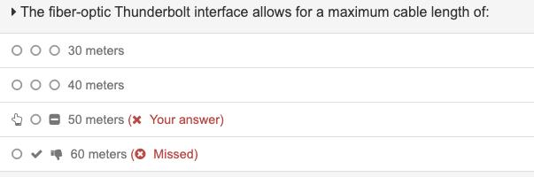

- 金属线缆：一般 3m（雷雳 3/4）
- **光纤 Thunderbolt**：最长 **60 m**，速度保持 10/20/40 Gbps
- 如果题目提“fiber-optic Thunderbolt” ⇒ 记住 60 m。

---

## Inverter（逆变器）作用
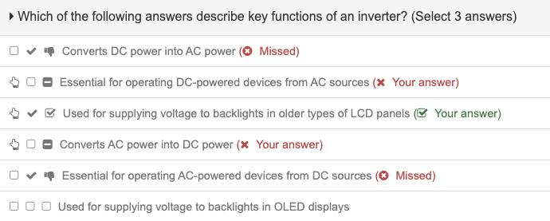

- **DC ➜ AC**：把笔记本电池（直流）转成驱动荧光灯/背光需要的交流
- **LCD CCFL 背光供电**：老式 CCFL 背光必须用 inverter 升压
- **用于把 DC 电源供给 AC 设备**，例如车载逆变器供笔记本充电
- 错误说法：“把 AC 变 DC”（那是整流器 rectifier）

---

## SATA 基础
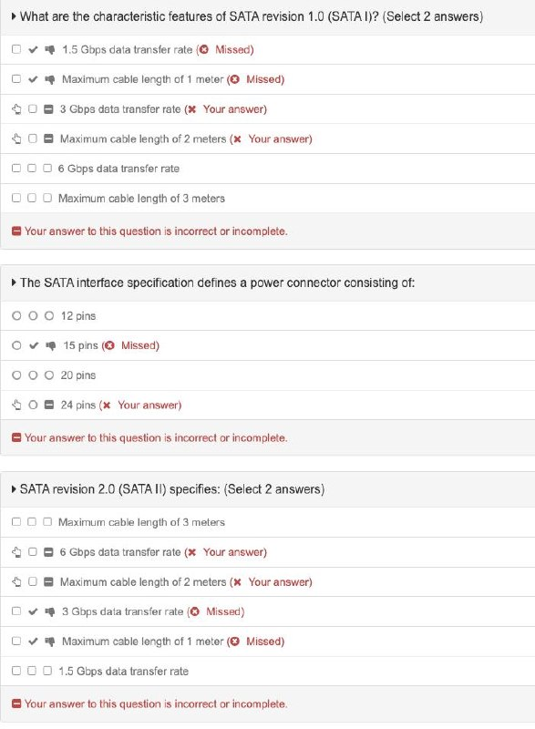

| 版本 | 速率 | 线缆长度 |
| --- | --- | --- |
| SATA 1.0 | **1.5 Gbps** | **1 米** |
| SATA 2.0 | **3.0 Gbps** | **1 米** |
| SATA 3.0 | 6.0 Gbps | 1 米 |

- SATA 数据线连接器 = **7 pin**
- SATA 电源连接器 = **15 pin**（3×3 组 + 地线）

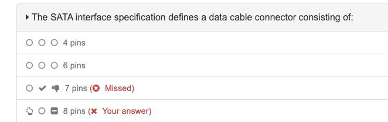

**记忆：** “数据 7 / 电源 15 / 线长 1m”。提到 3m、6Gbps+SATA2 都是陷阱。

---

## macOS Installer 格式
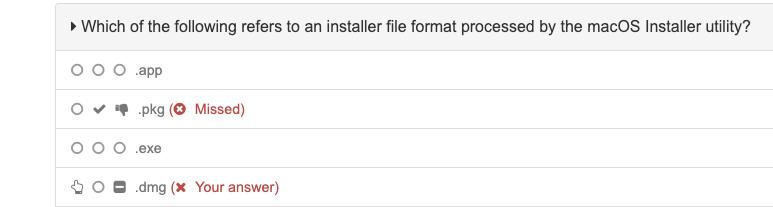

- macOS Installer 处理 `.pkg` 包（Package）
- `.dmg` 是磁盘镜像，里面可能包含 `.pkg` 或 `.app`
- `.app` 是应用包；`.exe` 是 Windows 可执行

**记忆：** “Installer = pkg；镜像 = dmg；App = .app”。

---

## Thunderbolt 光纤线最大长度

- 光纤 Thunderbolt 线最长可到 **60 米**。
- 这题容易和普通铜线长度搞混；铜线通常更短，光纤版本才适合更远距离。
- 记忆：Thunderbolt 光纤 = 长距离，高带宽。

---

## 反相器（Inverter）功能

**正确功能（选 3）：**
- 把 **DC 转成 AC**
- 让 **DC 电源可以驱动 AC 设备**
- 给老式 LCD 背光提供所需高压

**易错点：**
- 把 AC 转 DC 的是 **adapter / power supply / rectifier**，不是 inverter。
- OLED 不需要传统 CCFL 背光，所以不靠 inverter 供背光。

**记忆：** inverter = 反过来，**直流变交流**。

---

## SATA 基础知识：版本、针脚、长度

### SATA 1.0
- 速率：**1.5 Gbps**
- 线缆最大长度：**1 meter**

### SATA 2.0
- 速率：**3 Gbps**
- 线缆最大长度：**1 meter**

### SATA 3.0
- 速率：**6 Gbps**
- 线缆最大长度：一般仍按 **1 meter** 记

### 接口针脚
- **SATA 数据线接口：7 pins**
- **SATA 电源接口：15 pins**

**记忆：**
- SATA 速率：**1.5 / 3 / 6 Gbps**
- 数据 7 pin，供电 15 pin
- SATA 线缆考试常记 **1 米**

---

## macOS 启动安装盘文件系统

- 制作可启动的 macOS 安装 U 盘，常见要求是 **HFS+（Mac OS Extended, Journaled）**。
- 新系统日常使用常见 APFS，但做旧版/通用安装介质题目时，常考 **HFS+**。
- 记忆：安装盘/兼容性题，优先想到 **Mac OS Extended (Journaled)**。
---

## Windows 按流量计费连接（Metered Connection）
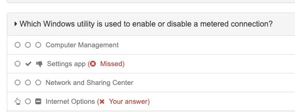

**题干：** Which Windows utility is used to enable or disable a metered connection?

|  |  |
| --- | --- |
| ❌ 我的答案 | Internet Options |
| ✅ 正确答案 | Settings app |

**说明：**
- Windows 里的 **Metered connection（按流量计费连接）** 是在 **Settings / 设置** 里配置的，不是在传统控制面板的 Internet Options。
- 这项设置常见路径：
  - **Settings → Network & Internet → Wi‑Fi / Ethernet → 当前网络 → Metered connection**
- 打开后，Windows 会尽量减少后台数据使用，比如：
  - 限制部分更新下载
  - 降低 OneDrive / 应用后台同步频率
  - 避免不必要的数据消耗

**易错点：**
- **Internet Options** 更偏 IE/旧式网络属性，不负责这个现代网络流量开关。
- **Network and Sharing Center** 是旧控制面板入口，很多现代网络选项已经迁到 Settings。

**记忆：** 现代 Windows 网络功能优先去 **Settings app** 找；看到 “metered connection” 就想到 **Settings → Network & Internet**。
---

## Windows 创建新网络连接的入口
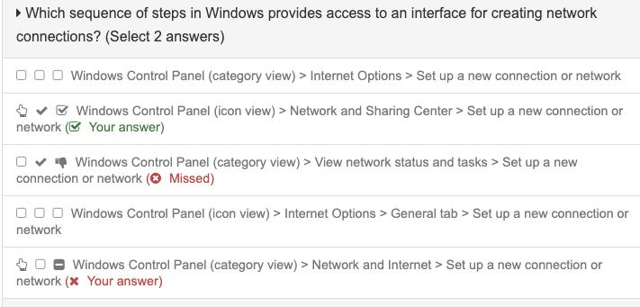

**题干：** Which sequence of steps in Windows provides access to an interface for creating network connections? (Select 2 answers)

**正确答案：**
1. **Windows Control Panel (icon view) → Network and Sharing Center → Set up a new connection or network**
2. **Windows Control Panel (category view) → View network status and tasks → Set up a new connection or network**

**说明：**
- 这道题考的是 **同一个功能入口在 Control Panel 两种视图下的不同路径**。
- 如果你用 **icon view（图标视图）**，可以直接看到 **Network and Sharing Center**。
- 如果你用 **category view（分类视图）**，要先点 **View network status and tasks**，本质上也是进入 **Network and Sharing Center**。

**为什么别的选项不对：**
- **Internet Options** 是浏览器/旧网络属性，不是创建网络连接的主入口。
- **Network and Internet → Set up a new connection or network** 少了一步，因为分类视图下通常还要进 **View network status and tasks**。

**记忆：**
- 关键词永远是 **Network and Sharing Center**。
- 分类视图：先看 **network status and tasks**
- 图标视图：直接进 **Network and Sharing Center**
---

## 打开 Network Connections（查看所有网卡）
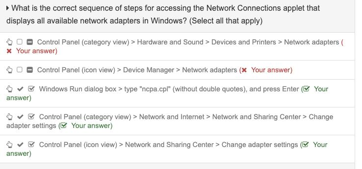

**题干：** What is the correct sequence of steps for accessing the Network Connections applet that displays all available network adapters in Windows? (Select all that apply)

**正确答案：**
- **Windows Run dialog → 输入 `ncpa.cpl` → Enter**
- **Control Panel (category view) → Network and Internet → Network and Sharing Center → Change adapter settings**
- **Control Panel (icon view) → Network and Sharing Center → Change adapter settings**

**说明：**
- 这道题问的是 **打开 Network Connections 小程序（能看到所有网卡）**，不是打开 **Device Manager**。
- `ncpa.cpl` 是最快捷的命令，直接跳到网卡列表页面。
- `Change adapter settings` 才是进入“所有网络适配器”列表的关键入口。

**为什么错项不对：**
- **Device Manager > Network adapters** 看到的是硬件设备树，不是 Network Connections applet。
- **Hardware and Sound > Devices and Printers > Network adapters** 这条路径本身就不是标准入口。

**记忆：**
- 看“网卡连接状态/启用禁用/IP 属性” → `ncpa.cpl`
- 看“驱动/硬件状态” → `devmgmt.msc`
---

## ECC RAM 的真正作用
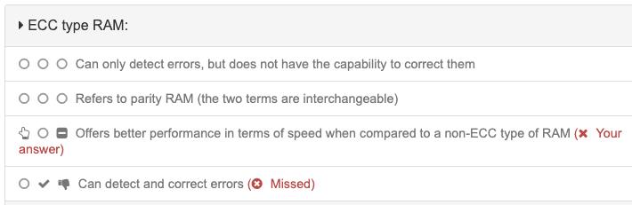

**题干：** ECC type RAM:

|  |  |
| --- | --- |
| ❌ 我的答案 | Offers better performance in terms of speed when compared to a non-ECC type of RAM |
| ✅ 正确答案 | Can detect and correct errors |

**说明：**
- **ECC = Error-Correcting Code memory**，核心作用是：
  - 检测内存位错误
  - 自动纠正单比特错误（部分还能检测多比特错误）
- 它的目标是 **稳定性 / 数据完整性**，不是速度。
- 因为 ECC 需要额外校验位和控制逻辑，性能通常不会比普通 non-ECC RAM 更快，反而可能略有开销。

**常见应用场景：**
- 服务器
- 工作站
- 数据库 / 虚拟化主机
- 对数据可靠性要求高的环境

**容易混淆的点：**
- **Parity RAM** 只能检测错误，不能自动纠正。
- **ECC RAM** 才是“能检测并纠正错误”的那一种。

**记忆：**
- Parity = 只会“报警”
- ECC = 会“报警 + 纠错”
- ECC 要的是稳，不是快
---

## Parity bit（奇偶校验位）
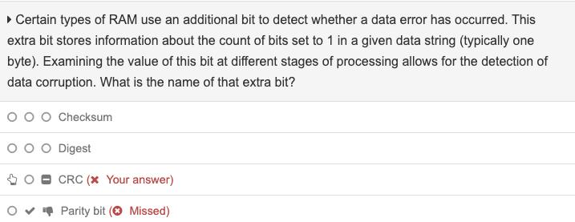

**题干：** 某些 RAM 会使用一个额外的 bit 来检测数据是否出错。这个额外的 bit 叫什么？

|  |  |
| --- | --- |
| ❌ 我的答案 | CRC |
| ✅ 正确答案 | Parity bit |

**说明：**
- **Parity bit（奇偶校验位）** 是最基础的错误检测方式：
  - 在一串数据后面多加 1 个 bit
  - 用来表示这一串数据里 `1` 的个数是 **奇数** 还是 **偶数**
- 接收端重新计算一次，如果结果对不上，就知道数据可能损坏了。

### 它能做什么？
- **能检测错误**
- **不能纠正错误**

### 为什么不是 CRC？
- **CRC**（Cyclic Redundancy Check）常用于网络传输、磁盘、文件校验
- CRC 是一种更复杂的校验算法，不是 RAM 里这道题描述的“额外 1 个 bit”

### 和 ECC 的关系
- **Parity bit**：只能发现错误
- **ECC**：不仅能发现，还能纠正部分错误

**记忆：**
- 多出来 **1 个 bit** 检错 → **Parity bit**
- 能纠错 → **ECC**
- CRC 更像“整段数据做校验码”，不是单独加 1 bit
---

## DDR4 SDRAM 特征
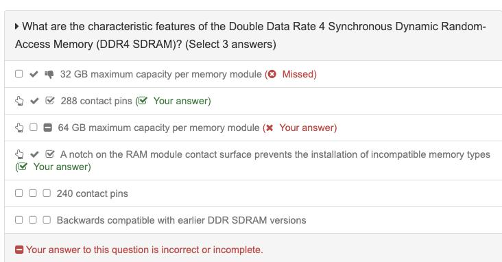

**正确特征（选 3）：**
- **288 contact pins**
- **A notch on the RAM module contact surface prevents the installation of incompatible memory types**
- **32 GB maximum capacity per memory module**

**为什么你会错：**
- 你把 **64 GB maximum capacity per module** 选进去了，但这题考的是 A+ 常见基准知识点，标准答案按 **DDR4 单条 32 GB** 记。
- 你漏了 **32 GB maximum capacity per memory module**。

**其他错误项：**
- **240 contact pins** → 这是 **DDR3 DIMM** 常见针脚数，不是 DDR4。
- **Backwards compatible with earlier DDR SDRAM versions** → DDR 各代物理缺口和电气规格都不同，**不能向后兼容混插**。

**记忆方法：**
- DDR3 = **240 pins**
- DDR4 = **288 pins**
- DDR5 = **288 pins**（但缺口位置不同）
- 看见 “DDR4” 先想到：**288 pin + 不兼容旧代 + 单条常考 32GB**
---

## DDR3 SDRAM 特征
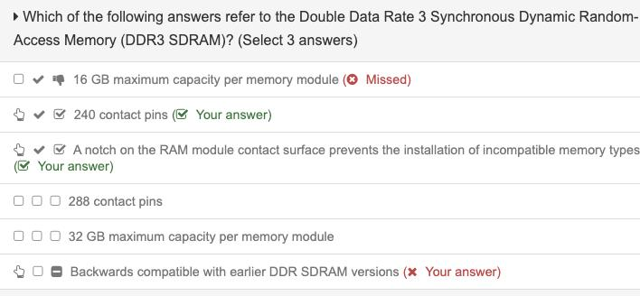

**正确特征（选 3）：**
- **240 contact pins**
- **A notch on the RAM module contact surface prevents the installation of incompatible memory types**
- **16 GB maximum capacity per memory module**

**这题的关键：**
- DDR3 常考容量按 **单条 16GB** 记
- DDR3 的桌面 DIMM 针脚数是 **240 pin**
- 和 DDR4 一样，也有**防呆缺口**，不能乱插

**为什么你错：**
- 你漏掉了 **16 GB maximum capacity per memory module**
- 你选了 **Backwards compatible with earlier DDR SDRAM versions**，这不对

**为什么“不向后兼容”：**
- 各代 DDR 的**缺口位置不同**
- 电压、时序、控制器要求不同
- 所以 DDR、DDR2、DDR3、DDR4 之间**不能混插**

**对照记忆：**
- DDR3 = **240 pins / 16GB**
- DDR4 = **288 pins / 32GB**

**记忆口诀：**
- DDR3：**240 + 16**
- DDR4：**288 + 32**
- 都有缺口，都不能向后兼容
---

## DRAM 的核心特征
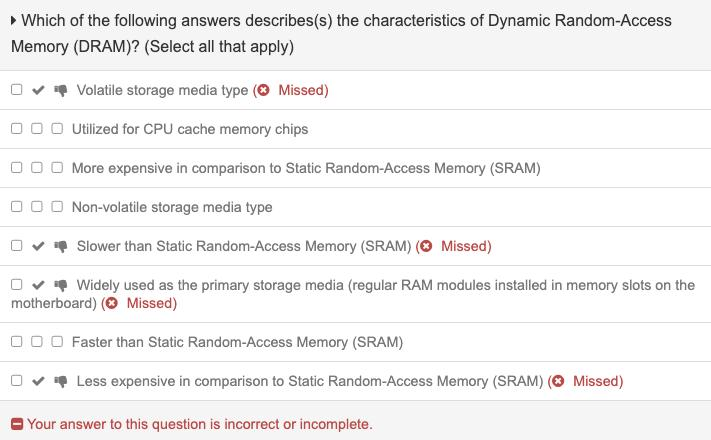

**题干：** Which of the following answers describes the characteristics of Dynamic Random-Access Memory (DRAM)? (Select all that apply)

**正确答案：**
- **Volatile storage media type**（易失性存储）
- **Slower than Static Random-Access Memory (SRAM)**（比 SRAM 慢）
- **Widely used as the primary storage media**（作为主内存广泛使用）
- **Less expensive in comparison to Static Random-Access Memory (SRAM)**（比 SRAM 便宜）

### 为什么这些是对的
#### 1. DRAM 是易失性存储
- 断电后数据会消失
- 所以它属于 **volatile memory**

#### 2. DRAM 比 SRAM 慢
- DRAM 需要周期性刷新（refresh）
- 结构更简单，但访问速度不如 SRAM

#### 3. DRAM 是电脑里的主内存
- 你平时插在主板内存槽里的 DDR3 / DDR4 / DDR5，本质上都属于 **DRAM**
- 所以它被广泛用作系统主内存（regular RAM modules）

#### 4. DRAM 比 SRAM 便宜
- DRAM 单位容量成本更低
- 因此适合做大容量内存

---

## DRAM vs SRAM 一次记住
| 项目 | DRAM | SRAM |
| --- | --- | --- |
| 全称 | Dynamic RAM | Static RAM |
| 是否易失性 | 易失性 | 易失性 |
| 速度 | 较慢 | 较快 |
| 成本 | 较低 | 较高 |
| 容量 | 可做很大 | 通常较小 |
| 典型用途 | 主内存（系统 RAM） | CPU Cache |
| 是否需要刷新 | 需要 | 不需要 |

---

## 为什么这些选项是错的
- **Utilized for CPU cache memory chips**
  - 这个更符合 **SRAM**，不是 DRAM
- **More expensive than SRAM**
  - 反了，DRAM 更便宜
- **Non-volatile storage media type**
  - 不对，DRAM 断电丢数据
- **Faster than SRAM**
  - 也反了，SRAM 更快

**记忆口诀：**
- **D = Dynamic = 需要刷新**
- **DRAM = 大、便宜、慢、做主内存**
- **SRAM = 小、贵、快、做缓存**
---

## SRAM 的核心特征
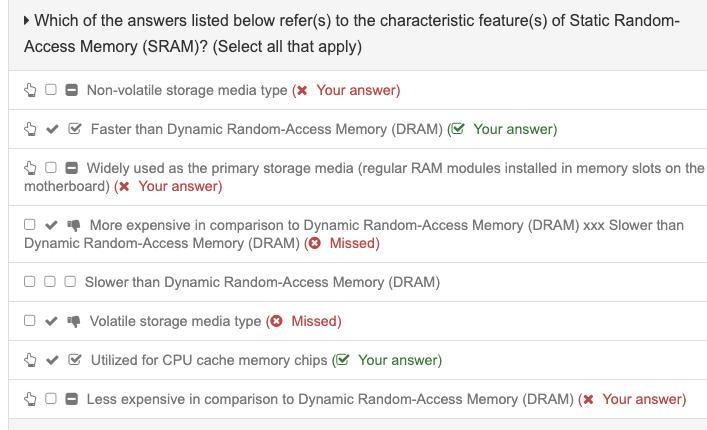

**题干：** Which of the answers listed below refer(s) to the characteristic feature(s) of Static Random-Access Memory (SRAM)? (Select all that apply)

**正确答案：**
- **Faster than Dynamic Random-Access Memory (DRAM)**（比 DRAM 快）
- **More expensive in comparison to DRAM**（比 DRAM 贵）
- **Volatile storage media type**（易失性）
- **Utilized for CPU cache memory chips**（常用于 CPU cache）

### 为什么这几个是对的
#### 1. SRAM 比 DRAM 快
- SRAM 不需要像 DRAM 那样持续 refresh
- 因此访问延迟更低，速度更快

#### 2. SRAM 更贵
- SRAM 单位容量成本更高
- 所以不适合做大容量主内存

#### 3. SRAM 也是易失性存储
- 断电一样会丢数据
- 这点和 DRAM 一样，千万别把它看成 non-volatile

#### 4. SRAM 常用于 CPU Cache
- 因为它快，所以适合做 L1/L2/L3 cache
- 但太贵，不适合拿来做普通 RAM 条

### 为什么这些选项是错的
- **Non-volatile storage media type** → 错，SRAM 也是断电丢数据
- **Widely used as the primary storage media** → 错，这是 DRAM 的定位
- **Less expensive than DRAM** → 错，SRAM 更贵
- **Slower than DRAM** → 错，SRAM 更快

### 和 DRAM 一起背
| 项目 | DRAM | SRAM |
| --- | --- | --- |
| 速度 | 慢 | 快 |
| 价格 | 便宜 | 贵 |
| 用途 | 主内存 | CPU Cache |
| 是否易失性 | 是 | 是 |
| 是否刷新 | 要 | 不要 |

**记忆口诀：**
- **SRAM = Small / Speed / Storage for cache**
- **DRAM = Dynamic / 大容量 / 主内存**
- 两者都断电丢数据
---

## DB-9 串口连接器
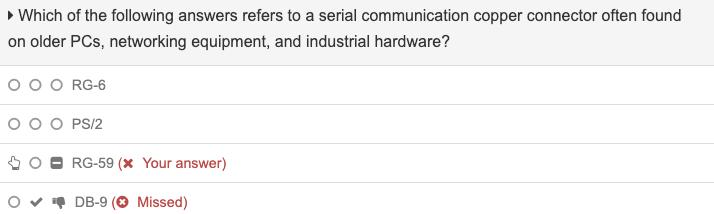

**正确答案：** DB-9

**说明：**
- DB-9（常见于 RS-232 串口）是老式 PC、网络设备 console、工业设备常见的**串行通信铜缆连接器**。
- 你选的 **RG-59** 是同轴线规格，常见于监控/视频，不是串口连接器。

**记忆：** 提到 serial / RS-232 / console port，就先想到 **DB-9**。

---

## Molex 供电接口
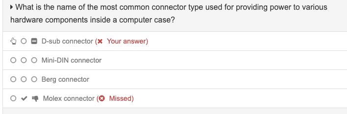

**正确答案：** Molex connector

**说明：**
- Molex 是传统电脑内部常见的 4-pin 供电接口，常给老式硬盘、光驱、风扇等设备供电。
- **D-sub** 主要是信号接口家族（如串口/VGA），不是机箱内部常见电源接口。
- **Berg** 是更小的软驱供电接口，不是“最常见”的那一个。

**记忆：** 老式机箱内部大电源头 = **Molex**；小软驱电源头 = **Berg**。

---

## 老旧移动设备常见 USB 接口
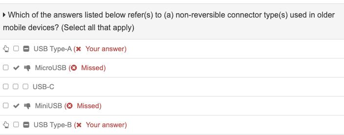

**正确答案：**
- MicroUSB
- MiniUSB

**说明：**
- 题目强调 **older mobile devices** 且 **non-reversible**，因此答案是老式、不能正反插的手机接口。
- **USB-C** 虽然用于移动设备，但它是可正反插的现代接口，不符合题意。
- **USB Type-A / Type-B** 主要不是移动设备常见接口。

**记忆：** 旧手机 + 不能正反插 = **MicroUSB / MiniUSB**。

---

## F-type connector 特征
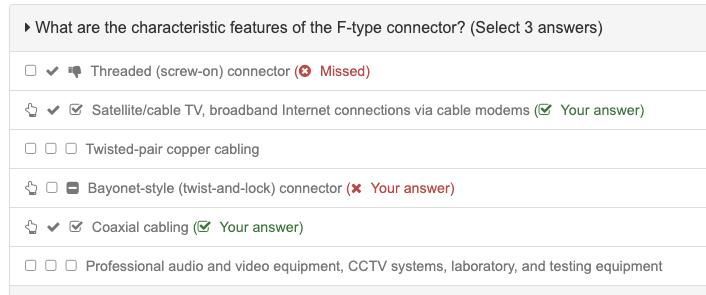

**正确特征：**
- Threaded / screw-on connector（螺纹拧紧）
- Coaxial cabling（同轴线）
- Satellite/cable TV、cable modem 等场景

**说明：**
- F-type 是家用电视、有线网络、Cable modem 最常见的同轴接口。
- 你错选的 **bayonet-style / twist-and-lock** 是 **BNC** 的特征，不是 F-type。

**记忆：** F-type = 家用同轴电视口，**拧上去**；BNC = 专业设备口，**卡上去**。

---

## eSATA 3.0 特征（更正）
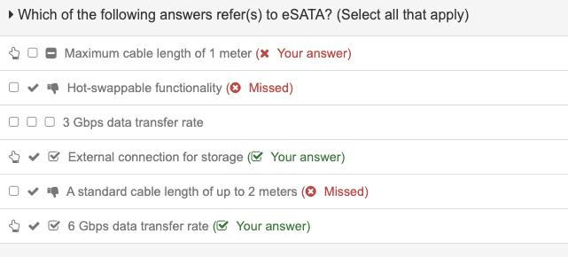

**正确答案：**
- Hot-swappable functionality
- External connection for storage
- A standard cable length of up to 2 meters
- **6 Gbps data transfer rate**

**说明：**
- 这题问的是 **eSATA 3.0**，因此 **6 Gbps** 也属于正确特征。
- eSATA 的核心定位：外接存储、支持热插拔、线长比内部 SATA 更长（常考 2 米）。
- 普通内部 SATA 线缆常按 **1 米** 记；eSATA 常按 **2 米** 记。

**记忆：** eSATA 3.0 = **外置存储 + 热插拔 + 2 米 + 6 Gbps**。
---

## 现代 HDD 的最高转速
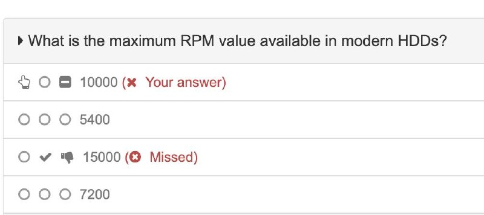

**题干：** What is the maximum RPM value available in modern HDDs?

|  |  |
| --- | --- |
| ❌ 我的答案 | 10000 |
| ✅ 正确答案 | 15000 |

**说明：**
- 传统消费级 HDD 常见转速：**5400 RPM**、**7200 RPM**。
- 更高性能的企业级/服务器级机械硬盘常见：**10,000 RPM**。
- 再往上的高端企业盘可达到：**15,000 RPM**，这也是这类题里常考的“现代 HDD 最高值”。

**为什么容易错：**
- 10K RPM 的确很常见，所以很容易误以为它就是最高值。
- 但考试题问的是 **maximum available**，所以应该选 **15,000 RPM**。

**记忆：**
- 家用盘：5400 / 7200
- 企业盘：10K / **15K**
- 问“最高”就优先想到 **15,000 RPM**
---

## NVMe 的核心特征
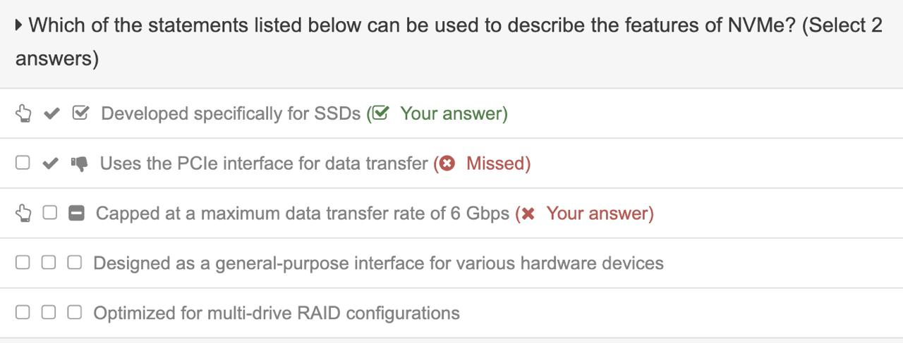

**题干：** Which of the statements listed below can be used to describe the features of NVMe? (Select 2 answers)

**正确答案：**
- **Developed specifically for SSDs**
- **Uses the PCIe interface for data transfer**

### 为什么这两个是对的
#### 1. NVMe 是专门为 SSD 设计的
- NVMe（Non-Volatile Memory Express）不是给机械硬盘设计的老协议
- 它是为了充分发挥闪存/SSD 的低延迟和高并发能力而制定的

#### 2. NVMe 走的是 PCIe
- NVMe SSD 使用 **PCIe 总线**传输数据
- 所以速度远高于传统 SATA SSD

### 你错的地方
你选了：
- **Capped at a maximum data transfer rate of 6 Gbps**

这个是 **SATA III** 的典型数字，不是 NVMe。

### 为什么别的选项不对
- **Designed as a general-purpose interface for various hardware devices**
  - 这更像在说 PCIe 本身，不是 NVMe 协议的定义
- **Optimized for multi-drive RAID configurations**
  - 不是 NVMe 的核心定义特征

### 最简单对比
| 技术 | 典型总线 | 常见上限印象 |
| --- | --- | --- |
| SATA SSD | SATA | 6 Gbps |
| NVMe SSD | PCIe | 明显高于 SATA |

**记忆：**
- **SATA = 6 Gbps**
- **NVMe = PCIe + 专为 SSD 设计**
---

## SAS 的核心特征
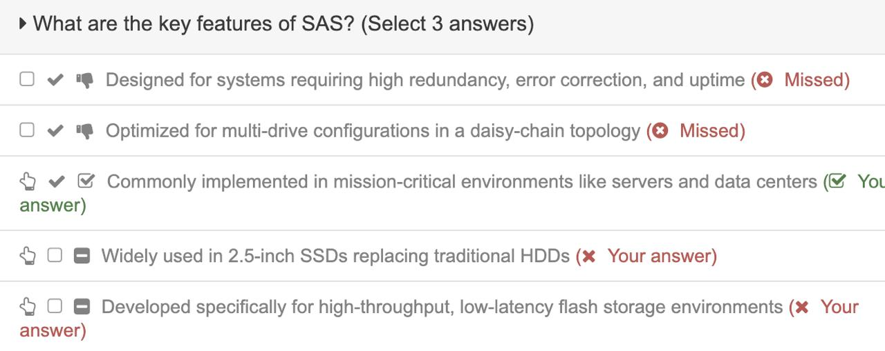

**题干：** What are the key features of SAS? (Select 3 answers)

**正确答案：**
- **Designed for systems requiring high redundancy, error correction, and uptime**
- **Optimized for multi-drive configurations in a daisy-chain topology**
- **Commonly implemented in mission-critical environments like servers and data centers**

### 为什么这三个是对的
#### 1. 高可靠性 / 高可用性
- SAS（Serial Attached SCSI）强调企业级稳定性
- 适合要求高冗余、纠错、长时间连续运行的环境

#### 2. 适合多盘配置
- SAS 面向服务器/存储阵列场景
- 支持多设备连接、扩展器（expander）、复杂盘柜结构
- 所以题目里说它适合多驱动器配置是对的

#### 3. 常见于关键业务环境
- 服务器
- 数据中心
- 企业存储系统
这些正是 SAS 的典型使用场景

### 你错选的为什么不对
#### Widely used in 2.5-inch SSDs replacing traditional HDDs
- 这个说法更像在描述 **消费级 SATA SSD** 的普及场景
- SAS 虽然也有 SAS SSD，但不是这类题想表达的核心特征

#### Developed specifically for high-throughput, low-latency flash storage environments
- 这更像 **NVMe** 的描述
- NVMe 才是专门为闪存/低延迟 SSD 环境设计的协议

### 你要这样区分
| 技术 | 典型定位 |
| --- | --- |
| SATA | 消费级存储，便宜，普及广 |
| SAS | 企业级存储，可靠性高，服务器/数据中心 |
| NVMe | 面向 PCIe 闪存，高吞吐、低延迟 |

**记忆：**
- **SAS = 企业级 / 高可靠 / 服务器阵列**
- **SATA = 家用普及**
- **NVMe = 闪存高速低延迟**
---

## 被 M.2 取代的旧 SSD 外形：mSATA
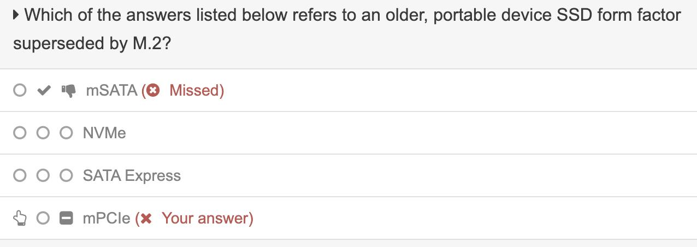

**题干：** Which answer refers to an older, portable-device SSD form factor superseded by M.2?

|  |  |
| --- | --- |
| ❌ 我的答案 | mPCIe |
| ✅ 正确答案 | mSATA |

### 为什么是 mSATA
- **mSATA**（mini-SATA）是早期笔记本、超极本、迷你设备中常见的小型 SSD 接口/外形。
- 后来被 **M.2** 广泛取代，因为 M.2 更灵活：
  - 支持 SATA
  - 也支持 PCIe / NVMe
  - 尺寸选择更多（2242 / 2260 / 2280 等）

### 为什么不是 mPCIe
- **mPCIe**（mini PCI Express）主要是给：
  - 无线网卡
  - WWAN 卡
  - 其他扩展卡
- 它不是“被 M.2 取代的旧 SSD 主流外形”这道题的标准答案。
- 虽然外观上 mSATA 和 mPCIe 有点像，很容易混淆，但用途不同。

### 另外几个选项为什么不对
- **NVMe**：这是协议/接口栈，不是那个“旧便携 SSD 外形”
- **SATA Express**：这是另一类接口标准，也不是题目要的老便携 SSD 形态

### 最简单记忆
- **mSATA = 老的迷你 SSD 形态**
- **M.2 = 新一代，后来把 mSATA 基本取代了**
- **mPCIe = 老扩展卡插槽，不是 SSD 形态答案**
---

## RAID 0 / 1 / 5 / 6 / 10 对照表

| RAID | 核心方式 | 最少磁盘数 | 容错能力 | 性能 | 容量利用率 | 适合场景 |
| --- | --- | ---: | --- | --- | --- | --- |
| RAID 0 | Striping（条带化） | 2 | 无容错，坏一块全盘风险 | 最快 | 100% | 只追求速度，不重视安全 |
| RAID 1 | Mirroring（镜像） | 2 | 可坏 1 块（每组镜像内） | 读快，写一般 | 50% | 重要数据、小规模高可靠 |
| RAID 5 | Striping + 1 parity | 3 | 可坏 1 块 | 读快，写较慢（有校验开销） | (N-1)/N | 常见文件服务器、平衡容量和安全 |
| RAID 6 | Striping + 2 parity | 4 | 可坏 2 块 | 读快，写更慢 | (N-2)/N | 大容量阵列，更高安全性 |
| RAID 10 | 1+0 = Mirroring + Striping | 4 | 每组镜像可坏 1 块（不能同组都坏） | 很快 | 50% | 数据库、虚拟化、高性能高可靠 |

### 最简单记忆
- **RAID 0** = 快，但 **0 容错**
- **RAID 1** = **1 份镜像**
- **RAID 5** = 坏 **1** 块还能活
- **RAID 6** = 坏 **2** 块还能活
- **RAID 10** = 又快又稳，但贵

### 重点提醒
- RAID **不是备份**。
- RAID 0 最危险，只要坏一块就可能全丢。
- RAID 10 很适合“既要性能又要可靠性”的场景。
---

## 为什么这题选 RAID 6，不是 RAID 10
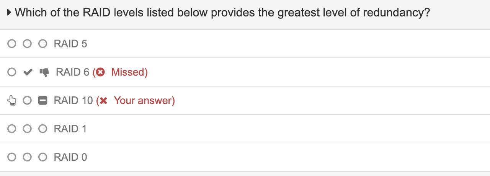

**题干：** Which RAID level provides the greatest level of redundancy?

|  |  |
| --- | --- |
| ❌ 容易误选 | RAID 10 |
| ✅ 正确答案 | RAID 6 |

### 为什么是 RAID 6
- **RAID 6** 使用 **双 parity（双校验）**
- 它可以明确承受 **任意 2 块磁盘同时损坏**
- 所以在这类考试题里，通常被视为“冗余最高”

### 为什么不是 RAID 10
RAID 10 虽然也很可靠，但它的容错能力取决于：
- 坏掉的两块盘是不是落在**同一组镜像**里

#### 举例
如果 RAID 10 有 4 块盘：
- A1 / A2 是一组镜像
- B1 / B2 是一组镜像

那么：
- 如果坏的是 **A1 + B1** → 阵列还能活
- 如果坏的是 **A1 + A2** → 同一镜像组全挂，阵列就挂

所以 RAID 10 不是“固定能抗 2 块盘损坏”，而 RAID 6 是。

### 考试记忆法
- 问 **最高冗余 / 最强容错** → 优先想到 **RAID 6**
- 问 **高性能 + 冗余兼顾** → 常想到 **RAID 10**

**一句话：**
RAID 10 很强，但容错取决于坏盘分布；RAID 6 明确能扛任意两块盘，因此这题标准答案是 **RAID 6**。
---

## TPM 的核心能力
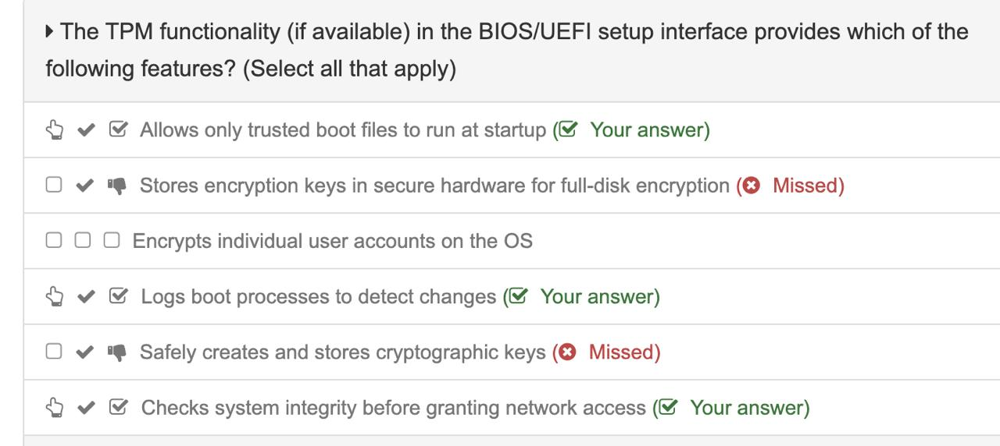

**TPM 常考功能：**
- 安全生成并存储加密密钥
- 给 BitLocker / 全盘加密保存密钥
- 记录启动过程（measured boot）
- 参与完整性检查 / attestation

**容易混淆：**
- “只允许受信任启动文件运行”更像 **Secure Boot** 的直接描述
- TPM 更偏向 **密钥、启动测量、完整性证明**
- TPM 不负责“加密单个用户账号”

**记忆：** TPM = **key / boot / integrity / attestation**。

---

## 为什么高端主板也不能兼容不同厂商 CPU
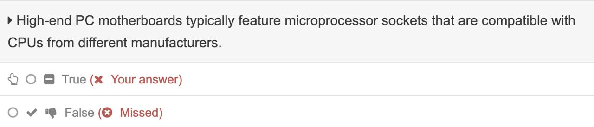

**错误说法：** 高端主板会配备能兼容不同厂商 CPU 的 socket。

**为什么错：**
- CPU socket 必须和 CPU 平台严格匹配
- Intel 和 AMD 的 socket 物理结构、电气定义、针脚布局都不同
- 就算同厂商，不同代际也经常不兼容

**记忆：** 主板再高端，也不能跨厂商通用 CPU 插槽。

---

## eSATA 这道判断题为什么是 False
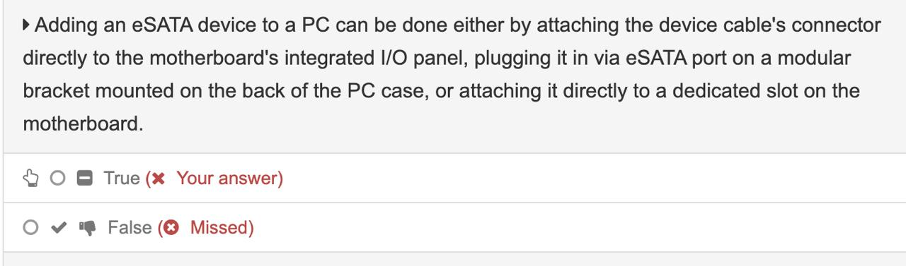

**错误点在最后一句：**
- eSATA 是外部存储接口
- 可以通过主板后置 I/O 或 bracket 引出
- **不是**“直接插在主板上的专用 slot”

**记忆：** eSATA = 外部版 SATA 接口，不是主板插槽标准。

---

## CPU 辅助供电接口
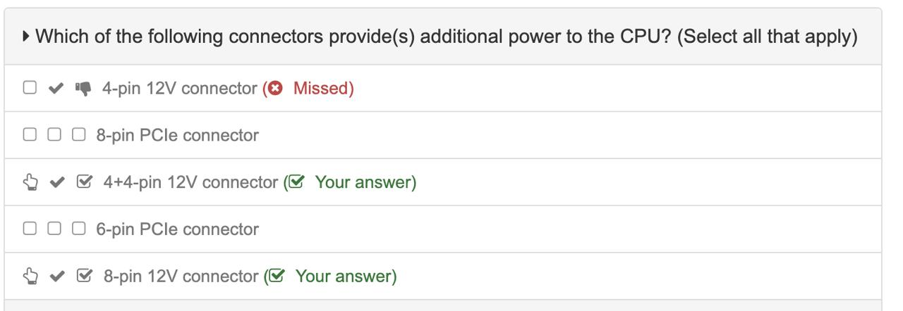

**正确答案：**
- 4-pin 12V connector
- 4+4-pin 12V connector
- 8-pin 12V connector

**说明：**
- 这些都属于主板上给 CPU 供电的 ATX12V / EPS12V 接口
- PCIe 6-pin / 8-pin 是给显卡供电，不是 CPU 供电

**记忆：**
- CPU 供电看 **12V / 4-pin / 4+4 / 8-pin**
- PCIe 6/8-pin 想到显卡

---

## 主板尺寸：ITX 比 microATX 更小

**正确答案：** ITX（通常指 Mini-ITX）

**大小顺序（大 → 小）：**
- EE-ATX
- E-ATX
- ATX
- microATX
- Mini-ITX

**记忆：**
- microATX 是小板，但 **ITX 更小**
---

## Memory card 和 flash drive 的区别

**题干：** Which features can be used to distinguish memory cards from flash drives? (Select 2 answers)

**正确答案：**
- **Compatible with dedicated slots or card readers**
- **Primarily designed to expand storage capacity of compact electronics**

### 为什么这两个是对的
#### 1. 需要专用卡槽或读卡器
- Memory card（如 SD / microSD）通常不是直接插 USB 用
- 它更常通过：
  - 相机/手机/游戏机卡槽
  - 读卡器
来读写数据

#### 2. 主要给小型电子设备扩容
- Memory card 的典型场景是：
  - 手机
  - 相机
  - 行车记录仪
  - 无人机
  - Switch 等小型设备
- 它的定位是“嵌进去扩容”

### 为什么你选的那个不对
#### Designed for general-purpose file transfer and storage
- 这更像 **USB flash drive（U盘）** 的典型用途
- U 盘强调“拿来拷文件、通用传输”
- 不是区分 memory card 的关键特征

### 为什么另外几项也不行
- **Non-volatile, rewritable storage media type**
  - 两者都是，不构成区分
- **Solid-state memory technology**
  - 两者也都是闪存，不构成区分
- **Plug-and-play across most devices supporting USB**
  - 这更偏向 flash drive，不是 memory card

### 最简单记忆
- **Memory card** = 卡槽 / 读卡器 / 小设备扩容
- **Flash drive** = USB / 通用拷文件 / 即插即用
---

## 工业与嵌入式常见小型低功耗主板：ITX

**题干：** Which answer refers to a low-power consumption, small form factor motherboard type used in industrial and embedded PC applications?

|  |  |
| --- | --- |
| ❌ 我的答案 | LPX |
| ✅ 正确答案 | ITX |

### 为什么是 ITX
- **ITX（尤其 Mini-ITX）** 的典型特点就是：
  - 小尺寸
  - 低功耗平台常见
  - 很适合工业控制、嵌入式设备、迷你主机、瘦客户端
- 它在嵌入式/工控/小型化主机里非常常见

### 为什么不是 LPX
- **LPX** 是很老的主板规格
- 主要是早期低矮桌面机箱时代的旧标准
- 现在考试里如果强调：
  - 小型
  - 低功耗
  - 工业 / embedded
  更应该想到 **ITX**，不是 LPX

### 其他选项为什么不对
- **ATX**：标准大板，不是小型嵌入式取向
- **NLX**：也是较老的桌面主板标准，不是这题最符合的答案

### 最简单记忆
- **ITX = 小、低功耗、嵌入式/工业常见**
- **ATX = 标准台式机大板**
- **LPX / NLX = 老规格，考试里多当干扰项**
---

## SPF、DKIM、DMARC 的关系

**题干：** 当前一个协议使用 IP 地址验证邮件，另一个协议使用公钥密码学验证邮件，如果还要加一个反垃圾邮件工具进一步增强安全，应该加什么？

|  |  |
| --- | --- |
| ❌ 我的答案 | SPF |
| ✅ 正确答案 | DMARC |

### 这题考的是三者怎么配合
#### 1. SPF
- 通过 **发信服务器 IP 地址** 验证邮件是否合法
- 你看到题目里“verify messages using IP addresses” 就是在说 **SPF**

#### 2. DKIM
- 通过 **公钥密码学签名** 验证邮件内容/来源
- 题目里“verify messages using public-key cryptography” 指的就是 **DKIM**

#### 3. DMARC
- DMARC 不替代 SPF/DKIM，而是**建立在它们之上**
- 它的作用是：
  - 统一使用 SPF / DKIM 的验证结果
  - 设定策略（none / quarantine / reject）
  - 提供报告（reporting）
  - 告诉收件方“不通过时该怎么处理”

### 为什么正确答案是 DMARC
因为题目说：
- 已经有一个按 IP 验证的协议（SPF）
- 还有一个按公钥验证的协议（DKIM）
- 现在要再加一个工具“配合这两个协议一起提高安全”

最符合这个描述的就是：
> **DMARC**

### 为什么你选 SPF 不对
因为 SPF 已经是题干里“现有协议之一”了，
题目是在问：
> **还要再加什么来和现有的 SPF + DKIM 一起工作？**

答案当然不是再加一次 SPF，而是加 **DMARC**。

### 最简单记忆
- **SPF** = 看发信 IP 对不对
- **DKIM** = 看签名对不对
- **DMARC** = 把 SPF + DKIM 结果整合起来，并决定怎么处理不合法邮件

**一句话：**
SPF 看“谁发的”，DKIM 看“有没有被改”，DMARC 负责“最后怎么判、怎么处理”。
---

## 虚拟化 / 云计算里的 Rapid Elasticity

**题干：** 能根据当下需要，快速给服务器增加或移除资源，这个特性叫什么？

|  |  |
| --- | --- |
| ❌ 我的答案 | rapid availability |
| ✅ 正确答案 | rapid elasticity |

### 为什么是 rapid elasticity
- **Rapid elasticity** 指的是：
  - 资源可以快速扩展（scale out / scale up）
  - 也可以快速缩减（scale in / scale down）
- 核心是：
  > **按需求快速增减资源**

这正好符合题目里说的：
- quickly add resources
- remove resources depending on needs

### 为什么不是 rapid availability
- availability 讲的是：
  - 服务是否持续可用
  - 高可用（HA）
  - 容错 / 故障切换
- 它不是“按需快速扩缩容”的概念

### 容易混淆的另一个词：On-demand self-service
- **On-demand self-service** 是指：
  - 用户自己就能申请/创建资源
  - 不需要人工介入
- 它强调的是“自助开通”
- 不是题目这里强调的“资源弹性伸缩”

### 最简单记忆
- **Rapid elasticity** = 资源弹性伸缩
- **Availability** = 可用性 / 稳定在线
- **On-demand self-service** = 用户自己开资源

**一句话：**
看到“按需要快速加减资源”，就想到 **rapid elasticity**。
---

## Resource Pooling（资源池化）

**题干：** 把多台物理服务器的资源合并成一个“池子”，再按需分配给虚拟机，这个概念叫什么？

|  |  |
| --- | --- |
| ❌ 我的答案 | resource allocation |
| ✅ 正确答案 | resource pooling |

### 为什么是 resource pooling
- **Resource pooling** 指的是：
  - 把多个物理资源（CPU、内存、存储、网络）汇集起来
  - 形成一个共享资源池
  - 再由虚拟机或服务按需使用
- 这就是虚拟化 / 云平台常见的底层资源管理方式

### 为什么不是 resource allocation
- **Resource allocation** 是“分配资源”这个动作本身
- 比如：给某台虚拟机分 4 核 CPU、8GB 内存
- 它不是“先把很多服务器资源汇总成池”的概念

### 你可以这样理解
- **Pooling** = 先把资源集中成池
- **Allocation** = 再从池里分给某个对象

### 最简单记忆
- **resource pooling** = 资源池化，先汇总
- **resource allocation** = 资源分配，后发放

**一句话：**
看到“combine multiple physical server resources into one bucket/pool”，直接想到 **resource pooling**。
---

## Community Cloud（社区云）

**题干：** 多个组织通过第三方共同共享一个云，这种云叫什么？

|  |  |
| --- | --- |
| ❌ 我的答案 | partnered cloud |
| ✅ 正确答案 | community cloud |

### 为什么是 community cloud
- **Community cloud** 指的是：
  - 多个有共同需求、共同政策、共同安全要求的组织
  - 共享同一个云环境
- 常见例子：
  - 多家政府机构共享一套云
  - 多家医院/医疗组织共享合规云环境
  - 多个教育或研究机构共享云资源

### 为什么不是 partnered cloud
- **partnered cloud** 不是标准的云部署模型术语
- 云计算常考的正式部署模型通常是：
  - **private cloud**
  - **public cloud**
  - **hybrid cloud**
  - **community cloud**

### 一句话区分
- **Private cloud** = 一家自己用
- **Public cloud** = 面向公众/市场提供
- **Hybrid cloud** = 私有 + 公有混合
- **Community cloud** = 多个组织共享，同一类需求

**记忆：**
看到“several organizations share a cloud”，就想到 **community cloud**。
---

## Windows 11 查看开机启动项：Task Manager

**题干：** 用户抱怨笔记本开机太慢，怀疑有很多进程在启动时自动运行。要用哪个工具查看 Windows 11 启动时会被加载的进程？

|  |  |
| --- | --- |
| ❌ 我的答案 | MSConfig |
| ✅ 正确答案 | Task Manager |

### 为什么是 Task Manager
在 **Windows 10 / 11** 里，最直接查看和管理启动项的位置是：
- **Task Manager → Startup apps / Startup**

这里可以看到：
- 哪些程序开机启动
- 启动影响（Startup impact）
- 是否启用/禁用

### 为什么不是 MSConfig
- **MSConfig（System Configuration）** 是老工具
- 现在它已经不是管理普通启动项的首选入口
- 在新版本 Windows 中，很多启动项管理实际上会把你引导到 **Task Manager**

### 其他选项为什么不对
- **Startup**：这不是独立工具名，题目要的是 utility
- **Performance Monitor**：主要看性能计数器/监控，不是看开机启动项的首选工具

### 最简单记忆
- **Windows 11 查开机启动项 → Task Manager**
- **MSConfig** 更像旧时代排障工具，不是现在这题的标准答案
---

## net user / net use 区别

**正确答案：**
- `net user` → 查看/管理本机用户账户
- `net use` → 映射网络驱动器 / 使用共享资源

**记忆：**
- **user 管账号**
- **use 管共享盘**

---

## macOS 里类似 ISO 的文件：DMG

**正确答案：** `.dmg`

**说明：**
- `.dmg` 是 macOS 常见的 **磁盘映像文件**（Disk Image）
- 功能上最接近 Windows/Linux 里常说的 `.iso`
- `.pkg` 是安装包，不是磁盘映像；`.zip` 是压缩包

**记忆：** Mac 磁盘映像 = **DMG**。

---

## Fast Startup 为什么对应 Hibernation

**正确答案：** Hibernation

**说明：**
- Windows Fast Startup 本质上是 **Hybrid Shutdown**
- 关机时会把内核会话写到磁盘（类似休眠文件）
- 下次开机更快恢复
- 所以它依赖的是 **hibernation 机制**，不是普通 sleep/standby

**记忆：** Fast Startup = 半个 hibernation。

---

## 32-bit 应用可以运行在哪些系统上

**正确答案：** both 32-bit and 64-bit OSs

**说明：**
- 大多数 **32-bit 应用** 可以运行在：
  - 32-bit OS
  - 64-bit OS
- 因为 64-bit 系统通常提供对 32-bit 程序的向下兼容
- 反过来，**64-bit 应用** 通常不能跑在 32-bit OS 上

**记忆：**
- 32-bit 程序 → 32 或 64 都行
- 64-bit 程序 → 必须 64-bit OS
---

## Intel 硬件虚拟化技术：VT-x

**题干：** A set of Intel CPU hardware enhancements that enable virtualization is known as:

|  |  |
| --- | --- |
| ❌ 我的答案 | Hyper-V |
| ✅ 正确答案 | VT-x |

### 为什么是 VT-x
- **Intel VT-x** 是 Intel CPU 内建的**硬件虚拟化扩展技术**
- 它让处理器更高效地支持虚拟机运行
- 题目说的是：
  > Intel CPU hardware enhancements
  所以问的是 CPU 硬件层面的特性名称

### 为什么不是 Hyper-V
- **Hyper-V** 是微软的虚拟化平台 / Hypervisor
- 它是软件/平台层面的虚拟化解决方案
- 不是 Intel CPU 的硬件增强名称

### 其他选项顺手区分
- **Xen**：一种 hypervisor / 虚拟化平台
- **ESXi**：VMware 的 hypervisor
- **VT-x**：Intel CPU 的硬件虚拟化扩展

### 最简单记忆
- **VT-x** = Intel 硬件虚拟化技术
- **AMD-V** = AMD 的对应技术
- **Hyper-V / Xen / ESXi** = 虚拟化平台，不是 CPU 指令集/硬件扩展名
---

## Boot password vs BIOS/UEFI setup password

**题干：** Which of the answers listed below refer(s) to a boot password? (Select all that apply)

**正确理解：**
- ✅ **Primarily protects against unauthorized use of the device**
- ✅ **Required before the OS loads to prevent unauthorized access**
- ✅ **Does not restrict access to BIOS/UEFI settings**

### 为什么这几个是对的
#### 1. Boot password 是开机前拦截
- 它会在系统启动、进入操作系统之前要求输入密码
- 目的是阻止别人直接开机使用设备

#### 2. 它主要保护设备使用权
- 没有密码，就不能顺利进入 OS
- 所以它针对的是“未授权使用设备”

#### 3. 它不等于 BIOS/UEFI 设置密码
- Boot password 和 BIOS/UEFI setup password 是两回事
- 题目里最容易错的点就是把两者混在一起

### 为什么你错的那些不对
#### Required to access and modify BIOS/UEFI settings
- 这是 **BIOS/UEFI setup password** 的描述
- 不是 boot password

#### Activated only when entering the BIOS configuration menu
- 这也是 setup password 的逻辑，不是 boot password

#### Prevents configuration changes to firmware settings
- 这同样是在说保护固件配置，而不是阻止系统启动

### 最简单区分
- **Boot password** = 开机前拦你，防止别人用电脑
- **BIOS/UEFI setup password** = 进固件设置时拦你，防止别人改配置

**记忆：**
- 想防止别人“用电脑” → **boot password**
- 想防止别人“改 BIOS” → **setup password**
---

## TPM vs HSM 对照表

### TPM（Trusted Platform Module）
**典型特征：**
- 嵌入在消费者设备或主板中
- 安全性通常绑定在**单台设备**上
- 提供基础密码学功能：
  - 密钥生成/存储
  - 平台完整性支持
  - measured boot / attestation

### HSM（Hardware Security Module）
**典型特征：**
- 用于**集中式密钥管理**
- 支持高强度/高吞吐密码学操作
- 可被多个设备、用户、系统通过网络共享使用
- 形态可以是：
  - network-attached appliance
  - PCIe card
  - USB device

### 一眼区分
| 维度 | TPM | HSM |
| --- | --- | --- |
| 典型位置 | 主板/设备内部 | 独立设备/卡/网络设备 |
| 服务对象 | 单台设备 | 多设备/多系统 |
| 主要用途 | 本机信任根、启动完整性、BitLocker | 企业级密钥管理、签名、证书、加密服务 |
| 规模 | 基础/本地 | 集中/高负载 |

### 记忆口诀
- **TPM** = 绑在一台机器上的安全芯片
- **HSM** = 给很多系统提供加密服务的硬件安全模块

**考试抓关键词：**
- 看到 **single device / embedded / platform integrity** → TPM
- 看到 **centralized key management / multiple systems / network appliance** → HSM
---

## 32-bit CPU 架构：x86

**题干：** Which of the following terms refers to a 32-bit CPU architecture?

|  |  |
| --- | --- |
| ❌ 我的答案 | x32 |
| ✅ 正确答案 | x86 |

### 为什么是 x86
- **x86** 在考试语境里通常指传统 **32-bit CPU architecture**
- 它源于 Intel 早期 80x86 处理器家族（8086、80286、80386、80486）
- 后来提到 32-bit Windows / 32-bit CPU / 32-bit instruction set，常常就简写成 **x86**

### 为什么不是 x64
- **x64** 指的是 **64-bit 架构**
- 也常见写法：x86-64 / AMD64

### 为什么 x32 不对
- **x32** 不是这类基础考试里标准的 32-bit CPU 架构名称
- 这题要考的是最经典的术语：
  - **x86 = 32-bit**
  - **x64 = 64-bit**

### 最简单记忆
- **x86 = 32-bit**
- **x64 = 64-bit**

**一句话：**
看到“32-bit CPU architecture”，标准答案优先想到 **x86**。
---

## 为什么看到 `Program Files (x86)` 反而说明系统多半是 64-bit

**错误描述：** 如果出现 `Program Files (x86)`，就说明系统是 32-bit 架构和 32-bit OS。

**为什么错：**
- `Program Files (x86)` 通常出现在 **64-bit Windows** 上
- 它是专门给 **32-bit 程序** 准备的目录
- 同时系统里通常还有：
  - `C:\Program Files`（给 64-bit 程序）
  - `C:\Program Files (x86)`（给 32-bit 程序）

**记忆：**
看到 `Program Files (x86)`，先想到：
> **这是 64-bit Windows 在兼容 32-bit 应用**

---

## RISC 是什么

**题干：** A CPU design based on an instruction set that tries to improve speed by utilizing relatively few and simple instructions is called:

**正确答案：** **RISC**

### 为什么是 RISC
- **RISC = Reduced Instruction Set Computer**
- 核心思想是：
  - 指令数量相对少
  - 指令更简单
  - 每条指令尽量执行得更快
- 这样可以提升处理效率，特别适合流水线（pipeline）设计

### 对比 CISC
- **CISC = Complex Instruction Set Computer**
- 指令更多、更复杂
- 单条指令能做更多事，但设计更复杂

### 其他选项为什么不是标准答案
- **IA-64**：Intel Itanium 架构名字，不是“少而简单指令集设计”的通用术语
- **EPIC**：一种和 Itanium 相关的设计理念，不是这类基础题最标准答案
- **CISC**：和题目描述方向相反

### 最简单记忆
- **RISC** = 指令少、简单、快
- **CISC** = 指令多、复杂

**一句话：**
看到“few and simple instructions” 就直接想到 **RISC**。
---

## ARM CPU 的典型特征

**ARM 常考特征：**
- 低功耗（lowered power consumption）
- RISC 风格，指令更简洁
- 常见于移动设备和嵌入式系统
- 很适合电池供电设备

### 这题最容易错的点
你错选了：
- **Typically used in personal computers, laptops, and servers**

这在现实里不是完全没有，但在 **CompTIA / 基础考试语境** 下，ARM 的“典型定位”主要仍然是：
- 手机
- 平板
- IoT
- 路由器
- 嵌入式设备

而不是传统 PC / laptop / server 主流平台。

### 另外一个常见误区
- **Employs complex instructions** 这更像 **CISC**（如传统 x86）的描述
- ARM 更偏 **RISC**，强调更简单的指令集和更高的能效

### 最简单记忆
- **ARM = 低功耗 + RISC + 移动设备/嵌入式**
- **x86/x64 = 传统 PC / laptop / server 主力**
---

## 欧洲民用插座标准电压范围

**题干：** What is the standard voltage range used for power outlets in Europe?

|  |  |
| --- | --- |
| ❌ 我的答案 | 210–220 VAC |
| ✅ 正确答案 | 220–240 VAC |

### 为什么是 220–240 VAC
- 在 CompTIA 这类基础考试里，欧洲常见民用市电通常记作：
  - **220–240 VAC**
- 美国/加拿大则通常记作：
  - **110–120 VAC**

### 为什么 210–220 VAC 不对
- 这个范围不是这类考试里标准记法
- 即使现实世界不同国家会有细节差异，考试通常按：
  - 北美：110–120V
  - 欧洲：220–240V
来记

### 最简单记忆
- **US / Canada = 110–120 VAC**
- **Europe = 220–240 VAC**

**一句话：**
欧洲电压题看到选项时，优先想到 **220–240 VAC**。
---

## AC 和 DC 的区别：为什么电脑内部主要用 DC

**题干：** Which type of electric current is supplied to most of the internal PC components?

|  |  |
| --- | --- |
| ❌ 我的答案 | AC |
| ✅ 正确答案 | DC |

### 先说结论
- **墙上插座出来的通常是 AC（交流电）**
- **电脑内部主板、CPU、硬盘、风扇等大多数部件真正使用的是 DC（直流电）**

### AC 是什么
**AC = Alternating Current（交流电）**
- 电流方向会周期性来回变化
- 适合远距离输电
- 家里墙上插座出来的就是 AC

### DC 是什么
**DC = Direct Current（直流电）**
- 电流方向固定
- 更适合电子元件、芯片、电路板工作
- 电池输出的通常也是 DC

### 为什么电脑内部主要是 DC
因为：
- CPU、RAM、SSD、主板芯片组这些电子元件都需要稳定的低压直流供电
- 所以电脑电源（PSU）的工作之一就是：
  > **把墙上的 AC 转成电脑内部需要的 DC**

常见输出例如：
- +12V DC
- +5V DC
- +3.3V DC

### 美国一般是什么情况
在美国，家用墙上插座通常是：
- **110–120 VAC**（交流电）

而电脑内部仍然是：
- **DC**

也就是说流程是：
> **美国墙上 120V AC → 电源供应器 PSU → 转成 12V / 5V / 3.3V DC → 供电脑内部使用**

### 欧洲一般是什么情况
- 欧洲墙上通常是：**220–240 VAC**
- 但电脑内部一样还是用 **DC**

### 最简单记忆
- **墙上插座 = AC**
- **电子设备内部 = DC**
- **PSU 的作用 = AC 转 DC**

**一句话：**
不管在美国还是欧洲，墙上是 AC，但电脑内部大多数元件真正吃的是 **DC**。
---

## ADF 是什么：Automatic Document Feeder

**题干：** Which MFD component would be most useful for handling multi-page documents?

|  |  |
| --- | --- |
| ❌ 我的答案 | transfer roller |
| ✅ 正确答案 | ADF |

### ADF 是什么
**ADF = Automatic Document Feeder**
中文常叫：
- 自动文稿送纸器
- 自动进稿器

### 它的作用
ADF 的作用就是：
> 一次放一叠纸，让打印机/扫描仪/复印机自动一张一张送进去处理。

特别适合：
- 多页扫描
- 多页复印
- 多页传真

### 为什么这题答案是 ADF
因为题目问的是：
> **哪一个 MFD 组件最适合处理 multi-page documents**

最符合的就是 ADF，它本来就是为“多页文档自动连续进纸”设计的。

### 为什么不是 transfer roller
- **transfer roller** 属于打印成像过程里的内部组件
- 它负责把碳粉图像转移到纸张上
- 它不是为了“方便处理多页文件”而设计的用户侧功能组件

### 最简单记忆
- **ADF** = 一叠纸自动送进去
- **Flatbed glass** = 一页一页手动放上去

**一句话：**
看到“multi-page documents”，优先想到 **ADF**。
---

## 扫描到个人网盘：Cloud service

**题干：** 用户想从多功能打印机扫描一份文件，并且稍后从个人在线存储账户远程访问它。应该配置哪个功能？

|  |  |
| --- | --- |
| ❌ 我的答案 | Scan to network folder |
| ✅ 正确答案 | Cloud service |

### 为什么正确答案是 Cloud service
题目的关键词是：
- **personal online storage account**
- **access it remotely**

这说明目标不是把文件存在本地局域网共享里，
而是要把文件送到类似：
- Google Drive
- OneDrive
- Dropbox
- Box
这类**云端存储服务**里。

所以应该配置的是：
> **Cloud service**

### 为什么不是 Scan to network folder
- **Scan to network folder** 是把扫描件保存到：
  - 局域网里的共享文件夹
  - NAS
  - SMB 共享目录
- 这更适合办公室内网使用
- 但题目强调的是：
  - 个人在线存储账户
  - 远程访问
所以更符合云服务，而不是本地网络文件夹

### 其他选项为什么不对
- **Web print service**：偏向网络打印，不是扫描到个人网盘
- **Network file share**：描述的是网络共享概念，不是最贴合题意的配置功能

### 最简单记忆
- **内网共享扫描** → Scan to network folder
- **扫描到个人网盘 / 云端** → Cloud service

**一句话：**
看到 “personal online storage account” 就优先想到 **Cloud service**。
---

## 通过 SMTP 发送扫描件：Email

**题干：** Which option allows an MFD to send a scanned document via an SMTP server?

|  |  |
| --- | --- |
| ❌ 我的答案 | Print from cloud |
| ✅ 正确答案 | Email |

### 为什么答案是 Email
题目里的关键词是：
- **send a scanned document**
- **via an SMTP server**

SMTP 是什么？
- **SMTP = Simple Mail Transfer Protocol**
- 它是用来 **发送电子邮件** 的协议

所以如果 MFD 要通过 SMTP server 把扫描件发出去，
那对应的功能一定是：
> **Email / Scan to Email**

### 为什么不是 Print from cloud
- **Print from cloud** 是从云端取文件来打印
- 它不是把扫描件通过 SMTP 发出去
- 题目在考的是“发邮件”，不是“云打印”

### 为什么其他选项也不对
- **SMB**：用于共享文件夹 / 网络共享，不是邮件发送协议
- **Fax**：传真走电话线路/传真协议，不是 SMTP

### 最简单记忆
- **SMTP** = 发邮件 → **Email**
- **SMB** = 共享文件夹
- **Cloud print** = 从云端拿文件打印
- **Fax** = 传真

**一句话：**
看到 **SMTP**，就先想到 **Email**。
---

## Tray settings：按纸张尺寸/类型/重量配置打印

**题干：** Which printer setting allows configuration of a printout based on its paper size, type, or weight?

|  |  |
| --- | --- |
| ❌ 我的答案 | Paper orientation settings |
| ✅ 正确答案 | Tray settings |

### 为什么答案是 Tray settings
打印机的 **tray settings（纸盒设置）** 通常用于定义某个纸盒里装的纸张属性，比如：
- 纸张尺寸（A4 / Letter / Legal）
- 纸张类型（普通纸 / 标签纸 / 卡纸 / 照片纸）
- 纸张重量（gsm / 厚纸）

打印任务就可以根据这些设置，自动选择合适的纸盒和打印参数。

### 为什么不是 Paper orientation settings
- **Paper orientation** 只决定页面方向：
  - Portrait（纵向）
  - Landscape（横向）
- 它不负责定义纸张尺寸、类型、重量

### 其他选项为什么不对
- **Media type settings** 听起来有点像，但题目问的是打印机里哪一项“允许你根据纸张尺寸/类型/重量去配置输出”，标准答案更偏 **tray settings**，因为纸盒本身就是承载这些纸张属性配置的地方。
- **Print scaling settings** 是缩放比例，不是纸张物理属性。

### 最简单记忆
- **Tray settings** = 纸盒里放的是什么纸
- **Orientation** = 横着打还是竖着打
- **Scaling** = 放大/缩小

**一句话：**
看到“size / type / weight of paper”，优先想到 **tray settings**。
---

## 现代 MFD 最常见的无线连接方式：802.11x / Wi‑Fi

**题干：** Which of the following answers refers to the most common wireless connectivity option for modern MFDs?

|  |  |
| --- | --- |
| ❌ 我的答案 | NFC |
| ✅ 正确答案 | 802.11x |

### 为什么答案是 802.11x
- 现代 MFD（多功能打印机）最常见的无线联网方式就是 **Wi‑Fi**
- 题目里的 **802.11x** 本质上就是在说 **802.11 无线局域网标准**（也就是 Wi‑Fi）
- 这是打印机连接家庭/办公室无线网络、被电脑/手机发现和打印的主流方式

### 为什么不是 NFC
- **NFC** 是近距离短程通信
- 常用于：
  - 碰一下配对
  - 移动支付
  - 快速触发某些操作
- 它不适合作为 MFD 的“最常见无线连接方式”
- 最多只能算辅助功能，不是主联网方式

### 其他选项为什么不对
- **4G/5G**：不是普通 MFD 的主流联网方式
- **IR**：过时且应用很少
- **RFID**：更多用于识别/门禁/资产追踪，不是打印机主连接方式

### 最简单记忆
- **打印机主无线联网** → Wi‑Fi / 802.11
- **NFC** → 短距离碰一下，不是主联网

**一句话：**
看到“modern MFD 的最常见无线连接”，优先想到 **802.11 / Wi‑Fi**。
---

## 5V 电压轨常见供电对象

**题干：** Which of the PC components listed below operate on the 5V voltage rail?

|  |  |
| --- | --- |
| ❌ 我的答案 | Graphics cards |
| ✅ 正确答案 | USB ports and devices |

### 为什么答案是 USB ports and devices
PC 电源常见几条主要电压轨：
- **+12V**
- **+5V**
- **+3.3V**

其中 **USB 端口标准供电就是 5V**，所以：
- USB 接口
- USB 外设
通常都和 **5V rail** 直接相关。

### 为什么显卡不对
现代显卡主要依赖：
- **12V rail**
- 来自 PCIe 插槽和 6-pin / 8-pin PCIe 电源接口

所以显卡不是这题的 5V 正确答案。

### 其他几个顺手区分
- **CPUs**：核心供电最终很低，但主要由主板 VRM 从 **12V** 降压转换而来，不直接按“5V rail 设备”来记。
- **RAM slots**：更偏向低压供电（如 1.2V、1.35V、1.5V），不是考试里典型的 5V rail 代表。

### 最简单记忆
- **USB = 5V**
- **显卡 / CPU = 更偏 12V 路线**

**一句话：**
看到 5V rail 题，优先想到 **USB ports and devices**。
---

## 12V 电压轨常见供电对象

**题干：** Which of the following PC components typically draw power from the 12V voltage rail provided by the power supply? (Select 3 answers)

**正确答案：**
- **Mechanical parts (e.g., case fans, motors, actuators)**
- **Graphics cards**
- **PCIe expansion cards**

### 为什么这三个是对的
#### 1. Mechanical parts
- 风扇、马达、机械执行件通常很常见地使用 **12V**
- 因为它们需要更高功率、更适合 12V 供电

#### 2. Graphics cards
- 现代显卡主要靠 **12V rail**
- 电力来源包括：
  - PCIe 插槽
  - 6-pin / 8-pin PCIe 电源接口

#### 3. PCIe expansion cards
- 很多扩展卡也会通过 PCIe 插槽获得 **12V** 供电
- 所以这是这题容易漏掉的一项

### 为什么 USB ports and devices 不对
- USB 标准供电是 **5V**
- 所以这项属于前一题的答案，不是 12V rail 代表

### 为什么 RAM / chipset 也不对
- RAM 和主板芯片组实际工作电压通常更低
- 往往由主板进一步降压转换后供电
- 不作为这类题里“典型 12V rail 设备”来记

### 最简单记忆
- **12V** → 风扇 / 显卡 / 扩展卡 / 马达
- **5V** → USB
- **低压核心供电** → RAM / 芯片组（由主板稳压降压）

**一句话：**
看到 12V rail，优先想到 **风扇/机械件、显卡、PCIe 扩展卡**。
---

## PCL vs PostScript 对照

### PCL（Printer Command Language）
**典型特征：**
- 更适合 **high-volume / everyday printing**
- 打印通常更快
- 对打印机内存和处理器要求更低
- 不如 PostScript 适合专业图形和精细排版

### PostScript
**典型特征：**
- 更适合 **professional design / desktop publishing / graphic arts**
- 处理复杂页面更强
- 通常比 PCL 更慢一些
- 更吃内存和处理器资源

### 一眼区分
| 项目 | PCL | PostScript |
| --- | --- | --- |
| 速度 | 较快 | 较慢 |
| 资源占用 | 较低 | 较高 |
| 日常办公 | 更适合 | 可以但不是优势 |
| 专业设计/排版 | 较弱 | 更强 |

### 题目常见陷阱
- 看到 **high-volume / efficient / less demanding** → 选 **PCL**
- 看到 **graphic arts / desktop publishing / more resource-intensive** → 选 **PostScript**

### 最简单记忆
- **PCL = 快、轻、办公**
- **PostScript = 准、重、设计**
---

## Firmware vs device driver（MFD 题）

**题干：** Which type of software is embedded within an MFD and provides basic instructions for its hardware to initialize and perform its core tasks?

|  |  |
| --- | --- |
| ❌ 我的答案 | Device driver |
| ✅ 正确答案 | Firmware |

### 为什么答案是 Firmware
- **Firmware** 是嵌在设备内部的软件
- 它直接负责：
  - 开机初始化
  - 底层硬件控制
  - 设备核心任务执行
- 题目里的关键词：
  - **embedded within an MFD**
  - **basic instructions for hardware**
  这几乎就是 firmware 的定义

### 为什么不是 Device driver
- **Device driver** 通常安装在电脑/操作系统里
- 它负责让 OS 和外部设备通信
- 它不是“设备内部自带、负责初始化硬件”的那层软件

### 顺手区分
- **Firmware** = 在设备里面，控制硬件
- **Driver** = 在电脑系统里，连接 OS 和设备
- **Print spooler** = 管理打印队列
- **Middleware** = 中间层软件

**记忆：**
看到 **embedded + hardware initialization**，优先想到 **firmware**。
---

## MFD 和单台电脑直连最常用：USB

**题干：** Which option would typically be used to set up a direct, wired connection between an MFD and a single computer host?

|  |  |
| --- | --- |
| ❌ 我的答案 | PS/2 |
| ✅ 正确答案 | USB |

### 为什么答案是 USB
- 打印机 / MFD 和单台电脑做**直接有线连接**时，最常见的就是 **USB**
- 这是最典型的“本机直连打印机”方式

### 为什么不是 PS/2
- **PS/2** 是老式键盘和鼠标接口
- 它不是给打印机/MFD 连接电脑用的标准接口

### 为什么 RJ45 不算这题的最佳答案
- RJ45 通常用于网络连接
- 更适合把打印机接入局域网，让多台设备共享
- 题目强调的是：
  - **direct**
  - **single computer host**
所以更典型答案还是 USB

### 为什么 PCIe 不对
- PCIe 是主板扩展总线
- 不是外接打印机/MFD 的接口

### 最简单记忆
- **单机直连打印机** → USB
- **网络共享打印机** → RJ45 / Wi‑Fi
- **PS/2** → 键盘鼠标

**一句话：**
看到 “MFD + single computer + direct wired” 就先想到 **USB**。
---

## 多用户有线网络访问 MFD：Ethernet

**题干：** Which connectivity option would be the most suitable in a scenario where multiple users on a wired network need access to MFD functions?

|  |  |
| --- | --- |
| ❌ 我的答案 | Parallel port |
| ✅ 正确答案 | Ethernet |

### 为什么答案是 Ethernet
- 题目关键词是：
  - **multiple users**
  - **wired network**
- 这说明打印机/MFD 应该接入局域网，让多台电脑共享使用
- 最适合这种场景的就是：
  > **Ethernet（以太网）**

### 为什么不是 Parallel port
- Parallel port 是老式本地直连接口
- 更像是一台电脑直接连一台打印机的旧方案
- 不适合现代多用户网络共享场景

### 其他选项为什么不对
- **Serial port**：不是现代 MFD 网络共享主流方式
- **KVM switch**：用于切换键盘/显示器/鼠标控制多台电脑，不是打印机网络连接方案

### 最简单记忆
- **单机直连** → USB
- **多用户网络共享** → Ethernet

**一句话：**
看到 “multiple users + wired network” 就先想到 **Ethernet**。
---

## 喷墨打印机出现竖线：先清洁 printheads

**题干：** Which troubleshooting step would resolve vertical lines on the output pages of an inkjet printer?

|  |  |
| --- | --- |
| ❌ 我的答案 | Replacing the imaging drum |
| ✅ 正确答案 | Cleaning printheads |

### 为什么答案是 Cleaning printheads
- 题目明确说的是 **inkjet printer（喷墨打印机）**
- 喷墨打印机如果输出出现竖线、断线、条纹，最常见原因就是：
  - 喷头堵塞
  - 喷嘴出墨不均匀
- 所以最典型的处理步骤是：
  > **Cleaning printheads**

### 为什么你选的 imaging drum 不对
- **Imaging drum（成像鼓）** 是激光打印机/硒鼓体系里的部件
- 喷墨打印机没有这一套“鼓组件”作为核心成像结构
- 所以这道题里看到 **inkjet**，就应该先排除 drum / toner 这种激光机思路

### 为什么 toner cartridge 也不对
- **Toner cartridge** 属于激光打印机
- 喷墨打印机用的是 **ink cartridge / ink tank**，不是 toner

### 为什么 updating printer drivers 不是首选
- 驱动问题更容易引发：
  - 乱码
  - 无法打印
  - 格式异常
- 而“竖线/条纹”这种更像硬件/喷头问题，不是驱动优先项

### 最简单记忆
- **喷墨（inkjet）条纹/断线** → 先想 **clean printheads**
- **激光（laser）成像问题** → 才去想 drum / toner / fuser

**一句话：**
看到 **inkjet + vertical lines**，优先想到 **喷头清洁**，不要跳去选激光打印机的 drum。
---

## 打印队列卡住：先重启 Print Spooler

**题干：** A user reports that several documents are stuck in the print queue and not printing. What should a technician try first?

|  |  |
| --- | --- |
| ❌ 我的答案 | Check for paper jams in the printer |
| ✅ 正确答案 | Restart the print spooler service |

### 为什么答案是 Restart the print spooler service
- 题目关键词是：
  - **documents are stuck in the print queue**
  - **not printing**
- 这更像是 **打印后台处理服务（print spooler）** 卡住了
- Print spooler 负责：
  - 接收打印任务
  - 暂存打印作业
  - 按顺序把任务送给打印机

如果队列卡死、任务堆住，最常见的第一步就是：
> **重启 print spooler service**

### 为什么不是先查纸张卡纸
- 纸张卡住当然也可能影响打印
- 但题目强调的是：
  - **多个文档都卡在队列里**
- 这更偏向系统/服务层面的打印队列问题，不是单纯机械卡纸优先

### 为什么其他项不是第一步
- **Clear all print jobs from the queue**：有时也会做，但标准题里更常把“重启 spooler”当第一步
- **Verify the network connection status**：更适合网络打印机离线、找不到打印机的场景

### 最简单记忆
- **卡在 print queue** → 先想 **print spooler**
- **打印机完全离线** → 再想网络/连接
- **纸张报错/异响** → 再想 jam

**一句话：**
看到“stuck in the print queue”，第一反应就是 **restart the print spooler service**。
---

## 喷墨打印机 grinding noise 常见原因

**题干：** In an inkjet printer, which issues are commonly associated with a grinding noise? (Select 3 answers)

**正确答案：**
- **Worn, damaged or misaligned paper feed rollers**
- **Small paper pieces or foreign objects stuck in the paper path**
- **Printhead carriage mechanism malfunctions (e.g., misaligned or obstructed carriage)**

### 为什么这三个是对的
#### 1. Paper feed rollers 问题
- 纸张进纸滚轮磨损、错位、损坏时，容易打滑或摩擦异常
- 会发出 grinding / grinding-like noise

#### 2. Paper path 里有异物
- 小纸屑、碎片、异物卡在纸路里
- 机械部件运动时会摩擦、卡顿、发出刺耳噪音

#### 3. Printhead carriage 机构异常
- 喷头小车错位、卡住、轨道受阻
- 来回移动时容易发出 grinding noise

### 为什么你选的 drum unit 不对
- 题目明确说的是 **inkjet printer**
- **drum unit（成像鼓）** 是激光打印机的概念
- 喷墨打印机不该优先往 drum / fuser 这类激光机部件上想

### 为什么 fuser 也不对
- **fuser** 同样是激光打印机组件
- 喷墨打印机没有用加热熔融碳粉的 fuser 这一套结构

### 最简单记忆
- **喷墨机异响** → 先想：
  - 进纸滚轮
  - 纸路异物
  - 喷头小车
- **drum / fuser** → 这是激光打印机思路

**一句话：**
看到 **inkjet + grinding noise**，优先检查滚轮、纸路异物、喷头小车，不要跳去选 drum 或 fuser。
---

## 默认页面方向先看 Printer driver settings

**题干：** Which of the print configuration options listed below would be the best place to verify default page orientation settings?

|  |  |
| --- | --- |
| ❌ 我的答案 | Print dialog options |
| ✅ 正确答案 | Printer driver settings |

### 为什么答案是 Printer driver settings
题目问的是：
> **default** page orientation settings

“default” 的重点是：
- 系统或打印机驱动层面的默认配置
- 不是某一次打印任务临时选项

所以最合适的查看位置是：
> **Printer driver settings**

这里通常能设置：
- 默认横向/纵向
- 默认纸张大小
- 默认双面打印
- 默认质量模式

### 为什么不是 Print dialog options
- **Print dialog** 更多是当前这一趟打印任务的临时设置
- 比如你这次打印临时改成横向、双面、缩放等
- 它不一定代表系统默认值

### 其他选项为什么不对
- **Application settings**：应用自己的页面设置，不一定是打印机默认配置
- **Printer utility settings**：更常见于维护/状态/清洁/耗材等工具，不是默认页面方向的首选位置

### 最简单记忆
- **default** 打印参数 → 先看 **printer driver settings**
- **这一次临时打印怎么打** → 看 **print dialog**

**一句话：**
看到题目问 **default page orientation**，优先想到 **printer driver settings**，不是 print dialog。
---

## 打印机无法识别纸盒：最不可能的原因

**题干：** Which of the following is the least likely cause of a printer failing to recognize a paper tray?

|  |  |
| --- | --- |
| ❌ 我的答案 | Printer settings that do not match the paper type or size |
| ✅ 正确答案 | Use of lower-grade, inexpensive, or recycled paper |

### 为什么答案是“低质量/再生纸”
题目问的是：
> **最不可能导致打印机“识别不到纸盒”的原因**

低质量纸、便宜纸、再生纸，确实可能导致：
- 卡纸
- 进纸不顺
- 打印质量差
- 多页进纸

但是它**通常不会导致打印机连纸盒本身都识别不到**。

### 更可能导致“识别不到纸盒”的原因有哪些
#### 1. 脏了或坏掉的纸盒传感器
- 这是最典型原因之一
- 传感器读不到纸盒状态，自然就像“没装纸盒”一样

#### 2. 纸盒没有插好 / 没有完全就位
- 如果纸盒没坐实，打印机也可能检测不到

#### 3. 某些设置与纸盒配置不匹配
- 尤其在高级打印机里，纸盒大小/类型检测和设置不一致，可能导致使用异常或识别逻辑错误
- 所以它比“纸张质量差”更接近题目想考的原因

### 最简单记忆
- **识别不到纸盒** → 优先想：
  - 传感器
  - 纸盒没插好
  - 配置/检测不匹配
- **纸太差** → 更容易想到：
  - 卡纸
  - 打印质量差
  - 进纸问题
  但不是“纸盒识别不到”

**一句话：**
低质量纸会影响打印和进纸，但通常不是“打印机识别不到纸盒”的首要原因，所以它是 **least likely**。
---

## 激光打印机定期更换部件套装：Maintenance kit

**题干：** A prepackaged set of laser printer spare parts, typically including components with a limited lifespan that must be replaced to maintain consistent performance and prevent failures, is commonly referred to as:

|  |  |
| --- | --- |
| ❌ 我的答案 | Service component pack |
| ✅ 正确答案 | Maintenance kit |

### 为什么答案是 Maintenance kit
在激光打印机里，**maintenance kit（维护套件）** 是标准术语。
它通常是一整套预包装的易损部件，用来在达到一定打印页数后统一更换，保证机器继续稳定工作。

### Maintenance kit 里常见会包含什么
常见可能包括：
- **fuser（定影组件）**
- **transfer roller（转印辊）**
- **pickup rollers（进纸滚轮）**
- 其他寿命型耗损部件

这些零件不是每次都坏，但随着打印量增加，会逐渐磨损。

### 为什么不是 Service component pack
- 这个说法听起来像“你猜也说得通”
- 但它不是考试里、也不是打印机维护里最标准的术语
- 题目问的是“commonly referred to as”，也就是行业常用名称
- 标准答案就是 **Maintenance kit**

### 最简单记忆
- **laser printer + prepackaged spare parts + limited lifespan**
  → **maintenance kit**

**一句话：**
看到“激光打印机里一整套定期更换的易损件包”，就想到 **maintenance kit**。
---

## 清洁激光打印机内部的合适工具

**题干：** Which of the following tools would be the most appropriate for cleaning the inside of a laser printer? (Select 3 answers)

**正确答案：**
- **Toner vacuum**
- **Toner cleaning wipes**
- **Isopropyl alcohol**

### 为什么这三个是对的
#### 1. Toner vacuum
- 专门用于清理碳粉
- 普通吸尘器不适合处理 toner 细粉，可能造成污染甚至损坏设备

#### 2. Toner cleaning wipes
- 适合清洁打印机内部表面上的碳粉残留
- 比纸巾更专业，也不容易掉屑

#### 3. Isopropyl alcohol
- 常用于清洁电子设备和某些打印机内部部件
- 挥发快、残留少，是考试里常见标准答案

### 为什么你选的 Paper towels 不对
- 纸巾容易掉纸屑
- 不适合精密设备内部清洁
- 也可能把碳粉擦得到处都是

### 为什么普通家用吸尘器不对
- **Regular vacuum** 不适合处理 toner
- 碳粉颗粒非常细，可能穿过滤网或造成静电问题
- 所以考试里通常强调要用 **toner vacuum**

### 为什么 compressed air 通常不是最佳答案
- 压缩空气可能把碳粉吹得更散
- 会把粉尘扩散到机器内部或空气中
- 所以它通常不是题目里的“most appropriate”首选

### 最简单记忆
清洁 **laser printer 内部** 时优先记：
- **toner vacuum**
- **toner cleaning wipes**
- **isopropyl alcohol**

**一句话：**
清激光打印机内部，优先用专业 toner 工具和异丙醇，不要用纸巾或普通吸尘器。
---

## 热敏打印机推动纸张前进的部件：Feed assembly

**题干：** Which of the answers listed below refers to a thermal printer's component responsible for moving paper through the printer during the printing process?

|  |  |
| --- | --- |
| ❌ 我的答案 | Platen roller |
| ✅ 正确答案 | Feed assembly |

### 为什么答案是 Feed assembly
题目问的是：
> **负责在打印过程中让纸张通过打印机前进的组件**

这个更偏向整套**送纸机构 / 进纸组件**，标准答案是：
> **Feed assembly**

也就是负责把纸张持续往前输送的那套机构。

### 为什么 platen roller 容易选错
**Platen roller（压纸滚筒）** 在热敏打印机里当然也很重要，
它会：
- 压住纸张
- 配合打印头工作
- 帮助纸张稳定通过打印区域

但题目考的是更广义、直接负责“moving paper through the printer”的组件名称，
所以标准答案给的是：
> **Feed assembly**

### 其他选项为什么不对
- **Transfer belt**：更像激光打印机相关部件，不是热敏打印机这题的正确思路
- **Paper guide**：负责引导纸路，不是主要的送纸驱动组件

### 最简单记忆
- **Feed assembly** = 负责送纸前进的整套机构
- **Platen roller** = 其中相关的重要滚轮部件，但不是这题要的最佳答案

**一句话：**
看到“thermal printer 里负责 moving paper through the printer”，优先想到 **feed assembly**。
---

## 打印机 ribbon 需要更换的迹象

**题干：** Which of the signs listed below may indicate that a printer ribbon needs replacement? (Select 2 answers)

**正确答案：**
- **Faded or light print output**
- **Characters appearing incomplete**

### 为什么这两个是对的
#### 1. Faded or light print output
- ribbon（色带）墨量不足或磨损时
- 最典型表现就是打印出来颜色变淡、发虚、变浅

#### 2. Characters appearing incomplete
- 色带局部磨损、供墨不均匀时
- 某些字会打不完整、缺笔画、断断续续
- 这也是非常典型的色带老化表现

### 为什么 repetitive smudging of characters 不是最佳答案
- **smudging（字符反复污迹/拖脏）** 更像是：
  - 打印头脏污
  - 机械接触问题
  - 压力/对位异常
  - 介质问题
- 它不是“色带该换了”的最典型、最标准信号

### 其他选项为什么不对
- **Frequent paper jams**：更偏进纸路径、滚轮、纸张问题
- **Paper feeding too slowly**：更偏送纸机构问题，不是 ribbon 首选症状

### 最简单记忆
- **ribbon 快没了 / 老化** →
  - 打印变淡
  - 字不完整
- **jam / feed slow** → 机械送纸问题
- **smudge** → 更像脏污/接触问题，不是 ribbon 首选答案

**一句话：**
看到 printer ribbon replacement，优先想到 **print faded** 和 **characters incomplete**。
---

## Impact printer printhead 故障的典型症状

**题干：** Which of the following symptoms may indicate a failing impact printer printhead? (Select 3 answers)

**正确答案：**
- **Vertical lines or dots are missing in printouts**
- **Printed characters or images appear faint or with inconsistent darkness**
- **Horizontal lines or dots are missing in printouts**

### 为什么这三个是对的
Impact printer（击打式打印机）的 printhead 如果有针损坏、磨损或击打不均，最常见就是：

#### 1. Vertical lines or dots missing
- 某些针不工作时，会造成特定位置的点打不出来
- 结果就是印出来会有缺失的竖向点列/线条

#### 2. Faint or inconsistent darkness
- 打印头击打力度不一致，或部分针工作异常
- 会导致字符深浅不均、发淡、不稳定

#### 3. Horizontal lines or dots missing
- 点阵式输出本来就是一行一行的点构成
- printhead 异常时，也可能出现横向缺点、缺线

### 为什么 misaligned output due to incorrect paper feed 不对
- 这更偏向：
  - 送纸问题
  - 纸张走位问题
  - 机械对位问题
- 它不是 printhead 故障最直接的典型症状

### 为什么 excessive noise 不是最佳答案
- 噪音大更可能和：
  - 机械磨损
  - 齿轮/马达/进纸机构
  - 设备本身结构特性
  有关
- 不属于 printhead failing 的标准核心症状

### 最简单记忆
Impact printer 的 **printhead** 出问题时，优先想：
- **missing dots/lines**
- **print faint / darkness inconsistent**

不要优先想：
- paper feed misalignment
- excessive noise

**一句话：**
看到 impact printer printhead failure，先想到 **缺点缺线、深浅不均**。
---

## Sandboxed environment 的主要好处

**题干：** What are the primary benefits of using a sandboxed environment in virtualization? (Select 2 answers)

**正确答案：**
- **Isolating untrusted software or code to prevent damage to the host system**
- **Analyzing malware in a controlled environment**

### 为什么这两个是对的
#### 1. 隔离不可信软件/代码
Sandbox 的核心价值就是：
- 把不可信程序放进隔离环境里运行
- 避免它直接影响宿主机
- 降低系统被破坏、被感染、被改动的风险

#### 2. 在受控环境中分析恶意软件
Sandbox 也常用于：
- 动态观察恶意软件行为
- 安全测试
- 分析文件/程序是否有危险

因为它提供了一个：
> **controlled environment（受控环境）**

### 为什么 sharing resources between multiple virtual machines 不对
- 这是虚拟化平台可能具备的资源管理能力
- 但不是“sandboxed environment 的主要 benefit”
- sandbox 的重点是：
  - **隔离**
  - **安全测试**
  - **受控运行**
不是共享资源

### 其他选项为什么不对
- **Enabling cross-platform application development**：这更像开发/兼容性用途，不是 sandbox 核心 benefit
- **Running multiple operating systems on a single physical machine**：这是 virtualization 的一般能力，不是 sandbox 特有好处

### 最简单记忆
**Sandbox** 看到就优先想到：
- **Isolation（隔离）**
- **Safe testing / malware analysis（安全测试 / 恶意软件分析）**

**一句话：**
sandbox 的重点不是资源共享，而是 **把不可信代码关起来安全观察**。
---

## 虚拟机适合测试新软件的原因

**题干：** Which features make virtual machines well-suited for testing new software? (Select 2 answers)

**正确答案：**
- **Ability to revert to a previous state using snapshots**
- **Support for software compatibility checks across multiple OS setups**

### 为什么这两个是对的
#### 1. 可以通过 snapshots 回滚到之前状态
- 这是 VM 做测试最经典的优势之一
- 装软件、改配置、做实验之后，如果出问题：
  - 直接回滚
  - 不用重装系统
  - 非常适合反复测试

#### 2. 可以跨多个 OS 环境做兼容性检查
- VM 很适合快速准备不同系统环境
- 比如测试软件在：
  - Windows 10
  - Windows 11
  - Linux
  等不同系统里的表现
- 所以 compatibility checks across multiple OS setups 是标准答案

### 为什么 real-time monitoring of system resource usage 不对
- 实时资源监控当然有用
- 但它不是“VM 特别适合测试新软件”的核心特征
- 这更像一般系统监控能力，不是这题想考的 VM testing 优势

### 为什么其他选项不对
- **Scaling of computing resources for better performance**：更偏云/资源管理，不是测试新软件的核心理由
- **Automatic reduction of software licensing costs**：明显不是 VM 的主要 testing feature

### 最简单记忆
VM 做软件测试时优先记：
- **snapshots / rollback**
- **multi-OS compatibility testing**

**一句话：**
虚拟机之所以适合测试新软件，核心就是：**能快照回滚**，还能**跨多个系统环境做兼容性测试**。
---

## Application virtualization 的主要目的

**题干：** What is the primary purpose of application virtualization?

|  |  |
| --- | --- |
| ❌ 我的答案 | To emulate computer hardware for running different operating systems |
| ✅ 正确答案 | To run software without installing it directly on the host operating system |

### 为什么答案是这个
**Application virtualization** 的重点不是虚拟整台电脑，也不是模拟硬件，
而是：
> **把某个应用隔离出来运行**
> **不需要像传统方式那样直接安装进宿主系统**

也就是说，它主要解决的是：
- 软件部署更方便
- 降低和宿主系统的冲突
- 更容易隔离运行环境
- 更容易集中管理应用

### 为什么你选的那个不对
你选的是：
> **To emulate computer hardware for running different operating systems**

这个描述更像是：
- **hardware virtualization**
- **virtual machines (VMs)**

也就是虚拟出一整套计算机环境，用来跑不同操作系统。
这不是 **application virtualization**，而是更接近 **system / hardware virtualization**。

### 最简单区分
#### Application virtualization
- 虚拟的是“应用”
- 目标：**不直接装进宿主系统也能运行**

#### VM / hardware virtualization
- 虚拟的是“整台机器 / 硬件环境”
- 目标：**运行另一个操作系统**

### 最简单记忆
- **App virtualization** → 不直接装系统里，也能跑应用
- **VM / hardware virtualization** → 虚拟电脑，跑别的 OS

**一句话：**
看到 **application virtualization**，不要先想“虚拟硬件/跑不同系统”，而要先想：
**让应用脱离宿主系统直接安装依赖，也能被隔离运行。**
---

## Community cloud 的典型例子

**题干：** Which of the following answers refer to example implementations of the community cloud deployment model? (Select 3 answers)

**正确答案：**
- **A cloud environment developed for universities conducting joint research projects**
- **A shared cloud used by several government agencies**
- **A cloud-based solution for public safety organizations with similar data handling policies**

### 为什么这三个是对的
**Community cloud** 的核心不是“很多人都能用”，而是：
> **一群有共同需求、共同政策、共同安全/合规要求的组织，共享一套云环境**

#### 1. Universities conducting joint research projects
- 多所大学一起做研究
- 有共同目标和合作需求
- 很符合 community cloud 的概念

#### 2. Shared cloud used by several government agencies
- 多个政府机构共享云资源
- 往往有类似的政策、合规、安全需求
- 也是典型 community cloud

#### 3. Public safety organizations with similar data handling policies
- 公共安全组织之间如果有相似的数据处理规则
- 共享一套云平台就很符合 community cloud
- 这也是你这题漏掉的正确答案

### 为什么 federated cloud infrastructure 不对
- **Federated cloud** 更强调多个独立 provider / system 之间的联合或互联
- 它不一定基于“共同组织群体、共同政策、共同使命”
- 所以不属于这题在考的 community cloud 典型例子

### 为什么 multinational private clouds 不对
- 这是跨地区的多个 private cloud 设计
- 核心更像企业内部多区域私有云架构
- 不是多个相似组织共享同一社区云

### 最简单记忆
**Community cloud** 看到就先想：
- **同一类组织**
- **共同政策/共同需求**
- **共享一套云环境**

例如：
- 大学联盟
- 政府机构
- 公共安全组织

**一句话：**
community cloud 不是“多云互联”，而是**一群有共同规则和共同目标的组织共用同一个云**。
---

## 第三方拥有并多租户共享：Public cloud

**题干：** Which of the following answers refers to a cloud deployment model where computing resources are owned and operated by a third-party cloud service provider and shared across multiple organizations or tenants?

|  |  |
| --- | --- |
| ❌ 我的答案 | Community cloud |
| ✅ 正确答案 | Public cloud |

### 为什么答案是 Public cloud
题目里的关键词非常明显：
- **owned and operated by a third-party cloud service provider**
- **shared across multiple organizations or tenants**

这正是：
> **Public cloud（公有云）**

也就是像：
- AWS
- Microsoft Azure
- Google Cloud

这种由第三方云服务商拥有和运营，多个客户共享底层云资源的模式。

### 为什么不是 Community cloud
**Community cloud** 的重点是：
- 一群有共同需求/共同政策/共同合规要求的组织
- 共用一套云环境

它不强调“面向广泛租户，由第三方提供给很多不同组织共享”这种公有云特征。

### 顺手对比一下
#### Public cloud
- 第三方 provider 拥有和运营
- 多租户共享
- 面向广泛客户

#### Community cloud
- 面向某个特定群体/社区
- 组织之间有共同规则或共同使命
- 不是“泛化给所有租户”的公有模式

#### Private cloud
- 给单一组织专用
- 不共享给多个租户

#### Hybrid cloud
- 是多种云模型混合使用
- 不是单独一种“第三方多租户共享”的定义

### 最简单记忆
- **third-party + shared by many tenants** → **Public cloud**
- **shared by similar organizations with common policies** → **Community cloud**

**一句话：**
看到“第三方拥有运营 + 多租户共享”，直接选 **public cloud**。
---

## 多用户虚拟桌面平台：VDI（不是 VNC）

**题干：** Which of the answers listed below refers to a virtualization platform used to deliver virtual desktops to multiple users?

|  |  |
| --- | --- |
| ❌ 我的答案 | VNC |
| ✅ 正确答案 | VDI |

### 为什么答案是 VDI
**VDI = Virtual Desktop Infrastructure**
它本身就是：
> **用于向多个用户交付虚拟桌面的平台/架构**

也就是说，题目里说的：
- virtualization platform
- deliver virtual desktops
- to multiple users

这几个关键词合在一起，标准答案就是：
> **VDI**

### 为什么 VNC 不对
**VNC = Virtual Network Computing**
它是：
- 远程桌面访问协议 / 远程控制方式
- 用来连接和查看某台远程桌面

但它**不是**用来“向多个用户提供虚拟桌面平台”的整体架构。

### 顺手区分一下
#### VDI
- 是虚拟桌面基础设施
- 提供、管理、交付虚拟桌面
- 面向多个用户

#### VNC
- 是远程访问/远程控制技术
- 用来连接到已有桌面
- 不是桌面交付平台

#### RDP
- 也是远程桌面协议
- 和 VNC 一样，更偏“连接方式”
- 不是题目要的 virtualization platform

### 最简单记忆
- **VDI** → 提供虚拟桌面平台
- **VNC / RDP** → 远程连接到桌面

**一句话：**
看到“deliver virtual desktops to multiple users”，优先想到 **VDI**，不要选 VNC 或 RDP 这种远程访问协议。
---

## Cross-platform virtualization 的主要优势

**题干：** What is the primary advantage of using cross-platform virtualization?

|  |  |
| --- | --- |
| ❌ 我的答案 | Running multiple operating systems simultaneously |
| ✅ 正确答案 | Enabling software to run on an unsupported operating system |

### 为什么答案是这个
**Cross-platform virtualization** 的重点在于：
- 解决平台不兼容问题
- 让某些原本不能直接在当前 OS 上运行的软件，有机会在隔离/兼容环境中运行

所以它最核心的优势是：
> **让软件能够在原本不支持的操作系统上运行**

### 为什么你选的“同时运行多个操作系统”不对
- **Running multiple operating systems simultaneously** 更像是一般 virtualization / hypervisor 的常见能力
- 但题目问的是 **cross-platform virtualization** 的主要优势
- 这里考点不在“多系统同时运行”，而在“跨平台兼容”

### 其他选项为什么不对
- **Allowing virtual machines to run without a host OS**：这更偏 bare-metal / type 1 hypervisor 角度，不是这题重点
- **Providing direct hardware access for legacy applications**：不是 cross-platform virtualization 的核心定义

### 最简单记忆
- **cross-platform virtualization** → 跨平台兼容
- **general virtualization** → 多系统同时运行 / 资源隔离 / 快照等

**一句话：**
看到 **cross-platform virtualization**，优先想到“让软件跨操作系统运行”，不要先想到“同时跑多个 OS”。
---

## 被攻破 VM 的影响控制：靠隔离（Isolation）

**题干：** Which of the following security best practices helps prevent a compromised virtual machine from affecting other virtual machines or the host system?

|  |  |
| --- | --- |
| ❌ 我的答案 | Conducting regular vulnerability scans of the virtual machines |
| ✅ 正确答案 | Ensuring proper isolation between virtual machines |

### 为什么答案是 Ensuring proper isolation between virtual machines
题目关键词是：
- **a compromised virtual machine**
- **affecting other virtual machines or the host system**

这题不是在问“怎么发现漏洞”，而是在问：
> **如果一台 VM 已经被攻破，怎样尽量阻止它继续影响别的 VM 和宿主机？**

最核心的做法就是：
> **做好虚拟机之间的隔离（isolation）**

### 为什么 regular vulnerability scans 不对
- 漏洞扫描当然是好习惯
- 它的作用是：
  - 提前发现漏洞
  - 帮助修补风险
- 但它不是“限制已被攻破 VM 扩散影响”的最直接答案

### 其他选项为什么不是最佳答案
- **MFA for hypervisor access**：保护管理员访问很重要，但不是这题的核心隔离控制点
- **IDS on the network**：偏检测和告警，不是最直接的“阻断横向影响”措施

### 最简单记忆
看到：
- **compromised VM**
- **prevent affecting other VMs / host**

就优先想到：
### **Isolation**

**一句话：**
一台 VM 已经出事后，最重要的是把它和其他 VM/宿主机隔离开，降低横向影响。
---

## Shared networking = NAT（不是 bridged）

**题干：** Which of the following are true regarding a shared networking configuration for a virtual machine? (Select 3 answers)

**正确答案：**
- **The VM receives its TCP/IP configuration settings from a virtual DHCP server managed by the hypervisor**
- **The VM uses the IP address of the host machine for outbound communication via NAT**
- **The VM's private address is not advertised on the LAN, preventing direct inbound connections**

### 这题本质在考什么
这题本质上就是在考：
> **shared networking（共享网络） = NAT 模式**
和
> **bridged networking（桥接模式）**
的区别。

### 为什么这三个是对的
#### 1. 虚拟 DHCP server 管理 TCP/IP 配置
- shared / NAT 模式下，VM 往往不是直接从物理网络 DHCP 拿地址
- 而是从 hypervisor 提供的虚拟 DHCP 获得私有 IP

#### 2. 出站通信通过宿主机 NAT
- VM 对外上网时，通常借用宿主机做 NAT
- 所以题目里说：
  > **uses the IP address of the host machine for outbound communication via NAT**
  这是非常典型的 shared networking 描述

#### 3. VM 私有地址不会直接公布在局域网里
- NAT 模式下，VM 通常藏在宿主机后面
- 局域网其他设备一般不能直接主动连进 VM
- 所以 direct inbound connections 默认受限

### 为什么 bridged 相关描述不对
如果是 **bridged networking**，通常会是：
- VM 直接接到物理网络
- VM 像一台独立电脑
- VM 从物理网络 DHCP 拿地址
- 局域网设备可以直接看到并访问它

而这题正确答案明显不是这种行为，所以它考的是 **NAT/shared**。

### 最简单记忆
#### Shared / NAT
- 虚拟 DHCP
- 私有地址
- 通过 host NAT 出网
- 外部默认难以直接连入

#### Bridged
- 直接接物理网络
- 独立 IP
- 像真实机器一样出现在 LAN 上

**一句话：**
看到 **shared networking**，就优先想到 **NAT 模式**，不要和 **bridged networking** 混起来。
---

## 虚拟化存储性能最关键：High IOPS + Low latency

**题干：** Which storage characteristics are considered critical for optimal performance in a virtualized environment? (Select 2 answers)

**正确答案：**
- **High IOPS**
- **Low latency**

### 为什么这两个是对的
#### 1. High IOPS
IOPS = **Input/Output Operations Per Second**
也就是：
- 存储每秒能处理多少次读写请求

虚拟化环境里通常会有：
- 多台 VM 同时访问存储
- 大量随机读写
- 数据库 / 系统盘 / 日志混合访问

所以 **IOPS 高不高**，对 VM 体验非常关键。

#### 2. Low latency
Latency = **延迟**
也就是：
- 一次存储请求发出后，要多久才拿到结果

如果 latency 高：
- VM 会卡
- 应用会慢
- 桌面虚拟化体验会差
- 数据库响应也会变慢

所以 **低延迟** 是另一个核心指标。

### 为什么 file system type 不对
- 文件系统类型可能会影响表现
- 但它不是这题想考的“最关键、最通用的存储性能指标”
- 考试更常考的是：
  - **IOPS**
  - **latency**

### 为什么 hypervisor type 不对
- hypervisor 类型影响的是虚拟化平台架构
- 但题目问的是：
  > **storage characteristics**
- 所以更直接的答案必须是存储本身的性能指标，而不是 hypervisor 分类

### 最简单记忆
看到：
- **storage performance**
- **virtualized environment**

就优先想到：
- **IOPS**
- **Latency**

**一句话：**
虚拟化环境里存储好不好，最关键先看 **高 IOPS** 和 **低延迟**。
---

## 主板性能变差但不一定报错：Swollen/leaking capacitors

**题干：** Which motherboard-related issue can result in degraded performance without triggering errors or shutdowns?

|  |  |
| --- | --- |
| ❌ 我的答案 | Corrupted BIOS/UEFI firmware |
| ✅ 正确答案 | Swollen/leaking capacitors |

### 为什么答案是 swollen/leaking capacitors
主板上的电容负责：
- 滤波
- 稳压
- 平滑供电

如果电容出现：
- **鼓包（swollen）**
- **漏液（leaking）**

系统不一定会立刻：
- 蓝屏
- 报错
- 直接关机

但很可能出现：
- 性能变差
- 不稳定
- 反应变慢
- 偶发异常

也就是题目说的：
> **degraded performance without triggering errors or shutdowns**

### 为什么 corrupted BIOS/UEFI firmware 不对
如果 BIOS/UEFI 真出问题，通常更容易出现：
- 无法开机
- POST 问题
- 硬件识别异常
- 明显故障症状

它不是这题要考的那种：
- 不一定报错
- 但性能慢慢变差

### 为什么另外两个更不对
- **Improperly seated CPU**：通常会导致更明显的启动/稳定性问题，不太像“只是性能下降”
- **Disconnected ATX power cable**：机器大概率根本就开不了机，不会只是轻微性能下降

### 最简单记忆
看到：
- **motherboard-related**
- **degraded performance**
- **without errors/shutdowns**

优先想到：
### **坏电容 / 鼓包电容**

**一句话：**
主板电容鼓包或漏液时，系统可能不会立刻报错关机，但会先表现成供电不稳、性能下降。
---

## Egress = Data leaving cloud

**题干：** In the context of metered utilization, what does the term egress refer to?

|  |  |
| --- | --- |
| ❌ 我的答案 | Data upload speed |
| ✅ 正确答案 | Data leaving cloud |

### 这题核心
你这题其实不是不会，主要是**马虎**了。
因为：

### **egress**
本身就很容易联想到：
> **出去 / 离开**

所以在 cloud / metered utilization 语境里，
它指的就是：
> **Data leaving cloud**

### 为什么不是 Data upload speed
- 题目问的是 **egress refer to what**
- 它考的是：
  - 数据流动方向
  - 不是速度（speed）
- 所以关键不是“上传速度快慢”，而是：
  > **数据从云环境往外流出**

### 顺手对比
- **Egress** → 数据离开云 / 离开网络
- **Ingress** → 数据进入云 / 进入网络

### 最简单记忆
- **Egress** = Exit = 出去
- **Ingress** = In = 进入

**一句话：**
看到 **egress**，第一反应就记：
### **出去 = data leaving cloud**
---

## Metered billing 常见核心项：Ingress + Egress data volume

**题干：** Which of the following are the core components of metered billing in cloud services? (Select 2 answers)

**正确答案：**
- **Volume of ingress data**
- **Volume of egress data**

### 这题你错在哪里
你这题不是概念完全不会，而是：
- 你已经选对了 **ingress data volume**
- 但你没意识到 cloud metered billing 常常也会把：
  > **egress 流量**
  作为核心计费项之一

### 为什么 ingress 和 egress 都重要
在云服务里，metered billing（按量计费）常常会根据：
- 进来的流量（ingress）
- 出去的流量（egress）
来计算费用

尤其是：
- 数据传输
- 带宽
- 跨区域/跨公网流量

### 为什么 API calls 这题不是答案
- 有些具体云服务确实会按 API calls 计费
- 但这题问的是：
  > **core components of metered billing in cloud services**
- 这里更基础、更通用的答案是：
  - **ingress data volume**
  - **egress data volume**

### 顺手再记一次
- **Ingress** = 进来
- **Egress** = 出去

所以如果题目说 cloud 计费、流量、按量收费，
就要马上想到：
- 进站流量
- 出站流量

### 最简单记忆
**metered billing + cloud traffic** →
- **Ingress volume**
- **Egress volume**

**一句话：**
云服务按量计费里，进入和离开云的数据流量都可能是核心计费指标，不要只想到 ingress。
---

## Cloud 共享资源的潜在缺点：高峰期性能下降

**题干：** What is a potential drawback of using shared resources in a cloud environment?

|  |  |
| --- | --- |
| ❌ 我的答案 | More complex management of the underlying infrastructure for the user |
| ✅ 正确答案 | Possible performance degradation during high demand periods |

### 为什么答案是这个
Cloud 里的 **shared resources（共享资源）** 意味着：
- 多个用户/租户共用同一批底层资源
- 在高峰时段，大家都在抢资源

所以一个典型缺点就是：
> **高需求时期可能出现性能下降**

比如：
- 响应变慢
- 资源争抢
- 吞吐下降
- 延迟升高

### 为什么你选的那个不对
你选的是：
> **More complex management of the underlying infrastructure for the user**

这其实更像是反过来的。
因为 cloud 的一个优点恰恰是：
- 用户通常**不用**自己复杂地管理底层基础设施
- 底层很多管理工作是 provider 负责的

所以它不是“shared resources”的典型 drawback。

### 其他选项为什么不对
- **Difficulty in managing multiple cloud instances simultaneously**：更像运维管理问题，不是共享资源本身的直接缺点
- **Inability to scale resources up or down based on demand**：这反而违背 cloud 的典型优势，cloud 通常就是强调弹性伸缩

### 最简单记忆
看到：
- **shared resources**
- **cloud environment**

优先想到的缺点就是：
### **高峰期可能性能下降**

**一句话：**
共享资源最大的隐患不是你来管理底层，而是大家一起用时，可能在高峰期互相抢资源导致性能变差。
---

## Dedicated resources 和 shared resources 刚好相反

**题干：** Which of the answers listed below describe effects of using dedicated resources in cloud computing? (Select 3 answers)

**正确答案：**
- **Consistent and reliable performance**
- **Higher, fixed costs regardless of resource use**
- **Greater control and stronger data isolation**

### 这题和前一题的关系
对，你这题和前面那道 **shared resources** 的题，核心上就是：
## **刚好反着记**

### Shared resources 常见缺点
- 高峰期可能性能下降
- 多租户抢资源
- 隔离感较弱一些

### Dedicated resources 常见特点
- 性能更稳定
- 隔离更强
- 但成本更高，而且往往更固定

### 为什么这三个是对的
#### 1. Consistent and reliable performance
- dedicated resources = 资源不跟别人抢
- 所以更容易得到稳定、可预测的性能
- 这正好和 shared resources 的“高峰期可能性能下降”相反

#### 2. Higher, fixed costs regardless of resource use
- 专属资源意味着你为这批资源长期买单
- 即使没用满，也要承担更高、更固定的成本
- 所以它不像 pay-as-you-go 那样灵活省钱

#### 3. Greater control and stronger data isolation
- dedicated resources 通常意味着：
  - 更少租户共享
  - 更强隔离
  - 更多控制权
- 对安全和合规场景往往更有吸引力

### 为什么你错选的 Performance degradation during peak usage 不对
- 这个更像 **shared resources** 的典型问题
- 不是 dedicated resources 的特点
- 你可以把这两个题配在一起记：
  - **shared** → 高峰期可能掉性能
  - **dedicated** → 性能更稳定

### 最简单记忆
- **Shared** → 便宜/灵活，但高峰期可能被抢资源
- **Dedicated** → 贵一些，但更稳、更可控、更隔离

**一句话：**
这题和前一题可以成对记：
### **shared 看性能下降，dedicated 看性能稳定 + 隔离更强 + 成本更高。**
---

## 换盘也救不回来的 RAID：RAID 0

**题干：** In all the RAID levels listed below, restoring a RAID array after physical failure of one of the drives may involve a relatively straightforward step, namely, replacing the failed drive, except for:

|  |  |
| --- | --- |
| ❌ 我的答案 | RAID 10 |
| ✅ 正确答案 | RAID 0 |

### 这题在考什么
题目其实是在问：
> **哪一种 RAID 在坏掉一块盘之后，不能靠“换一块新盘”来恢复阵列？**

答案就是：
### **RAID 0**

### 为什么 RAID 0 是对的
因为 RAID 0：
- 只有 **striping（条带化）**
- **没有镜像**
- **没有 parity**
- **没有冗余**

所以一旦一块盘坏了：
## 整个阵列数据通常就直接没了

这时你不是简单“换盘”就能 rebuild 回来，
因为它根本没有冗余信息可用。

### 为什么 RAID 10 不对
你这题容易错在：
- 感觉 RAID 10 更复杂
- 直觉以为复杂结构更难恢复

但 RAID 10 本质上有：
- **镜像（RAID 1）**
- 再加条带（RAID 0）

所以它是有冗余的，
坏一块盘后通常可以：
- 换盘
- 让阵列重建

### 顺手对比
- **RAID 0** → 只要性能，不要保护
- **RAID 1** → 镜像，可换盘恢复
- **RAID 5** → 有 parity，可换盘恢复
- **RAID 6** → 双 parity，可换盘恢复
- **RAID 10** → 有镜像，可换盘恢复

### 最简单记忆
## RAID 0 = 0 容错
看到：
- **坏盘**
- **能不能换盘重建**

第一反应就记：
### **RAID 0 不行**

**一句话：**
RAID 0 只提供性能，不提供冗余；一块盘坏掉后，不能像其他冗余 RAID 那样通过换盘重建恢复。
---

## RAID 文件损坏先查硬盘健康：看 S.M.A.R.T. 数据

**题干：** A technician discovers that critical files in a RAID configuration are becoming corrupted and some data is missing. Which troubleshooting action should be performed first to determine if the drives are failing?

|  |  |
| --- | --- |
| ❌ 我的答案 | Back up all data before initiating any troubleshooting steps |
| ✅ 正确答案 | Evaluate the storage devices' self-monitoring diagnostic data for anomalies |

### 这题在考什么
题目不是在问：
> **最安全的总体做法是什么？**

而是在问：
> **为了先判断硬盘是不是正在坏掉，第一步该做什么？**

所以关键词是：
### **to determine if the drives are failing**

### 为什么答案是看 S.M.A.R.T. / self-monitoring diagnostic data
如果你想先确认硬盘是不是出问题，最直接的第一步就是：
- 看硬盘的健康监控信息
- 看有没有异常指标
- 看有没有 impending failure 的迹象

也就是：
> **Evaluate the storage devices' self-monitoring diagnostic data for anomalies**

这实际上就是在看：
### **S.M.A.R.T. 数据**

### 为什么你选的 backup 不是这题答案
你选的：
> **Back up all data before initiating any troubleshooting steps**

这个思路在现实里其实不算错，
甚至从风险角度说很合理。 
但这题考的是：
- **哪一步最先用来判断 drives are failing**

也就是说它要的是：
### **诊断动作**
不是：
### **风险控制动作**

所以这题标准答案不会选 backup。

### 其他选项为什么不是第一步
- **Review operating system logs**：也有帮助，但不如直接看硬盘自监控数据更直接
- **Check RAID controller firmware**：更偏后续排查，不是判断 drive failure 的首选第一步

### 最简单记忆
看到：
- **drives are failing?**
- **first troubleshooting action**

第一反应就记：
### **先看 S.M.A.R.T. / self-monitoring diagnostics**

**一句话：**
如果题目是在问“先怎么判断盘是不是快坏了”，标准答案通常是先看硬盘自监控诊断数据，而不是先做 backup。
---

## 电脑啪一声后关机：优先想到 blown capacitor

**题干：** A user reports a popping sound from their computer, followed by it shutting down. What is the most probable cause?

|  |  |
| --- | --- |
| ❌ 我的答案 | Power surge from the wall outlet |
| ✅ 正确答案 | Blown capacitor |

### 为什么答案是 blown capacitor
题目关键词非常典型：
- **popping sound**
- **followed by it shutting down**

这很像电子元件（尤其电容）损坏时的表现。
### **Blown capacitor（爆掉的电容）**
可能会：
- 发出“啪”一声
- 冒味道或轻微爆裂声
- 之后导致系统立即断电或关机

### 为什么不是 power surge from the wall outlet
- 墙上电源浪涌当然也可能损坏设备
- 但题目问的是：
  > **most probable cause**
- 这里给出的“啪一声 + 立刻关机”更像是机器内部元件本身炸掉，尤其是电容

### 为什么另外两个更不对
- **Failing hard drive**：硬盘坏通常不会表现成“啪一声然后整机断电”
- **Static electricity discharge**：静电更偏瞬间放电风险，不是这种典型设备内部爆裂故障描述

### 最简单记忆
看到：
- **popping sound**
- **computer shuts down**

优先想到：
### **blown capacitor**

**一句话：**
电脑内部“啪”一声后马上关机，考试里最典型的答案就是 **blown capacitor**。
---

## 过热最直接的典型结果：Random system shutdowns

**题干：** Which of the symptoms listed below is most likely a direct result of overheating?

|  |  |
| --- | --- |
| ❌ 我的答案 | Reduced cooling efficiency |
| ✅ 正确答案 | Random system shutdowns |

### 为什么答案是 Random system shutdowns
过热最典型、最直接的系统级表现之一就是：
- **突然关机**
- **随机重启/掉电**
- 保护性断电

因为系统为了防止 CPU / GPU / 主板继续受损，
温度过高时可能会触发：
### **thermal protection**
于是就出现：
### **random system shutdowns**

### 为什么你选的 Reduced cooling efficiency 不对
这个很容易混，因为：
- **reduced cooling efficiency** 更像是“导致过热的原因”
- 不是“过热造成的直接症状”

也就是说：
- 散热效率下降 → 会导致过热
- 过热之后 → 更直接看到的是随机关机、卡顿、降频、崩溃

### 其他选项为什么不如 shutdown 典型
- **Application crashes**：也可能出现，但不如随机关机更直接、更典型
- **Blank screen during boot**：更偏硬件/显示/启动问题，不是过热的首选标准答案

### 最简单记忆
- **Cooling efficiency reduced** = 过热的原因
- **Random shutdowns** = 过热的直接后果

**一句话：**
这题关键是分清“原因”和“结果”：散热差会导致过热，但过热最直接的典型结果是 **random system shutdowns**。
---

## 显示器画面发暗：先查亮度/节能/线缆

**题干：** A user complains that the image displayed on their monitor is dim. What should be the initial troubleshooting steps? (Select 3 answers)

**正确答案：**
- **Check the brightness and contrast settings on the monitor**
- **Verify the monitor's power-saving or eco mode is disabled**
- **Inspect the video and power cable connections**

### 这题在考什么
题目问的是：
> **initial troubleshooting steps**

也就是：
### 先做最基础、最直接、最常见的检查

### 为什么这三个是对的
#### 1. Check the brightness and contrast settings
- 画面发暗时，最先就该看亮度/对比度
- 这是最直接的显示设置问题

#### 2. Verify eco mode / power-saving is disabled
- 很多显示器开了节能模式后会明显变暗
- 所以这也是初步排查里很典型的一步

#### 3. Inspect the video and power cable connections
- 线缆松动、供电异常、视频连接问题
- 也可能造成显示异常、亮度异常、信号表现不稳定
- 这也是考试里典型的 first-step 检查动作

### 为什么你选的 dynamic contrast 不对
- **dynamic contrast** 更像某种增强/优化功能
- 不是“画面发暗时最基础的初步排查步骤”
- 考试这里更看重基础 troubleshooting 逻辑，而不是打开额外增强功能

### 为什么 saturation 也不对
- **saturation（饱和度）** 影响的是颜色鲜艳程度
- 不直接对应“整体变暗”的核心问题
- 所以不是首选排查项

### 最简单记忆
显示器发暗先查三件事：
- **亮度/对比度**
- **节能模式**
- **线缆连接**

不要先去想：
- 动态对比增强
- 饱和度微调

**一句话：**
monitor dim 题先走最基础排查：亮度、eco mode、线缆连接，而不是先开高级画质功能。
---

## 笔记本声音没走外接显示器：先查默认音频设备 + 显示器是否支持音频

**题干：** Which of the following actions would help resolve an issue where audio plays through laptop speakers instead of an intended external display? (Select 2 answers)

**正确答案：**
- **Verify that the monitor supports audio over the selected input**
- **Set the external display as the default audio device**

### 为什么这两个是对的
#### 1. Verify that the monitor supports audio over the selected input
这题最容易漏掉的点就在这里：
- 不是所有显示器都支持音频输出
- 就算支持，也不一定每种输入方式都支持音频

例如：
- HDMI 通常可以同时传音频和视频
- DisplayPort 也常常支持音频
- 但某些转接器、某些接口模式、某些显示器本身可能不支持

所以第一步就要确认：
> **这个显示器在当前选用的输入接口下，到底支不支持音频**

#### 2. Set the external display as the default audio device
即使外接显示器支持音频，系统也可能默认还在走：
- laptop speakers
- internal audio device

所以必须把：
> **外接显示器/外接音频设备设成默认输出设备**

### 为什么 Disable the laptop’s internal speakers 不对
- 这个做法太粗暴
- 也不是标准 troubleshooting 的首选
- 你真正要做的是把正确输出设备设为 default，而不是先把内建喇叭禁掉

### 为什么另外两个不对
- **Turn off automatic audio device switching**：不是这个场景最核心的解决动作
- **Adjust the equalizer settings**：均衡器不会解决“声音走错设备”的问题

### 最简单记忆
外接显示器没出声时，先查两件事：
- **显示器/接口支不支持音频**
- **它是不是默认音频输出设备**

**一句话：**
这题关键不是禁用笔记本喇叭，而是确认外接显示器有音频能力，并把它设为默认音频输出。

